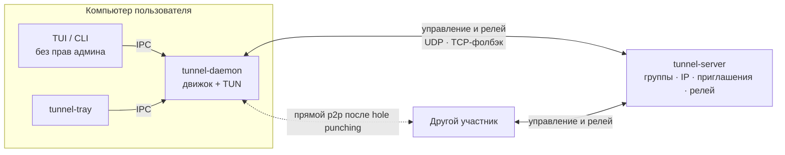

<div align="center">

# ◈ VoidLink

### Своя виртуальная LAN. Свой сервер. Свои ключи.

Соберите друзей, команду или парк машин в защищённую виртуальную сеть
за пару минут — как будто все подключены к одному свитчу.

[](https://github.com/adamantida/VoidLink2/actions/workflows/ci.yml)


[**Быстрый старт**](#-быстрый-старт) ·
[**Возможности**](#-возможности) ·
[**Безопасность**](#-безопасность) ·
[**Документация**](#-документация) ·
[**Архитектура**](#-архитектура)

</div>

---

## Зачем VoidLink

Игры по LAN, общий доступ к домашнему NAS, SSH до машин за NAT, тестовый стенд
команды — всё это требует, чтобы устройства «видели» друг друга. VoidLink даёт
каждому участнику постоянный адрес `100.66.<a>.<b>` (один на сервере для всех его групп) и доставляет между
ними любой IP-трафик: `ping`, TCP, UDP, игровые протоколы.

|  | |
|---|---|
| 🏠 **Полностью self-hosted** | Один бинарник сервера на любом VPS. Никаких сторонних облаков и аккаунтов: сервер, данные и ключи — ваши. |
| ⚡ **Напрямую, когда возможно** | UDP hole punching и LAN-кандидаты поднимают p2p-канал; релей сервера страхует с первой секунды. |
| 🛡️ **Криптография, а не обещания** | ChaCha20-Poly1305, рукопожатие с прямой секретностью, защита от повторов, ротация ключей групп при каждом изменении состава. |
| 🧭 **Работает сквозь сети** | Резервный TCP-путь, когда UDP заблокирован; переподключение за секунды после рестарта сервера или сна ноутбука. |
| 🖥️ **Красивый терминальный UI** | TUI на ratatui с мышью, пятью темами, экранами администрирования — и тонкий клиент без прав администратора. |
| 🧩 **Служба, трей, CLI** | Туннель живёт в службе и не зависит от окон; CLI для скриптов, трей для повседневной жизни. |

## ✨ Возможности

<table>
<tr>
<td width="50%" valign="top">

**Сеть**
- Публичные и приватные группы до 253 участников
- Постоянный IP: адрес закреплён за ключом участника
- Прямой p2p-канал + релей сервера как запасной путь
- LAN-кандидаты: соседи за одним NAT общаются локально
- TCP-фолбэк, если UDP режется провайдером
- DNS-имена пиров: `alpha.vl`, `alpha.mynet.vl`
- IPv6 внутри туннеля: `fd66:766c:696e::<a>:<b>`

</td>
<td width="50%" valign="top">

**Управление**
- Приглашения с принятием, отказом и сроком жизни
- Кик, бан, разбан, передача владения группой
- Друзья с алиасами, статусы, режим невидимки
- Несколько серверов, переключение без перезапуска
- Профили и перенос identity (`export-identity` с паролем)
- Метрики Prometheus и `/healthz` на сервере
- Корректная остановка и сохранение по `SIGTERM`

</td>
</tr>
</table>

### Платформы

| Компонент | Windows | Linux | macOS |
|---|:---:|:---:|:---:|
| Клиент: туннель, CLI, TUI | ✅ Wintun | ✅ `/dev/net/tun` | ✅ `utun` |
| Демон (`tunnel-daemon`) | ✅ служба Windows | консоль (разработка) | консоль (разработка) |
| Трей (`tunnel-tray`) | ✅ | — | — |
| Сервер (`tunnel-server`) | для отладки | ✅ systemd | для отладки |

## 🖥️ Интерфейс

```text
┌ VoidLink · демон ── сервер 203.0.113.10:5555 ── ● в сети ── ✉ 1 ── ◆ 2 прямых / ◇ 1 через релей ┐
├ Группы ────────────────┬ Участники «mynet»─────────────────────────────────────────────────────┤
│ ▸ mynet       pub   4  │  IP            связь      RTT    имя                                  │
│   home        prv   2  │  100.66.3.2    ◆ прямая   12 мс  alpha     «на связи»                 │
│ Друзья                 │  100.66.3.3    ◇ релей    48 мс  bravo                                │
│ ● bravo                │  100.66.3.4    ○ офлайн    —     charlie                              │
├ Лог ─────────────────────────────────────────────────────────── ↓ 1.2 МБ/с ▁▂▅▇▅▃ ↑ 340 КБ/с ┤
│ 21:04:17  alpha: прямой канал установлен                                                       │
└ : команда · / поиск · Tab фокус · F2 создать · j войти · o приглашения · F1 справка ────────────┘
```

Мышь, поиск, командная строка `:`, окна приглашений, экраны «Управление
группой» и «Серверы», пять тем (тёмная, светлая, контрастная, янтарная, фьорд),
горячие клавиши работают и в русской раскладке. Подробно — [TUI](docs/TUI.md).

## 🚀 Быстрый старт

### 1. Сервер (Linux, ~2 минуты)

Нужен хост с публичным IP и открытым портом `5555` (UDP, плюс TCP для фолбэка).

```bash
cargo build --release -p tunnel-server
sudo infrastructure/linux/install-server.sh target/release/tunnel-server --listen 0.0.0.0:5555
sudo ufw allow 5555/udp && sudo ufw allow 5555/tcp
```

Установщик создаёт systemd-службу `tunnel-server` и печатает **server code**
(`TUN-…`) — его вводят клиенты. Тонкая настройка, лимиты, метрики:
[SERVER](docs/SERVER.md).

### 2. Клиент на Windows

Распакуйте артефакт сборки и выполните в PowerShell **от администратора**:

```powershell
powershell -ExecutionPolicy Bypass -File .\install.ps1
```

Скрипт копирует программу в `%ProgramFiles%\Tunnel`, ставит службу
`TunnelDaemon` и запускает трей. Дальше — **обычная консоль, без прав
администратора**:

```powershell
cd "$env:ProgramFiles\Tunnel"
.\tunnel-client.exe add-server 203.0.113.10:5555 TUN-XXXX… home
.\tunnel-client.exe set-name alpha
.\tunnel-client.exe tui
```

В TUI создайте группу (`F2`) или войдите в существующую (`j`).

### 3. Клиент на Linux и macOS

```bash
cargo build --release -p tunnel-client
./target/release/tunnel-client add-server 203.0.113.10:5555 TUN-XXXX… home
./target/release/tunnel-client set-name alpha
sudo ./target/release/tunnel-client --dir "$HOME/.tunnel-client" tui
```

Туннелю нужны права root (на Linux достаточно `CAP_NET_ADMIN`); адаптер —
`voidlink0` на Linux и `utunN` на macOS. Демон `tunnel-daemon console` на этих
ОС — режим для разработки, см. [DAEMON](docs/DAEMON.md).

### 4. Проверка

```bash
ping 100.66.<a>.<b>       # по адресу
ping bravo.vl            # по имени участника
```

Подробно, включая удаление и обновление: [INSTALL](docs/INSTALL.md).

## 🛡️ Безопасность

| Угроза | Защита |
|---|---|
| Прослушивание трафика в сети | ChaCha20-Poly1305 для всех фреймов; наружу виден только заголовок маршрутизации |
| Подмена или угон сессии | Рукопожатие HELLO3 → CHALLENGE (cookie по адресу) → WELCOME, подпись ed25519, pinning ключа сервера |
| Запись трафика и кража ключей позже | Эфемерные X25519-ключи сессии: прямая секретность управляющего канала |
| Повтор перехваченных пакетов | Счётчики и окна повторов (1024) для управляющих и групповых фреймов |
| Исключённый участник | Ротация ключа группы с немедленным отзывом при кике, бане, выходе |
| Подмена отправителя внутри группы | Приём только от текущих участников, с их известных адресов, с проверкой внутреннего IP |
| Усиление и флуд | Ответ без cookie меньше запроса; лимиты по IP, сессии, группе и серверу |
| Компрометация ключа сервера | `tunnel-server rotate-key`: клиенты перезакрепляются по подписанной цепочке |
| Локальная эскалация на Windows | IPC-канал с ACL и проверкой, что сервер канала — служба; бинарники и `wintun.dll` только из защищённого каталога |

> **Модель доверия.** Ключи групп создаёт и раздаёт сервер, поэтому его оператор
> считается доверенным: он технически может читать трафик групп. Для своего
> сервера это так и задумано; детали и остаточные риски — в [SECURITY](docs/SECURITY.md).

## 🏗️ Архитектура



Workspace на Rust 2024, семь крейтов:

| Крейт | Роль |
|---|---|
| [`protocol`](crates/protocol) | Протокол v4: фреймы, рукопожатие, identity, шифрование, окна повторов, фрагментация |
| [`server`](crates/server) | `tunnel-server`: группы, адреса, приглашения, релей, лимиты, метрики, TCP, персистентность |
| [`client`](crates/client) | `tunnel-client`: движок, CLI, TUI, TUN для трёх ОС, DNS, IPv6, TCP-путь |
| [`ipc`](crates/ipc) | Протокол и транспорт фронтенд ↔ демон: named pipe, Unix-сокет, общий замок |
| [`daemon`](crates/daemon) | `tunnel-daemon`: владелец туннеля, хаб событий, режимы console и service |
| [`winsvc`](crates/winsvc) | Служба Windows: SCM, установка, ACL, удаление |
| [`tray`](crates/tray) | `tunnel-tray`: значок, меню групп и приглашений, уведомления |

Как устроены потоки, состояние и путь пакета — [ARCHITECTURE](docs/ARCHITECTURE.md),
проводной формат — [PROTOCOL](docs/PROTOCOL.md).

## ⌨️ Шпаргалка CLI

<details>
<summary><b>tunnel-client</b> — основные команды</summary>

| Команда | Действие |
|---|---|
| `id` | friend code и ключи identity |
| `set-name <имя>` · `set-status <текст>` · `invisible on\|off` | профиль |
| `add-server <addr> <code> [label]` · `servers` · `del-server <…>` | серверы |
| `groups` · `create <имя> [--private]` · `join` · `leave` · `delete <gid>` | группы |
| `invite` · `kick` · `ban` · `unban <gid> <peer>` · `bans <gid>` · `transfer <gid> <peer>` | администрирование |
| `invites` · `decline <gid>` | входящие приглашения |
| `add-friend <code> [alias]` · `alias` · `del-friend` · `friends` | друзья |
| `set-transport auto\|udp\|tcp` · `set-mtu <N>` · `dns on\|off` | сеть |
| `export-identity <file>` · `import-identity <file>` · `--profile <имя>` | identity и профили |
| `tui [--remote\|--embedded]` · `run` | интерфейс и туннель |

Полный справочник: [CLIENT](docs/CLIENT.md).
</details>

<details>
<summary><b>tunnel-server</b> и <b>tunnel-daemon</b></summary>

```text
tunnel-server [0.0.0.0:5555] [--data <dir>] [--workers N] [--tcp|--no-tcp]
              [--metrics 127.0.0.1:9100] [--relay-rate …] [--max-owned-groups …]
tunnel-server rotate-key [--data <dir>]

tunnel-daemon console | service | install | uninstall [--purge]
```

Подробно: [SERVER](docs/SERVER.md), [DAEMON](docs/DAEMON.md).
</details>

## 📚 Документация

| Пользователям | Администраторам | Разработчикам |
|---|---|---|
| [Установка](docs/INSTALL.md) | [Сервер](docs/SERVER.md) | [Архитектура](docs/ARCHITECTURE.md) |
| [Клиент и CLI](docs/CLIENT.md) | [Конфигурация](docs/CONFIG.md) | [Протокол v4](docs/PROTOCOL.md) |
| [TUI](docs/TUI.md) | [Служба и трей](docs/DAEMON.md) | [IPC](docs/IPC.md) |
| [FAQ](docs/FAQ.md) | [Сеть и NAT](docs/NETWORKING.md) | [Разработка](docs/DEVELOPMENT.md) |
| [Решение проблем](docs/TROUBLESHOOTING.md) | [Безопасность](docs/SECURITY.md) | [Тестирование](docs/TESTING.md) |
| [Глоссарий](docs/GLOSSARY.md) | [История изменений](docs/CHANGELOG.md) | [План развития](docs/PLAN.md) |

Порядок чтения по ролям — [docs/README](docs/README.md).

## 📈 Качество

- **439 автотестов**: юнит-тесты, фаззинг декодеров, e2e с настоящим сервером и
  движками (3+ клиента, кик, подмена отправителя, повторы, ротация ключей при
  потере пакетов, TCP-фолбэк, DNS/IPv6, IPC демона).
- **CI на трёх ОС** (ubuntu, macOS, Windows): тесты, `clippy -D warnings`,
  `cargo fmt --check`, `cargo deny`, `cargo audit`, релизные артефакты.
- Протокол описан нормативной спецификацией, код проверяется на соответствие ей.

## 🗺️ Статус

**Готово:** протокол v4, клиент для трёх ОС, служба Windows и трей, TUI и CLI
поверх демона, DNS и IPv6, TCP-фолбэк, метрики сервера.

**В работе:** MSI-установщик, кнопки «Принять/Отклонить» в уведомлениях Windows,
смена сервера внутри демона без перезапуска. Полный план — [PLAN](docs/PLAN.md).

> Протокол v4 несовместим с v3: сервер и клиенты обновляются вместе. Один адрес на пользователя
> заменил отдельные адреса по группам.

## 🤝 Участие

```bash
cargo fmt --all -- --check
cargo test --workspace
cargo clippy --workspace --all-targets -- -D warnings
```

Ветки, стиль и отладка — [DEVELOPMENT](docs/DEVELOPMENT.md).
Нашли уязвимость? Не открывайте публичный issue — напишите мейнтейнеру напрямую.

<div align="center">
<sub>VoidLink · своя сеть, без посредников</sub>
</div>
