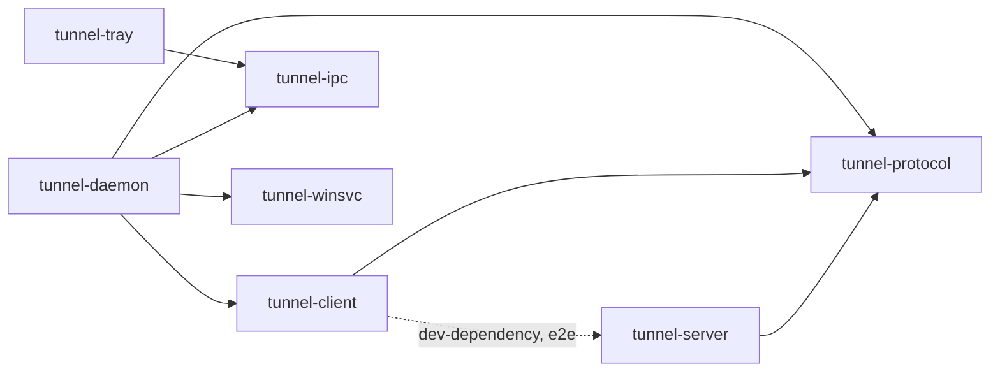
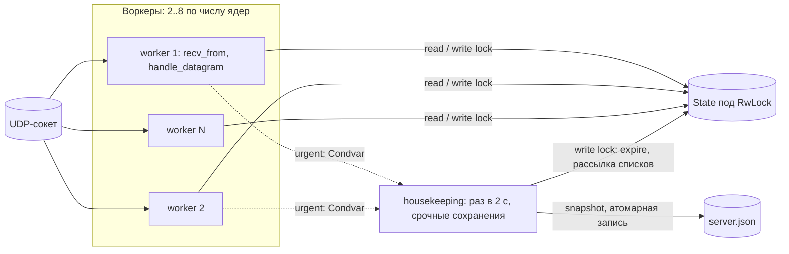
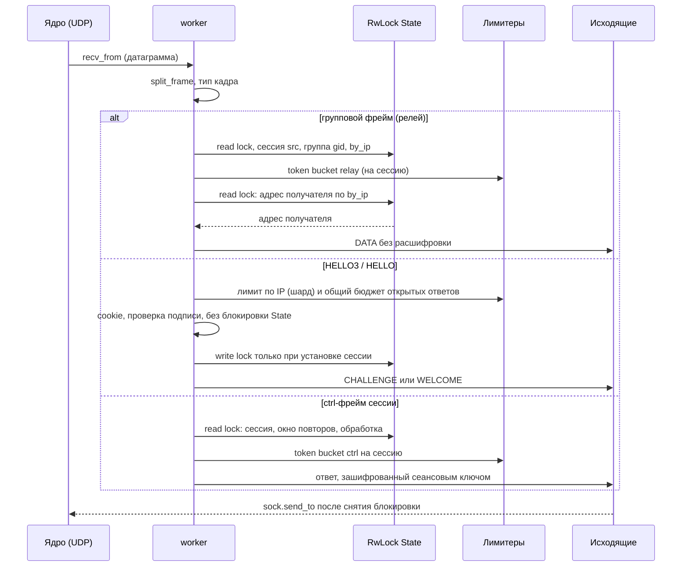
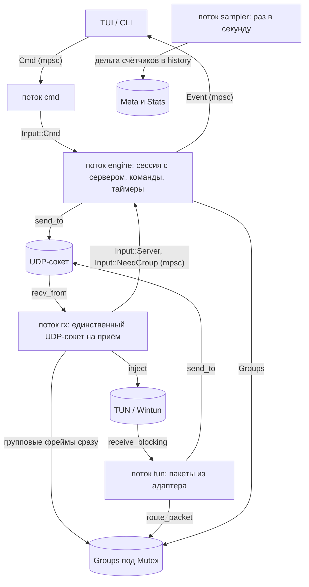
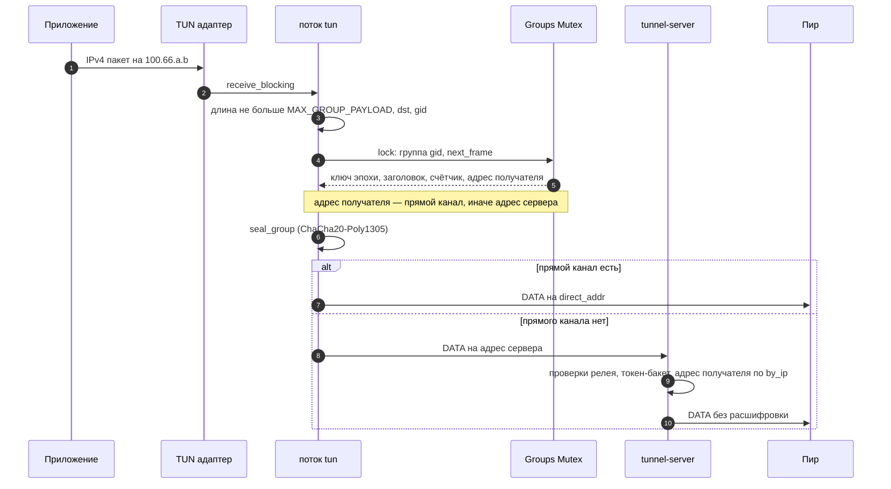
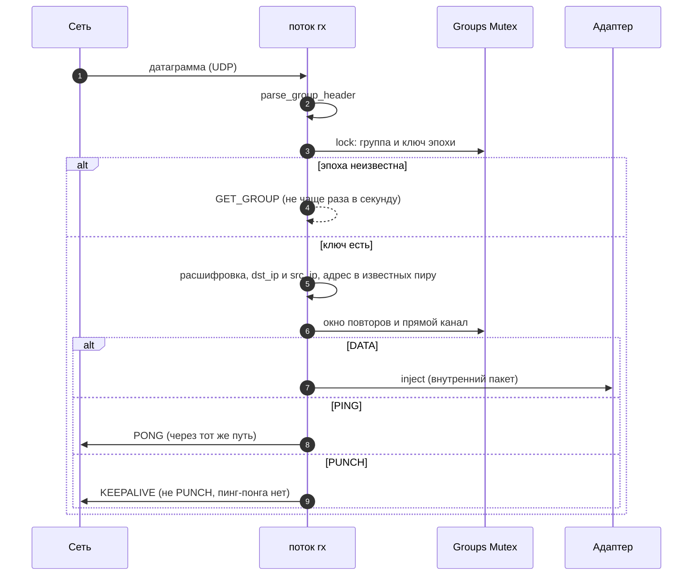
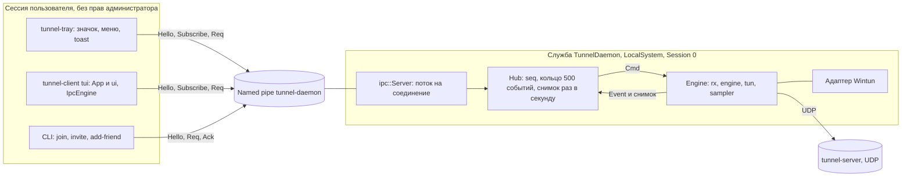

# Архитектура VoidLink

VoidLink — самохостируемая виртуальная локальная сеть в духе Hamachi и ZeroTier:
участники получают по одному IP из диапазона `100.66.0.0/16` (общему для
всех их групп на сервере) и обмениваются
пакетами так, будто находятся в одной LAN. Система состоит из **сервера**
(рандеву, релей и управление группами, Linux) и **клиента** (виртуальный
адаптер, движок, TUI; Windows, Linux и macOS). Сервер не
видит содержимого пакетов групп: релеит только открытый заголовок. Этот
документ описывает, как устроены компоненты, какие потоки и блокировки есть
в каждом процессе, как пакет проходит путь от адаптера до пира, и почему
выбраны именно такие решения.

Формат проводных сообщений нормативно описан в [PROTOCOL.md](PROTOCOL.md),
эксплуатация сервера — в [SERVER.md](SERVER.md), план работ и этапы — в
[PLAN.md](PLAN.md).

## Содержание

1. [Компоненты и статус](#1-компоненты-и-статус)
2. [Граф зависимостей крейтов](#2-граф-зависимостей-крейтов)
3. [Плоскости: управление и данные](#3-плоскости-управление-и-данные)
4. [Сервер: процессы, потоки, блокировки](#4-сервер-процессы-потоки-блокировки)
5. [Клиент: движок и его потоки](#5-клиент-движок-и-его-потоки)
6. [Путь пакета](#6-путь-пакета)
7. [Владение состоянием](#7-владение-состоянием)
8. [Демон, IPC и трей (этап 7)](#8-демон-ipc-и-трей-этап-7)
9. [Ключевые решения и компромиссы](#9-ключевые-решения-и-компромиссы)
10. [Ограничения и открытые вопросы](#10-ограничения-и-открытые-вопросы)

---

## 1. Компоненты и статус

Workspace на Rust 2024 содержит семь крейтов. Статус отражает состояние
ветки на момент написания; «в работе» — код существует, но подключён не
полностью (детали — в [PLAN.md](PLAN.md)).

| Крейт | Роль | Статус |
|---|---|---|
| `crates/protocol` (`tunnel-protocol`) | Проводной формат v4: заголовки, рукопожатие, шифрование, фреймы групп, FRAG, payload'ы, окно повторов | Готов |
| `crates/server` (`tunnel-server`) | Рандеву-сервер: identity, группы, выдача IP, приглашения, релей, персистентность `server.json` | Готов: TCP-фолбэк на том же порту (`tcp.rs`, `--tcp` / `--no-tcp`), метрики Prometheus (`metrics.rs`, `--metrics`) и корректная остановка по сигналу (`signals.rs`) подключены |
| `crates/client` (`tunnel-client`) | Движок (`engine.rs`), хранилище (`store.rs`), TUN, DNS, IPv6, TUI (ratatui), CLI | Библиотека (`lib.rs`) и бинарь CLI. Движок, TUN (Wintun, `tun_linux.rs`, `tun_macos.rs`), встроенный DNS, IPv6-оверлей, TCP-фолбэк, TUI. IPC-клиент (`remote.rs`, `remote_cli.rs`) и `EngineApi` (`api.rs`) для TUI и CLI поверх демона (этап 7.4) |
| `crates/ipc` (`tunnel-ipc`) | Транспорт и сообщения IPC между демоном и фронтендами: фрейм `u32 LE + JSON`, named pipe / Unix-сокет | Библиотека готова; используется демоном и треем |
| `crates/daemon` (`tunnel-daemon`) | Ядро демона: хаб событий, IPC-сервер, замок single-instance, лог с ротацией, `FakeBackend` | Ядро, `EngineBackend` поверх `tunnel-client`, `console` с настоящим движком или `--fake`. `console` и `service` запускают настоящий движок (`DaemonEngine`); без сервера — режим ожидания `AddServer` |
| `crates/winsvc` (`tunnel-winsvc`) | Служба Windows: SCM-вход, установка и удаление, ACL каталога данных | SCM-вход, установка и удаление службы, ACL каталога данных; подключены в `tunnel-daemon` (`service`, `install`, `uninstall`) |
| `crates/tray` (`tunnel-tray`) | Значок в области уведомлений: IPC-клиент демона, меню, уведомления | IPC-бэкенд, Win32-оболочка и `--demo`; трей не зависит от `tunnel-client` и читает JSON-снимок. Собирается только под Windows |

Ключевые процессы в целевой раскладке:

| Процесс | Где работает | Права | Что делает |
|---|---|---|---|
| `tunnel-server` | Linux-хост с публичным UDP-портом | Системный пользователь `tunnel` (юнит systemd) | Рандеву, группы, релей |
| `tunnel-daemon` (служба) | Windows, Session 0 | LocalSystem | Владеет адаптером Wintun, движком и пайпом IPC |
| `tunnel-client tui` / CLI | Сессия пользователя | Тонкий клиент демона по IPC (права администратора не нужны) или, без демона, свой движок (`--embedded`, нужны права на адаптер) | Фронтенд |
| `tunnel-tray` | Сессия пользователя | Без прав администратора | Значок, меню, уведомления |

---

## 2. Граф зависимостей крейтов

Зависимости между крейтами намеренно узкие. Протокол не знает ни о сервере,
ни о клиенте. Сервер и клиент разделяют только `tunnel-protocol`. IPC не
зависит от движка: снимки и команды передаются как JSON, поэтому трей
компилируется без `tunnel-client`; демон подключает `tunnel-client` как
библиотеку.

Пунктир на графе: `client` зависит от `server` только в тестах (e2e). Движок
остался в `crates/client` и подключается к демону как библиотека
(`tunnel_client::engine`); демон работает с ним через трейт `Backend`
(`EngineBackend`, см. раздел 8). Отдельного крейта `tunnel-engine` нет.

---

## 3. Плоскости: управление и данные

Весь трафик делится на две плоскости, и у них разные требования к
шифрованию, нагрузке и потерям.

| Плоскость | Что передаёт | Шифрование | Надёжность | Где обрабатывается |
|---|---|---|---|---|
| Управление (control) | HELLO3/CHALLENGE/WELCOME, ctrl-фреймы: группы, состав, приглашения, администрирование, RTT | Рукопожатие открытым текстом, подписи ed25519 и X25519 (static-static + ephemeral); ctrl-фреймы — ChaCha20-Poly1305 с сеансовыми ключами | Повторы на уровне движка (LEAVE, DECLINE, INVITE_SYNC), FRAG для больших payload'ов | Клиент: `engine` (состояние сессии); сервер: воркеры |
| Данные (data) | Фреймы групп: `DATA` (IP-пакеты), `PING`/`PONG`, `PUNCH`, `KEEPALIVE` | ChaCha20-Poly1305 ключом группы эпохи `epoch`, открытый заголовок (gid, src_ip, dst_ip, epoch) | Без повторов: потерянный IP-пакет — как в обычной сети; окно повторов против replay | Клиент: `rx` (приём), `tun` (отправка); сервер: `relay_group` |

Важное следствие: **сервер никогда не расшифровывает данные групп**. Он
проверяет открытый заголовок (участник ли отправитель, совпадает ли `src_ip`
со своим адресом в группе) и пересылает датаграмму дальше. Это позволяет
релею работать на тех же ресурсах, что и рандеву, а компрометация сервера не
раскрывает содержимого (при условии, что он не получил ключей группы через
управляющую плоскость; состав и ключи группы сервер знает, поэтому
конфиденциальность от оператора сервера — ограниченная, см. раздел 9).

---

## 4. Сервер: процессы, потоки, блокировки

Сервер — один процесс с пулом воркеров и одним фоновым потоком (плюс отдельные потоки TCP-фолбэка и HTTP-метрик, если они включены). Все потоки
работают с одним UDP-сокетом. Точка входа — `Server::start` в
`crates/server/src/lib.rs`, разбор аргументов — в `main.rs`.

### Потоки

| Поток | Число | Что делает | Блокирует |
|---|---|---|---|
| `worker` | `available_parallelism` в диапазоне 2..8 | `recv_from` на общем сокете, разбор, обработка, отправка ответов | `State` (чтение или запись), `Session.rx` / `relay` / `ctrl` (Mutex на сессию), `per_ip` (шард), `plain` |
| `housekeeping` | 1 | Каждые `HOUSEKEEPING_EVERY` = 2 с: истечение сессий и приглашений, рассылка `GROUP_LIST` (если `list_dirty`), очистка лимитера по IP, сохранение раз в `SAVE_EVERY` = 3 с, сводка раз в 5 мин | `State` на запись на короткий срок; сохранение — вне блокировки состояния |
| Основной поток | 1 | Запуск, ожидание остановки, финальный persist | — |

Срочные сохранения (кик, бан, выход, удаление группы) не ждут 3 с: воркер
выставляет флаг `urgent` и будит `housekeeping` через `Condvar`. Частота
таких записей ограничена `URGENT_SAVE_GAP` = 200 мс, поэтому поток команд не
превращается в поток записей на диск.

### Блокировки и правила

- **`RwLock<State>`** — единственная блокировка состояния. Релей, PING, LIST и
  GET_GROUP берут её на чтение и не мешают друг другу. JOIN, LEAVE, создание и
  удаление группы и подобные изменения — на запись.
- **Ответы собираются, потом уходят.** Воркер собирает исходящие датаграммы
  под блокировкой, а отправляет через `sh.flush(out)` уже после её снятия.
  Так `send_to` не держит `State`.
- **Шифрование ответа под чтением.** Счётчики отправки сессии атомарные, окно
  повторов защищено своим `Mutex` (`rx`). Поэтому шифрование ответа не требует
  записи в `State`.
- **Индексы под той же блокировкой.** `by_pub` (identity → адрес сессии) и
  `by_ip` (IP участника в группе → identity) меняются только вместе с сессией и группой,
  иначе релей за O(1) вернул бы устаревший адрес.
- **Лимитеры** — отдельно от `State`: `per_ip` (16 шардов, на каждый шард
  свой `Mutex`, IPv6 — по /64) и `plain` (общий бюджет открытых ответов). Так
  поток HELLO с одного адреса не блокирует остальные воркеры.
- **Персистентность.** `written` и `rotated` — маленькие `Mutex`, на которых
  стоят отпечаток `server.json` и ключ, сменённый `rotate-key` во время работы
  сервера.

### Путь датаграммы в воркере

Мусор и чужие фреймы отбрасываются без записи в лог (счётчик `dropped`
растёт, сводка раз в 5 минут это показывает).

### Дополнительные модули сервера

- `tcp.rs` — TCP-фолбэк на том же порту, что UDP (включён по умолчанию,
  `--no-tcp` выключает): тот же кадр, рамка `u16 LE длина`.
- `metrics.rs` — атомарные счётчики и HTTP-эндпоинт `/metrics` (Prometheus) и
  `/healthz` (только std). Включается флагом `--metrics <addr>`; метрики:
  `voidlink_sessions`, `voidlink_groups`, `voidlink_members`,
  `voidlink_invites_pending`, `voidlink_relayed_frames_total`,
  `voidlink_dropped_frames_total`, `voidlink_hello_total`,
  `voidlink_challenge_total`, `voidlink_ctrl_frames_total`,
  `voidlink_bytes_relayed_total`.
- `signals.rs` — корректная остановка по SIGTERM/SIGINT (Windows: Ctrl+C):
  воркеры останавливаются, состояние сохраняется, код выхода 0.

---

## 5. Клиент: движок и его потоки

Движок (`crates/client/src/engine.rs`) — это набор потоков, которые общаются
через каналы и общее состояние группы. UI ничего не знает о сети: он читает
состояние и шлёт команды.

### Потоки клиента

| Поток | Что делает | Ждёт | Общее состояние |
|---|---|---|---|
| `rx` | `recv_from` на сокете. Групповые фреймы (DATA, PING, PONG, PUNCH, KEEPALIVE) обрабатывает сам, сразу, по правилам приёма. Управляющие фреймы сервера отдаёт движку | `recv_from` с таймаутом `RX_POLL` = 250 мс | `Groups` (Mutex), `Stats` (атомики) |
| `engine` | Состояние сессии (`State`), команды UI, таймеры, рукопожатие, реконнект | `recv_timeout(TICK)` = 100 мс на `Input` | `Groups`, `Meta`, `Config`, `server` |
| `cmd` | Переносит `Cmd` из канала UI в общий входной канал движка | `recv` на `cmd_rx` | — |
| `tun` (Wintun на Windows, TUN на Linux, utun на macOS) | Читает IP-пакеты из адаптера и отправляет их пирам | `receive_blocking` | `Groups` (короткий захват), сокет |
| `sampler` | Раз в секунду переводит дельту `rx_bytes` / `tx_bytes` в историю для спарклайна | `sleep(1 с)` | `Meta` |

Сокет один на всё время работы процесса. При реконнекте и смене сервера
движок шлёт новый HELLO3 с того же адреса, поэтому NAT-маппинги и прямые
каналы с пирами не рвутся.

### Таймеры

Все таймеры идут по часам (`Instant`), а не по паузам в приёме: под потоком
входящих пакетов они не «замерзают». Это исправляет ошибку этапа 6, когда
постоянный спам мешал движку пинговать сервер.

| Таймер | Значение | Назначение |
|---|---|---|
| `TICK` | 100 мс | Период `engine_loop` |
| `RTT_EVERY` | 2 с | RTT-зонд онлайн-пиров (прямым — держит NAT, остальным — через релей) |
| `PUNCH_EVERY` | 5 с | Раунд NAT-пробития |
| `PING_EVERY` | 5 с | CTRL_PING серверу |
| `LIST_EVERY` | 15 с | Обновление списка групп |
| `SERVER_TIMEOUT` | 20 с | Сервер молчит — переподключение |
| `RECONNECT_MAX` | 30 с | Потолок задержки реконнекта |
| `LEAVE_RETRY` / `DECLINE_RETRY` | 1 с | Повтор LEAVE и DECLINE до подтверждения |
| `INVITE_SYNC_RETRY` | 3 с | Сверка списка приглашений |
| `GET_GROUP_EVERY` | 1 с | Не чаще запроса состояния группы на группу |
| `CAND_EVERY` | 60 с | Обновление кандидатов для NAT |

### Дополнительные модули клиента

- `dns.rs` — встроенный DNS-ответчик на `100.66.0.53:53` (имена
  `<member>.vl`, `<member>.<group>.vl`, TTL ответа 30 с) и настройка split-DNS
  ОС для `.vl` (NRPT на Windows, `/etc/resolver/vl` на macOS, `resolvectl` на
  Linux). Включается полем конфига `dns` (по умолчанию `true`).
- `ipv6.rs` — IPv6-оверлей: ULA-подсеть `fd66:766c:696e::/64`; участник
  `100.66.<a>.<b>` получает `fd66:766c:696e::<a>:<b>` (например,
  `100.66.7.42` → `fd66:766c:696e::7:2a`), на адаптере — один адрес `/64`.
- `tcp_link.rs` — TCP-канал до сервера. Режим задаёт поле конфига `transport`:
  `auto` (UDP, при молчании сервера — TCP), `udp` или `tcp`; p2p с пирами
  всегда по UDP.
- `invites.rs`, `profile.rs`, `snapshot.rs` — неотвеченные приглашения,
  экспорт/импорт identity, сериализуемый снимок состояния для демона.

---

## 6. Путь пакета

### 6.1. Отправка: TUN → движок → шифрование → прямой канал или релей

Функция `route_packet` берёт IPv4-пакет из адаптера, по адресу назначения
определяет группу (в IP `gid` не закодирован: ищется своя группа, где есть
участник с таким адресом; при нескольких — с живым прямым каналом, затем
с онлайн-пиром, затем с наименьшим gid), выбирает
адрес получателя и шифрует пакет ключом текущей эпохи группы.

Если прямого канала с пиром нет, датаграмма уходит на сервер. Если пир
отвечает напрямую, движок на приёме заводит прямой канал (см. 6.2), и
следующие пакеты пойдут мимо релея.

### 6.2. Приём: rx → проверки → окно повторов → inject

Приём идёт в потоке `rx`. Фрейм принимается только при выполнении всех
условий из раздела 7 [PROTOCOL.md](PROTOCOL.md):

1. группа известна; эпоха текущая или прошлая в пределах grace (новая эпоха —
   запрос `GET_GROUP`, не чаще раза в секунду на группу);
2. расшифровка успешна и `dst_ip` — наш адрес;
3. `src_ip` — текущий участник группы, не мы сами;
4. счётчик проходит окно повторов (на связку gid, epoch, src_ip);
5. фрейм пришёл через релей **или** с UDP-адреса, известного от сервера;
6. для `DATA`: IPv4-источник внутреннего пакета совпадает с `src_ip`.

Два правила, которые стоят за последними строками диаграммы:

- **PUNCH отвечает KEEPALIVE, а KEEPALIVE не отвечается.** До исправления
  этапа 6 два клиента отвечали друг другу PUNCH бесконечно (около 10 000
  пакетов в секунду на клиента). Сейчас цепочка обрывается на втором шаге.
- **Через релей PUNCH не отвечается.** Пробитие нужно только прямому каналу.

Прямой канал включается на том адресе, с которого первым пришёл верный
фрейм, и не переписывается по последующим фреймам с другого адреса.

---

## 7. Владение состоянием

Правило простое: каждое изменяемое состояние принадлежит одному потоку или
защищено одной блокировкой. Смешанное владение (несколько `Mutex` на одну
сущность) не допускается.

### Сервер

| Состояние | Где живёт | Кто меняет | Защита |
|---|---|---|---|
| `sessions`, `by_pub`, `by_ip` | `State` | Воркеры (HELLO, JOIN, LEAVE), `housekeeping` (истечение) | `RwLock<State>` |
| `groups`, `next_gid`, `invite_ttl_ms` | `State` | Воркеры (администрирование), `housekeeping` (истечение приглашений) | `RwLock<State>` |
| Ключ сервера, `links` (цепочка ротации) | `Shared` | Только при старте и `rotate-key` | Неизменны при работе: подпись и DH без блокировки |
| Счётчики сессии (отправка) | `Session` | Воркеры | Атомики |
| Окно повторов, лимиты сессии | `Session` | Воркеры | `Mutex` на поле |
| Лимит HELLO по IP | `per_ip` | Воркеры | 16 `Mutex` (шарды) |
| Отпечаток `server.json`, ключ `rotate-key` | `Shared` | `housekeeping`, `rotate-key` | Маленькие `Mutex` |
| Счётчики `relayed`, `dropped` | `Shared` | Воркеры | Атомики |

`server.json` содержит identity, группы, `user_ips` (постоянный адрес identity,
один на все её группы), баны, приглашения и цепочку
ротации. Номера `epoch` и `rev` растут монотонно, и при загрузке к ним
добавляется `LOAD_MARGIN` = 65 536: состояние сохраняется раз в 3 секунды, и
после падения номера, уже выданные клиентам, не должны повторяться.

### Клиент

| Состояние | Где живёт | Кто меняет | Защита |
|---|---|---|---|
| `GroupSess` (ключи эпох, окна повторов, участники, прямые каналы) | `Groups` = `Arc<Mutex<HashMap<gid, GroupSess>>>` | `rx`, `tun`, `engine` | `Mutex` |
| `Meta` (история для спарклайна, время старта, сводка) | `Arc<Mutex<Meta>>` | `sampler`, `engine` | `Mutex` |
| `Stats` (`rx_bytes`, `tx_bytes`, `rx_pkts` и т. п.) | `Arc<Stats>` | `rx`, `tun`, `sampler` | Атомики |
| `Config` (identity, друзья, серверы, автовход) | `Arc<Mutex<Config>>` | `engine` (команды), UI (через команды) | `Mutex`, сохранение через `save` |
| Адрес сервера | `Mutex<SocketAddr>` | `engine` (смена сервера) | `Mutex` |
| Сессия с сервером (`CtrlSession`, ключи, счётчики) | `State` в потоке `engine` | Только `engine` | Владение одним потоком, без блокировки |
| Ключи групп и счётчики | Только в памяти | `rx`, `tun`, `engine` | Через `Groups` |
| Флаг выхода | `Env.quit` | Все потоки | `AtomicBool` |

Ключи групп и счётчики клиент **не сохраняет**: после перезапуска HELLO3
участника ротирует ключи всех его групп. Поэтому повторное использование
счётчика под тем же ключом (после потерянного LEAVE) продолжает счётчик, а не
начинает с нуля.

### Снимки для UI

UI не читает `Groups` напрямую каждый кадр: это нарушило бы работу `rx`
(см. историю этапа 6, «лаги интерфейса»). Для демона состояние
сериализуется в `Snapshot` (`crates/client/src/snapshot.rs`), который
`EngineBackend` строит по флагу «изменилось». Фронтенд (TUI) работает с движком через трейт `EngineApi`
(`crates/client/src/api.rs`): `LocalEngine` — движок в своём процессе
(embedded), `IpcEngine` (`remote.rs`) — тонкий клиент демона с кэшем снимка.

---

## 8. Демон, IPC и трей (этап 7)

Цель этапа: один привилегированный процесс владеет туннелем, а фронтенды
подключаются к нему по IPC и не требуют прав администратора. Демон, IPC, трей
и TUI/CLI поверх IPC (этап 7.4) реализованы. Без демона движок живёт внутри
процесса `run` или embedded `tui`: закрыли окно — туннель упал. CLI-команды с той
же identity посылают собственный HELLO и вытеснили бы сессию работающего движка
(сервер снимает старую сессию этого публичного ключа), поэтому при демоне они идут
через него, а при занятом замке отказывают (`remote_cli.rs`).

На Unix тот же протокол идёт через Unix-сокет `<данные>/daemon.sock` (`0600`) в
каталоге `0700`; его поднимает `tunnel-daemon console`. Так разрабатывают и
тестируют демон на Linux и macOS.

### Протокол IPC

| Направление | Сообщение | Смысл |
|---|---|---|
| Клиент → демон | `Hello{proto, kind, ver}` | Первое сообщение; `kind` — `Tui`, `Tray` или `Cli` |
| Клиент → демон | `Subscribe{snapshots_ms}` | Подписка: история из кольца, снимок, дальше поток событий |
| Клиент → демон | `Req{id, cmd}` | Команда движка (JSON-форма `Cmd`) |
| Клиент → демон | `Bye` | Корректное закрытие |
| Демон → клиент | `Welcome{proto, daemon_ver, me}` или `Reject` | Ответ на Hello; при несовпадении мажорной версии — закрытие |
| Демон → клиент | `Ack{id, Ok или Err}` | Принято или отклонено демоном (неверный gid, нет сервера). Результат операции приходит событием |
| Демон → клиент | `Event{seq, ev}`, `Snapshot{seq, snap}` | Поток событий и снимки |
| Демон → клиент | `Shutdown{reason}` | Остановка демона |

Кодек: `u32 LE` длина и JSON, лимит кадра 1 МиБ. Битые данные дают разрыв
соединения, но не панику. Выбор JSON вместо бинарного формата сделан ради
читаемости: трафик IPC — порядка 1–2 КБ/с.

### Хаб событий демона

`Hub` владеет бэкендом и раздаёт его события подписчикам:

- каждое событие получает монотонный `seq` без повторов;
- очередь на подписчика ограничена; при переполнении подписчик пропускает
  события, видит дырку в `seq` и получает снимок. Остальные подписчики и движок
  не ждут медленного;
- пока подписчик ждёт снимок, события ему не шлются: снимок покрывает их;
- снимок строится вне мьютекса хаба, чтобы IPC-потоки не ждали движок;
- кольцо последних 500 событий: новый подписчик сразу получает историю лога.

### Single-instance и безопасность

- Замок движка берёт любой, кто его поднимает (демон, embedded TUI, `run`):
  Unix — `flock` на `daemon.lock`, Windows — именованный мьютекс
  `Global\TunnelEngine`. Два движка с одной identity одновременно невозможны.
- Named pipe на Windows `\\.\pipe\tunnel-daemon`: SDDL
  `O:SYD:P(A;;GA;;;SY)(A;;GA;;;BA)(A;;0x12019b;;;<SID владельца>)`, удалённые
  клиенты отклонены флагом `PIPE_REJECT_REMOTE_CLIENTS`,
  `FILE_FLAG_FIRST_PIPE_INSTANCE` против подмены. Клиент проверяет, что процесс
  сервера пайпа работает от SYSTEM. Пайп поднимает только служба; `console` на
  Windows IPC не открывает.
- Секреты identity не покидают служебный процесс: снимок и IPC содержат
  только публичные данные.
- Конфиг службы — `%ProgramData%\tunnel\client.json` (ACL: SYSTEM и
  Administrators). Identity принадлежит машине, а не пользователю:
  `%APPDATA%` для LocalSystem не подходит.

### Обязанности процессов

| Процесс | Владеет | Не делает |
|---|---|---|
| Демон | Адаптером, сокетом, движком, `client.json`, IPC-сервером, логом | Не рисует UI |
| TUI | Выбором строки, темой (`ui.json` в тонком режиме), очередью окон приглашений | В тонком режиме не пишет `client.json`: конфиг меняется командами демона |
| CLI | Разбор аргументов | При работающем демоне не открывает движок: команда уходит демону |
| Трей | Значком и уведомлениями | Не владеет состоянием: всё берётся из снимков |

Поведение этапа 7.4 (см. [PLAN.md](PLAN.md)): если демона нет, а замок
single-instance (`tunnel-ipc::lock`, общий для демона, embedded TUI и `run`)
занят, CLI не поднимает второй движок, а сообщает причину (кроме чтения
локального конфига: `id`, `servers`, `friends`). Если пайп есть, но `Hello` не
прошёл, фолбэка на embedded-режим нет: два движка с одной identity выбивают друг
друга с сервера. Режимы TUI выбираются флагами `tui --remote` и `tui --embedded`;
при работающем демоне настройки движка (`set-transport`, `set-mtu`, `dns`,
`import-identity`) и `run` отказывают. Переподключение `IpcEngine` — раз в 1 с,
пока пайп недоступен («демон недоступен»).

---

## 9. Ключевые решения и компромиссы

| Решение | Почему | Цена |
|---|---|---|
| UDP как основной транспорт, TCP — фолбэк | Низкая задержка и NAT-пробитие; TCP нужен там, где режут UDP | Два пространства адресов (`Peer::Tcp` и UDP), сложнее сессии сервера |
| Рукопожатие с cookie, ответ не длиннее запроса | Сервер не становится усилителем DDoS: открытые ответы уходят только на подтверждённый адрес | Лишний обмен на каждое новое рукопожатие |
| Сеансовые ключи через static-static и ephemeral-ephemeral X25519 | Прямая секретность управляющих сессий | Более сложное рукопожатие и тесты |
| Сервер не расшифровывает данные групп | Релей дешевле, компрометация сервера не раскрывает пакеты | Сервер знает состав и ключи групп, поэтому конфиденциальность от оператора ограничена |
| Пул воркеров, `RwLock` вместо async-рантайма | Проект на std-потоках, без зависимости от tokio; релей идёт под чтением | Блокировка записи на JOIN и LEAVE влияет на все воркеры |
| Отправка ответов после снятия блокировки | `send_to` не держит состояние | Нужен буфер исходящих на время обработки |
| Один сокет на весь клиент | NAT-маппинги и прямые каналы не рвутся при реконнекте | Один поток `rx` — узкое место при очень высокой нагрузке |
| Таймеры по часам, а не по паузам приёма | Поток входящих пакетов не замораживает таймеры (ошибка этапа 6) | Больше внимания к состоянию таймеров при тестах |
| Ключи групп и счётчики не сохраняются на клиенте | Компрометация диска не раскрывает ключи | После перезапуска клиента ключи всех групп ротируются |
| Сохранение `server.json` раз в 3 с плюс срочные сохранения | Не пишем на диск на каждый пакет | Окно потери до 3 с; срочные события (кик, бан) сохраняются с задержкой не больше 200 мс; при падении номера сдвигаются через `LOAD_MARGIN` |
| Список групп рассылается раз в 2 с по флагу | Одна команда не разносит N кадров по всем сессиям | Задержка обновления списка до 2 с |
| Лимиты token bucket по сессии, по IP и общие | Защита от флуда без блокировки всего сервера | Нужна настройка под нагрузку (флаги `--relay-rate` и другие) |
| Демон владеет туннелем, фронтенды — IPC | Туннель живёт при закрытом окне; фронтенды без прав администратора | Новый уровень: протокол IPC, версии, пайп с SDDL |
| IPC в JSON, без async | Читаемость, отладка, минимум зависимостей | Больше трафика, чем у бинарного формата (трафик мал) |
| `tunnel-tray` не зависит от `tunnel-client` | Трей собирается отдельно и не тянет TUI и движок | Имена полей снимка дублируются в трее и должны совпадать |

---

## 10. Ограничения и открытые вопросы

- **Движок живёт в `crates/client`.** Отдельный крейт `tunnel-engine` не
  создавался: демон подключает `tunnel-client` как библиотеку и работает с ним
  через `Backend`.
- **Служба проверена только компиляцией.** `tunnel-daemon service` запускает
  настоящий движок, но SCM, Wintun и события питания на живой Windows не прогонялись.
- **Настройки движка при демоне.** IPC-команд для `set-transport`, `set-mtu`, `dns`
  и `import-identity` нет: при работающем демоне их меняют, остановив демон.
- **Единая identity на машину.** Служба одна, поэтому несколько пользователей
  на одной машине делят identity. Вариант «служба на пользователя» не выбран.
- **Ограниченная конфиденциальность от оператора сервера.** Сервер видит
  состав групп, адреса и ключи групп через управляющий канал. Поэтому
  приватность данных внутри групп держится на доверии к серверу, а не на
  сквозном шифровании.
- **Сон и пробуждение.** Служба должна делать немедленный HELLO после
  выхода из сна (`POWEREVENT`); для этого в демоне есть `ResumeSignal`, но
  подключение к движку службы зависит от подключения движка к `service`.

Если в этом документе описано поведение, которого нет в коде, верен код:
исправьте документ и сообщите в [PLAN.md](PLAN.md), где отмечено, что ещё
не сделано.
