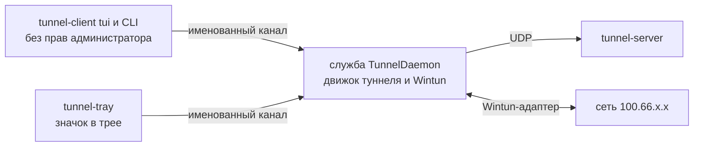
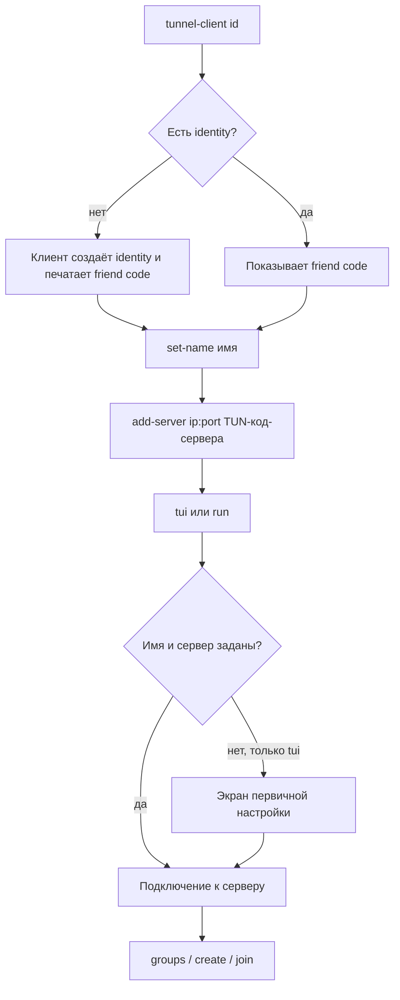
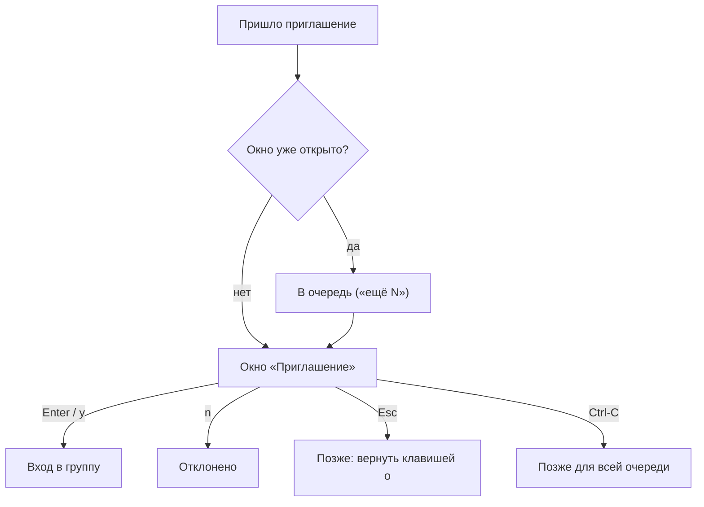
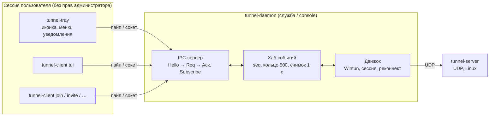
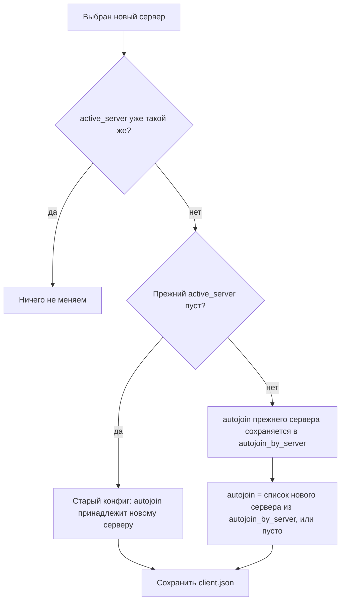
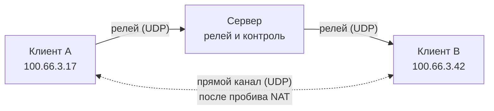
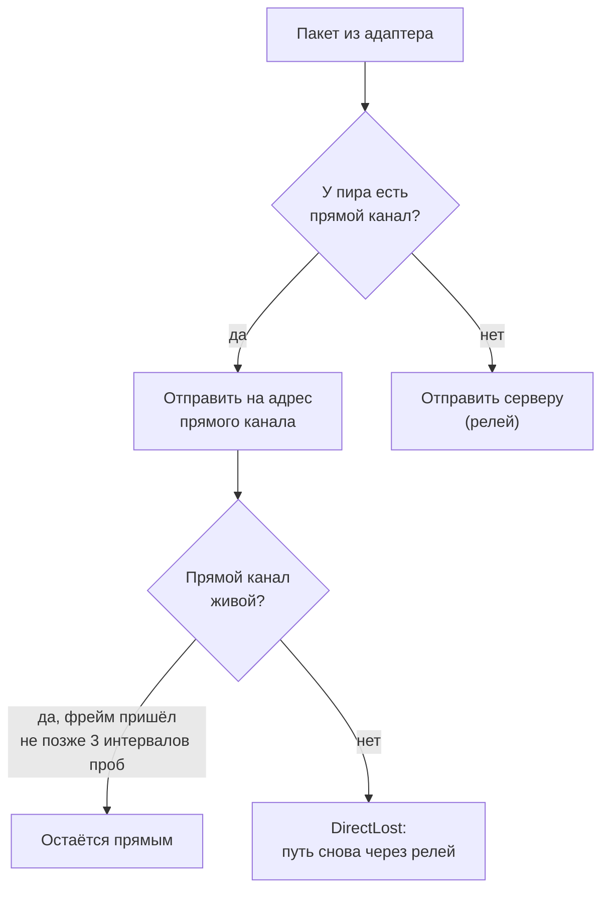
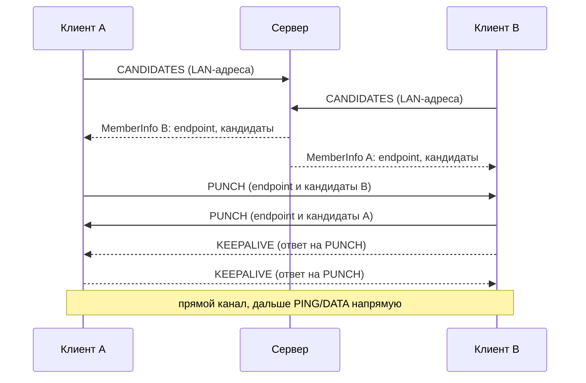

# Клиент VoidLink: CLI, TUI, демон и конфигурация

Клиент VoidLink: установка на трёх ОС, CLI, текстовый интерфейс, демон и служба Windows, конфигурация и сетевое поведение. Нормативный формат пакетов — в [PROTOCOL.md](PROTOCOL.md), эксплуатация сервера — в [SERVER.md](SERVER.md), частые проблемы — в [FAQ.md](FAQ.md).

## Содержание

- [Установка](#установка)
  - [Что понадобится](#что-понадобится)
  - [Windows: служба и трей (рекомендуется)](#windows-служба-и-трей-рекомендуется)
  - [Windows: переносной режим](#windows-переносной-режим)
  - [Linux: клиент](#linux-клиент)
  - [macOS: клиент](#macos-клиент)
  - [Мастер первичной настройки](#мастер-первичной-настройки)
  - [Первый запуск](#первый-запуск)
  - [Проверка работы](#проверка-работы)
- [CLI](#cli)
  - [Основные понятия](#основные-понятия)
  - [Глобальные флаги](#глобальные-флаги)
  - [Identity и профиль](#identity-и-профиль)
  - [Серверы](#серверы)
  - [Друзья](#друзья)
  - [Группы](#группы)
  - [Приглашения](#приглашения)
  - [Администрирование группы](#администрирование-группы)
  - [Настройки](#настройки)
  - [Запуск туннеля: `run` и `tui`](#запуск-туннеля-run-и-tui)
  - [Коды ошибок и подсказки](#коды-ошибок-и-подсказки)
  - [Friend code и server code](#friend-code-и-server-code)
- [TUI](#tui)
  - [Запуск](#запуск)
  - [Главный экран](#главный-экран)
  - [Навигация](#навигация)
  - [Клавиши](#клавиши)
  - [Мышь](#мышь)
  - [Командная строка](#командная-строка)
  - [Попапы](#попапы)
  - [Экран настроек (F3)](#экран-настроек-f3)
  - [Экран серверов (F4)](#экран-серверов-f4)
  - [Офлайн-режим, пути и проба (этап 9)](#офлайн-режим-пути-и-проба-этап-9)
  - [Экран управления группой (m, :admin)](#экран-управления-группой-m-admin)
  - [Темы](#темы)
  - [Уведомления и лог](#уведомления-и-лог)
  - [Копирование в буфер обмена](#копирование-в-буфер-обмена)
  - [Раскладка клавиатуры](#раскладка-клавиатуры)
  - [Требования к терминалу](#требования-к-терминалу)
  - [Советы](#советы)
  - [TUI поверх демона](#tui-поверх-демона)
- [Демон, служба и трей](#демон-служба-и-трей)
  - [Зачем нужен демон](#зачем-нужен-демон)
  - [Архитектура](#архитектура)
  - [Режимы `tunnel-daemon`](#режимы-tunnel-daemon)
  - [Данные и логи](#данные-и-логи)
  - [Трей](#трей)
  - [Single-instance и работа без демона](#single-instance-и-работа-без-демона)
  - [Windows-служба](#windows-служба)
  - [Linux и macOS: разработка через Unix-сокет](#linux-и-macos-разработка-через-unix-сокет)
- [Конфигурация](#конфигурация)
  - [Где лежат файлы и данные](#где-лежат-файлы-и-данные)
  - [Клиент: client.json](#клиент-clientjson)
  - [Профили](#профили)
  - [Служба Windows и daemon](#служба-windows-и-daemon)
  - [ui.json](#uijson)
  - [Миграция со старых версий](#миграция-со-старых-версий)
- [Сеть и пути](#сеть-и-пути)
  - [Как ходят пакеты](#как-ходят-пакеты)
  - [Релей и прямой канал](#релей-и-прямой-канал)
  - [Уровни доставки L0–L3 (этап 9)](#уровни-доставки-l0l3-этап-9)
  - [DHT и mesh: что живёт без сервера](#dht-и-mesh-что-живёт-без-сервера)
  - [Пробив NAT](#пробив-nat)
  - [Симметричный NAT](#симметричный-nat)
  - [Дублирование путей (issue #25)](#дублирование-путей-issue-25)
  - [Задержка и пропускная способность](#задержка-и-пропускная-способность)
  - [Mesh, проба и пути (этап 9)](#mesh-проба-и-пути-этап-9)
- [Обновление и удаление](#обновление-и-удаление)
  - [Обновление](#обновление)
  - [Удаление](#удаление)
- [Диагностика](#диагностика)

## Установка

### Что понадобится

| Что | Зачем |
|---|---|
| Адрес и UDP-порт сервера (по умолчанию `5555`) | точка встречи и релей |
| Server code сервера (`TUN-…`) | проверка подлинности сервера при подключении |
| Права администратора на машине клиента | создание TUN/Wintun-адаптера |
| Исходящий UDP с клиента на сервер | обычно достаточно; если UDP режут, клиент сам переходит на TCP (`set-transport`, см. [NETWORKING.md](CLIENT.md)) |

Клиенту не нужны открытые входящие порты: соединение устанавливает клиент с
сервера. Трафик между участниками идёт напрямую, когда это возможно, иначе через
релей сервера.


### Windows: служба и трей (рекомендуется)

Служба `TunnelDaemon` держит туннель, поэтому он работает до входа пользователя
в систему и не падает при закрытии окон. Трей показывает статус и уведомления.
Трей, TUI и CLI подключаются к службе через именованный канал
`\\.\pipe\tunnel-daemon` и работают **без прав администратора**: `tunnel-client tui`
при запущенной службе становится тонким клиентом (в шапке «демон»). Без службы
`tui` и `run` поднимают туннель сами и требуют прав администратора (см.
«Переносной режим»). Если сервер ещё не добавлен, служба ждёт первой настройки:
`add-server` из обычной консоли передаётся ей, подробнее — [DAEMON.md](CLIENT.md).

#### Что в архиве

Артефакт `tunnel-windows-x64` собирает CI (вкладка **Actions**, запуск
*build · windows release*, раздел **Artifacts**; хранится 14 дней). Собрать самим
можно командой `cargo build --release --workspace`.

| Файл | Назначение |
|---|---|
| `tunnel-daemon.exe` | служба, владелец движка туннеля |
| `tunnel-client.exe` | CLI и TUI |
| `tunnel-tray.exe` | значок в трее |
| `tunnel-server.exe` | сервер, нужен только для отладки на Windows |
| `wintun.dll` | драйвер адаптера Wintun (из `vendor/wintun`) |
| `install.ps1`, `uninstall.ps1` | установка и удаление |

`install.ps1` требует `tunnel-daemon.exe`, `tunnel-tray.exe`, `tunnel-client.exe`
и `wintun.dll`. Если файла нет, скрипт останавливается с ошибкой
`Не найден <файл>`, поэтому берите полный артефакт.

#### Установка

1. Распакуйте архив в любую папку, например `C:\Downloads\tunnel`.
2. Откройте PowerShell в этой папке и выполните:

   ```powershell
   powershell -ExecutionPolicy Bypass -File .\install.ps1
   ```

3. Подтвердите запрос UAC. Скрипт перезапустит себя с правами администратора.

`install.ps1` делает следующее:

- копирует файлы в `%ProgramFiles%\Tunnel`. Туда пишет только администратор, а
  `wintun.dll` служба загружает только из этого каталога;
- выполняет `tunnel-daemon install`: регистрирует службу `TunnelDaemon`
  (LocalSystem, автозапуск, перезапуск при сбое) и создаёт конфиг
  `%ProgramData%\tunnel\client.json` с ограниченными правами;
- если у текущего пользователя есть `%APPDATA%\tunnel\client.json`, импортирует
  его: identity, друзья и friend code сохраняются;
- настраивает автозапуск трея при входе и запускает службу и трей.

Флаг `-NoTray` оставляет трей незапущенным:

```powershell
powershell -ExecutionPolicy Bypass -File .\install.ps1 -NoTray
```

Команды консоли (`create`, `invite`, `groups` и т. д.) при работающей службе
уходят ей по IPC; настройки движка (`set-transport`, `set-mtu`, `dns`,
`import-identity`) при службе отказывают. Подробнее — [CLIENT.md](CLIENT.md).

#### Как устроены компоненты




### Windows: переносной режим

Без службы туннель запускается из консоли **с правами администратора**:

```powershell
cd "$env:ProgramFiles\Tunnel"        # или папка с распакованным архивом
.\tunnel-client.exe tui              # или: .\tunnel-client.exe run
```

`wintun.dll` должна лежать рядом с `tunnel-client.exe`. Конфиг берётся из
`%APPDATA%\tunnel\client.json`. Туннель живёт, пока открыто окно, и падает при
его закрытии.

Не запускайте переносной режим одновременно со службой: одна identity даёт одну
сессию на сервере. Замок single-instance это проверяет: `tui` при работающей
службе сам станет тонким клиентом, а `run` откажет. Режим можно выбрать флагами
`tui --embedded` / `tui --remote`.


### Linux: клиент

Сборка: `cargo build --release -p tunnel-client`, бинарник появится в
`target/release/tunnel-client`. Туннель использует TUN-устройство `/dev/net/tun`,
поэтому нужны:

- **root** или capability `CAP_NET_ADMIN` на бинарнике;
- утилита `ip` (пакет `iproute2`);
- для DNS по именам: `systemd-resolved` с командой `resolvectl`.

Запуск от root:

```bash
sudo ./target/release/tunnel-client tui
```

Либо выдать бинарнику только нужную capability, и тогда `sudo` не нужен:

```bash
sudo setcap cap_net_admin+ep ./target/release/tunnel-client
```

Имя интерфейса задаёт глобальный флаг `--adapter` (по умолчанию `voidlink0`),
например `--adapter vl1`; то же можно сохранить в конфиге (поле `adapter`).
Флаг `--dll` относится только к Windows.

Конфиг по умолчанию лежит в `~/.tunnel-client/client.json`. **При запуске через
`sudo` учтите:** `HOME` может указывать на `/root`, и конфиг окажется в другом
месте. Чтобы всегда использовать один каталог, укажите его явно:

```bash
sudo ./target/release/tunnel-client --dir "$HOME/.tunnel-client" tui
```

Дальше настройка и команды такие же, как в
[мастере настройки](#мастер-первичной-настройки).


### macOS: клиент

Сборка та же: `cargo build --release -p tunnel-client`. Туннель использует
системный интерфейс `utun`, номер (`utunN`) система выбирает сама. Один адрес
(маска /16) и маршрут `100.66.0.0/16` клиент настраивает через `ifconfig` и `route`, поэтому нужен
`sudo`:

```bash
sudo ./target/release/tunnel-client --dir "$HOME/.tunnel-client" tui
```

Здесь `--dir` тоже полезен по той же причине, что и в разделе про Linux.

Для macOS службы пока нет: клиент работает, пока открыт терминал. Для работы в
фоне можно использовать `tmux` или `screen`.


### Мастер первичной настройки

Если в конфиге не заданы имя или сервер, `tunnel-client tui` сначала открывает
экран первичной настройки. Он спрашивает:

1. **Имя**: как вас видят другие участники. Его можно поменять позже.
2. **Сервер**: адрес `ip:порт` и Server code (`TUN-…`).
3. **Адаптер** и **путь к `wintun.dll`**: заполняются значениями по умолчанию,
   обычно их менять не нужно.

Клавиша **Enter** применяет настройки, **Esc** отменяет. Если отменить мастер,
TUI закрывается, и ту же настройку можно выполнить командами CLI:

```powershell
.\tunnel-client.exe add-server 203.0.113.10:5555 TUN-XXXX-XXXX-XXXX main
.\tunnel-client.exe set-name alpha
```

Аргументы `add-server`: адрес, код сервера и необязательная метка.

Свой friend code (`TUN-…`, по нему вас добавляют в друзья и приглашают в группы):

```powershell
.\tunnel-client.exe id
```

Чтобы сменить сервер, используйте `servers`, `del-server <N|addr|label>` и
`add-server`.


### Первый запуск

Минимальный путь от установки до работающего туннеля:



1. Любая команда создаёт identity, если её ещё нет, и печатает friend code.
   Удобнее начать с `tunnel-client id`: команда выводит friend code, ключи и
   текущее имя.
2. Задайте имя, которое увидят другие: `tunnel-client set-name alpha`.
3. Добавьте сервер по его адресу и server code:
   `tunnel-client add-server 203.0.113.10:5555 TUN-…  home`.
4. Запустите `tunnel-client tui`. Если имя или список серверов пусты, TUI
   сначала открывает экран первичной настройки (имя, сервер, адаптер, DLL).
   Enter применяет настройки, Esc отменяет.
5. Создайте группу (`create <имя>`) или войдите в существующую (`join <gid>`).
   Другой участник входит тем же способом или принимает приглашение.

Консольный `run` не показывает экран настройки. Имя и сервер нужно задать
командами заранее, иначе он завершится с подсказкой.


### Проверка работы

Проверяйте по шагам: сначала связь с сервером, потом группа, потом пинг и имя.

1. **Сервер принимает клиента.** В строке состояния TUI виден статус соединения.
   В CLI:

   ```bash
   tunnel-client servers
   tunnel-client groups
   ```

   На Windows вместо `tunnel-client` пишите `.\tunnel-client.exe`.

2. **Есть общая группа.** Создайте группу (`create <имя>`, при желании с
   `--private`), пригласите друга (`invite <gid> <peer>`). Друг принимает
   приглашение через `invites` и `join <gid>`. Peer можно указать friend code
   (`TUN-…`), hex или псевдоним.

3. **Пинг участника по адресу.** Адрес участника в группе имеет вид
   `100.66.<a>.<b>`: сервер выдаёт пользователю один адрес, общий для всех его
   групп на этом сервере. Адреса видны в TUI, в списке участников группы:

   ```bash
   ping 100.66.<a>.<b>
   ```

   Ответ на ping означает, что туннель работает. Если прямого пути между
   участниками нет, трафик идёт через релей сервера, и это штатная работа.

4. **Имя вместо адреса.** Встроенный DNS-сервер туннеля (`100.66.0.53`) отвечает
   на имена участников вида `<участник>.vl` и `<участник>.<группа>.vl`, регистр
   не важен. Клиент сам настраивает системный резолвер для зоны `.vl`: NRPT на
   Windows, `resolvectl` на Linux, файл `/etc/resolver/vl` на macOS. Проверка:

   ```bash
   ping alpha.vl
   ping alpha.<группа>.vl
   ```

   Если имя не разрешается, а адрес `100.66.x.x` отвечает, значит, DNS-настройка
   не применилась. Проверьте, что она не отключена в конфиге (параметр `dns`), и
   посмотрите предупреждение о резолвере в журнале клиента.


## CLI

### Основные понятия

| Термин | Что это |
|---|---|
| **Identity** | Пара ключей клиента (ed25519 и x25519). Создаётся при первом запуске и не меняется, пока её не заменили импортом. |
| **Friend code** | Публичный код identity вида `TUN-…`. Его отдают друзьям и владельцам групп, чтобы вас можно было добавить. |
| **Server code** | Friend code самого сервера. Он нужен при добавлении сервера, и по нему клиент закрепляет ключ сервера. |
| **Сервер** | Экземпляр `tunnel-server`, который держит группы и relay. Адрес — `ip:port`. Клиент может знать несколько серверов. |
| **Группа** | Виртуальная LAN с числовым `gid`. Адрес участника — один на сервер, `100.66.<a>.<b>`, общий для всех его групп (номер группы в адрес не входит). Группа может быть публичной или приватной (`--private`). |
| **Владелец** | Тот, кто создал группу. Только владелец может приглашать, исключать, банить и т. п. Права проверяет сервер. |
| **Peer** | Токен, которым называют участника. Это friend code (`TUN-…`), hex-ключ (64 символа) или alias из списка друзей. |
| **autojoin** | Список групп, в которые клиент входит сам при `run` и `tui`. Список хранится отдельно для каждого сервера. |


### Глобальные флаги

Глобальные флаги ставятся до имени команды. Флаги можно ставить в любом месте командной строки. `--dir`, `--profile`,
`--server`, `--debug` работают для всех команд, `--adapter` и `--dll` нужны
только для `run` и `tui`.

| Флаг | По умолчанию | Описание |
|---|---|---|
| `--dir <путь>` | см. [Где лежат данные](#где-лежат-файлы-и-данные) | Каталог с `client.json`. |
| `--server <N\|addr\|label>` | последний использованный сервер | Какой сервер использовать для команды. `N` — номер из `servers` (с 0), `addr` — `ip:port`, `label` — метка. |
| `--profile <имя>` | не задано | Отдельный профиль данных: каталог `<dir>/profiles/<имя>`, см. [Профиль](#профиль---profile-имя). |
| `--debug` | выключено | Подробный вывод движка. |
| `--adapter <имя>` | `TunnelVPN` (Windows), `voidlink0` (Linux), `utun` (macOS, номер выбирается автоматически) | Имя адаптера. Если флаг не задан, берётся поле `adapter` из `client.json`. Используется в `run` и `tui`. |
| `--dll <путь>` | не задано | Путь к `wintun.dll`; принимается только на Windows (на других ОС — ошибка). Если флаг не задан, берётся поле `dll` из `client.json`. |

```bash
tunnel-client --dir ~/vl-test --server 1 servers
tunnel-client --server home groups
tunnel-client --adapter voidlink0 run
```

Справка выводится командой `tunnel-client help`, `-h` или `--help`.


### Identity и профиль

#### `id`

Показывает friend code, публичные ключи и текущие имя и статус. Создаёт
identity, если её ещё нет.

```bash
tunnel-client id
```

Пример вывода:

```text
friend code: TUN-XXXXXXXX-XXXXXXXX-XXXXXXXX-XXXXXXXX-XXXXXXXX-XXXXXXXX
ed25519 pub: <64 hex-символа>
x25519 pub:  <64 hex-символа>
name:        alpha
status:      (не задано)
```

Права: не нужны. Сервер не вызывается.

#### `set-name <имя>`

Имя профиля, которое видят другие участники. Имя может содержать пробелы:
все аргументы склеиваются через пробел. Пустое имя запрещено.

```bash
tunnel-client set-name Саша ноутбук
```

Права: не нужны.

#### `set-status <текст>`

Короткий статус, который виден другим участникам. Пустой текст очищает
статус.

```bash
tunnel-client set-status в сети до 18:00
```

Права: не нужны.

#### Профиль: `--profile <имя>`

Профиль — отдельный каталог данных: `<каталог по умолчанию>/profiles/<имя>`.
Это удобно, если на одной машине нужны две разные identity.

- Имя профиля: от 1 до 32 символов, латиница, цифры, `_` и `-`.
- Флаг действует на все команды в запуске.

```bash
tunnel-client --profile work id
tunnel-client --profile work set-name alpha-work
```

#### `export-identity <файл>`

Сохраняет identity в файл, чтобы перенести её на другую машину. Файл содержит
секретные ключи, поэтому храните его как пароль.

- Без пароля файл открытый (JSON, ключи в hex, с контрольной суммой); команда предупреждает, что файл не зашифрован.
- С паролем ключи шифруются (ChaCha20-Poly1305, ключ выводится медленной
  KDF). Пароль задаётся флагом `--passphrase <p>` или читается из стандартного
  ввода флагом `--passphrase-stdin` (флаги взаимоисключающие, пустой пароль запрещён).
- Существующий файл без `--force` не перезаписывается.

```bash
tunnel-client export-identity ~/vl-identity.json --passphrase-stdin
```

Права: не нужны. Сервер не вызывается.

#### `import-identity <файл>`

Загружает identity из файла, сделанного `export-identity`. Клиент проверяет,
что friend code совпадает с ключами. Существующую identity без `--force` не
затирает. Импорт выполняется до автосоздания identity, поэтому в свежем профиле
`--force` не нужен.

```bash
tunnel-client import-identity ~/vl-identity.json --passphrase-stdin
tunnel-client import-identity ~/vl-identity.json --force
```

Замена identity меняет friend code. Друзья и владельцы групп, которые знали
старый код, должны получить новый.


### Серверы

Сервер задаётся адресом `ip:port` и server code (friend code сервера).
Клиент закрепляет ключ сервера при добавлении (pinning). Если ключ сервера
сменился по цепочке ротации, клиент сам закрепляет новый ключ и печатает
об этом сообщение.

#### `add-server <addr> <code> [label]`

Добавляет сервер. `addr` — `ip:port`, `code` — server code, `label` —
необязательная короткая метка.

```bash
tunnel-client add-server 203.0.113.10:5555 TUN-XXXX-… home
```

Нельзя добавить сервер с адресом, который уже есть в списке. Код должен
быть корректным friend code.

Права: не нужны.

#### `servers`

Список серверов с номерами (нумерация с 0), адресом, меткой и закреплённым
ключом.

```bash
tunnel-client servers
```

```text
0: 203.0.113.10:5555 home [<hex ключа сервера>]
1: 198.51.100.7:5555 - [<hex ключа сервера>]
```

Права: не нужны.

#### `del-server <N|addr|label>`

Удаляет сервер из списка. Токен — номер из `servers`, адрес или метка.

```bash
tunnel-client del-server 1
tunnel-client del-server home
```

Права: не нужны. Группы на сервере не затрагиваются, но автовход этого
сервера перестаёт работать.

#### Сервер по умолчанию

Сервер по умолчанию — тот, к которому клиент подключался последним
(`active_server`). Если его ещё не было, берётся первый в списке. Выбрать
другой сервер для одной команды можно флагом `--server`, например
`tunnel-client --server 1 groups`. Отдельной команды для постоянной смены
сервера по умолчанию пока нет.

#### `set-transport auto|udp|tcp`

Выбирает транспорт до сервера: `auto` (по умолчанию: UDP, а если сервер не отвечает на рукопожатие — TCP), только `udp` или
только `tcp`. При `tcp` связь с сервером идёт по TCP (нужен сервер с включённым TCP-фолбэком), а p2p-каналы между участниками остаются UDP.

```bash
tunnel-client set-transport tcp
```

Права: не нужны. Вступает в силу при следующем подключении.


### Друзья

Друг — это identity, которую вы добавили локально. Друзья нужны, чтобы
называть участников короткими именами (alias) и видеть, какие группы есть у
друга.

#### `add-friend <code> [alias]`

Отправляет **заявку** в друзья по friend code. Дружба появляется только
после того, как вторая сторона её примет: сервер хранит заявку и пары, поэтому
заявка доходит и до того, кто сейчас офлайн (он увидит её при следующем
подключении).

```bash
tunnel-client add-friend TUN-XXXX-… petya
```

Если `alias` не задан, запись показывается ником с сервера, а пока его нет —
коротким кодом; код друга в качестве имени больше не подставляется.

**Нужен запущенный движок** (`tunnel-client run` или демон): заявка — сетевой
кадр `FRIEND_REQ`, без связи доставлять её некому, поэтому без движка команда
честно отвечает «нужен запущенный движок», а не пишет друга в конфиг
локально. Повторная заявка тому же человеку не создаёт дубликата — она
продлевает срок.

Права: не нужны.

#### `accept-friend [peer]` / `decline-friend [peer]`

Ответ на входящую заявку. Без аргумента берётся первая входящая заявка из
списка. `peer` — friend code, hex, alias или ник.

```bash
tunnel-client accept-friend petya
tunnel-client decline-friend
```

Принятие делает дружбу взаимной у обоих; отказ снимает заявку и уведомляет
инициатора. Обе команды требуют движка (сетевые кадры `FRIEND_ACCEPT` /
`FRIEND_DECLINE`).

#### `remove-friend <peer>`

Снимает дружбу. Запись уходит у обоих: сервер уведомляет вторую сторону
кадром `FRIEND_REMOVED`, а если она офлайн — она узнает при следующем
подключении (полный список друзей после `HELLO`). Требует движка.

```bash
tunnel-client remove-friend petya
```

#### `del-friend <имя>`

Убирает запись из своего списка по имени (alias, ник или короткий код).
Локальная запись (`state: "legacy"`, добавленная до появления заявок)
снимается сразу и без движка; подтверждённая сервером дружба снимается
только через сервер — иначе следующий список вернул бы её обратно, поэтому
без связи команда отвечает ошибкой. Отменить уже отправленную заявку
протокол не умеет: она истечёт сама (`friend_req_ttl`).

```bash
tunnel-client del-friend petya
```

Права: не нужны. Друг не исключается из групп.

#### `friends`

Список друзей: имя (alias → ник → короткий код), состояние и hex-ключ.

```bash
tunnel-client friends
```

Состояния: `legacy` — локальная запись, сервер её не подтверждал;
`pending_out` — заявка отправлена, ответа нет; `pending_in` — заявка пришла
нам; `accepted` — дружба подтверждена взаимно.

#### `friend-groups <peer>`

Спрашивает у сервера, какие группы видны у друга. Ответ виден только для
групп, которые друг разрешил показывать. Команда подключается к серверу.

```bash
tunnel-client friend-groups petya
```

```text
   7  Офис                 [private] (общая)
```

Права: не нужны.

#### `alias <friend> <имя>`

Переименовывает друга в локальном списке (`friend` — alias, friend code или hex). Имя не должно совпадать с alias другого друга.

```bash
tunnel-client alias TUN-XXXX-… petya-work
```

Права: не нужны.


### Группы

#### `groups`

Список групп на текущем сервере. Показывает gid, имя, видимость, число
онлайн-участников и отметку, состоите ли вы в группе.

```bash
tunnel-client groups
```

```text
   7  Офис                 [private] online 3/5 (состою)
   9  Игры                 [public]  online 0/2
```

Видимость: `[public]` — группу видно всем на сервере, `[private]` — только
участникам. Права: не нужны.

#### `create <имя> [--private]`

Создаёт группу, вы становитесь её владельцем. Сервер выдаёт вам адрес в
группе. Группа сразу попадает в автовход текущего сервера.

```bash
tunnel-client create Офис --private
```

Имя — все аргументы, кроме `--private`, склеенные через пробел.

Права: создать может любой клиент. Владельцем группы становится создатель.

#### `join <gid>`

Входит в группу. Для публичной группы вход свободный. Приватная группа
доступна по приглашению. Группа попадает в автовход.

```bash
tunnel-client join 7
```

Если группа удалена, команда завершится ошибкой `группа не существует`
(надгробие удалённой группы держит её номер — см. [PROTOCOL.md](PROTOCOL.md)
§5.2). `группа не найдена` значит, что такого номера на сервере не было.

Права: нужны для приватной группы приглашение (см. [Приглашения](#приглашения)).

#### `leave <gid>`

Выходит из группы и убирает её из автовхода.

```bash
tunnel-client leave 7
```

Выход считается состоявшимся, когда сервер прислал список групп без этой
группы. До подтверждения клиент держит группу локально удалённой и
**повторяет** `LEAVE_GROUP` (раз в секунду, до 20 с), а сам выход
сохраняется в `client.json` → `pending_leave`: после рестарта клиента или
переподключения `LEAVE` уйдёт снова, иначе сервер продолжал бы считать вас
участником, а приватная группа пустила бы обратно без приглашения.
`pending_leave` очищается при подтверждении (группы больше нет в списке),
при кике из группы и при смене сервера (gid у каждого сервера свои).

Повторный вход в **приватную** группу после выхода — только по новому
приглашению владельца (запись о выходе живёт на сервере 10 минут и
переживает его рестарт); в публичную — по общим правилам (пауза 3 с).

Права: не нужны.

#### Выход и отключение: два разных действия

В группе есть два действия, и они не заменяют друг друга:

| действие | команда TUI | что происходит |
|---|---|---|
| выйти | `x`, `:leave <gid>` | участие прекращается, ключ группы ротируется, адрес и приглашение не сохраняются; повторный вход в приватную — только по приглашению |
| отключиться | `d`, `:detach <gid>` | остаётесь участником (место, адрес, ключ), но кадры группы не отправляются и не принимаются; ключ **не** ротируется |
| подключиться | `d`, `:attach <gid>` | доставка возвращается без повторного входа и без приглашения |

Отключение — локальное решение клиента, сервер лишь перестаёт релеить вам
кадры и считать вас онлайн (`GROUP_ATTACH`, [PROTOCOL.md](PROTOCOL.md)
§5.1). Старый сервер этот кадр молча игнорирует: отключение остаётся
локальным, о чём клиент сообщает в статусе через 5 секунд без
подтверждения. Команды CLI (`leave` и др.) отключение пока не
предоставляют — оно доступно в TUI.

#### `delete <gid>`

Удаляет группу целиком. Команда доступна только владельцу. Группа исчезает
у всех участников, а из автовхода она удаляется.

```bash
tunnel-client delete 7
```

Права: владелец. Удаление необратимо, поэтому перед командой проверьте gid
в `groups`.

#### `rename <gid> <имя>`

Меняет имя группы.

```bash
tunnel-client rename 7 Офис-2
```

Права: владелец.


### Приглашения

#### `invites`

Список неотвеченных приглашений: gid, имя группы, от кого и через сколько
истекает.

```bash
tunnel-client invites
```

```text
   7  Офис                 от petya (истекает через 6 д)
принять: join <gid> · отклонить: decline <gid>
```

Если список получен не полностью (потеря пакетов), команда просит повторить.

Права: не нужны.

#### `decline <gid>`

Отклоняет приглашение. Команда повторяет запрос при потере пакетов и
подтверждает отказ, когда сервер ответил.

```bash
tunnel-client decline 7
```

Права: не нужны. Если приглашения в этой группе нет, команда завершится
ошибкой `нет приглашения в группу <gid>`.


### Администрирование группы

Команды ниже доступны только владельцу группы. Сервер проверяет права сам,
клиент лишь отправляет запрос. Если вы не владелец, сервер вернёт ошибку,
и клиент выведет её текст.

Команды принимают `<peer>` в одном из трёх видов: friend code, hex-ключ или
alias из списка друзей.

#### `invite <gid> <peer>`

Приглашает участника в приватную группу. Приглашение живёт ограниченное
время (`invite_ttl` на сервере).

```bash
tunnel-client invite 7 petya
tunnel-client invite 7 TUN-XXXX-…
```

#### `kick <gid> <peer>`

Исключает участника из группы. Если у участника есть неотвеченное
приглашение, `kick` его отзывает.

```bash
tunnel-client kick 7 petya
```

#### `ban <gid> <peer>`

Исключает участника и запрещает повторный вход.

```bash
tunnel-client ban 7 petya
```

#### `unban <gid> <peer>`

Снимает бан. Участник снова может войти по приглашению или публичному входу.

```bash
tunnel-client unban 7 petya
```

#### `bans <gid>`

Показывает баны и неотвеченные приглашения группы. Заодно подсказывает
команды `unban` и `kick` для них.

```bash
tunnel-client bans 7
```

```text
баны группы 7:
  petya                TUN-XXXX-…
неотвеченные приглашения:
  (нет)
снять бан: unban 7 <peer> · отозвать приглашение: kick 7 <peer>
```

#### `transfer <gid> <peer>`

Передаёт владение группой участнику. После передачи вы остаётся участником,
но управлять группой уже не сможете.

```bash
tunnel-client transfer 7 petya
```

После передачи вернуть владение может только новый владелец, командой
`transfer` от своего имени.


### Настройки

#### `invisible on|off`

Режим невидимки: другие участники видят вас офлайн. Флаг передаётся серверу
в HELLO при подключении и действует, пока жива сессия.

```bash
tunnel-client invisible on
```

Команда сохраняет настройку. Она вступит в силу при следующем подключении
(`tui` или `run`). Текущая сессия не перезапускается.

Права: не нужны.

#### `set-mtu <N>`

Задаёт MTU адаптера. Значение ограничено диапазоном 576–1500. По умолчанию
1400: запас под заголовки IP, UDP и фрейма группы, а также под IPv6 и PPPoE.

```bash
tunnel-client set-mtu 1380
```

Команда принимает значение только в диапазоне 576–1500, иначе — ошибка.
Если в `client.json` вписано значение вне диапазона, при запуске оно
приводится к ближайшей границе. На сетях с PPPoE уменьшайте MTU. Применяется
при следующем подключении.

#### `dns on|off`

Включает или выключает внутренний DNS для имён участников. Клиент отвечает
на запросы вида `<участник>.vl` и `<участник>.<группа>.vl` адресом внутри
туннеля (`100.66.0.53`). Включено по умолчанию. При `on` клиент пытается
настроить системный резолвер для зоны `.vl` (NRPT на Windows, `resolvectl` на
Linux, `/etc/resolver/vl` на macOS). Если настроить не удалось, клиент
выводит предупреждение.

```bash
tunnel-client dns off
```

Настройка сохраняется в `client.json` и применяется при следующем
подключении. Системный резолвер меняется, поэтому нужны права администратора
(как и для `run` / `tui`). DNS-сервер слушает `100.66.0.53:53`, TTL ответов — 30 с;
подробности — в [NETWORKING.md](CLIENT.md).

#### `name` и `status`

Имя и статус задаются командами `set-name` и `set-status`, см.
[Identity и профиль](#identity-и-профиль).

#### Настройки в `client.json`

Часть настроек хранится в файле `client.json` и редактируется через CLI или
TUI (полный список полей — в [CONFIG.md](CLIENT.md)). Значения по умолчанию:

| Поле | По умолчанию | Смысл |
|---|---|---|
| `name` | пусто | Имя профиля, задаётся `set-name`. |
| `status` | пусто | Статус, задаётся `set-status`. |
| `theme` | пусто (тёмная) | Тема TUI: `dark`, `light`, `contrast`, `amber` или `fjord`. |
| `lan_discovery` | `true` | Сообщать серверу LAN-адрес, чтобы участники в одной сети соединялись напрямую. |
| `mtu` | `1400` | MTU адаптера, фактическое значение ограничено диапазоном 576–1500. |
| `invisible` | `false` | Режим невидимки, задаётся `invisible on\|off`. |
| `dns` | `true` | Встроенный DNS для имён пиров, `dns on\|off`. |
| `transport` | `auto` | Транспорт до сервера: `auto`, `udp`, `tcp`; `set-transport`. |
| `adapter` | пусто | Имя адаптера (экран серверов в TUI); флаг `--adapter` важнее. |
| `dll` | пусто | Путь к `wintun.dll`; флаг `--dll` важнее. |
| `active_server` | пусто | Адрес сервера, к которому относится `autojoin`. |
| `autojoin` | `[]` | Группы автовхода текущего сервера. |
| `autojoin_by_server` | `{}` | Автовход остальных серверов. |
| `mesh` | включён | Mesh-оверлей (этап 9): `enabled`, `relay_enabled`, `relay_budget_kbps`, `contacts`. |
| `pinned_paths` | `{}` | Ручные закрепления путей: `"<ip>" → "direct" \| "server" \| "relay:<hex>"`. |

Поля, которых нет в файле, получают значения по умолчанию. Старый
`client.json` читается без миграции.


### Запуск туннеля: `run` и `tui`

Обе команды поднимают TUN-адаптер, подключаются к выбранному серверу и входят
в группы из автовхода. Создание адаптера требует прав администратора на
Windows и root на Linux и macOS.

#### `run`

Консольный режим. Туннель работает, пока процесс запущен. Команда не
показывает экран настройки. Если имя или сервер не заданы, она завершится
подсказкой.

```bash
tunnel-client run
tunnel-client --server home run
```

Для Windows можно задать адаптер и DLL:

```powershell
.\tunnel-client.exe --adapter TunnelVPN --dll .\wintun.dll run
```

Права: администратор (Windows) или root (Linux, macOS).

#### `tui` (алиас `ui`)

Интерфейс на ratatui: список групп, друзья, приглашения, серверы и
управление группой (см. [TUI.md](CLIENT.md)). Если имя или сервер не заданы, сначала открывается экран
первичной настройки. На нём задаются имя, сервер, адаптер и DLL. Enter
сохраняет, Esc отменяет. Код сервера (friend code) обязателен только для
нового адреса — у уже сохранённого сервера ключ есть. При работающем демоне
адаптер и DLL задаёт служба: поля не обязательны, а имя и сервер TUI
отправляет демону и ждёт, пока он их сохранит.

```bash
tunnel-client tui [--embedded|--remote|--offline]
```

Если демон доступен ([DAEMON.md](CLIENT.md)), `tui` подключается к нему как тонкий клиент (права администратора не нужны, в шапке «демон»), в том числе когда движка в демоне ещё нет («нет сервера»): правки конфига идут по IPC, и движок поднимется по `AddServer`. Серверы, добавленные локально, тонкий клиент досылает демону при подключении (у службы и `console` свой каталог данных), а при несовпадении identity предупреждает, что используется identity демона. Без демона запускается **свой движок**, как до этапа 9; если его не поднять (нет прав на TUN, замок занят) — **офлайн-TUI**: конфиг правится локально, правки копятся в `ui-pending.json` и уходят демону, когда он появится (см. [TUI.md](CLIENT.md)). `--embedded` принудительно выбирает свой движок в этом процессе (права как у `run`), `--remote` — только демон (без демона ошибка, без молчаливого отката), `--offline` — не искать демона при старте (сразу офлайн-TUI). Флаги взаимоисключающие и только для `tui`. Без серверов TUI тоже открывается: пилюля `○ нет сервера`, сервер меняется через `F3`/`F4`.

#### Команды при работающем демоне

CLI определяет, куда идти команде (см. [PLAN.md](archive/PLAN.md), раздел 7.4):

| Ситуация | Поведение |
|---|---|
| Демон доступен | сетевые команды (`groups`, `create`, `join`, `invite`, `invites`, `set-name`, `add-server`, `alias`, `invisible` и др.) уходят демону по IPC; он сам правит `client.json` |
| Демона нет, замок занят (embedded TUI или `run`) | отказ; свой HELLO вытеснил бы сессию движка. Читают локальный конфиг и работают `id`, `servers`, `friends` |
| Движка нет | короткий ctrl-сеанс с сервером, как раньше |

При работающем демоне отказывают `run`, `set-transport`, `set-mtu`, `dns` и `import-identity`: это настройки движка демона, IPC-команд для них нет (остановите демон и повторите). `export-identity` — локальная.

Если настройка была прервана, команда завершится сообщением
`настройка не завершена; запусти ещё раз или задай параметры командами CLI`.


### Коды ошибок и подсказки

- Неизвестная команда печатает справку и завершает процесс с кодом `2`; `help`, `-h` и `--help` печатают справку.
- Пустое имя в `set-name`, `create` и `rename` завершает процесс с кодом `2`
  и подсказкой по синтаксису. Остальные ошибки аргументов выводятся как
  обычная ошибка программы с текстом вида `usage: ...`.
- Ошибки сервера (нет прав, группа не найдена, неверный peer) выводятся с
  префиксом `сервер:`. Текст зависит от сервера.
- Ошибки разбора friend code подсказывают, что код, скорее всего, скопирован
  не целиком: нужно 52 символа после `TUN-`.


### Friend code и server code

Friend code — это публичный код identity. Он выглядит так:

```text
TUN-XXXXXXXX-XXXXXXXX-XXXXXXXX-XXXXXXXX-XXXXXXXX-XXXXXXXX-XXXX
```

- Префикс `TUN-`, затем 52 символа алфавита Crockford (`0-9` и `A-Z` без
  `I`, `L`, `O`, `U`).
- Символы разбиты дефисами по восемь (в последней группе 4). Полная длина с дефисами — 62 символа.
- Код кодирует публичный ключ ed25519 (32 байта).

Разбор терпим к тому, как код попал к вам:

- регистр не важен;
- пробелы, переводы строк, дефисы и рамка TUI (`│`) игнорируются;
- префикс `TUN-` можно не вводить;
- `O` читается как `0`, а `I` и `L` как `1`;
- русские буквы, похожие на латинские (`А`, `В`, `Е`, `К`, `М`, `Н`, `О`,
  `Р`, `С`, `Т`, `Х`), приводятся к латинским. Это удобно при наборе в
  русской раскладке.

Server code устроен так же, но кодирует ключ сервера. Его выдаёт владелец
сервера (см. [docs/SERVER.md](SERVER.md)).


## TUI

### Запуск

```bash
tunnel-client tui                     # как есть: демон → свой движок → офлайн-TUI
tunnel-client tui --embedded          # свой движок в этом процессе (нужны права на TUN)
tunnel-client tui --remote            # только демон; ошибка, если демона нет
tunnel-client tui --offline           # не искать демона: офлайн-TUI сразу
```

То же делает `tunnel-client` без аргументов: `tui` — команда по умолчанию. Полные инструкции установки и команды для Windows (`tunnel-client.exe tui`) — в [INSTALL.md](CLIENT.md).

TUI открывается **всегда** (этап 9). Если в конфиге ещё нет имени или
сервера, сначала открывается экран первичной настройки: имя, сервер, адаптер
и путь к dll; без серверов интерфейс всё равно работает (пилюля
`○ нет сервера`, `F3`/`F4`). Если демона нет или в нём нет движка (TUN не
поднялся, сервер недоступен), интерфейс переходит в **офлайн-режим**: правки
конфига применяются и сохраняются, копятся в очереди `ui-pending.json`, а
когда демон появляется — уходят ему (см. [Офлайн-режим](#офлайн-режим)).
Позже сервер, адаптер и `wintun.dll` меняются на экране серверов (`F4` /
`:servers`), остальное — в настройках (`F3`); на другой сервер без
перезапуска переключает `:server`.

Код сервера (friend code) нужен только для нового адреса: сервер, уже записанный в конфиг, ключ имеет — достаточно ввести имя. При работающем демоне адаптер и `wintun.dll` задаёт служба, поэтому на экране настройки эти поля не обязательны, а введённое имя и сервер TUI отправляет демону и ждёт, пока он их сохранит.

Выход — `Ctrl-C` (или `:quit`). Сессия завершается сразу, без подтверждения.


### Главный экран

```text
╭─ ◆ Tunnel ────────────────────────────────────────────────────────────────────╮
│ Максим · 203.0.113.10:7000 (main)                  ● в сети                  │
╰──────────────────────────────────────────────────────────────────────────────╯
 F1 справка  F2 создать  j войти  x выйти  d отключ.  i пригласить  k исключить  a друг
╭─ ≡ Группы 2                ╮╭─ ◆ Группа 7 «Офис» (приватная)                 ╮
│ ▌● Офис [priv]   3/4       ││  имя        IP           связь     RTT     путь                 │
│  ● Гейминг       4/9       ││  Максим (я) 100.66.7.2   —         —       —                    │
│  ○ Кафе (публ.)            ││  Анна       100.66.7.3   ◆ прямая   12 мс   ◆ прямой 12 мс       │
│  ○ Старая сеть             ││  Лена       100.66.7.4   ◇ relay    48 мс   ⇄ через Анна (2 хопа)│
│                            ││  Дима       100.66.7.5   ○ офлайн   —       —                    │
╰────────────────────────────╯│                                                │
╭─ ◇ Друзья 2/4              ╮│                                                │
│  ● Анна     общих 2        ││                                                │
│  ● Лена     общих 1        ││                                                │
│  ○ Игорь                   ││                                                │
│  ○ Дима                    ││                                                │
╰────────────────────────────╯╰─ сортировка: имя · s — сменить                 ╯
╭─ » Лог                                           ╮╭─ ↕ Трафик                ╮
│ 12:04:10 · подключено к 203.0.113.10:7000        ││ ↓ приём      3.2 КБ/с    │
│ 12:04:12 ✓ вход в группу «Офис»                  ││ ▁▂▃▂▁▂▄▅▃▂▁▂▃            │
│ 12:05:31 ! Анна: прямой путь потерян, relay      ││ ↑ передача   1.1 КБ/с    │
│                                                  ││ ▁▁▂▁▁▂▁▁▁▂▁              │
╰─ PgUp/PgDn или колесо                            ╯╰──────────────────────────╯
 IP 100.66.7.2   ◆ 1 direct  ◇ 2 relay   реле 12,3 КБ  mesh 2 сессии   ≡ 2 групп
 Группы Друзья Участники Лог
```

Экран делится на пять зон сверху вниз.

| Зона | Что показывает |
|------|----------------|
| Шапка (3 строки) | Ваше имя, статус, адрес и метка сервера, сообщение строки состояния (жёлтым). Справа — пилюля связи. |
| Панель действий (1 строка) | Кнопки с клавишами. Клик по кнопке равен нажатию клавиши. |
| Основная часть | Слева — **Группы** (сверху) и **Друзья** (снизу). Справа — **Участники** выбранной группы: имя, IP, связь (прямая или relay), RTT, путь (этап 9) и статус. |
| Нижняя часть (8 строк) | Слева — **Лог**, справа — **Трафик** (если ширина терминала позволяет). |
| Строка статуса (1 строка) | Вкладки фокуса (клик переводит в панель), ваш IP, число ваших групп, активный фильтр `/…`, счётчик отданного релея `реле <байты>` и число mesh-сессий (если mesh включён), справа — бейджи: состояние связи (`● в сети` / `○ сервер недоступен` / `⚠ демон недоступен` / `○ нет сервера`), `⏳ ожидает применения (N)` для офлайн-правок, число неотвеченных приглашений (`✦ N [o]`, клик открывает их), `◌ невидимка`, транспорт `UDP`/`TCP`, счётчики `◆ N прямых / ◇ N через релей`. При нехватке ширины бейджи отбрасываются по приоритету. |

#### Панели

- **Группы.** Значок `●` — группа, в которой вы состоите; `○` — группа, в которой вас нет. Счётчик `онлайн/всего` показан для ваших групп. Пометка `[priv]` — приватная группа; `(публичная)` и `(по приглашению)` — как в неё попасть.
- **Друзья.** `●` — друг в сети, `○` — не в сети. Справа указано число общих групп.
- **Участники.** Строка «я» всегда первая. Связь: `◆ прямая` — прямой туннель до участника, `◇ relay` — трафик идёт через сервер. Колонка «путь» (этап 9) показывает выбранный путь доставки: `◆ прямой`, `◇ сервер`, `⇄ через <реле>` (RTT и «2 хопа»); у офлайн-участника нет ни пути, ни RTT — `—` в обеих колонках. В карточке участника — «путь», метрики канала и «закреплено». Внизу панели — сортировка (клавиша `s`).
- **Лог.** Журнал событий с временем. Значки: `·` — информация, `✓` — успех, `!` — предупреждение, `✗` — ошибка.
- **Трафик.** Скорость приёма и передачи, график за последние секунды, пиковое значение и число пакетов. Появляется, только если ширина терминала не меньше 72 колонок. В узком окне скорость выводится в заголовке лога.


### Навигация

- `Tab` / `Shift-Tab` — переход между панелями по кругу: **Группы → Друзья → Участники → Лог**.
- `↑` / `↓` — перемещение по списку. `Home` / `End` — в начало и конец списка.
- `Enter` — действие над выбранным элементом: в группе — войти (если вы ещё не участник), у друга — открыть карточку. В остальных панелях ничего не делает.
- `/` — поиск (фильтр) по спискам. Ввод сразу сужает список; `Enter` принимает фильтр и выходит из строки поиска, `Esc` сбрасывает его. Пока фильтр активен, он виден в строке статуса.
- `s` — сменить сортировку участников: по имени → по онлайну → по RTT.
- `r` — обновить список групп.
- `Esc` вне попапа — сбросить фильтр и вернуть лог к последним записям.


### Клавиши

#### Общие

| Клавиша | Действие |
|---------|----------|
| `F1`, `?` | Справка (окно с полным списком клавиш) |
| `:` | Командная строка (см. [ниже](#командная-строка)) |
| `F3` (или `F10`) | Настройки |
| `F4`, `:servers` | Экран серверов |
| `F2` | Создать группу |
| `Tab` / `Shift-Tab` | Смена панели |
| `↑` `↓` `Home` `End` | Перемещение по списку |
| `Enter` | Войти в группу / открыть карточку друга |
| `PgUp` / `PgDn` | Прокрутка лога на 5 строк |
| `/` | Поиск по спискам |
| `s` | Сортировка участников |
| `r` | Обновить список групп |
| `o` | Неотвеченные (отложенные) приглашения |
| `Ctrl-C` | Выход |

#### Группы

| Клавиша | Действие |
|---------|----------|
| `F2` | Создать группу. В форме `Tab` переключает «приватная» |
| `F6` | Переименовать группу |
| `F8` | Удалить группу (только владелец, с подтверждением) |
| `j` | Войти в публичную группу |
| `x` | Покинуть группу (с подтверждением) |
| `d` | Отключиться от доставки группы / снова подключиться (участие сохраняется, с подтверждением) |
| `i` | Пригласить друга в группу |
| `k` | Исключить участника из группы (только владелец) |
| `b` | Забанить участника в группе (только владелец) |
| `m` (или `:admin`) | Экран управления своей группой: баны, приглашения, передача владения |

Для `i`, `k` и `b` открывается список (см. [Выбор участника](#выбор-участника)).
`k` и `b` открывают список только владельцу: если группа в снимке и она не
ваша, показывается предупреждение «исключить может только владелец», а
команда не отправляется (сервер всё равно остаётся авторитетом). После
отправки кика/бана успех не подтверждается локально — тост «исключён»
появился бы до проверки прав; в лог и строку статуса пишется нейтральное
«запрос на исключение отправлен: X», а результат приходит ответом сервера.

`d` — второе действие рядом с `x`: группа остаётся вашей (место, адрес и
ключ), но кадры не ходят. В панели друзей `d` по-прежнему удаляет друга.

#### Друзья и профиль

| Клавиша | Действие |
|---------|----------|
| `a` | Заявка в друзья по friend code (нужен движок и связь) |
| `a` (в карточке участника) | Заявка в друзья участнику без кода — прямо из карточки |
| `d` (в списке друзей) | Удалить друга (с подтверждением) |
| `r` (в списке друзей) | Переименовать друга локально (то же, что `:alias`) |
| `c` | Скопировать: в группах — ваш IP (или gid, если вы не участник), в участниках — IP участника, у друзей — публичный ключ (hex) |
| `p` | Карточка профиля (ваш friend code, имя, статус) |
| `P` | Путь до выбранного участника: окно выбора `0 авто · 1 прямой · 2 сервер · 3 реле`; без выбранного участника — подсказка в строке статуса |

В карточке профиля клавиша `c` копирует ваш friend code. В карточке друга `c` копирует friend code друга.

##### Панель друзей и ник

Строка друга показывает имя по правилу **alias → ник → короткий код**:
ручное имя (`alias`, клавиша `r` или `:alias`) перекрывает ник с сервера, ник
перекрывает короткий код (первые 4 байта ключа). Ник приходит от сервера
(`FRIEND_LIST`) и кэшируется в `client.json`, поэтому список остаётся
читаемым и офлайн. Код друга больше не подставляется в имя: при загрузке
старый `alias`, равный коду этого же ключа, очищается
(см. [CONFIG.md](CLIENT.md#друзья)).

Маркер состояния справа от имени:

| маркер | состояние |
|---|---|
| `→` | заявка отправлена, ответа нет |
| `←` | заявка пришла — принять/отклонить можно в окне заявки |
| `лок.` | локальная запись: сервер её не подтверждал (добавлена до заявок) |
| (нет) | дружба подтверждена взаимно |

##### Заявка из списка участников

Добавить человека в друзья можно, не набирая friend code: `Enter` по строке в
панели участников открывает карточку, `a` в карточке отправляет заявку
(то же, что `:friend <code>`). Отдельный список кандидатов — команда
«добавить друга» в панели действий: в нём нет вас самих, уже друзей и тех,
кому заявка уже отправлена. Заявка не создаёт локальную запись «друг» — до
принятия это `→ заявка отправлена`.

##### Окно входящей заявки

Когда приходит заявка, поверх экрана открывается окно «☆ Заявка в друзья»:
`Enter` / `y` — принять (дружба сразу у обоих), `n` / `т` — отклонить,
`Esc` — закрыть (заявка останется на сервере до истечения срока,
`friend_req_ttl`). Кнопки внизу окна дублируют эти клавиши для мыши. Заявка,
пришедшая пока вы были офлайн, покажется после подключения — по полному
списку с сервера.


### Мышь

Мышь работает везде, где есть рамки и кнопки:

| Действие | Что происходит |
|----------|----------------|
| Клик по строке списка | Фокус на панель и выбор строки. Второй клик по той же строке равен `Enter`. |
| Клик по панели мимо строк | Только фокус на панель |
| Колесо над списком | Прокрутка списка под курсором |
| Колесо над логом | Прокрутка лога (по 3 строки) |
| Клик по кнопке панели действий | Нажатие соответствующей клавиши |
| Клик по кнопке в окне | То же, что клавиша этой кнопки |
| Клик по вкладке в строке статуса | Переход в панель |
| Клик мимо окна | Закрытие окна, как `Esc` |

Выделение текста мышью перехватывается программой. Чтобы выделить текст средствами терминала, зажмите `Shift` (в большинстве терминалов). Исключение — окно приглашения: клик мимо него не принимает приглашение, а откладывает его (см. [Приглашения](#приглашение-в-группу)).


### Командная строка

Нажмите `:`, введите команду без двоеточия и подтвердите `Enter`. Ошибки разбора показываются во всплывающем уведомлении. Команды `help`, `?` и пустая строка открывают справку; имена команд регистронезависимы.

#### Группы

| Команда | Что делает |
|---------|------------|
| `:create <имя> [--private]` | Создать группу. С `--private` группа приватная |
| `:join <gid>` | Войти в группу |
| `:leave <gid>` | Покинуть группу |
| `:detach <gid>` | Отключиться от доставки, оставаясь участником |
| `:attach <gid>` | Снова принимать кадры группы (участие сохранялось) |
| `:rename <gid> <новое имя>` | Переименовать группу |
| `:delete <gid>` | Удалить группу (владелец) |
| `:decline <gid>` | Отклонить приглашение в группу. Требует связи с сервером |
| `:invites` | Показать отложенные приглашения (то же, что `o`) |

#### Участники

Участник в командах указывается одним из трёх способов: **friend code** (`TUN-…`), **hex-ключ** или **алиас** друга.

| Команда | Что делает |
|---------|------------|
| `:invite <gid> <участник>` | Пригласить в группу |
| `:kick <gid> <участник>` | Исключить из группы |
| `:ban <gid> <участник>` | Забанить в группе |
| `:unban <gid> <участник>` | Снять бан |
| `:transfer <gid> <участник>` | Передать владение группой. После передачи права владельца у вас пропадают |
| `:path` (или `:путь`) | Окно пути до выбранного участника — то же, что `P`, но без Shift |
| `:admin [<gid>]` (или `:bans [<gid>]`) | Открыть экран управления группой (только владелец); без `gid` — выбранная группа |

#### Друзья

| Команда | Что делает |
|---------|------------|
| `:friend <friend code> [алиас]` | Заявка в друзья (нужен движок). Без алиаса показывается ник с сервера, затем короткий код |
| `:delfriend <алиас>` | Удалить друга по алиасу |
| `:alias <друг> <имя>` | Переименовать друга локально |
| `:copy ip` / `:copy code` | Скопировать ваш IP в выбранной группе (по умолчанию) или ваш friend code |

#### Профиль и сервер

| Команда | Что делает |
|---------|------------|
| `:name <имя>` | Сменить ваше имя |
| `:status <текст>` | Сменить статус. Пустой текст очищает статус |
| `:invisible on` / `:invisible off` | Режим невидимки: другие видят вас офлайн |
| `:servers` | Экран серверов (то же, что `F4`) |
| `:server <номер \| адрес \| метка>` | Переключиться на сервер из списка без перезапуска |
| `:joinfed <uuid-hex \| gid>` | Войти в федерированную группу (T4) |
| `:sort name` / `:sort online` / `:sort rtt` | Сортировка участников |
| `:quit` (или `:q`) | Выход |

Федерированные группы в списке помечены `[федерация]`; вход — `:joinfed`.

Пример:

```text
:create Офис --private
:invite 7 Anna
:friend TUN-XXXX-XXXX-XXXX Лена
:server 1
```


### Попапы

Попапы открываются поверх экрана. Пока открыт попап, клавиши относятся к нему. Закрывает попап `Esc` (кроме окна приглашения, где есть свои ответы), клик мимо окна тоже закрывает его.

#### Справка (`F1`, `?`)

Полный список клавиш и мыши. Закрывается `Esc`, `Enter`, `F1` или кликом мимо окна. Другие клавиши не закрывают справку.

#### Ввод (`F2`, `F6`, `a`, `:` и др.)

Однострочное поле с подсказкой внизу. `Enter` — отправить, `Esc` — отмена, `Backspace` — стереть символ. В форме создания группы `Tab` переключает признак «приватная».

#### Подтверждение

Используется перед удалением группы или друга, перед выходом из группы и перед отключением от её доставки (или возвратом доставки). `y`, `Y` или `Enter` — подтвердить. Любая другая клавиша (например `Esc`) — отмена.

#### Выбор участника

Открывается по `i`, `k`, `b` (и по нажатию на кнопки панели действий с этими клавишами).

- Для приглашения список — друзья и участники группы, дубликаты убраны. Последний пункт — **«ввести friend code вручную…»**, если нужного человека нет в списке.
- Для исключения и бана — участники группы.
- `↑` / `↓` — выбор, `Enter` — применить. Мышью: первый клик выбирает строку, второй по ней применяет.

#### Карточка друга

Открывается по `Enter` на друге. Показывает алиас, friend code, список общих групп с видом (приватная или публичная). `c` — скопировать friend code, `Esc` — закрыть.

#### Профиль (`p`)

Ваш identicon, имя, статус, friend code и служебные данные. `c` — скопировать friend code.

#### Приглашение в группу

Окно появляется само, когда кто-то приглашает вас в группу. Показывает, от кого приглашение, название и gid группы, время получения и срок действия («истекает через N д»).

| Клавиша / действие | Ответ |
|--------------------|-------|
| `Enter` или `y` | Принять: вход в группу |
| `n` (или `т` в русской раскладке) | Отклонить |
| `Esc` (или `l`, `д`) | Позже: окно закрыто, приглашение остаётся на сервере |
| `Ctrl-C` | Позже для всего, что в очереди |
| `o` (на главном экране) или `:invites` | Вернуть отложенные приглашения |
| `:decline <gid>` | Отклонить из командной строки (нужна связь с сервером) |



Защита от случайного нажатия: первые 0,4 секунды после появления окна `Enter`, `y`, `n` и клики не отвечают — они могли предназначаться основному экрану. `Esc` работает сразу.

Приглашение, которое вы отклонили, не появляется снова в течение 5 секунд. Приглашение снимается автоматически, если вы вошли в группу или её удалили, а также если список приглашений с сервера его больше не содержит.

Приглашения от друзей показывают алиас друга, а не только публичный ключ.


### Экран настроек (F3)

Окно «Настройки» с шестью строками. Выбор — `↑` / `↓` (или колесо), изменение — `Enter` или клик. `Esc` закрывает окно.

| Строка | Что изменяется | Как |
|--------|----------------|-----|
| **имя** | Имя профиля, которое видят другие | Однострочное поле, `Enter` — сохранить |
| **статус** | Короткий текст статуса | Однострочное поле, `Enter` — сохранить |
| **сервер** | Серверы профиля | Открывает [экран серверов](#экран-серверов-f4) |
| **автовход** | Группы, в которые клиент входит при старте | Список ваших групп с галочками. `Enter` переключает галочку, окно остаётся открытым. Если групп нет — предупреждение «нет групп» |
| **тема** | Цветовая схема | `Enter` переключает тему по кругу и сразу сохраняет выбор |
| **невидимка** | Режим невидимки | `Enter` переключает; другие участники видят вас офлайн |


### Экран серверов (F4)

Открывается по `F4`, команде `:servers` или строке «сервер» в настройках. Показывает серверы профиля (метка, адрес, ключ) и колонки пробы: **«доступен»** (`✓`/`✗`/`—`), **RTT**, **«ключ»** (`✓` совпал с закреплённым, `✗` чужой, `—` сверять не с чем).

| Клавиша | Действие |
|---------|----------|
| `↑` `↓` (`k` `j`), `Home`, `End`, `PgUp`, `PgDn` | Выбор сервера |
| `Enter` | Переключиться на выбранный сервер без перезапуска |
| `p` | Проверить выбранный сервер пробой (`PROBE_REQ`/`PROBE_RESP`) |
| `a` (или `Insert`) | Добавить сервер: адрес, server code, метка |
| `d` (или `Delete`) | Удалить сервер (текущий удалить нельзя; с подтверждением) |
| `e` | Имя адаптера Wintun и путь к `wintun.dll` (поля конфига `adapter` / `dll`, применяются после перезапуска) |
| `Esc` (или `q`) | Закрыть |

Проба идёт **без сессии** и не ломает текущее подключение; при открытии
экрана она запускается автоматически — по одному серверу раз в 500 мс, по
порядку списка. Пока идёт проверка, в колонке «доступен» написано
«проверяется…»; `p` на уже проверяемом сервере отвечает «уже проверяется».
Несовпадение ключа (`✗`) — предупреждение, а не запрет: проба открытая и
подделывается (см. [SECURITY.md](SECURITY.md), раздел 18.2). Офлайн-TUI
тоже умеет пробовать серверы: проба работает без движка.

Добавление, удаление и правка адаптера сразу сохраняются в конфиг. Автовход у каждого сервера свой (`autojoin_by_server`, см. [CONFIG.md](CLIENT.md)).


### Офлайн-режим, пути и проба (этап 9)

Четыре вещи этапа 9 в TUI работают: офлайн-режим, пилюли и счётчики,
колонка «путь» с закреплением и проба серверов.

#### Офлайн-режим

TUI открывается и без демона, и без доступного сервера. Как выбирается режим:

1. `--embedded` — свой движок в этом процессе (нужны права на TUN);
2. `--remote` — только демон: демона нет — ошибка, без молчаливого отката;
3. `--offline` — **не искать демона** при старте: сразу офлайн-режим;
4. без флагов, демон есть — тонкий клиент по IPC, в том числе когда движка в
   нём ещё нет (`Waiting`, «нет сервера»): правки конфига идут демону, и он
   поднимает движок по `AddServer`;
5. без флагов, демона нет — свой движок, как до этапа 9; не вышло (нет прав
   на TUN, замок занят другим движком) — офлайн-TUI с причиной в шапке и логе;
6. демон прислал заглушку `{"engine": null, "error"}` (его `client.json` не
   читается) — офлайн-TUI с причиной: правки такой демон не примет.

У службы и у `console` свой каталог данных (`%ProgramData%\tunnel`), поэтому
серверы, добавленные локально в `%APPDATA%`, тонкий клиент досылает демону
при подключении (`AddServer` для отсутствующих по адресу; совпавший адрес не
перезаписывается) и пишет об этом тостом. Если у демона своя identity
(например, только что созданная службой), шапка показывает её, а TUI
предупреждает, что локальная identity не используется.

В офлайн-режиме (`offline::ResilientEngine`):

- правки конфига применяются сразу и сохраняются в `client.json` — ничего не
  теряется;
- каждая правка кладётся в очередь `ui-pending.json` (атомарная запись
  tmp+rename): очередь переживает перезапуск TUI, а в строке статуса виден
  бейдж `⏳ ожидает применения (N)`;
- фон раз в 500 мс ищет демона; появился живой движок — очередь уходит по
  порядку, успешные команды из неё убираются;
- сетевые команды (группы, приглашения, вход) отвечают ошибкой «движка нет —
  команда не отправлена (офлайн-режим)», а не блокируют интерфейс;
- проба серверов работает без движка (свой UDP-сокет);
- `F3`/`F4` и смена сервера доступны, пока подключения нет.

#### Пилюли

Пилюля связи в шапке: `● в сети`, `○ сервер недоступен`, `⚠ демон
недоступен`, `○ нет сервера`. Офлайн-TUI показывает `⚠ демон недоступен`
(демона нет) или `○ сервер недоступен`/`○ нет сервера` по причине; причина
пишется в шапке и логе.

Рядом с пилюлей в строке статуса:

- `⏳ ожидает применения (N)` — сколько правок ждёт демона (офлайн-очередь);
- `реле <байты>` — сколько клиент отдал как реле-пир (показывается, когда
  `mesh.enabled`, и остаётся `реле 0`, пока байт нет, — счётчик не прыгает);
- `mesh N сессий` — живые mesh-сессии (появляется, когда их больше нуля).

Отдельной пилюли «mesh включён» нет: выключенный `mesh.enabled` убирает
счётчик релея и сессий, а выключенный `relay_enabled` оставляет счётчик
нулевым. Проба и офлайн-режим работают независимо от mesh.

#### Колонка «путь»

В панели участников после «связь» и RTT появилась колонка **«путь»**
(скрывается, если терминал узкий):

- `◆ прямой` — L0, прямой канал (с RTT, если он измерен);
- `◇ сервер` — L1, релей сервера; если движок прислал плечо, полная форма —
  `◇ сервер 48 мс, плечо 1 мс` (полный RTT и отдельно «мы → сервер»);
- `⇄ через <имя>` — L2, релей через участника; в полной форме — RTT и
  «(2 хопа)»;
- `—` — пути ещё нет (не было пересчёта), участник офлайн или это вы.

Колонка строится только из снимка и событий движка: у офлайн-участника нет
ни пути, ни RTT (замер с прошлой сессии не показывается — `—` в обеих
колонках). Смена пути приходит событием `PathChanged` и сразу меняет колонку;
в лог пишется «путь до <имя>: <вид>», в строку статуса — то же самое.

В карточке участника (`Enter`) есть строки «путь» и «закреплено», а для L2 —
«реле: <имя>». Если движок прислал метрики (issue #26), добавляются:

- «канал: джиттер 3 мс · потери 1.2 %» — джиттер и потери на текущем пути
  (потери в промилле переводятся в проценты);
- строка `rtt:` со спарклайном последних замеров RTT (до 60 значений).

У старого демона этих полей нет — строк нет вовсе, окно не растёт. Высота
карточки и окна пути считается по содержимому.

#### Закрепление

`P` в любом фокусе (и `P` в карточке участника) открывает окно «Путь до
<имя>» для выбранного участника; без выбранного участника окно не
открывается, а в строке статуса появляется подсказка. То же самое — команда
`:path` (или `:путь`), если Shift неудобен:

| Клавиша | Действие |
|---------|----------|
| `0` | Авто: снять закрепление, путь снова выбирает движок |
| `1` | Закрепить прямой путь (L0) |
| `2` | Закрепить путь через сервер (L1) |
| `3` | Закрепить путь через реле (L2); если реле неизвестно — предупреждение «нет реле: некому релеить» |
| `Esc` | Закрыть, ничего не меняя |

Текущее закрепление помечено `●`, недоступный вариант — `—`. Выбор сразу
пишется в `client.json` → `pinned_paths` (`direct`, `server` или
`relay:<hex ed25519>`) и переживает рестарт движка и TUI. Закреплённый, но
недоступный путь даёт `PathLost` и откат на автоматику; само закрепление при
этом сохраняется и снова действует, когда путь оживёт. Испорченная строка
конфига равносильна «авто».


### Экран управления группой (m, :admin)

Доступен владельцу группы: `m` на выбранной своей группе или `:admin [<gid>]`. Для чужой группы показывается предупреждение «управлять группой может только владелец». Три вкладки: **баны**, **приглашения**, **передача владения**.

| Клавиша | Действие |
|---------|----------|
| `Tab` / `→`, `Shift-Tab` / `←`, `1`–`3` | Переключение вкладок |
| `↑` `↓` (`k` `j`), `PgUp`, `PgDn`, `Home`, `End` | Выбор строки |
| `Enter` / `Delete` | Действие над строкой: снять бан, отозвать приглашение, выбрать нового владельца |
| `r` / `F5` | Обновить данные с сервера |
| `y` / `n` | Подтвердить / отменить передачу владения |
| `Esc` (или `q`) | Закрыть |

Протокол управления группой — в [PROTOCOL.md](PROTOCOL.md).


### Темы

Тема переключается в настройках (строка «тема») и сохраняется в конфиге клиента. Порядок переключения: тёмная → светлая → контрастная → янтарная → фьорд → тёмная.

| Тема (ключ) | Для чего | Описание |
|-------------|----------|----------|
| **тёмная** (`dark`) | Работа в обычной обстановке, тема по умолчанию | Глубокий сине-серый фон, один акцент — небесно-голубой |
| **светлая** (`light`) | Яркое освещение, дневная работа, светлый фон терминала | Тёмный текст на почти белом фоне, насыщенные тёмные цвета для статусов |
| **контрастная** (`contrast`) | Когда важна максимальная разборчивость текста: яркий свет, слабое зрение | Чёрный фон, белый текст, яркие циан и жёлтый. Текст задуман не ниже 7:1 по контрасту |
| **янтарная** (`amber`) | Тёплая палитра для тех, кто предпочитает тёплые оттенки и мягкий свет | Тёмно-коричневый фон, медовый акцент |
| **фьорд** (`fjord`) | Спокойная холодная палитра | Серо-синий сумрак, ледяной циан |

Тема сама красит фон кадра, поэтому светлая тема выглядит одинаково независимо от фона вашего терминала.


### Уведомления и лог

#### Тосты

Короткие сообщения в правом нижнем углу над строкой статуса. Исчезают через 5 секунд. Видно не больше пяти последних. Значки:

| Значок | Тип | Цвет рамки |
|--------|-----|-----------|
| `•` | Информация | Акцентный |
| `✓` | Успех | Зелёный |
| `!` | Предупреждение | Жёлтый |
| `✗` | Ошибка | Красный |

Тосты обычно не дублируются в лог: лог — журнал событий, тосты — подтверждения действий и ошибки команд.

Тост поднимается только на то, что сделал сам пользователь, или на ошибку
команды. Автоматика — смена пути (`PathChanged`), установка и потеря прямого
канала (`Direct` / `DirectLost`) — идёт в лог и строку статуса без тоста: на
старте такие события приходят пачкой и всплывали бы все сразу. Потеря пути
(`PathLost`) даёт тост, только если путь до участника закреплён вручную;
закрепление и снятие закрепления (`0`–`3` в окне пути) подтверждаются тостом
`✓`.

#### Лог

Панель «Лог» хранит последние 400 записей с временем. Прокрутка — `PgUp` / `PgDn` или колесо мыши. Чтобы вернуться к последним записям, нажмите `Esc` на главном экране.


### Копирование в буфер обмена

Клавиша `c` (в группах, участниках, друзьях, карточках профиля и друга) и команда `:copy ip` / `:copy code` копируют текст в буфер. Способ выбирается по окружению:

- **Windows** — `clip.exe`; **macOS** — `pbcopy`; **Linux** — `wl-copy` (Wayland), `xclip` или `xsel` (X11).
- В SSH-сессии (заданы `SSH_TTY`, `SSH_CONNECTION` или `SSH_CLIENT`) первым пробуется **OSC 52** (буфер терминала, где вы сидите), затем системные утилиты. Локально OSC 52 — запасной способ.
- OSC 52 поддерживают не все терминалы (в tmux нужна его поддержка); слишком длинный текст (около 100 КБ в base64) этим способом не копируется.
- Если ни один способ не сработал, показывается ошибка с причиной по каждому способу. Успех подтверждается тостом.


### Раскладка клавиатуры

Хоткеи работают и в русской раскладке (ЙЦУКЕН): буква переводится в клавишу QWERTY на том же месте (`о` → `j`, `л` → `k`), в том числе с `Ctrl`. Исключение — ASCII-символы: `/`, `?`, `:` и Shift+цифры стоят в ЙЦУКЕН на других клавишах, поэтому для них переключитесь на латиницу (вместо `?` есть `F1`). В полях ввода принимаются любые символы, перевод не применяется.

В окне приглашения: `т` — отклонить, `д` — позже; `н` намеренно не отвечает (защита от случайного принятия).

Клавиши `F1`–`F10`, `Tab`, `Enter`, `Esc`, стрелки и `Ctrl-C` работают в любой раскладке.


### Требования к терминалу

- Рекомендуется **80 × 24** символов и больше. Вся разметка занимает 21 строку по высоте: шапка, панель действий, основная часть (от 8 строк), нижняя часть (8 строк) и строка статуса. При меньшей высоте часть панелей не поместится.
- Панель «Трафик» появляется при ширине от 72 колонок.
- Нужен UTF-8 и поддержка 24-битного цвета: темы заданы RGB-палитрами. Для символов `◆ ● ◇ ▁▂▃` нужен шрифт, в котором они есть.
- Мышь использует стандартные escape-последовательности xterm, их поддерживают большинство современных терминалов.


### Советы

- Начинайте с `Tab`: он переводит фокус по панелям, а `Enter` тогда действует именно там, где вы стоите.
- Если хоткей не реагирует, проверьте раскладку (см. [выше](#раскладка-клавиатуры)) и открыт ли попап: клавиши сначала уходят в него.
- Команды `:` удобнее клавиш, когда нужен точный gid или алиас. Всё, что доступно клавишами, есть и в командах.
- Кнопки в панели действий — хороший способ запомнить клавиши: подпись на кнопке показывает клавишу.
- Фильтр `/` работает и в группах, и в друзьях. Строка статуса показывает активный фильтр, чтобы вы не потеряли список.
- Сообщение о последнем действии выводится жёлтым цветом в шапке. Если что-то «не происходит», посмотрите и его, и лог, и тосты.


### TUI поверх демона

`tunnel-client tui` выбирает, где живёт движок (PLAN.md, раздел 7.4; код — `api.rs`, `remote.rs`):

- **Демон доступен** — TUI тонкий клиент ([демона](CLIENT.md) по [IPC](DEVELOPMENT.md)), права администратора не нужны. Кадр рисуется из кэшированного снимка и не ждёт пайп. В шапке пометка `демон`.
- **Демона нет** — embedded: движок внутри процесса TUI, нужны права на TUN-адаптер, в шапке пометка `embedded`. Замок single-instance не даст запустить второй движок.
- `--remote` / `--embedded` выбирают режим принудительно (взаимоисключающие, только для `tui`); `--remote` без демона — ошибка.
- Демон отвечает, но рукопожатие не прошло — ошибка без перехода в embedded: два движка с одной identity вытесняли бы друг друга на сервере.
- Связь с демоном потеряна — в шапке «○ демон недоступен», TUI переподключается раз в секунду.
- Тема в тонком режиме сохраняется в `ui.json` (каталог клиента), потому что `client.json` принадлежит демону. Адаптер и dll задаёт демон, а не TUI: изменить их в TUI нельзя.


## Демон, служба и трей

### Зачем нужен демон

Без демона туннель живёт внутри процесса TUI или `run`. Из этого следуют три
проблемы:

1. **Закрыли окно — упал туннель.** Группы, пинги и игра в LAN пропадают вместе
   с процессом.
2. **TUI нужны права администратора.** Wintun создаёт адаптер и требует
   элевации, поэтому интерфейс запускался «от администратора» целиком.
3. **Конфликт сессий.** Сервер при новом HELLO снимает старую сессию того же
   ключа. Если CLI-команда поднимет второй движок с той же identity, она
   вытеснит работающий туннель.

Демон решает это разделением ролей:

- **Один привилегированный владелец туннеля** — `tunnel-daemon` (на Windows —
  служба LocalSystem). Он держит адаптер, сессию с сервером и реконнект.
- **Сколько угодно непривилегированных фронтендов** — TUI, CLI, трей. Они
  подключаются по IPC, читают снимок состояния и шлют команды. Закрытие любого из
  них не влияет на туннель.
- **Источник истины — демон.** Фронтенды не хранят состояние сверх своего
  (выбранная строка, тосты, тема интерфейса); группы, друзья, приглашения и
  статус связи берутся из снимков демона.


### Архитектура



Внутри демона:

- **Движок** (модуль `engine` крейта `tunnel-client`, подключается как библиотека) — протокол v4, адаптер, реконнект. Демон знает о
  нём только через трейт `Backend` (JSON-снимки, события, команды).
- **Хаб** (`crates/daemon/src/hub.rs`) — присваивает каждому событию монотонный
  `seq`, хранит последние 500 событий и раз в секунду (и сразу после изменений)
  рассылает снимок. Очередь на подписчика ограничена 256 сообщениями. Медленный
  клиент не тормозит ни движок, ни остальных: при переполнении он получает
  пропуск в `seq` и ждёт свежий снимок.
- **IPC-сервер** (`crates/daemon/src/server.rs`) — поток на соединение. Новый
  фронтенд сразу получает историю из кольца и текущий снимок.


### Режимы `tunnel-daemon`

```text
tunnel-daemon console [--debug] [--fake] [--data-dir <каталог>]
tunnel-daemon service [--data-dir <каталог>]
tunnel-daemon install
tunnel-daemon uninstall [--purge]
```

| Команда | Что делает | Где используется |
|---|---|---|
| `console` | Запускает демон в консоли с настоящим движком по `<каталог>/client.json` (нужны права администратора/root на TUN): лог и в консоль, и в файл. Останавливается по Ctrl+C или SIGTERM; при ошибке запуска движка выходит с ошибкой | разработка, отладка движка и хаба, Linux/macOS |
| `console --debug` | То же, с подробным логом (уровень `DEBUG`) | диагностика |
| `console --fake` | Бэкенд в памяти без движка и сети: три публичные группы («группа-1…3»), команды `Join`, `Leave`, `Create` работают локально | разработка фронтендов без сервера |
| `console --data-dir <каталог>` | Каталог данных вместо значения по умолчанию | несколько демонов на одной машине для тестов |
| `service` | Точка входа службы Windows. Запускает SCM, руками не вызывать | только служба |
| `install` | Устанавливает и запускает службу (от администратора) | только Windows |
| `uninstall [--purge]` | Удаляет службу. `--purge` дополнительно удаляет данные: identity, конфиг, логи | только Windows |

На не-Windows `service`, `install` и `uninstall` завершаются ошибкой «только Windows».

Пример разработки на Unix:

```bash
# терминал 1: демон с фейковым бэкендом
tunnel-daemon console --fake --debug

# терминал 2: TUI подключается к <данные>/daemon.sock как тонкий клиент
tunnel-client tui --remote
# или CLI-команда: уходит демону по IPC
tunnel-client groups
```

Остановка `console`: Ctrl+C. Демон сообщает фронтендам `Shutdown` с причиной
«демон остановлен», пишет в лог «демон остановлен» и освобождает замок.


### Данные и логи

#### Каталоги данных

| Платформа | Каталог данных демона | Комментарий |
|---|---|---|
| Windows (служба) | `%ProgramData%\tunnel` | identity принадлежит машине, а не пользователю; у LocalSystem нет нормального `%APPDATA%` |
| Linux / macOS | `~/.tunnel-client` | тот же каталог, что у клиента, чтобы фронтенды нашли сокет |
| Любая ОС, `--data-dir` | указанный каталог | для тестов и нескольких демонов |

Содержимое каталога данных (основное):

| Файл или каталог | Назначение |
|---|---|
| `client.json` | конфиг: identity (ключи), серверы, друзья, группы, автовход. Секреты ключей по IPC не передаются |
| `daemon.lock` | файл замка single-instance на Unix; в нём записан PID. Открывается без перехода по символической ссылке и только как обычный файл без других жёстких ссылок |
| `daemon.sock` | Unix-сокет IPC (права `0600`) |
| `owner.sid` | SID установившего пользователя; нужен для ACL named pipe (только Windows) |
| `logs/` | логи демона |

Права каталога данных: на Unix демон создаёт его с правами `0700` — в самом
начале, до замка и до записи `client.json`. Если каталог принадлежит нашему
пользователю, но открыт для других, демон исправляет права на `0700`. Чужой
каталог демон не трогает, но замок в чужом каталоге, доступном на запись
группе или всем, не берётся.

На Windows DACL каталога `%ProgramData%\tunnel` даёт полный доступ только
SYSTEM и Administrators; наследование от `%ProgramData%` отключено. `console`
на Windows создаёт каталог данных с тем же DACL, а существующий каталог без
такой защиты (владелец не SYSTEM/Administrators или запись для обычных
пользователей) отказывается использовать: выполните `tunnel-daemon install`,
удалите каталог или укажите другой через `--data-dir`. Путь по умолчанию
берётся из known folder `ProgramData`, а не из переменной окружения.

#### Логи

- Файл: `<данные>\logs\daemon.log` (Windows — `%ProgramData%\tunnel\logs\daemon.log`,
  Linux/macOS — `~/.tunnel-client/logs/daemon.log`).
- Формат строки: `2026-11-17 12:34:56.789Z INFO  текст`. Время в UTC.
- Уровни: `DEBUG`, `INFO`, `WARN`, `ERROR`. Без `--debug` пишутся `INFO` и выше.
- Ротация: при достижении 1 МиБ файл переименовывается, архивы сдвигаются.
  Хранится до 5 файлов: `daemon.log` (текущий), `daemon.log.1` … `daemon.log.4`
  (чем больше номер, тем старше). Итого не больше примерно 5 МиБ.
- Ошибки записи в лог не останавливают демон: строка просто теряется.
- В режиме `console` строки дублируются в stderr.
- Лог движка (`--debug` движка) пишется туда же, через колбэк, а не через
  `eprintln!`.

Просмотр на Unix:

```bash
tail -f ~/.tunnel-client/logs/daemon.log
```

Просмотр на Windows (PowerShell):

```powershell
Get-Content "$env:ProgramData\tunnel\logs\daemon.log" -Tail 100 -Wait
```


### Трей

`tunnel-tray.exe` — значок в области уведомлений Windows. Это IPC-клиент, а
не отдельный движок: он ничего не настраивает и не держит туннель. Запускается
автоматически при входе пользователя (ключ `HKCU\…\Run`, значение `TunnelTray`).
Режим `tunnel-tray --demo` показывает заглушку без демона; удобно для проверки
меню и уведомлений.

#### Цвет иконки

| Цвет | Состояние | Что значит |
|---|---|---|
| зелёный | «подключён» | демон работает, сервер на связи |
| жёлтый | «переподключение…» | демон работает, связь с сервером восстанавливается |
| серый | «нет связи с сервером» или «служба недоступна» | сервер не настроен или недоступен, либо демон не отвечает по IPC |

Подсказка (tooltip) показывает статус связи, мои IP в группах (`10.x.y.z`) и
подпись текущего сервера. Длина ограничена 127 символами UTF-16.

#### Меню

| Пункт | Действие | Доступность |
|---|---|---|
| Статус «Tunnel: …» | только информация | всегда |
| Открыть Tunnel | открывает `tunnel-client tui` | всегда |
| Группы | галочка «в группе» — переключатель: войти (`Join`) или выйти (`Leave`) | при живом демоне |
| Приглашения (N) | подменю: **Принять** (`Join`) и **Отклонить** (`DeclineInvite`) для каждого приглашения | при наличии приглашений и связи |
| Скопировать мой IP | копирует свой адрес | при наличии IP |
| Скопировать friend code | копирует мой код `TUN-…` | при наличии кода |
| Остановить туннель | останавливает туннель | только при живом демоне |
| Выход | закрывает только трей; туннель продолжает работать | всегда |

Выход из трея не останавливает демон. Остановка туннеля из трея — отдельный
пункт; права на неё определяются правилами этапа 7.5 (см.
[PLAN.md](archive/PLAN.md)).

#### Уведомления

Уведомления Windows (toast) приходят в четырёх случаях:

| Событие | Текст | Когда показывается |
|---|---|---|
| Новое приглашение | «Приглашение в группу» — «`<кто>` приглашает в «`<группа>`»» | только новые приглашения; стартовый список приглашений молча запоминается |
| Исключение или удаление группы | «Группа недоступна» — «Вы больше не в группе «…»» | только по событию демона; свой выход через CLI или TUI не уведомляет |
| Нет связи | «Нет связи» — «Tunnel не на связи больше 30 секунд» | один раз за эпизод, если связь была и пропала дольше 30 секунд; после своей остановки туннеля не показывается |
| Ошибка своего действия | «Tunnel: ошибка» — текст ответа демона | всегда, в любом режиме |

Режим уведомлений для приглашений, исключений и обрывов связи:

- `WhenTuiClosed` (по умолчанию) — молчим, пока открыт TUI: там приглашение и
  так видно в окне;
- `Always` — уведомления всегда.

Ошибки своих действий показываются при любом режиме, потому что в TUI о них
никто не скажет.

Уведомления приглашений и ошибок требуют AppUserModelID (`Tunnel.Tray`) — его
создаёт установщик через ярлык в меню «Пуск».


### Single-instance и работа без демона

В каждый момент движок туннеля может быть запущен только в одном процессе.
Замок берёт любой, кто поднимает движок: демон, `tunnel-client run`
или embedded-режим TUI.

| Платформа | Механизм | Поведение |
|---|---|---|
| Unix | `flock` на `<данные>/daemon.lock` | замок привязан к открытому файлу; падение процесса снимает его само; устаревший сокет `daemon.sock` удаляется только под этим замком |
| Windows | именованный мьютекс `Global\TunnelEngine` | занят, только если владелец существующего мьютекса — SYSTEM, Administrators или текущий пользователь. Создать объект в `Global\` может любой пользователь, поэтому мьютекс постороннего (захват имени) игнорируется. Наш мьютекс даёт всем аутентифицированным `READ_CONTROL`, чтобы владельца мог проверить и CLI без прав администратора |

Второй экземпляр демона на том же каталоге данных сразу завершается с
ошибкой «движок уже запущен (демон, TUI или run)». Единственность самой службы
гарантирует SCM, единственность сервера пайпа — `FILE_FLAG_FIRST_PIPE_INSTANCE`;
мьютекс лишь не даёт службе работать одновременно с embedded TUI, `run` или
`console`. CLI решает, куда идти, сначала по доступности пайпа или сокета
демона и только потом по замку. Проверка замка на Unix берёт общий `flock` на
миг, а запуск движка при занятом замке коротко повторяет попытку, поэтому
проверка из CLI не даёт ложного «занято».

#### Фронтенды: тонкий режим и embedded-режим

Поведение (этап 7.4; реализовано в `tunnel-client`):

| Ситуация | TUI | CLI (`join`, `invite`, …) | Трей |
|---|---|---|---|
| Демон работает, пайп или сокет доступен | **тонкий (remote)**: интерфейс читает кэшированный снимок демона, права администратора не нужны; в шапке пометка `демон`; при потере связи — «демон недоступен» и переподключение раз в 1 с | команды уходят демону по IPC | работает |
| Демон не работает, замок свободен | **embedded**: движок внутри TUI; нужны права администратора (Wintun); в шапке пометка `embedded` | короткий сеанс с сервером, как раньше | «служба недоступна» |
| Демон не работает, замок занят (TUI embedded или `run`) | embedded уже запущен в другом процессе — отказ | отказ с сообщением «движок уже запущен без демона … закройте TUI / остановите run или установите службу»; свой HELLO не отправляется, чтобы не вытеснить сессию движка. Исключение — чтение локального конфига: `id`, `servers`, `friends` работают | «служба недоступна» |
| Пайп есть, но HELLO отвергнут (версия IPC не совпадает) | ошибка, **без** тихого перехода на embedded | ошибка | сообщение об ошибке |

Флаги `tunnel-client tui --embedded` и `tunnel-client tui --remote` принудительно
выбирают режим (`--remote` без демона — ошибка «демон не запущен»; флаги
взаимоисключающие и только для `tui`). Замок single-instance (`daemon.lock` /
`Global\TunnelEngine`, крейт `tunnel-ipc`) общий для демона, embedded TUI и `run`. Ошибки «пайп есть, но HELLO не прошёл» не маскируются
фолбэком: два движка с одной identity выбивают друг друга с сервера.

Команды, меняющие конфиг (`set-name`, `set-status`, `add-server`, `del-server`,
`add-friend`, `del-friend`, `alias`, `invisible`), при работающем демоне не пишут `client.json`
напрямую: демон сам перезаписывает конфиг, и правка из пользовательского
`%APPDATA%` до него бы не дошла. Такие команды отправляются демону как команды
движка. Настройки самого движка — `set-transport`, `set-mtu`, `dns` и
`import-identity` — при работающем демоне отказывают («недоступно … остановите
демон и повторите»): IPC-команд для них нет. `run` при демоне тоже отказывает.
`export-identity` локальная, но при работающем демоне сверяет identity: если
у демона она другая (служба Windows хранит свою в `%ProgramData%\tunnel`, а не в
`%APPDATA%`), команда отказывает и называет friend code демона — тот же, что
показывает `id`.
Тема TUI в тонком режиме хранится не в `client.json` (он принадлежит демону), а в
локальном `ui.json`.

#### Что видно на Windows в режиме `console`

`tunnel-daemon console`, запущенный **от администратора**, поднимает тот же пайп
`\\.\pipe\tunnel-daemon` (владелец объекта — Administrators, доступ — SID этого
пользователя), и TUI, трей и CLI подключаются к нему как к службе. Без прав
администратора пайпа нет: `O:BA` не поставить, и демон пишет в лог «IPC
выключен». Служба и `console` делят одно имя — одновременно работать может
только один из них (второй сообщает «пайп занят»).

Свой конфиг в каталог демона (`%ProgramData%\tunnel`) `console` не переносит
молча: на чистой машине он создаёт новую identity. Перенести identity, серверы и
друзей из `%APPDATA%\tunnel\client.json` — `tunnel-daemon console --seed-config`
(как `install`, только явно).


### Windows-служба

#### Параметры службы

| Параметр | Значение |
|---|---|
| Имя службы | `TunnelDaemon` |
| Отображаемое имя | «Tunnel daemon» |
| Исполняемый файл | `%ProgramFiles%\Tunnel\tunnel-daemon.exe service` |
| Учётная запись | LocalSystem |
| Запуск | автоматически, до входа пользователя в систему |
| Восстановление после сбоя | перезапуск через 5 с, затем через 10 с, затем через 30 с; счётчик сбоев обнуляется после 24 часов без сбоев |
| Описание | «Владелец туннеля Tunnel: Wintun-адаптер, соединение с сервером, IPC для трея и TUI» |

Учётная запись LocalSystem нужна, чтобы создавать Wintun-адаптер и держать
туннель без входа пользователя. Идентичность хранится в
`%ProgramData%\tunnel`, а не в профиле пользователя.

#### Установка

`install` устанавливает службу, создаёт каталог данных и ярлык, а также
импортирует конфиг установившего пользователя (identity и друзья переезжают;
friend code не меняется):

- создаёт `%ProgramData%\tunnel` с DACL `O:BAD:PAI(A;OICI;FA;;;SY)(A;OICI;FA;;;BA)`
  (полный доступ SYSTEM и Administrators);
- копирует `%APPDATA%\tunnel\client.json` пользователя в
  `%ProgramData%\tunnel\client.json`;
- записывает SID установившего пользователя в `owner.sid`;
- регистрирует автозапуск трея (`HKCU\…\Run`, значение `TunnelTray`) и
  создаёт ярлык с AUMID `Tunnel.Tray`.

Если каталог данных уже существует, установка проверяет, что его владелец —
SYSTEM или Administrators. Каталог, созданный обычным пользователем заранее,
не принимается: иначе тот мог бы подменить `owner.sid` или конфиг.

#### Пайп и доступ к нему

Пайп: `\\.\pipe\tunnel-daemon` (`DEFAULT_PIPE_NAME`). Он же у `console` от
администратора (см. выше) — имя одно.

Дескриптор безопасности (SDDL) пайпа службы:

```text
O:SYD:P(A;;GA;;;SY)(A;;GA;;;BA)(A;;0x12019b;;;<SID владельца из owner.sid>)
```

У `console` владелец объекта — Administrators, а SID доступа — текущего
пользователя: `O:BAD:P(A;;GA;;;SY)(A;;GA;;;BA)(A;;0x12019b;;;<SID>)`.

- SYSTEM и Administrators — полный доступ;
- объект пайпа принадлежит SYSTEM (`O:SY`) у службы и Administrators (`O:BA`) у `console`;
- владелец-пользователь (SID из `owner.sid` у службы, текущий SID у `console`) — чтение и запись (`0x12019b`), но без права создавать экземпляры пайпа;
- остальные пользователи доступа не имеют;
- удалённые клиенты отклоняются флагом `PIPE_REJECT_REMOTE_CLIENTS`;
- первый экземпляр пайпа создаётся с `FILE_FLAG_FIRST_PIPE_INSTANCE`: если
  пайп с таким именем уже есть (например, его подменил другой процесс), сервер
  не стартует на нём.

Клиент (TUI, CLI, трей) перед работой проверяет, что сервер пайпа — служба
(SYSTEM) или повышенный процесс того же пользователя (`console`). Так
непривилегированный процесс, который успел занять имя пайпа до старта службы,
не получит данные; подробности — [SECURITY.md](SECURITY.md), раздел 13.

#### Обновление

Запустите `install.ps1` новой версии поверх установленной: служба останавливается,
exe заменяются, служба стартует снова. Фронтенды переподключаются сами. Если
версия протокола IPC изменилась, фронтенд покажет «несовместимая версия IPC»:
обновите остальные компоненты.

#### Удаление

`uninstall` останавливает службу и удаляет её, удаляет адаптер Wintun, запись
автозапуска трея и ярлык. Конфиг в `%ProgramData%\tunnel` сохраняется, если не
указан `--purge`:

```powershell
tunnel-daemon uninstall          # служба и адаптер; конфиг остаётся
tunnel-daemon uninstall --purge  # ещё и %ProgramData%\tunnel: identity и друзья пропадут
```

Удаление с `--purge` необратимо: identity и friend code пропадают, восстановить
их нельзя, даже с той же машиной.

#### DLL Wintun

Служба загружает `wintun.dll` только из каталога, где лежит её exe
(`%ProgramFiles%\Tunnel`). Пользовательский каталог и системный поиск
(`PATH`, `System32`) для службы не используются, иначе подменённая DLL
выполнилась бы с правами SYSTEM. Если `wintun.dll` рядом с exe нет, служба
не поднимает туннель.

Каталог exe, сам exe и `wintun.dll` должны быть доступны на запись только
SYSTEM, Administrators и TrustedInstaller (и принадлежать им), а каталоги выше
— не давать обычным пользователям переименовать или удалить потомка.
`tunnel-daemon install` иначе отказывает с подсказкой; служба при старте
проверяет то же и не загружает DLL. `infrastructure/windows/install.ps1`
копирует файлы в `%ProgramFiles%\Tunnel` и выставляет каталогу явные права
(SYSTEM и Administrators — полный доступ, Users — чтение, владелец —
Administrators). `console` тоже берёт `wintun.dll` только рядом со своим exe;
поле `dll` из `client.json` демон не читает.


### Linux и macOS: разработка через Unix-сокет

На Unix службы нет: демон запускается как `tunnel-daemon console`, а фронтенды
подключаются к Unix-сокету `<данные>/daemon.sock`, по умолчанию
`~/.tunnel-client/daemon.sock`. Это нужно для разработки и тестов, а не для
продакшена. Без `--fake` `console` поднимает настоящий движок (TUN Linux/macOS,
нужен root) тем же путём, что `tunnel-client run` (`engine::start`): один адрес
адаптера (маска /16) и маршрут `100.66.0.0/16`, DNS для `.vl` (на macOS —
`/etc/resolver/vl` и host-маршрут `100.66.0.53` в utun), интерфейс Linux по умолчанию — `voidlink0`.

```bash
# Демон с фейковым бэкендом, без сервера и без root
tunnel-daemon console --fake --debug

# Демон с настоящим движком (root; client.json в каталоге данных)
sudo tunnel-daemon console --data-dir <каталог>
```

Трей (`tunnel-tray`) есть только на Windows; `tunnel-tray --demo` показывает
заглушку без демона.

Сокет создаёт демон с правами `0600` в каталоге `0700`. Устаревший сокет после
падения демона удаляется при следующем старте, но только под замком
(`daemon.lock`). Второй демон на том же каталоге данных не стартует.

Интеграционный тест IPC (`crates/daemon/tests/ipc_e2e.rs`) использует тот же
Unix-сокет и заглушку вместо TUN-устройства, без root.


## Конфигурация

### Где лежат файлы и данные

| Что | Windows | Linux / macOS | Переопределение |
|---|---|---|---|
| Конфиг клиента `client.json` | `%APPDATA%\tunnel\` | `~/.tunnel-client/` | `tunnel-client --dir <путь>` |
| Профиль клиента | `%APPDATA%\tunnel\profiles\<имя>\` | `~/.tunnel-client/profiles/<имя>/` | `--profile <имя>` |
| Настройки UI `ui.json` | `%APPDATA%\tunnel\` | `~/.tunnel-client/` | тема TUI в тонком режиме (при демоне) |
| Очередь офлайн-правок `ui-pending.json` | `%APPDATA%\tunnel\` | `~/.tunnel-client/` | появляется, пока TUI работает без движка (уходит демону, когда он появляется) |
| Конфиг и данные демона | `%ProgramData%\tunnel\` (`C:\ProgramData\tunnel`, если переменной нет) | `~/.tunnel-client/` (как у клиента) | `tunnel-daemon console\|service --data-dir <каталог>` |
| Состояние сервера `server.json` | — | `tunnel-data/` рядом с запуском по умолчанию, в systemd-юните `/var/lib/tunnel/` | `--data <каталог>` |
| IPC демона | пайп `\\.\pipe\tunnel-daemon` | сокет `daemon.sock` в каталоге данных | — |

Если `APPDATA` и `HOME` не заданы, клиент использует каталог
`tunnel-client-data` в текущей папке.

Каталоги создаются автоматически при первом запуске. Файлы с identity
содержат приватные ключи: ограничивайте права доступа, чтобы их не читали
посторонние пользователи (на Linux — `0600`, как в примере резервной копии
в [SERVER.md](SERVER.md)).


Копия `client.json` — это вся ваша identity. Чтобы перенести её, используйте
`export-identity` (см. [Identity и профиль](#identity-и-профиль)).

### Клиент: client.json

Файл читает и пишет `tunnel-client` (CLI, TUI и `run`). Структура —
`Config` в `crates/client/src/store.rs`. Все поля, кроме `identity`, имеют
значения по умолчанию, поэтому старый файл с неполным набором полей загружается
без ошибок. Неизвестные поля игнорируются.

#### Поля client.json

| Поле | Тип | По умолчанию | Описание |
|---|---|---|---|
| `identity` | объект или `null` | `null` | Ключи клиента (`ed_seed`, `x_seed`, hex, по 32 байта). Создаётся при первом запуске. Отсюда берутся friend code и подпись сообщений. |
| `name` | строка | `""` | Имя профиля, видное другим участникам. Задаётся командой `set-name`. |
| `status` | строка | `""` | Текст статуса (`set-status`). |
| `servers` | массив | `[]` | Известные серверы: `addr`, `pubkey`, `label`. См. [Автовход и серверы](#автовход-и-серверы). |
| `friends` | массив | `[]` | Друзья: `pubkey`, `alias`, `nick`, `state`. См. [Друзья](#друзья). |
| `autojoin` | массив `u32` | `[]` | Группы (gid), в которые клиент входит при `run` и `tui`. Относится к `active_server`. |
| `autojoin_by_server` | объект | `{}` | Списки автовхода остальных серверов: ключ — `ip:port`, значение — массив gid. |
| `active_server` | строка | `""` | Адрес `ip:port` сервера, к которому относится `autojoin`. Пусто — старый конфиг. |
| `theme` | строка | `""` (тёмная) | Тема TUI: `dark`, `light`, `contrast`, `amber`, `fjord`. Неизвестное значение — тёмная. |
| `lan_discovery` | bool | `true` | Сообщать серверу LAN-адреса (кандидаты). Пиры в одной сети соединяются напрямую. |
| `mtu` | число | `1400` | MTU адаптера. При чтении ограничивается диапазоном `576..1500`: `0` даёт `576`, `9000` даёт `1500`. Команда `set-mtu` вне диапазона — ошибка. |
| `invisible` | bool | `false` | Невидимка: другие участники видят клиент офлайн (флаг HELLO3, PRESENCE). |
| `transport` | строка | `auto` | Транспорт к серверу: `auto` (UDP, а если рукопожатие не отвечает — TCP), `udp` или `tcp` (только до сервера; p2p с пирами всё равно UDP). Команда `set-transport`. |
| `dns` | bool | `true` | Встроенный DNS для имён `<участник>.vl` и `<участник>.<группа>.vl` на `100.66.0.53` и настройка split-DNS ОС для `.vl`. Команда `dns on\|off`. |
| `adapter` | строка | `""` | Имя адаптера (Wintun / TUN). Пусто — по умолчанию (`TunnelVPN` на Windows, `voidlink0` на Linux, `utun` на macOS); флаг `--adapter` важнее. Задаётся на экране серверов TUI, применяется после перезапуска. |
| `dll` | строка | `""` | Путь к `wintun.dll` (Windows). Пусто — рядом с exe или из `PATH`; флаг `--dll` важнее. |
| `mesh` | объект | см. ниже | Mesh-оверлей (этап 9): `enabled`, `relay_enabled`, `relay_budget_kbps`, `contacts`. |
| `pinned_paths` | объект | `{}` | Ручные закрепления путей: ключ — адрес оверлея (`"100.66.7.4"`), значение — `direct`, `server` или `relay:<hex ed25519>`. Сильнее автоматического выбора. |
| `rtt_interval_ms` | число | `5000` | Интервал RTT-проб пирам, мс (issue #16). При чтении ограничивается диапазоном `2000..20000`: `500` даёт `2000`, `60000` даёт `20000`. От него масштабируются порог жизни прямого канала (`max(12 с, 3 × интервал)`) и свежесть end-to-end замера через сервер (`max(30 с, 2 × интервал)`). |
| `path_hysteresis_ms` | число | `15` | Абсолютный гистерезис выбора пути, мс (issue #17): новый путь должен быть дешевле текущего и на 20 %, и на эту величину. При чтении ограничивается сверху `200`; `0` — только относительный порог. |
| `path_dwell_ms` | число | `10000` | Удержание выбранного пути, мс (issue #17): автопереключение по выгоде не раньше, чем через это время после предыдущего выбора. Сверху ограничивается `120000`; `0` — без удержания. Мёртвый путь меняется сразу, ручное закрепление удержанию не подчиняется. |
| `pending_leave` | массив `u32` | `[]` | Выходы из групп, которые сервер ещё не подтвердил (issue #20): `LEAVE_GROUP` повторяется при старте и переподключении, запись снимается, когда группа исчезает из `GROUP_LIST`. Без этого потерянный выход оставлял бы клиента участником приватной группы. |

Изменения `transport`, `dns`, `mtu`, `invisible` применяются при следующем подключении.

**`mesh` (этап 9).** Все поля с `serde(default)`, поэтому старый `client.json`
без секции читается как значения по умолчанию:

| Поле | По умолчанию | Смысл |
|---|---|---|
| `enabled` | `true` | Участвовать в mesh: публиковать `MESH_INFO`, принимать пиров. |
| `relay_enabled` | `true` | Релеить чужой трафик (L2). |
| `relay_budget_kbps` | `16384` (≈ 2 МБ/с) | Лимит отдачи релея **на каждого пира** в окне 10 с; одновременно ≤ 8 реле-пиров. |
| `contacts` | `[]` | Кэш DHT-контактов: `ed`, `x` (hex), `addr` (`ip:port`), `rtt_ms`, `seen_s`, `caps`. Пишется движком раз в 10 с (только при изменении), при старте загружается в таблицу DHT как **подсказка** — до первого `MESH_SEED`, данные сервера перебивают кэш. Не больше 256 записей, не старше 7 суток; записи старше TTL (15 мин) при загрузке получают «полу-TTL», чтобы первый `expire` не вычистил кэш. Вход в сеть без сервера кэш не даёт: ключи групп, состав и `my_ip` выдаёт сервер. |
| `duplicate` | `false` | Дублировать маленький latency-sensitive трафик по нескольким путям (issue #25). Включается только если получатель объявил `caps::DUP`. |
| `duplicate_max_kbps` | `256` | Потолок EWMA скорости цели, кбит/с: быстрее — не дублируем (полоса удвоится). |
| `duplicate_max_pkt` | `512` | Потолок размера пакета для дублирования, байт. |
| `duplicate_paths` | `2` | Сколько путей копировать: 2 или 3 (клэмпится в `DUPLICATE_PATHS_MIN..=MAX`). |

Дублирование (issue #25) по умолчанию выключено: цена — двойная полоса,
выигрыш — меньше потерь у редкого трафика (DNS, keepalive, игровые пакеты).
Правила выбора (не больше 8 целей одновременно, второй путь не дороже 1.5×
лучшего, закреплённая цель не дублируется) — в
[NETWORKING.md](CLIENT.md#дублирование-путей-issue-25). Счётчики
`dup_sent`/`dup_dropped` видны в снимке состояния (`StatsSnap`).

**`pinned_paths` (этап 9).** Ключ — IPv4-адрес оверлея в виде строки. Значения:
`direct` (L0), `server` (L1) или `relay:<hex>` (L2 через конкретного пира).
Мусор в значении не ломает конфиг — закрепление просто игнорируется.
Закреплённый, но недоступный путь даёт откат на автоматику, а само
закрепление сохраняется до явного снятия.

#### Пример client.json

```json
{
  "identity": {
    "ed_seed": "3f9a1c…(64 hex-символа)…",
    "x_seed": "b07e52…(64 hex-символа)…"
  },
  "name": "maksim",
  "status": "в сети до вечера",
  "servers": [
    {
      "addr": "203.0.113.10:5555",
      "pubkey": "9c1e0d…(64 hex-символа)…",
      "label": "home"
    },
    {
      "addr": "198.51.100.7:5555",
      "pubkey": "4ad2f8…(64 hex-символа)…",
      "label": "work"
    }
  ],
  "friends": [
    {
      "pubkey": "e51b07…(64 hex-символа)…",
      "alias": "anna",
      "nick": "anna-srv",
      "state": "accepted"
    }
  ],
  "active_server": "203.0.113.10:5555",
  "autojoin": [3, 7],
  "autojoin_by_server": {
    "198.51.100.7:5555": [2]
  },
  "theme": "fjord",
  "lan_discovery": true,
  "mtu": 1400,
  "invisible": false,
  "transport": "auto",
  "dns": true
}
```

Значения `pubkey` и `ed_seed`/`x_seed` в примере сокращены. Реальный файл
содержит полные 64-символьные hex-строки. Поля `adapter` и `dll` в примере
опущены: они пустые по умолчанию.

#### Автовход и серверы

`autojoin` хранит gid групп одного сервера. Gid назначаются каждым сервером
независимо, поэтому список от сервера A на сервере B означал бы вход в чужие
группы. Поэтому при смене активного сервера функция `activate_server`
откладывает текущий список и восстанавливает список нового сервера:



Серверы описываются записями `servers`:

| Поле записи | Описание |
|---|---|
| `addr` | Адрес сервера `ip:port`. Ключ для `active_server` и `autojoin_by_server`. |
| `pubkey` | hex ed25519-ключ сервера. Ключ закрепляется (пиннинг) при первом подключении. Если сервер сменил ключ по цепочке ротации, клиент переписывает значение сам. |
| `label` | Произвольное название для `servers` и `del-server`. |

Сервер можно выбрать по номеру, адресу или метке (`--server <N|addr|label>`).
Без флага используется последний использованный сервер.

#### Друзья

```json
{
  "pubkey": "e51b07…",
  "alias": "anna",
  "nick": "anna-srv",
  "state": "accepted"
}
```

`pubkey` — hex публичного ключа друга. `alias` — ручное имя для команд и
списка (`invite <gid> anna`): при поиске пира имя сравнивается без учёта
регистра. `nick` — ник с сервера (кэш из `FRIEND_LIST`, issue #24): сервер
ников не хранит, имя приходит из живой сессии или групп, а в конфиге остаётся
последнее известное. Показывается по правилу **alias → nick → короткий код**.

`state` — состояние дружбы (issue #24):

| значение | смысл |
|---|---|
| `legacy` | запись до появления заявок: живёт локально, пока сервер не подтвердит пару |
| `pending_out` | заявка отправлена, ответа нет |
| `pending_in` | заявка пришла нам, ответа нет |
| `accepted` | дружба подтверждена взаимно (пара хранится на сервере) |

**Миграция старого конфига.** Файл без `state` читается как `legacy` (serde
подставляет `#[default]`), а `alias`, который парсится как friend code **этого
же** `pubkey`, при загрузке очищается: раньше `add-friend` подставлял код в
качество имени, и в панели друзей код занимал всю строку, скрывая ник.
Очистка делается только для совпадающего ключа — код другого человека
считается осмысленным содержимым и не трогается. `nick` у старых записей
пустой: он появится при первом `FRIEND_LIST` после подключения.

`legacy`-запись показывается как «локально, не подтверждён» и апгрейдится до
`accepted`, когда сервер пришлёт пару. Сверка с полным списком снимает
`pending_*`/`accepted`-записи, которых на сервере нет, но **не** трогает
`legacy`: это наша локальная запись, сервер про неё не знает.


### Профили

Профиль — отдельный каталог данных клиента, то есть отдельная identity, друзья
и серверы. Имя профиля: `[A-Za-z0-9_-]`, от 1 до 32 символов, без точек и
слешей.

```text
%APPDATA%\tunnel\                     (или ~/.tunnel-client/)
├── client.json                       профиль по умолчанию
├── ui.json                           настройки UI: тема тонкого TUI
└── profiles/
    ├── work/
    │   └── client.json
    └── home/
        └── client.json
```

Список профилей — это подкаталоги `profiles/`, имена которых проходят проверку.
Файлы в `profiles/` и каталоги с недопустимыми именами игнорируются.

Флаг `--profile <имя>` выбирает каталог `<базовый каталог>/profiles/<имя>`
(`crates/client/src/profile.rs`). Перенос identity между машинами —
`export-identity` / `import-identity` (см. [CLIENT.md](CLIENT.md)).


### Служба Windows и daemon

Служба `tunnel-daemon` (установка через `tunnel-daemon install`) держит
адаптер и туннель. Её конфиг и состояние лежат в `%ProgramData%\tunnel`, а не в
профиле пользователя: служба работает под SYSTEM и не видит `%APPDATA%`
установившего пользователя.

```text
%ProgramData%\tunnel\
├── client.json        конфиг службы (ACL: полный доступ SYSTEM и Administrators)
├── owner.sid          SID пользователя, записанный при установке
├── daemon.lock        блокировка от двух экземпляров (Unix: flock)
└── logs\
    └── daemon.log     журнал службы, ротация 1 МиБ × 5 файлов
```

- При установке (`tunnel-daemon install`) `client.json` установившего
  пользователя импортируется из `%APPDATA%\tunnel\` в `%ProgramData%\tunnel\`. Identity и друзья переходят вместе с ним.
- `owner.sid` задаёт SID пользователя, которому разрешён доступ к пайпу
  `\\.\pipe\tunnel-daemon`. У `tunnel-daemon console` отдельного файла нет:
  доступ выдаётся текущему SID, а владелец объекта пайпа — Administrators
  (`O:BA`), поэтому такой пайп поднимается только от администратора.
  Свой `client.json` в каталог демона консольный режим переносит только с
  `--seed-config`.
- Удаление `tunnel-daemon uninstall --purge` удаляет и `%ProgramData%\tunnel`
  (identity, друзья, `owner.sid`). Без `--purge` данные остаются.
- Сиды ключей никогда не отправляются по IPC: интерфейсы (`tunnel-tray`,
  `tunnel-client`) получают только состояние, без ключей.

На Unix демон использует тот же каталог, что и клиент (`~/.tunnel-client`),
поэтому фронтенды и `tunnel-daemon console` используют один и тот же сокет
`daemon.sock`. Это режим для разработки и тестов. Режимы запуска демона —
в [DAEMON.md](CLIENT.md), протокол IPC — в [IPC.md](DEVELOPMENT.md).


### ui.json

Файл `ui.json` — локальные настройки тонкого TUI (`tunnel-client tui`, когда
движок в демоне). Нужен потому, что `client.json` принадлежит демону и TUI его не
пишет. Лежит в каталоге данных клиента (`%APPDATA%\tunnel\ui.json`,
`~/.tunnel-client/ui.json` или `--dir`); читается и записывается атомарно
(`remote.rs`, `UiPrefs`). Без демона (embedded) тема хранится в `client.json`
(поле `theme`).

```json
{
  "theme": "amber"
}
```


### Миграция со старых версий

**Клиент (старый `client.json`).** Файл без новых полей загружается, отсутствующие
поля получают значения по умолчанию:

- `lan_discovery` — `true`; `dns` — `true`; `transport` — `auto`; `mtu` — `1400`; `invisible` — `false`; `theme` — тёмная; `adapter` и `dll` — пусто.
- `active_server` пуст. Список `autojoin` принадлежит первому серверу, который
  клиент активирует. При смене сервера список переносится в `autojoin_by_server`
  (см. [Автовход и серверы](#автовход-и-серверы)).
- `mtu` вне диапазона `576..1500` используется с ограничением до ближайшей границы.
- `rtt_interval_ms` — `5000`; `path_hysteresis_ms` — `15`; `path_dwell_ms` — `10000`.
  Вне диапазонов (2–20 с, ≤ 200 мс, ≤ 120 с) берётся ближайшая граница
  (issue #16/#17).

**Служба Windows.** Конфиг переносится из `%APPDATA%` в `%ProgramData%` при
установке (см. [Служба Windows и daemon](#служба-windows-и-daemon)).


## Сеть и пути

### Как ходят пакеты

Сервер не является VPN-шлюзом: он знает группы и адреса участников, пересылает зашифрованные пакеты, когда прямой связи нет. Внимание: ключи групп создаёт и раздаёт сервер, поэтому он технически способен расшифровать групповой трафик (см. [SECURITY.md](SECURITY.md)); для посторонних в сети трафик зашифрован. Клиенты пытаются соединиться напрямую, а сервер выступает запасным путём.



Пунктир — цель: когда прямой канал поднят, пакеты между A и B идут мимо сервера. Пока его нет, всё идёт через релей.


### Релей и прямой канал

Каждый пакет IP между двумя участниками инкапсулируется в групповой фрейм (раздел 7 [PROTOCOL.md](PROTOCOL.md)). Фрейм шифруется ключом группы, а открытым остаётся только заголовок: `gid`, адрес отправителя, адрес получателя и эпоха ключа. По заголовку сервер решает, пересылать ли фрейм.

Выбор пути делает клиент в момент отправки:



Правила:

- **Релей.** Сервер принимает групповой фрейм, только если отправитель — участник группы и пишет от своего адреса. Тип фрейма должен быть групповым (`DATA`, `PING`, `PONG`, `PUNCH`, `KEEPALIVE`), остальное сервер не пересылает. Лимит частоты описан в [Задержка и пропускная способность](#задержка-и-пропускная-способность).
- **Прямой канал.** Пир получает адреса двух видов: `endpoint` (адрес, с которого сервер получил UDP от его клиента) и `candidates` (до 4 LAN-адресов, которые клиент сообщает сам). Прямым становится тот адрес из этого набора, с которого раньше всех пришёл ответ. Адрес пакетов не переписывается: фреймы принимаются только с адресов, известных от сервера.
- **Срок жизни.** Если от пира на прямом адресе не пришло ни одного фрейма `DIRECT_TIMEOUT` — это `max(12 с, 3 × интервал проб)` (15 с при интервале 5 с), канал считается потерянным: клиент шлёт событие `DirectLost`, сбрасывает прямой адрес и возвращает трафик на релей. Пир, сменивший адрес в списке участников, тоже даёт `DirectLost` сразу.

Прямой канал поддерживают RTT-зонды (`PING`), которые клиент шлёт раз в
`rtt_interval_ms` — 5 с по умолчанию, допустимо 2–20 с (issue #16). Прямому
пиру они уходят напрямую, и этим же пакетом обновляется NAT-маппинг; пиру без
прямого канала — через сервер, и это честный end-to-end замер маршрута
(issue #15).


### Уровни доставки L0–L3 (этап 9)

Этап 9 добавляет к «прямой или релей» явные уровни доставки. Клиент выбирает
уровень по измеренной стоимости, а не по фиксированному приоритету.

| Уровень | Путь | Статус |
|---|---|---|
| **L0** | прямой p2p-канал (UDP, после hole punching) | ✅ работает; стоимость — `rtt_direct` |
| **L1** | релей сервера | ✅ работает; стоимость — `rtt_server_e2e + 5` |
| **L2** | релей через участника группы (mesh) | ✅ работает (T3); стоимость — `rtt(us→R) + rtt(R→dst) + 15 + 10 * load(R)` |
| **L3** | кросс-серверный релей (федерация) | ✅ работает (T4); стоимость — серверный RTT + федеративный участок |

Модель стоимости (мс):

```text
cost(direct) = rtt_direct
cost(server) = rtt_server_e2e + 5   (до первого e2e-замера — rtt_server_leg + 5)
cost(peer R) = rtt(us→R) + rtt(R→dst) + 15 + 10 * load(R)
```

**`rtt_server_e2e` — честный end-to-end RTT маршрута через сервер**
(issue #15): клиент шлёт групповой `PING` с меткой времени по фактическому
маршруту (напрямую, если есть прямой канал, иначе серверу), а `PONG` даёт
полный round-trip этого маршрута. Плечо «мы→сервер» (`CTRL_PING`/`CTRL_PONG`)
— отдельная величина: до первого e2e-замера оно участвует в стоимости, но
**никогда** не подставляется в RTT пути ни в одном месте UI-контракта. В
снимке состояния RTT пути (`PathSnap.rtt_ms`) и плечо (`PathSnap.leg_ms`,
только для серверного пути) — разные поля.

Надбавки: +5 мс за лишний хоп и очередь сервера (L1), +15 мс за два хопа,
NAT и чужой процесс (L2); загрузка реле-пира `load` 0..1 добавляет 0..10 мс.

Правила выбора:

* **Гистерезис: относительный и абсолютный (issue #17).** Новый путь
  выбирается, только если он дешевле текущего и на ≥ 20 %, и на
  `path_hysteresis_ms` (по умолчанию 15 мс) — или если текущий путь мёртв.
  Относительного порога мало: при RTT 10 мс 20 % — это 2 мс, то есть шум.
* **Удержание (dwell).** После выбора путь держится `path_dwell_ms`
  (по умолчанию 10 с): переключение по выгоде раньше не происходит. Мёртвый
  путь (нет прямого адреса, реле отказал, замер протух) меняется сразу, без
  порогов и без удержания.
* **Свежесть замеров.** Прямой канал считается живым
  `max(12 с, 3 × интервал проб)` после последнего замера (15 с при 5 с),
  RTT сервера и маршрут через пира — 30 с (плечо — 30 с). Устаревший замер не
  участвует в выборе; протухший e2e-замер серверного пути означает «RTT
  неизвестен», а не «плечо вместо маршрута».
* **Проверка и авто-откат (issue #26).** После автоматического переключения
  5 с (`VERIFY_MS`) новый путь сравнивается со старым по метрикам: откат,
  если RTT вырос больше чем на 20 % **и** больше чем на `path_hysteresis_ms`,
  либо потери выросли больше чем на 50 ‰, либо джиттер вырос больше чем
  вдвое. При откате клиент возвращает старый путь, отправляет событие
  `PathReverted` и держит альтернативу в карантине 60 с: автоматика её больше
  не выбирает (ручное закрепление сильнее карантина).
* **Пересчёт.** Раз в 10 с и немедленно при падении прямого канала: путь
  снимается, трафик возвращается на автоматический выбор (событие
  `PathLost`, затем `PathChanged`).
* **Закрепление.** Ручной выбор (`pinned_paths` в `client.json`:
  `direct`, `server` или `relay:<hex ed25519>`) сильнее автоматики и не
  подчиняется удержанию и порогам. Закреплённый, но недоступный путь даёт
  `PathLost` и откат на автоматику; закрепление сохраняется и снова
  действует, когда путь оживёт.
* **События.** Смена пути — `PathChanged` (вид, RTT, флаг `manual`: `true`
  для ручного закрепления/открепления), потеря всех путей — `PathLost`,
  авто-откат — `PathReverted` (`from` — от чего отказались, `to` — что
  вернули). В TUI путь виден колонкой «путь» и в карточке участника
  (`◆ прямой`, `◇ сервер`, `⇄ через <реле>`); для L2 показывается имя реле,
  RTT и «2 хопа». У офлайн-участника пути нет — «—» (issue #14).
* **Отправка.** Пакет идёт выбранным путём: прямой адрес, `MESH_FORWARD`
  через реле или сервер. Отказ пути (нет прямого адреса, реле не приняло
  кадр, кончился бюджет) — `PathLost` и немедленная отправка сервером;
  следующий пересчёт может выбрать другое реле.

Поведение при мёртвом сервере:

* Прямые каналы (L0) живут сами: P2P-таймеры, PUNCH и RTT-зонды работают и
  без сервера, поэтому при его недоступности уже установленные прямые пути
  продолжают доставлять трафик.
* L1 недоступен, пока сервер молчит; `PathTable` пересчитывается с
  `server_up = false`, и путь «через сервер» не выбирается.
* Уже установленные mesh-сессии и прямые каналы от сервера не зависят: они
  живут на своих таймерах, а пира, сменившего адрес, ищут по контактам из
  `mesh.contacts` и последних `MESH_SEED`/`GROUP_STATE` (`MESH_FIND_NODE`,
  `MESH_GET_CONTACT`). Это верно только для **работающего** процесса — после
  перезапуска без сервера движок не поднимется (см.
  [DHT и mesh: что живёт без сервера](#dht-и-mesh-что-живёт-без-сервера)).
* Если доступных путей не осталось, движок шлёт `PathLost`; пакеты до этого
  пира не доставляются, остальные пиры не затронуты.

Лимиты релея через пира (L2, T3): не больше 3 хопов (`MESH_MAX_HOPS`), не
больше 8 записей `visited`, `inner` не длиннее `MAX_FORWARD_INNER`; повторный
проход через того же релея и возврат к отправителю запрещены. Получатель
релея не может подменить содержимое внутреннего кадра — оно зашифровано
ключом группы. Своя отдача как релея ограничена настройкой
`mesh.relay_budget_kbps` (по умолчанию 16 384 кбит/с ≈ 2 МБ/с) **на каждого
пира** в окне 10 с; одновременно обслуживается не больше 8 реле-пиров
(`RELAY_PEERS_MAX`), девятый получает отказ `BUDGET`. Занятость полосы
(0..=255) уходит в `PONG`/`ROUTE_OK` и участвует в стоимости пути как
`load`. Сам клиент релеит чужой трафик, только если `mesh.relay_enabled`
(по умолчанию включено).


### DHT и mesh: что живёт без сервера

Mesh-оверлей (T3) — **дополнение** к серверу, а не замена. Источник правды
остаётся один: сервер выдаёт ключи групп, состав группы и адрес участника
(`my_ip`). DHT и прямой канал лишь ускоряют доставку и снимают с сервера
трафик.

* **Bootstrap при входе — только от сервера.** Первые контакты приходят в
  `MESH_SEED` (кто в сети и умеет mesh) и в хвосте `GROUP_STATE` (адреса и
  x-ключи участников). У нового клиента своих контактов нет.
* **Кэш переживает рестарт процесса.** Таблица DHT сохраняется в `client.json`
  → `mesh.contacts` (не больше 256 записей, не старше 7 суток) и грузится при
  старте движка — до первого `MESH_SEED`, поэтому данные сервера перебивают
  кэш. Записи старше TTL (15 мин) получают «полу-TTL»: иначе первый `expire`
  (через ≤ 10 с после старта) вычистил бы кэш, и он не успел бы пригодиться.
* **Пока процесс работает, сервер не нужен уже поднятому.** Установленные
  mesh-сессии и прямые каналы живут на своих таймерах, а пира, сменившего
  адрес, ищут по известным контактам (`MESH_FIND_NODE`, `MESH_GET_CONTACT`).
* **После перезапуска без сервера mesh не поднимется.** Ключи групп
  (ротируются и отзываются), состав групп и свой `my_ip` приходят только от
  сервера; кэшировать ключи нельзя — это противоречит модели безопасности
  ([SECURITY.md](SECURITY.md)). Движок вдобавок не стартует без `WELCOME`:
  запуск при мёртвом сервере падает с ошибкой «нет WELCOME от сервера».

DHT при этом **не ищет серверы**: его контакты — участники групп. Серверы
узнают друг о друге через федерацию — явный пин (`--federate --peer`,
`--fed-pool`) или недоверенную подсказку клиента `SERVER_HINT` (≤ 8
кандидатов: адреса из `client.json.servers` и контактов DHT). Кандидат —
лишь повод послать `SRV_HELLO`; ключ проверяется по подписи в
`SRV_HELLO`/`ACK` и закрепляется по TOFU
(`server.json → federation.peers`, ≤ 64). Дальше между серверами идут
репликация групп и адресов и кросс-серверный релей `FED_RELAY` (L3).
Подробно — [SERVER.md](SERVER.md#проба-mesh-и-федерация-этап-9) и
[PROTOCOL.md](PROTOCOL.md) §12.

Короче: кэш адресов ускоряет повторный вход и переживает падение сервера в
уже запущенном клиенте, но вход в сеть без сервера не даёт.


### Пробив NAT

Пробив нужен, чтобы два клиента за NAT открыли друг другу UDP-дыры. Порядок:

1. **Регистрация адреса.** Клиент после рукопожатия (WELCOME) и далее раз в минуту шлёт серверу `CANDIDATES` — свои LAN-адреса: IP интерфейса, через который виден сервер, и порт UDP-сокета движка. Сервер отбрасывает непригодные адреса (нулевой адрес или порт, multicast, broadcast) и отдаёт их пирам в `MemberInfo`. Отключается настройкой `lan_discovery: false` в конфиге клиента.
2. **Endpoint.** Сервер видит UDP-источник клиента и сообщает его пирам как `endpoint`. Это внешний адрес после NAT.
3. **PUNCH.** Клиент шлёт `PUNCH` всем онлайн-пирам без прямого канала, на `endpoint` и на все кандидаты. Пакет без полезной нагрузки. Дальше — с бэкоффом: пауза 5 → 10 → 20 → 40 → 60 с (потолок 60 с), пока не появится прямой канал; канал сбрасывает счётчик (issue #16). Так пара, у которой пробив не получается (symmetric NAT), не спамит сеть.
4. **Ответ — KEEPALIVE.** На `PUNCH` отвечают `KEEPALIVE`, а не `PUNCH`, иначе два клиента бесконечно отражали бы друг другу один и тот же пакет.
5. **Прямой канал.** Адрес, с которого первым пришёл валидный ответ, становится `direct_addr`. Дальше трафик и RTT-зонды идут на него, а PUNCH этому пиру больше не шлётся.
6. **Поддержание.** `KEEPALIVE` и RTT-зонды держат NAT-маппинг открытым (NAT обычно закрывает неактивную дыру через десятки секунд).



Если пробить не удалось, ничего не ломается: трафик остаётся на релее, а PUNCH продолжает уходить с бэкоффом 5 → 60 с.


### Симметричный NAT

NAT, который выбирает внешний порт отдельно для каждого адреса назначения (symmetric NAT, часто встречается у мобильных операторов и в некоторых корпоративных сетях), ломает пробив: порт, который видит сервер, не совпадает с портом, который откроется для пира. В коде нет отдельного определения типа NAT. Клиент просто не получает ответа на PUNCH и остаётся на релее.

Практически это значит: одна из сторон за симметричным NAT — связь идёт через сервер. Сама связь при этом работает; меняется задержка и пропускная способность (см. ниже).


### Дублирование путей (issue #25)

По умолчанию пакет идёт одним путём. Режим дублирования (`mesh.duplicate`)
шлёт **маленький latency-sensitive** трафик по нескольким путям сразу: копии —
это одна и та же датаграмма, получатель доставляет её один раз, а вторую
отбрасывает как повтор. Цена — двойная полоса; выигрыш — переупорядочивание
вместо потерь: дубликат приходит первым, оригинал отбрасывается как повтор.

Правило выбора (движок, `engine::dup_plan`):

* дублирование включено и пакет не больше `mesh.duplicate_max_pkt` (по
  умолчанию 512 байт);
* получатель умеет дедуп — бит `caps::DUP` в его маске (старые клиенты
  копии не получат);
* цель не закреплена вручную: pin сильнее автоматики, у пина один путь;
* EWMA скорости цели не выше `mesh.duplicate_max_kbps` (по умолчанию
  256 кбит/с) — быстрый поток дублировать нельзя;
* `PathTable::fallbacks` даёт ≥ 2 пути с конечной стоимостью, и каждый
  следующий не дороже 1.5× лучшего (плюс допуск 5 мс на шум быстрых путей);
* одновременно дублируется не больше 8 целей.

Сколько путей копировать — `mesh.duplicate_paths` (2 или 3, по умолчанию 2).
Копии идут по первым путям из `fallbacks`; отказ копии не снимает путь —
состояние таблицы поправят обычные измерения. Счётчик `dup_sent` растёт на
каждую дополнительную копию, `dup_dropped` — на каждый отброшенный повтор.


### Задержка и пропускная способность

- **Прямой канал.** Задержка — один путь между участниками. Пропускная способность ограничена каналом сторон и MTU.
- **Релей.** Задержка — сумма двух участков: клиент → сервер → клиент. Пропускная способность ограничена лимитом сервера.
- **Релей через пира (L2, этап 9).** Задержка — два участка плюс надбавка за чужой процесс: `rtt(us→R) + rtt(R→dst) + 15 + 10 * load(R)`. Пропускная способность ограничена каналом реле-пира и его `relay_budget_kbps` — по умолчанию ≈ 2 МБ/с на пира (окно 10 с), не больше 8 реле-пиров одновременно.
- **Кросс-серверный релей (L3, T4).** Задержка — два серверных участка; пропускная способность — лимитами обоих серверов. Реализован: `FED_RELAY` между серверами, клиент видит его как серверный путь.

Лимиты сервера по умолчанию (настраиваются флагами, см. [SERVER.md](SERVER.md)):

| Параметр | Значение по умолчанию | Смысл |
|---|---|---|
| relay rate / burst | 4000 / 8000 фреймов/с на сессию | релей, включая RTT-зонды |
| ctrl rate / burst | 50 / 100 фреймов/с на сессию | управляющие фреймы |
| hello rate / burst | 5 / 20 в секунду на IP | рукопожатие |
| plain rate / burst | 2000 / 4000 в секунду на весь сервер | открытые ответы без cookie |
| join rate / burst | 1 / 10 в секунду на группу | входы в группу |
| session timeout | 30 с | сессия без пакетов считается офлайн |

Оценка верхней границы релея: 4000 фреймов/с при полном MTU 1400 — около 5,6 МБ/с (≈45 Мбит/с) на сессию. Это грубая оценка: часть фреймов — служебные, и лимит считается по фреймам, а не по байтам. На практике для игр и голосовой связи лимит не бывает узким местом, для больших передач через релей он ощутим.

Клиент шлёт RTT-зонд `PING` всем онлайн-пирам раз в `rtt_interval_ms` — 5 с по умолчанию, 2–20 с допустимо (issue #16). При интервале 2 с это была заметная постоянная нагрузка (300–600 Б/с при трёх участниках), поэтому по умолчанию 5 с; ниже 2 с — «чаттер», выше 20 с — NAT-маппинг прямого канала успевает протухнуть, поэтому потолок именно 20 с.

Рекомендации:

- для больших передач (файлы, стриминг) стремитесь к прямому каналу: проверьте, что нет симметричного NAT и что LAN-обнаружение включено;
- на слабом канале сервера держите группы небольшими, так как каждый участник шлёт и получает трафик через релей;
- сервер в том же регионе, что и участники, заметно снижает задержку релея.


### Mesh, проба и пути (этап 9)

Подсистемы этапа 9 работают (T2/T3), но **отдельных CLI-команд у них нет**:
проба серверов, закрепление пути и вход в федерированную группу
(`:joinfed <uuid|gid>`) живут в TUI (см. [TUI.md](CLIENT.md)), а настройки — в
`client.json` и в движке (`Cmd`/`Event`). Клиентская федерация шлёт
`SERVER_HINT` (раз в 5 мин) и принимает `FED_GROUPS`. Новый флаг CLI один:
`tui --offline`. Ниже — что уже можно настроить и как это устроено.

#### `client.json`

```json
{
  "mesh": {
    "enabled": true,
    "relay_enabled": true,
    "relay_budget_kbps": 16384,
    "contacts": []
  },
  "pinned_paths": {
    "100.66.7.4": "direct",
    "100.66.7.5": "relay:9c1e0d…(64 hex)…"
  }
}
```

* `mesh.enabled` — участвовать в mesh: публиковать `MESH_INFO`, принимать
  `MESH_HELLO` и `MESH_SEED`. По умолчанию включено.
* `mesh.relay_enabled` — релеить чужой трафик (L2). По умолчанию включено;
  выключите на слабом канале или в мобильном интернете.
* `mesh.relay_budget_kbps` — лимит отдачи релея, кбит/с; по умолчанию
  16 384 (≈ 2 МБ/с) **на каждого реле-пира** в окне 10 с; одновременно не
  больше 8 пиров, девятый получает отказ `BUDGET`.
* `mesh.contacts` — кэш адресов пиров DHT (`ed`, `x`, `addr`, `rtt_ms`,
  `seen_s`, `caps`). Переживает рестарт процесса: движок пишет его раз в 10 с
  (только при изменении) и загружает при старте как подсказку — до первого
  `MESH_SEED`, после чего данные сервера перебивают кэш. Хранится не больше
  256 записей и не старше 7 суток. **Вход в сеть без сервера кэш не даёт**:
  ключи групп, состав группы и свой адрес выдаёт сервер, а без `WELCOME`
  движок вообще не стартует.
* `pinned_paths` — ручное закрепление пути сильнее автоматики. Закреплённый,
  но недоступный путь даёт `PathLost` и откат на автоматику; закрепление
  сохраняется и снова действует, когда путь оживёт.
* `rtt_interval_ms` — интервал RTT-проб, мс (2 000–20 000, по умолчанию
  5 000): чаще — «чаттер», реже — NAT-маппинг прямого канала протухает.
* `path_hysteresis_ms` — абсолютный гистерезис выбора пути, мс (по умолчанию
  15): новый путь должен быть дешевле и на 20 %, и на эту величину.
* `path_dwell_ms` — сколько держать выбранный путь до автопереключения, мс
  (по умолчанию 10 000). Сломанный путь меняется сразу, закрепление
  удержанию не подчиняется.

#### Команды движка и события

Движок принимает (`Cmd`): `PinPath { ip, path }`, `UnpinPath { ip }`,
`SetRelayEnabled(bool)`, `SetMeshEnabled(bool)`, `ProbeServer { addr }` и шлёт
(`Event`): `PathChanged { ip, name, path, rtt_ms, manual }`,
`PathLost { ip, name }`, `PathReverted { ip, name, from, to }`,
`ProbeResult { addr, success, rtt_ms, key_match }`,
`RelayStats { bytes_total, peers }`. `manual` — путь изменён ручным
закреплением (`true`) или автоматикой (`false`); `PathReverted` — авто-откат
после проверки нового пути. Это же — форма IPC демона, поэтому фронтенды
(TUI, трей) получат данные без изменений протокола IPC.

**Что видит пользователь.** Колонка «путь» у участника показывает `◆ прямой`,
`◇ сервер` или `⇄ через <реле>`, рядом — RTT **полного маршрута** (для
серверного пути — end-to-end, а не плечо до сервера; в карточке участника
плечо показано отдельно) и метрики текущего пути: джиттер, потери в ‰ и
спарклайн последних замеров. У офлайн-участника пути и RTT нет — «—»
(issue #14): человек не в сети, и «1 мс до сервера» не должен выглядеть как
задержка до него. Авто-откат пути виден строкой лога и тостом.

#### Проба и закрепление в TUI

| Где | Действие |
|---|---|
| `F4` (экран серверов) | колонки «доступен / RTT / ключ»; при открытии проба идёт автоматически по одному серверу раз в 500 мс, `p` — проверить выбранный |
| `P` (в любом фокусе) или `:path` / `:путь` | окно «Путь до участника» для выбранного участника: `0` авто, `1` прямой, `2` сервер, `3` реле — сразу пишется в `pinned_paths`; без выбранного участника — подсказка в строке статуса |
| `P` в карточке участника | то же окно пути |

Отдельных команд `probe`/`pin`/`unpin` в CLI нет: значения задаются в
`client.json` (вручную или через движок демона), а в TUI — клавишей `P`
(или командой `:path`).
Проба — подсказка: её открытый ответ подделывается, поэтому несовпадение
ключа показывается предупреждением, а не приговором (см.
[SECURITY.md](SECURITY.md), раздел 18.2).


## Обновление и удаление

### Обновление

Конфиг и identity при обновлении сохраняются.

**Windows, служба.** Запустите `install.ps1` из новой распаковки поверх старой
установки. Служба и трей останавливаются, exe-файлы заменяются, служба
запускается снова. Интерфейсы переподключаются сами.

```powershell
powershell -ExecutionPolicy Bypass -File .\install.ps1
```

**Linux и macOS.** Остановите клиент (`Ctrl+C` в окне TUI), соберите новую версию
и замените бинарник. Каталог `~/.tunnel-client` не трогается.


Совместимость определяется версией протокола (сейчас v4, см.
[PROTOCOL.md](PROTOCOL.md)). Если сервер обновили с изменением протокола,
обновите и клиентов. Ключ сервера можно менять без переустановки клиентов:
`tunnel-server rotate-key` (см. [SERVER.md](SERVER.md)).


### Удаление

**Windows.** Скрипт `uninstall.ps1` лежит в `%ProgramFiles%\Tunnel`, его копирует
`install.ps1`. Можно запустить и из распакованного архива. Скрипт запросит UAC
сам:

```powershell
powershell -ExecutionPolicy Bypass -File "$env:ProgramFiles\Tunnel\uninstall.ps1"
```

Скрипт останавливает трей и клиенты, удаляет службу, адаптер Wintun, автозапуск
трея и каталог `%ProgramFiles%\Tunnel`. Конфиг в `%ProgramData%\tunnel`
(identity, друзья, серверы) **сохраняется**: при повторной установке friend code
останется прежним.

Чтобы удалить и конфиг, добавьте `-Purge`:

```powershell
powershell -ExecutionPolicy Bypass -File "$env:ProgramFiles\Tunnel\uninstall.ps1" -Purge
```

> **Внимание:** `-Purge` безвозвратно удаляет identity. Friend code изменится,
> и участники, которые добавили вас по старому коду, потеряют связь. Переносной
> конфиг `%APPDATA%\tunnel\client.json` скрипт не трогает, его можно удалить
> вручную.

**Linux и macOS.** Остановите клиент, затем удалите бинарник и каталог конфига:

```bash
rm -f /usr/local/bin/tunnel-client          # путь, куда вы его положили
rm -rf ~/.tunnel-client                     # identity и серверы будут потеряны
```

Удаление сервера описано в [SERVER.md](SERVER.md).


## Диагностика

#### Куда смотреть

Краткая шпаргалка: глобальный флаг --debug включает подробный журнал движка; на Windows журнал службы — %ProgramData%\tunnel\logs\daemon.log (ротация 1 МиБ x 5); состояние конфига — tunnel-client id и tunnel-client servers. Полные таблицы симптомов и сбор диагностики — в [FAQ.md](FAQ.md#диагностика).
