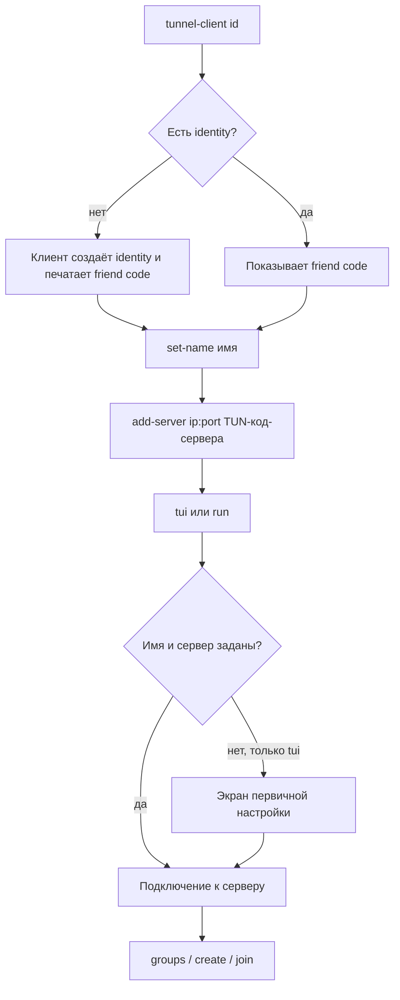

# Справочник CLI `tunnel-client`

Этот документ описывает все команды и флаги клиента VoidLink: как устроен
первый запуск, как читать friend code и server code, какие команды требуют
прав владельца группы, и где лежат настройки. Общая картина проекта — в
[README.md](../README.md), установка — в [INSTALL.md](INSTALL.md),
протокол — в [PROTOCOL.md](PROTOCOL.md), сервер — в [SERVER.md](SERVER.md),
интерфейс — в [TUI.md](TUI.md), файл настроек — в [CONFIG.md](CONFIG.md).

**Содержание**

- [Основные понятия](#основные-понятия)
- [Первый запуск](#первый-запуск)
- [Глобальные флаги](#глобальные-флаги)
- [Identity и профиль](#identity-и-профиль)
- [Серверы](#серверы)
- [Друзья](#друзья)
- [Группы](#группы)
- [Приглашения](#приглашения)
- [Администрирование группы](#администрирование-группы)
- [Настройки](#настройки)
- [Запуск туннеля: `run` и `tui`](#запуск-туннеля-run-и-tui)
- [Коды ошибок и подсказки](#коды-ошибок-и-подсказки)
- [Где лежат данные](#где-лежат-данные)

## Основные понятия

| Термин | Что это |
|---|---|
| **Identity** | Пара ключей клиента (ed25519 и x25519). Создаётся при первом запуске и не меняется, пока её не заменили импортом. |
| **Friend code** | Публичный код identity вида `TUN-…`. Его отдают друзьям и владельцам групп, чтобы вас можно было добавить. |
| **Server code** | Friend code самого сервера. Он нужен при добавлении сервера, и по нему клиент закрепляет ключ сервера. |
| **Сервер** | Экземпляр `tunnel-server`, который держит группы и relay. Адрес — `ip:port`. Клиент может знать несколько серверов. |
| **Группа** | Виртуальная LAN с числовым `gid`. Адрес участника — один на сервер, `100.66.<a>.<b>`, общий для всех его групп (номер группы в адрес не входит). Группа может быть публичной или приватной (`--private`). |
| **Владелец** | Тот, кто создал группу. Только владелец может приглашать, исключать, банить и т. п. Права проверяет сервер. |
| **Peer** | Токен, которым называют участника. Это friend code (`TUN-…`), hex-ключ (64 символа) или alias из списка друзей. |
| **autojoin** | Список групп, в которые клиент входит сам при `run` и `tui`. Список хранится отдельно для каждого сервера. |

## Первый запуск

Минимальный путь от установки до работающего туннеля:



1. Любая команда создаёт identity, если её ещё нет, и печатает friend code.
   Удобнее начать с `tunnel-client id`: команда выводит friend code, ключи и
   текущее имя.
2. Задайте имя, которое увидят другие: `tunnel-client set-name alpha`.
3. Добавьте сервер по его адресу и server code:
   `tunnel-client add-server 203.0.113.10:5555 TUN-…  home`.
4. Запустите `tunnel-client tui`. Если имя или список серверов пусты, TUI
   сначала открывает экран первичной настройки (имя, сервер, адаптер, DLL).
   Enter применяет настройки, Esc отменяет.
5. Создайте группу (`create <имя>`) или войдите в существующую (`join <gid>`).
   Другой участник входит тем же способом или принимает приглашение.

Консольный `run` не показывает экран настройки. Имя и сервер нужно задать
командами заранее, иначе он завершится с подсказкой.

## Глобальные флаги

Глобальные флаги ставятся до имени команды. Флаги можно ставить в любом месте командной строки. `--dir`, `--profile`,
`--server`, `--debug` работают для всех команд, `--adapter` и `--dll` нужны
только для `run` и `tui`.

| Флаг | По умолчанию | Описание |
|---|---|---|
| `--dir <путь>` | см. [Где лежат данные](#где-лежат-данные) | Каталог с `client.json`. |
| `--server <N\|addr\|label>` | последний использованный сервер | Какой сервер использовать для команды. `N` — номер из `servers` (с 0), `addr` — `ip:port`, `label` — метка. |
| `--profile <имя>` | не задано | Отдельный профиль данных: каталог `<dir>/profiles/<имя>`, см. [Профиль](#профиль---profile-имя). |
| `--debug` | выключено | Подробный вывод движка. |
| `--adapter <имя>` | `TunnelVPN` (Windows), `voidlink0` (Linux), `utun` (macOS, номер выбирается автоматически) | Имя адаптера. Если флаг не задан, берётся поле `adapter` из `client.json`. Используется в `run` и `tui`. |
| `--dll <путь>` | не задано | Путь к `wintun.dll`; принимается только на Windows (на других ОС — ошибка). Если флаг не задан, берётся поле `dll` из `client.json`. |

```bash
tunnel-client --dir ~/vl-test --server 1 servers
tunnel-client --server home groups
tunnel-client --adapter voidlink0 run
```

Справка выводится командой `tunnel-client help`, `-h` или `--help`.

## Identity и профиль

### `id`

Показывает friend code, публичные ключи и текущие имя и статус. Создаёт
identity, если её ещё нет.

```bash
tunnel-client id
```

Пример вывода:

```text
friend code: TUN-XXXXXXXX-XXXXXXXX-XXXXXXXX-XXXXXXXX-XXXXXXXX-XXXXXXXX
ed25519 pub: <64 hex-символа>
x25519 pub:  <64 hex-символа>
name:        alpha
status:      (не задано)
```

Права: не нужны. Сервер не вызывается.

### `set-name <имя>`

Имя профиля, которое видят другие участники. Имя может содержать пробелы:
все аргументы склеиваются через пробел. Пустое имя запрещено.

```bash
tunnel-client set-name Саша ноутбук
```

Права: не нужны.

### `set-status <текст>`

Короткий статус, который виден другим участникам. Пустой текст очищает
статус.

```bash
tunnel-client set-status в сети до 18:00
```

Права: не нужны.

### Профиль: `--profile <имя>`

Профиль — отдельный каталог данных: `<каталог по умолчанию>/profiles/<имя>`.
Это удобно, если на одной машине нужны две разные identity.

- Имя профиля: от 1 до 32 символов, латиница, цифры, `_` и `-`.
- Флаг действует на все команды в запуске.

```bash
tunnel-client --profile work id
tunnel-client --profile work set-name alpha-work
```

### `export-identity <файл>`

Сохраняет identity в файл, чтобы перенести её на другую машину. Файл содержит
секретные ключи, поэтому храните его как пароль.

- Без пароля файл открытый (JSON, ключи в hex, с контрольной суммой); команда предупреждает, что файл не зашифрован.
- С паролем ключи шифруются (ChaCha20-Poly1305, ключ выводится медленной
  KDF). Пароль задаётся флагом `--passphrase <p>` или читается из стандартного
  ввода флагом `--passphrase-stdin` (флаги взаимоисключающие, пустой пароль запрещён).
- Существующий файл без `--force` не перезаписывается.

```bash
tunnel-client export-identity ~/vl-identity.json --passphrase-stdin
```

Права: не нужны. Сервер не вызывается.

### `import-identity <файл>`

Загружает identity из файла, сделанного `export-identity`. Клиент проверяет,
что friend code совпадает с ключами. Существующую identity без `--force` не
затирает. Импорт выполняется до автосоздания identity, поэтому в свежем профиле
`--force` не нужен.

```bash
tunnel-client import-identity ~/vl-identity.json --passphrase-stdin
tunnel-client import-identity ~/vl-identity.json --force
```

Замена identity меняет friend code. Друзья и владельцы групп, которые знали
старый код, должны получить новый.

## Серверы

Сервер задаётся адресом `ip:port` и server code (friend code сервера).
Клиент закрепляет ключ сервера при добавлении (pinning). Если ключ сервера
сменился по цепочке ротации, клиент сам закрепляет новый ключ и печатает
об этом сообщение.

### `add-server <addr> <code> [label]`

Добавляет сервер. `addr` — `ip:port`, `code` — server code, `label` —
необязательная короткая метка.

```bash
tunnel-client add-server 203.0.113.10:5555 TUN-XXXX-… home
```

Нельзя добавить сервер с адресом, который уже есть в списке. Код должен
быть корректным friend code.

Права: не нужны.

### `servers`

Список серверов с номерами (нумерация с 0), адресом, меткой и закреплённым
ключом.

```bash
tunnel-client servers
```

```text
0: 203.0.113.10:5555 home [<hex ключа сервера>]
1: 198.51.100.7:5555 - [<hex ключа сервера>]
```

Права: не нужны.

### `del-server <N|addr|label>`

Удаляет сервер из списка. Токен — номер из `servers`, адрес или метка.

```bash
tunnel-client del-server 1
tunnel-client del-server home
```

Права: не нужны. Группы на сервере не затрагиваются, но автовход этого
сервера перестаёт работать.

### Сервер по умолчанию

Сервер по умолчанию — тот, к которому клиент подключался последним
(`active_server`). Если его ещё не было, берётся первый в списке. Выбрать
другой сервер для одной команды можно флагом `--server`, например
`tunnel-client --server 1 groups`. Отдельной команды для постоянной смены
сервера по умолчанию пока нет.

### `set-transport auto|udp|tcp`

Выбирает транспорт до сервера: `auto` (по умолчанию: UDP, а если сервер не отвечает на рукопожатие — TCP), только `udp` или
только `tcp`. При `tcp` связь с сервером идёт по TCP (нужен сервер с включённым TCP-фолбэком), а p2p-каналы между участниками остаются UDP.

```bash
tunnel-client set-transport tcp
```

Права: не нужны. Вступает в силу при следующем подключении.

## Друзья

Друг — это identity, которую вы добавили локально. Друзья нужны, чтобы
называть участников короткими именами (alias) и видеть, какие группы есть у
друга.

### `add-friend <code> [alias]`

Добавляет друга по friend code. Если alias не задан, в качестве alias
используется сам код.

```bash
tunnel-client add-friend TUN-XXXX-… petya
```

Повторно добавить того же друга нельзя.

Права: не нужны.

### `del-friend <alias>`

Удаляет друга по alias.

```bash
tunnel-client del-friend petya
```

Права: не нужны. Друг не исключается из групп.

### `friends`

Список друзей: alias и hex-ключ.

```bash
tunnel-client friends
```

### `friend-groups <peer>`

Спрашивает у сервера, какие группы видны у друга. Ответ виден только для
групп, которые друг разрешил показывать. Команда подключается к серверу.

```bash
tunnel-client friend-groups petya
```

```text
   7  Офис                 [private] (общая)
```

Права: не нужны.

### `alias <friend> <имя>`

Переименовывает друга в локальном списке (`friend` — alias, friend code или hex). Имя не должно совпадать с alias другого друга.

```bash
tunnel-client alias TUN-XXXX-… petya-work
```

Права: не нужны.

## Группы

### `groups`

Список групп на текущем сервере. Показывает gid, имя, видимость, число
онлайн-участников и отметку, состоите ли вы в группе.

```bash
tunnel-client groups
```

```text
   7  Офис                 [private] online 3/5 (состою)
   9  Игры                 [public]  online 0/2
```

Видимость: `[public]` — группу видно всем на сервере, `[private]` — только
участникам. Права: не нужны.

### `create <имя> [--private]`

Создаёт группу, вы становитесь её владельцем. Сервер выдаёт вам адрес в
группе. Группа сразу попадает в автовход текущего сервера.

```bash
tunnel-client create Офис --private
```

Имя — все аргументы, кроме `--private`, склеенные через пробел.

Права: создать может любой клиент. Владельцем группы становится создатель.

### `join <gid>`

Входит в группу. Для публичной группы вход свободный. Приватная группа
доступна по приглашению. Группа попадает в автовход.

```bash
tunnel-client join 7
```

Если группа удалена, команда завершится ошибкой `группа <gid> удалена`.

Права: нужны для приватной группы приглашение (см. [Приглашения](#приглашения)).

### `leave <gid>`

Выходит из группы и убирает её из автовхода.

```bash
tunnel-client leave 7
```

Права: не нужны.

### `delete <gid>`

Удаляет группу целиком. Команда доступна только владельцу. Группа исчезает
у всех участников, а из автовхода она удаляется.

```bash
tunnel-client delete 7
```

Права: владелец. Удаление необратимо, поэтому перед командой проверьте gid
в `groups`.

### `rename <gid> <имя>`

Меняет имя группы.

```bash
tunnel-client rename 7 Офис-2
```

Права: владелец.

## Приглашения

### `invites`

Список неотвеченных приглашений: gid, имя группы, от кого и через сколько
истекает.

```bash
tunnel-client invites
```

```text
   7  Офис                 от petya (истекает через 6 д)
принять: join <gid> · отклонить: decline <gid>
```

Если список получен не полностью (потеря пакетов), команда просит повторить.

Права: не нужны.

### `decline <gid>`

Отклоняет приглашение. Команда повторяет запрос при потере пакетов и
подтверждает отказ, когда сервер ответил.

```bash
tunnel-client decline 7
```

Права: не нужны. Если приглашения в этой группе нет, команда завершится
ошибкой `нет приглашения в группу <gid>`.

## Администрирование группы

Команды ниже доступны только владельцу группы. Сервер проверяет права сам,
клиент лишь отправляет запрос. Если вы не владелец, сервер вернёт ошибку,
и клиент выведет её текст.

Команды принимают `<peer>` в одном из трёх видов: friend code, hex-ключ или
alias из списка друзей.

### `invite <gid> <peer>`

Приглашает участника в приватную группу. Приглашение живёт ограниченное
время (`invite_ttl` на сервере).

```bash
tunnel-client invite 7 petya
tunnel-client invite 7 TUN-XXXX-…
```

### `kick <gid> <peer>`

Исключает участника из группы. Если у участника есть неотвеченное
приглашение, `kick` его отзывает.

```bash
tunnel-client kick 7 petya
```

### `ban <gid> <peer>`

Исключает участника и запрещает повторный вход.

```bash
tunnel-client ban 7 petya
```

### `unban <gid> <peer>`

Снимает бан. Участник снова может войти по приглашению или публичному входу.

```bash
tunnel-client unban 7 petya
```

### `bans <gid>`

Показывает баны и неотвеченные приглашения группы. Заодно подсказывает
команды `unban` и `kick` для них.

```bash
tunnel-client bans 7
```

```text
баны группы 7:
  petya                TUN-XXXX-…
неотвеченные приглашения:
  (нет)
снять бан: unban 7 <peer> · отозвать приглашение: kick 7 <peer>
```

### `transfer <gid> <peer>`

Передаёт владение группой участнику. После передачи вы остаётся участником,
но управлять группой уже не сможете.

```bash
tunnel-client transfer 7 petya
```

После передачи вернуть владение может только новый владелец, командой
`transfer` от своего имени.

## Настройки

### `invisible on|off`

Режим невидимки: другие участники видят вас офлайн. Флаг передаётся серверу
в HELLO при подключении и действует, пока жива сессия.

```bash
tunnel-client invisible on
```

Команда сохраняет настройку. Она вступит в силу при следующем подключении
(`tui` или `run`). Текущая сессия не перезапускается.

Права: не нужны.

### `set-mtu <N>`

Задаёт MTU адаптера. Значение ограничено диапазоном 576–1500. По умолчанию
1400: запас под заголовки IP, UDP и фрейма группы, а также под IPv6 и PPPoE.

```bash
tunnel-client set-mtu 1380
```

Команда принимает значение только в диапазоне 576–1500, иначе — ошибка.
Если в `client.json` вписано значение вне диапазона, при запуске оно
приводится к ближайшей границе. На сетях с PPPoE уменьшайте MTU. Применяется
при следующем подключении.

### `dns on|off`

Включает или выключает внутренний DNS для имён участников. Клиент отвечает
на запросы вида `<участник>.vl` и `<участник>.<группа>.vl` адресом внутри
туннеля (`100.66.0.53`). Включено по умолчанию. При `on` клиент пытается
настроить системный резолвер для зоны `.vl` (NRPT на Windows, `resolvectl` на
Linux, `/etc/resolver/vl` на macOS). Если настроить не удалось, клиент
выводит предупреждение.

```bash
tunnel-client dns off
```

Настройка сохраняется в `client.json` и применяется при следующем
подключении. Системный резолвер меняется, поэтому нужны права администратора
(как и для `run` / `tui`). DNS-сервер слушает `100.66.0.53:53`, TTL ответов — 30 с;
подробности — в [NETWORKING.md](NETWORKING.md).

### `name` и `status`

Имя и статус задаются командами `set-name` и `set-status`, см.
[Identity и профиль](#identity-и-профиль).

### Настройки в `client.json`

Часть настроек хранится в файле `client.json` и редактируется через CLI или
TUI (полный список полей — в [CONFIG.md](CONFIG.md)). Значения по умолчанию:

| Поле | По умолчанию | Смысл |
|---|---|---|
| `name` | пусто | Имя профиля, задаётся `set-name`. |
| `status` | пусто | Статус, задаётся `set-status`. |
| `theme` | пусто (тёмная) | Тема TUI: `dark`, `light`, `contrast`, `amber` или `fjord`. |
| `lan_discovery` | `true` | Сообщать серверу LAN-адрес, чтобы участники в одной сети соединялись напрямую. |
| `mtu` | `1400` | MTU адаптера, фактическое значение ограничено диапазоном 576–1500. |
| `invisible` | `false` | Режим невидимки, задаётся `invisible on\|off`. |
| `dns` | `true` | Встроенный DNS для имён пиров, `dns on\|off`. |
| `transport` | `auto` | Транспорт до сервера: `auto`, `udp`, `tcp`; `set-transport`. |
| `adapter` | пусто | Имя адаптера (экран серверов в TUI); флаг `--adapter` важнее. |
| `dll` | пусто | Путь к `wintun.dll`; флаг `--dll` важнее. |
| `active_server` | пусто | Адрес сервера, к которому относится `autojoin`. |
| `autojoin` | `[]` | Группы автовхода текущего сервера. |
| `autojoin_by_server` | `{}` | Автовход остальных серверов. |

Поля, которых нет в файле, получают значения по умолчанию. Старый
`client.json` читается без миграции.

## Запуск туннеля: `run` и `tui`

Обе команды поднимают TUN-адаптер, подключаются к выбранному серверу и входят
в группы из автовхода. Создание адаптера требует прав администратора на
Windows и root на Linux и macOS.

### `run`

Консольный режим. Туннель работает, пока процесс запущен. Команда не
показывает экран настройки. Если имя или сервер не заданы, она завершится
подсказкой.

```bash
tunnel-client run
tunnel-client --server home run
```

Для Windows можно задать адаптер и DLL:

```powershell
.\tunnel-client.exe --adapter TunnelVPN --dll .\wintun.dll run
```

Права: администратор (Windows) или root (Linux, macOS).

### `tui` (алиас `ui`)

Интерфейс на ratatui: список групп, друзья, приглашения, серверы и
управление группой (см. [TUI.md](TUI.md)). Если имя или сервер не заданы, сначала открывается экран
первичной настройки. На нём задаются имя, сервер, адаптер и DLL. Enter
сохраняет, Esc отменяет. Код сервера (friend code) обязателен только для
нового адреса — у уже сохранённого сервера ключ есть. При работающем демоне
адаптер и DLL задаёт служба: поля не обязательны, а имя и сервер TUI
отправляет демону и ждёт, пока он их сохранит.

```bash
tunnel-client tui [--embedded|--remote]
```

Если демон доступен ([DAEMON.md](DAEMON.md)), `tui` подключается к нему как тонкий клиент (права администратора не нужны, в шапке «демон»). Без демона поднимается собственный движок (`embedded`, права как у `run`). `--embedded` принудительно выбирает свой движок, `--remote` — демон (без демона ошибка). Флаги взаимоисключающие и только для `tui`.

### Команды при работающем демоне

CLI определяет, куда идти команде (см. [PLAN.md](PLAN.md), раздел 7.4):

| Ситуация | Поведение |
|---|---|
| Демон доступен | сетевые команды (`groups`, `create`, `join`, `invite`, `invites`, `set-name`, `add-server`, `alias`, `invisible` и др.) уходят демону по IPC; он сам правит `client.json` |
| Демона нет, замок занят (embedded TUI или `run`) | отказ; свой HELLO вытеснил бы сессию движка. Читают локальный конфиг и работают `id`, `servers`, `friends` |
| Движка нет | короткий ctrl-сеанс с сервером, как раньше |

При работающем демоне отказывают `run`, `set-transport`, `set-mtu`, `dns` и `import-identity`: это настройки движка демона, IPC-команд для них нет (остановите демон и повторите). `export-identity` — локальная.

Если настройка была прервана, команда завершится сообщением
`настройка не завершена; запусти ещё раз или задай параметры командами CLI`.

## Коды ошибок и подсказки

- Неизвестная команда печатает справку и завершает процесс с кодом `2`; `help`, `-h` и `--help` печатают справку.
- Пустое имя в `set-name`, `create` и `rename` завершает процесс с кодом `2`
  и подсказкой по синтаксису. Остальные ошибки аргументов выводятся как
  обычная ошибка программы с текстом вида `usage: ...`.
- Ошибки сервера (нет прав, группа не найдена, неверный peer) выводятся с
  префиксом `сервер:`. Текст зависит от сервера.
- Ошибки разбора friend code подсказывают, что код, скорее всего, скопирован
  не целиком: нужно 52 символа после `TUN-`.

## Friend code и server code

Friend code — это публичный код identity. Он выглядит так:

```text
TUN-XXXXXXXX-XXXXXXXX-XXXXXXXX-XXXXXXXX-XXXXXXXX-XXXXXXXX-XXXX
```

- Префикс `TUN-`, затем 52 символа алфавита Crockford (`0-9` и `A-Z` без
  `I`, `L`, `O`, `U`).
- Символы разбиты дефисами по восемь (в последней группе 4). Полная длина с дефисами — 62 символа.
- Код кодирует публичный ключ ed25519 (32 байта).

Разбор терпим к тому, как код попал к вам:

- регистр не важен;
- пробелы, переводы строк, дефисы и рамка TUI (`│`) игнорируются;
- префикс `TUN-` можно не вводить;
- `O` читается как `0`, а `I` и `L` как `1`;
- русские буквы, похожие на латинские (`А`, `В`, `Е`, `К`, `М`, `Н`, `О`,
  `Р`, `С`, `Т`, `Х`), приводятся к латинским. Это удобно при наборе в
  русской раскладке.

Server code устроен так же, но кодирует ключ сервера. Его выдаёт владелец
сервера (см. [docs/SERVER.md](SERVER.md)).

## Где лежат данные

| Система | Каталог по умолчанию |
|---|---|
| Windows | `%APPDATA%\tunnel` |
| Linux и macOS | `~/.tunnel-client` |
| Если домашний каталог не определён | `./tunnel-client-data` |

Переопределить каталог можно флагом `--dir <путь>`. Все данные лежат в файле
`client.json`: identity, серверы, друзья, автовход и настройки. С `--profile <имя>` данные лежат в подкаталоге `profiles/<имя>`. Файл
содержит секретные ключи, поэтому его не стоит показывать посторонним.

Копия `client.json` — это вся ваша identity. Чтобы перенести её, используйте
`export-identity` (см. [Identity и профиль](#identity-и-профиль)).

## Связанные документы

- [INSTALL.md](INSTALL.md): установка на Windows и Linux/macOS.
- [SERVER.md](SERVER.md): развёртывание сервера и выдача server code.
- [PROTOCOL.md](PROTOCOL.md): протокол v3, которым клиент и сервер обмениваются.
- [TESTING.md](TESTING.md): как запускать тесты клиента.
