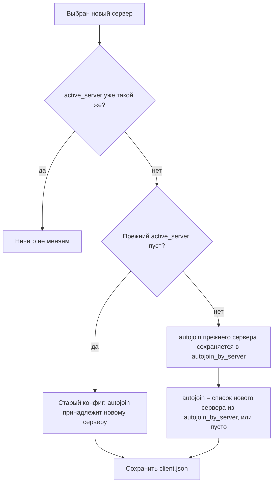

# Конфигурация VoidLink

Справочник по всем файлам конфигурации и состояния: клиент (`client.json`,
профили, `ui.json`), служба Windows (`%ProgramData%\tunnel`) и сервер
(`server.json`, флаги и лимиты). Здесь описано, что лежит на диске, какие
поля читаются, какие значения по умолчанию и как старые файлы переносятся в
новую версию. Установка и первый запуск — в [INSTALL.md](INSTALL.md), эксплуатация
сервера — в [SERVER.md](SERVER.md), протокол и лимиты — в [PROTOCOL.md](PROTOCOL.md).

Все файлы — JSON в UTF-8. Записи атомарные: сначала пишется временный файл
(`*.tmp`), затем он переименовывается в целевой. Редактировать файлы вручную
можно, но запущенный процесс перезаписывает их при следующем сохранении, поэтому
правку делайте при остановленном клиенте или сервере.

Пометка **план** означает, что в коде этого ещё нет (описано в [PLAN.md](PLAN.md));
всё остальное соответствует текущему коду.

## Содержание

- [Где лежат файлы](#где-лежат-файлы)
- [Клиент: client.json](#клиент-clientjson)
  - [Поля](#поля-clientjson)
  - [Пример](#пример-clientjson)
  - [Автовход и серверы](#автовход-и-серверы)
  - [Друзья](#друзья)
- [Профили](#профили)
- [Служба Windows и daemon](#служба-windows-и-daemon)
- [ui.json](#uijson)
- [Сервер: server.json](#сервер-serverjson)
  - [Структура](#структура-serverjson)
  - [Пример](#пример-serverjson)
  - [Срок жизни приглашений и лимиты на группу](#срок-жизни-приглашений-и-лимиты-на-группу)
  - [Ротация ключа и цепочка](#ротация-ключа-и-цепочка)
- [Флаги сервера](#флаги-сервера)
- [Лимиты сервера (Limits)](#лимиты-сервера-limits)
- [Миграция со старых версий](#миграция-со-старых-версий)

## Где лежат файлы

| Что | Windows | Linux / macOS | Переопределение |
|---|---|---|---|
| Конфиг клиента `client.json` | `%APPDATA%\tunnel\` | `~/.tunnel-client/` | `tunnel-client --dir <путь>` |
| Профиль клиента | `%APPDATA%\tunnel\profiles\<имя>\` | `~/.tunnel-client/profiles/<имя>/` | `--profile <имя>` |
| Настройки UI `ui.json` | `%APPDATA%\tunnel\` | `~/.tunnel-client/` | тема TUI в тонком режиме (при демоне) |
| Очередь офлайн-правок `ui-pending.json` | `%APPDATA%\tunnel\` | `~/.tunnel-client/` | появляется, пока TUI работает без движка (уходит демону, когда он появляется) |
| Конфиг и данные демона | `%ProgramData%\tunnel\` (`C:\ProgramData\tunnel`, если переменной нет) | `~/.tunnel-client/` (как у клиента) | `tunnel-daemon console\|service --data-dir <каталог>` |
| Состояние сервера `server.json` | — | `tunnel-data/` рядом с запуском по умолчанию, в systemd-юните `/var/lib/tunnel/` | `--data <каталог>` |
| IPC демона | пайп `\\.\pipe\tunnel-daemon` | сокет `daemon.sock` в каталоге данных | — |

Если `APPDATA` и `HOME` не заданы, клиент использует каталог
`tunnel-client-data` в текущей папке.

Каталоги создаются автоматически при первом запуске. Файлы с identity
содержат приватные ключи: ограничивайте права доступа, чтобы их не читали
посторонние пользователи (на Linux — `0600`, как в примере резервной копии
в [SERVER.md](SERVER.md)).

## Клиент: client.json

Файл читает и пишет `tunnel-client` (CLI, TUI и `run`). Структура —
`Config` в `crates/client/src/store.rs`. Все поля, кроме `identity`, имеют
значения по умолчанию, поэтому старый файл с неполным набором полей загружается
без ошибок. Неизвестные поля игнорируются.

### Поля client.json

| Поле | Тип | По умолчанию | Описание |
|---|---|---|---|
| `identity` | объект или `null` | `null` | Ключи клиента (`ed_seed`, `x_seed`, hex, по 32 байта). Создаётся при первом запуске. Отсюда берутся friend code и подпись сообщений. |
| `name` | строка | `""` | Имя профиля, видное другим участникам. Задаётся командой `set-name`. |
| `status` | строка | `""` | Текст статуса (`set-status`). |
| `servers` | массив | `[]` | Известные серверы: `addr`, `pubkey`, `label`. См. [Автовход и серверы](#автовход-и-серверы). |
| `friends` | массив | `[]` | Друзья: `pubkey`, `alias`. См. [Друзья](#друзья). |
| `autojoin` | массив `u32` | `[]` | Группы (gid), в которые клиент входит при `run` и `tui`. Относится к `active_server`. |
| `autojoin_by_server` | объект | `{}` | Списки автовхода остальных серверов: ключ — `ip:port`, значение — массив gid. |
| `active_server` | строка | `""` | Адрес `ip:port` сервера, к которому относится `autojoin`. Пусто — старый конфиг. |
| `theme` | строка | `""` (тёмная) | Тема TUI: `dark`, `light`, `contrast`, `amber`, `fjord`. Неизвестное значение — тёмная. |
| `lan_discovery` | bool | `true` | Сообщать серверу LAN-адреса (кандидаты). Пиры в одной сети соединяются напрямую. |
| `mtu` | число | `1400` | MTU адаптера. При чтении ограничивается диапазоном `576..1500`: `0` даёт `576`, `9000` даёт `1500`. Команда `set-mtu` вне диапазона — ошибка. |
| `invisible` | bool | `false` | Невидимка: другие участники видят клиент офлайн (флаг HELLO3, PRESENCE). |
| `transport` | строка | `auto` | Транспорт к серверу: `auto` (UDP, а если рукопожатие не отвечает — TCP), `udp` или `tcp` (только до сервера; p2p с пирами всё равно UDP). Команда `set-transport`. |
| `dns` | bool | `true` | Встроенный DNS для имён `<участник>.vl` и `<участник>.<группа>.vl` на `100.66.0.53` и настройка split-DNS ОС для `.vl`. Команда `dns on\|off`. |
| `adapter` | строка | `""` | Имя адаптера (Wintun / TUN). Пусто — по умолчанию (`TunnelVPN` на Windows, `voidlink0` на Linux, `utun` на macOS); флаг `--adapter` важнее. Задаётся на экране серверов TUI, применяется после перезапуска. |
| `dll` | строка | `""` | Путь к `wintun.dll` (Windows). Пусто — рядом с exe или из `PATH`; флаг `--dll` важнее. |
| `mesh` | объект | см. ниже | Mesh-оверлей (этап 9): `enabled`, `relay_enabled`, `relay_budget_kbps`, `contacts`. |
| `pinned_paths` | объект | `{}` | Ручные закрепления путей: ключ — адрес оверлея (`"100.66.7.4"`), значение — `direct`, `server` или `relay:<hex ed25519>`. Сильнее автоматического выбора. |

Изменения `transport`, `dns`, `mtu`, `invisible` применяются при следующем подключении.

**`mesh` (этап 9).** Все поля с `serde(default)`, поэтому старый `client.json`
без секции читается как значения по умолчанию:

| Поле | По умолчанию | Смысл |
|---|---|---|
| `enabled` | `true` | Участвовать в mesh: публиковать `MESH_INFO`, принимать пиров. |
| `relay_enabled` | `true` | Релеить чужой трафик (L2). |
| `relay_budget_kbps` | `16384` (≈ 2 МБ/с) | Лимит отдачи релея **на каждого пира** в окне 10 с; одновременно ≤ 8 реле-пиров. |
| `contacts` | `[]` | Кэш DHT-контактов: `ed`, `x` (hex), `addr` (`ip:port`), `rtt_ms`, `seen_s`, `caps`. Пишется движком раз в 10 с (только при изменении), при старте загружается в таблицу DHT как **подсказка** — до первого `MESH_SEED`, данные сервера перебивают кэш. Не больше 256 записей, не старше 7 суток; записи старше TTL (15 мин) при загрузке получают «полу-TTL», чтобы первый `expire` не вычистил кэш. Вход в сеть без сервера кэш не даёт: ключи групп, состав и `my_ip` выдаёт сервер. |
| `duplicate` | `false` | Дублировать маленький latency-sensitive трафик по нескольким путям (issue #25). Включается только если получатель объявил `caps::DUP`. |
| `duplicate_max_kbps` | `256` | Потолок EWMA скорости цели, кбит/с: быстрее — не дублируем (полоса удвоится). |
| `duplicate_max_pkt` | `512` | Потолок размера пакета для дублирования, байт. |
| `duplicate_paths` | `2` | Сколько путей копировать: 2 или 3 (клэмпится в `DUPLICATE_PATHS_MIN..=MAX`). |

Дублирование (issue #25) по умолчанию выключено: цена — двойная полоса,
выигрыш — меньше потерь у редкого трафика (DNS, keepalive, игровые пакеты).
Правила выбора (не больше 8 целей одновременно, второй путь не дороже 1.5×
лучшего, закреплённая цель не дублируется) — в
[NETWORKING.md](NETWORKING.md#дублирование-путей-issue-25). Счётчики
`dup_sent`/`dup_dropped` видны в снимке состояния (`StatsSnap`).

**`pinned_paths` (этап 9).** Ключ — IPv4-адрес оверлея в виде строки. Значения:
`direct` (L0), `server` (L1) или `relay:<hex>` (L2 через конкретного пира).
Мусор в значении не ломает конфиг — закрепление просто игнорируется.
Закреплённый, но недоступный путь даёт откат на автоматику, а само
закрепление сохраняется до явного снятия.

### Пример client.json

```json
{
  "identity": {
    "ed_seed": "3f9a1c…(64 hex-символа)…",
    "x_seed": "b07e52…(64 hex-символа)…"
  },
  "name": "maksim",
  "status": "в сети до вечера",
  "servers": [
    {
      "addr": "203.0.113.10:5555",
      "pubkey": "9c1e0d…(64 hex-символа)…",
      "label": "home"
    },
    {
      "addr": "198.51.100.7:5555",
      "pubkey": "4ad2f8…(64 hex-символа)…",
      "label": "work"
    }
  ],
  "friends": [
    { "pubkey": "e51b07…(64 hex-символа)…", "alias": "anna" }
  ],
  "active_server": "203.0.113.10:5555",
  "autojoin": [3, 7],
  "autojoin_by_server": {
    "198.51.100.7:5555": [2]
  },
  "theme": "fjord",
  "lan_discovery": true,
  "mtu": 1400,
  "invisible": false,
  "transport": "auto",
  "dns": true
}
```

Значения `pubkey` и `ed_seed`/`x_seed` в примере сокращены. Реальный файл
содержит полные 64-символьные hex-строки. Поля `adapter` и `dll` в примере
опущены: они пустые по умолчанию.

### Автовход и серверы

`autojoin` хранит gid групп одного сервера. Gid назначаются каждым сервером
независимо, поэтому список от сервера A на сервере B означал бы вход в чужие
группы. Поэтому при смене активного сервера функция `activate_server`
откладывает текущий список и восстанавливает список нового сервера:



Серверы описываются записями `servers`:

| Поле записи | Описание |
|---|---|
| `addr` | Адрес сервера `ip:port`. Ключ для `active_server` и `autojoin_by_server`. |
| `pubkey` | hex ed25519-ключ сервера. Ключ закрепляется (пиннинг) при первом подключении. Если сервер сменил ключ по цепочке ротации, клиент переписывает значение сам. |
| `label` | Произвольное название для `servers` и `del-server`. |

Сервер можно выбрать по номеру, адресу или метке (`--server <N|addr|label>`).
Без флага используется последний использованный сервер.

### Друзья

```json
{ "pubkey": "e51b07…", "alias": "anna" }
```

`pubkey` — hex публичного ключа друга, `alias` — короткое имя для команд
(`invite <gid> anna`). При поиске пира алиас сравнивается без учёта регистра.

## Профили

Профиль — отдельный каталог данных клиента, то есть отдельная identity, друзья
и серверы. Имя профиля: `[A-Za-z0-9_-]`, от 1 до 32 символов, без точек и
слешей.

```text
%APPDATA%\tunnel\                     (или ~/.tunnel-client/)
├── client.json                       профиль по умолчанию
├── ui.json                           настройки UI: тема тонкого TUI
└── profiles/
    ├── work/
    │   └── client.json
    └── home/
        └── client.json
```

Список профилей — это подкаталоги `profiles/`, имена которых проходят проверку.
Файлы в `profiles/` и каталоги с недопустимыми именами игнорируются.

Флаг `--profile <имя>` выбирает каталог `<базовый каталог>/profiles/<имя>`
(`crates/client/src/profile.rs`). Перенос identity между машинами —
`export-identity` / `import-identity` (см. [CLIENT.md](CLIENT.md)).

## Служба Windows и daemon

Служба `tunnel-daemon` (установка через `tunnel-daemon install`) держит
адаптер и туннель. Её конфиг и состояние лежат в `%ProgramData%\tunnel`, а не в
профиле пользователя: служба работает под SYSTEM и не видит `%APPDATA%`
установившего пользователя.

```text
%ProgramData%\tunnel\
├── client.json        конфиг службы (ACL: полный доступ SYSTEM и Administrators)
├── owner.sid          SID пользователя, записанный при установке
├── daemon.lock        блокировка от двух экземпляров (Unix: flock)
└── logs\
    └── daemon.log     журнал службы, ротация 1 МиБ × 5 файлов
```

- При установке (`tunnel-daemon install`) `client.json` установившего
  пользователя импортируется из `%APPDATA%\tunnel\` в `%ProgramData%\tunnel\`. Identity и друзья переходят вместе с ним.
- `owner.sid` задаёт SID пользователя, которому разрешён доступ к пайпу
  `\\.\pipe\tunnel-daemon`. У `tunnel-daemon console` отдельного файла нет:
  доступ выдаётся текущему SID, а владелец объекта пайпа — Administrators
  (`O:BA`), поэтому такой пайп поднимается только от администратора.
  Свой `client.json` в каталог демона консольный режим переносит только с
  `--seed-config`.
- Удаление `tunnel-daemon uninstall --purge` удаляет и `%ProgramData%\tunnel`
  (identity, друзья, `owner.sid`). Без `--purge` данные остаются.
- Сиды ключей никогда не отправляются по IPC: интерфейсы (`tunnel-tray`,
  `tunnel-client`) получают только состояние, без ключей.

На Unix демон использует тот же каталог, что и клиент (`~/.tunnel-client`),
поэтому фронтенды и `tunnel-daemon console` используют один и тот же сокет
`daemon.sock`. Это режим для разработки и тестов. Режимы запуска демона —
в [DAEMON.md](DAEMON.md), протокол IPC — в [IPC.md](IPC.md).

## ui.json

Файл `ui.json` — локальные настройки тонкого TUI (`tunnel-client tui`, когда
движок в демоне). Нужен потому, что `client.json` принадлежит демону и TUI его не
пишет. Лежит в каталоге данных клиента (`%APPDATA%\tunnel\ui.json`,
`~/.tunnel-client/ui.json` или `--dir`); читается и записывается атомарно
(`remote.rs`, `UiPrefs`). Без демона (embedded) тема хранится в `client.json`
(поле `theme`).

```json
{
  "theme": "amber"
}
```

## Сервер: server.json

Файл пишет и читает `tunnel-server` в каталоге `--data`. В нём identity сервера,
группы, участники, баны, приглашения и цепочка ротации ключа. Структура —
`Persisted` и `PGroup` в `crates/server/src/persist.rs`. Файл переписывается
раз в ~3 секунды, если состояние изменилось, а срочные события (кик, бан, выход,
удаление группы) сохраняются не чаще раза в 200 мс.

Файл содержит приватные ключи сервера. Потеря или подмена файла означает
новую identity: клиенты, закрепившие старый ключ, перестанут подключаться.
Резервные копии — в [SERVER.md](SERVER.md#резервная-копия-serverjson).

### Структура server.json

| Поле | Тип | Описание |
|---|---|---|
| `ed_seed` | массив из 32 байт | Приватный ключ ed25519 сервера (identity, на которую пиннятся клиенты). |
| `x_seed` | массив из 32 байт | Сид X25519 для рукопожатия. |
| `next_gid` | `u32` | Следующий свободный номер группы. |
| `rotations` | массив строк | Цепочка ротации ключа: hex 160-байтных звеньев, от старых к новым. Пишет `rotate-key`. По умолчанию пусто. |
| `groups` | массив `PGroup` | Группы сервера. |

Поля `PGroup`:

| Поле | Тип | По умолчанию | Описание |
|---|---|---|---|
| `id` | `u32` | — | gid группы. |
| `name` | строка | — | Название. |
| `owner` | строка | — | hex pubkey владельца. |
| `private` | bool | `false` | Закрытая группа: вход только по приглашению. |
| `key` | массив из 32 байт | — | Текущий групповой ключ. |
| `epoch` | `u32` | `0` | Номер группового ключа (раздел 5 спецификации). Растёт при ротации. |
| `rev` | `u32` | `0` | Ревизия состояния группы. |
| `revoke_prev` | bool | `false` | Последняя ротация отзывает прошлый ключ (LEAVE, KICK, BAN). |
| `members` | массив пар `[hex pubkey, ip]` | — | Участники и выданный им адрес в сети группы (`ip` — `u32`). |
| `banned` | массив строк | `[]` | hex pubkey забаненных. |
| `invites` | массив строк | `[]` | hex pubkey приглашённых, ещё не ответивших. |
| `invite_times` | объект | `{}` | hex pubkey приглашения → время приглашения, unix в миллисекундах. |
| `invite_names` | объект | `{}` | hex pubkey приглашённого → последнее известное имя. |
| `member_names` | объект | `{}` | hex pubkey участника → имя. Офлайн-участники после рестарта показываются с последним именем, а не «…». |
| `member_status` | объект | `{}` | hex pubkey участника → статус. |
| `ban_names` | объект | `{}` | hex pubkey забаненного → последнее имя (ADMIN_INFO). |

Поля, добавленные в v3, имеют значения по умолчанию, поэтому файл v2 читается
без правок (см. [Миграция](#миграция-со-старых-версий)).

### Пример server.json

```json
{
  "ed_seed": [12, 201, 7, 88, 143, 0, 19, 254, 61, 33, 90, 17, 240, 6, 150, 77,
              3, 118, 225, 40, 9, 199, 64, 130, 21, 5, 172, 48, 99, 210, 14, 56],
  "x_seed": [211, 9, 42, 174, 60, 5, 133, 240, 17, 88, 2, 199, 73, 120, 36, 162,
             250, 14, 101, 7, 95, 183, 28, 66, 149, 31, 204, 12, 77, 240, 8, 19],
  "next_gid": 5,
  "rotations": [],
  "groups": [
    {
      "id": 3,
      "name": "Друзья",
      "owner": "9c1e0d…(hex pubkey владельца)…",
      "private": true,
      "key": [42, 7, 190, 3, 221, 90, 14, 66, 8, 120, 255, 1, 37, 99, 180, 6,
              54, 201, 12, 77, 230, 19, 3, 148, 61, 170, 9, 88, 115, 23, 140, 5],
      "epoch": 4,
      "rev": 17,
      "revoke_prev": false,
      "members": [
        ["9c1e0d…", 2],
        ["e51b07…", 3]
      ],
      "banned": ["4ad2f8…"],
      "invites": ["7b0c55…"],
      "invite_times": { "7b0c55…": 1762900000000 },
      "invite_names": { "7b0c55…": "boris" },
      "member_names": { "9c1e0d…": "maksim", "e51b07…": "anna" },
      "member_status": { "e51b07…": "на связи" },
      "ban_names": { "4ad2f8…": "spammer" }
    }
  ]
}
```

Байтовые массивы сериализуются как JSON-массивы чисел (стандартное поведение
`serde` для `[u8; 32]`). Сокращённые в примере ключи и hex-строки на самом
деле полные. Значения `ip` — целые числа, которые сервер сопоставляет с адресом
в сети группы.

### Срок жизни приглашений и лимиты на группу

- Приглашение живёт `invite_ttl` (по умолчанию 7 дней, флаг `--invite-ttl-days`).
  Отсчёт идёт от `invite_times`. После загрузки старого файла, где таких
  времён нет, срок начинается с момента загрузки.
- На группу действуют ограничения `Limits`: не больше **256** приглашений
  (`--max-invites-per-group`) и **1024** банов (`--max-bans-per-group`); на одну
  identity по всем группам — не больше **64** живых приглашений
  (`--max-invites-per-target`). Сверх лимита команда возвращает ошибку.
  Освободить место можно снятием старых банов (`unban`) или отзывом
  приглашения (`kick`).

### Ротация ключа и цепочка

`rotate-key` добавляет звено в `rotations`. Звено подписывается старым ключом и
содержит новый. Клиент, закрепивший любой из последних 8 ключей цепочки,
перезакрепляется сам и получает новый ключ по цепочке. Новому клиенту выдаётся
напечатанный код. Новый ключ вступает в силу после перезапуска сервера.

Номера `epoch` и `rev` растут монотонно. Чтобы после падения сервера номера не
повторялись, при загрузке к ним добавляется запас `LOAD_MARGIN` (65 536).
Поэтому после аварии номера в файле могут выглядеть «прыжком» вперёд: это ожидаемо.

## Флаги сервера

```text
tunnel-server [адрес=0.0.0.0:5555] [флаги]
tunnel-server rotate-key [--data <dir>]
```

| Флаг | По умолчанию | Статус | Описание |
|---|---|---|---|
| `адрес` (позиционный) | `0.0.0.0:5555` | в коде | Адрес прослушивания UDP. Любой аргумент без `-` считается адресом. |
| `--data <dir>` | `tunnel-data` | в коде | Каталог состояния `server.json`. |
| `--workers N` | `0` (по ядрам, не больше 8) | в коде | Число потоков-воркеров. |
| `-q`, `--quiet` | выключено | в коде | Не печатать события. |
| `--relay-rate R` | `4000` | в коде | Релей: фреймов в секунду на сессию. |
| `--relay-burst B` | `8000` | в коде | Релей: запас фреймов. |
| `--ctrl-rate R` | `50` | в коде | Управляющие фреймы в секунду на сессию. |
| `--ctrl-burst B` | `100` | в коде | Запас управляющих фреймов. |
| `--hello-rate R` | `5` | в коде | HELLO и открытые ответы в секунду на IP (IPv6 — на /64). |
| `--hello-burst B` | `20` | в коде | Запас HELLO на IP. |
| `--plain-rate R` | `2000` | в коде | Открытые ответы без подтверждённого адреса на весь сервер. |
| `--plain-burst B` | `4000` | в коде | Их запас. |
| `--join-rate R` | `1` | в коде | Входы не-участников в группу в секунду на группу. |
| `--join-burst B` | `10` | в коде | Их запас. |
| `--session-timeout <сек>` | `30` | в коде | Сессия без пакетов столько секунд считается офлайн. Минимум 1. |
| `--max-owned-groups N` | `16` | в коде | Групп во владении одной identity. |
| `--invite-ttl-days N` | `7` | в коде | Срок жизни приглашения в днях. Минимум 1. |
| `--max-invites-per-group N` | `256` | в коде | Приглашений на группу. |
| `--max-bans-per-group N` | `1024` | в коде | Банов на группу. |
| `--max-invites-per-target N` | `64` | в коде | Живых приглашений одной identity по всем группам. |
| `--tcp` / `--no-tcp` | включено | в коде | TCP-фолбэк на том же порту, что UDP. |
| `--metrics <адрес>` | выключено | в коде | HTTP-эндпоинт `/metrics` (Prometheus) и `/healthz`, например `127.0.0.1:9100`. |

Значения `R` должны быть числами больше нуля, `B` — числами не меньше 1.
Некорректные значения сервер отклоняет при старте с сообщением об ошибке.

Пример для systemd (`/etc/default/tunnel-server`):

```bash
TUNNEL_LISTEN=0.0.0.0:5555
TUNNEL_ARGS="--workers 4 --invite-ttl-days 14"
```

## Лимиты сервера (Limits)

Структура `Limits` в `crates/server/src/lib.rs`. Значения по умолчанию в коде
совпадают с флагами из таблицы выше. Программный API использует те же поля.

| Поле | Флаг | По умолчанию | Смысл |
|---|---|---|---|
| `relay_rate` / `relay_burst` | `--relay-rate` / `--relay-burst` | 4000 / 8000 | Релей, фреймов в секунду на сессию и запас. |
| `ctrl_rate` / `ctrl_burst` | `--ctrl-rate` / `--ctrl-burst` | 50 / 100 | Управляющие фреймы на сессию. |
| `hello_rate` / `hello_burst` | `--hello-rate` / `--hello-burst` | 5 / 20 | HELLO, HELLO3, а также ответы CHALLENGE, UNSUPPORTED, WELCOME и RESET на IP. |
| `plain_rate` / `plain_burst` | `--plain-rate` / `--plain-burst` | 2000 / 4000 | Открытые ответы без подтверждённого адреса на весь сервер. |
| `join_rate` / `join_burst` | `--join-rate` / `--join-burst` | 1 / 10 | Входы не-участников на группу. |
| `session_timeout` | `--session-timeout` | 30 с | Таймаут офлайн-статуса сессии. |
| `max_owned_groups` | `--max-owned-groups` | 16 | Групп на одну identity-владельца. |
| `invite_ttl` | `--invite-ttl-days` | 7 дней | Срок жизни приглашения. |
| `max_invites_per_group` | `--max-invites-per-group` | 256 | Приглашений на группу. |
| `max_bans_per_group` | `--max-bans-per-group` | 1024 | Банов на группу. |
| `max_invites_per_target` | `--max-invites-per-target` | 64 | Живых приглашений одной identity по всем группам. |

Сетевые детали и обоснование лимитов — в разделе 9 [PROTOCOL.md](PROTOCOL.md).

## Миграция со старых версий

**Сервер (v2 → v3).** `server.json` версии 2 загружается без изменений.
Новые поля (`epoch`, `rev`, `revoke_prev`, `member_names`, `member_status`,
`ban_names`, `invite_times`, `invite_names`, `rotations`) получают значения по
умолчанию. Последствия, которые стоит знать:

- `epoch` и `rev` начинаются заново (с 1 по умолчанию, плюс запас при загрузке).
- Имена офлайн-участников показываются как «…», пока участник не выйдет на связь.
- Срок приглашений отсчитывается от момента загрузки файла.

Идентичность сервера сохраняется, поэтому клиенты переподключаются без нового
кода. Повреждённый файл сервер не перезаписывает: он завершается с ошибкой,
которую нужно исправить или восстановить из копии. Новая identity означает
новый код для всех клиентов.

**Клиент (старый `client.json`).** Файл без новых полей загружается, отсутствующие
поля получают значения по умолчанию:

- `lan_discovery` — `true`; `dns` — `true`; `transport` — `auto`; `mtu` — `1400`; `invisible` — `false`; `theme` — тёмная; `adapter` и `dll` — пусто.
- `active_server` пуст. Список `autojoin` принадлежит первому серверу, который
  клиент активирует. При смене сервера список переносится в `autojoin_by_server`
  (см. [Автовход и серверы](#автовход-и-серверы)).
- `mtu` вне диапазона `576..1500` используется с ограничением до ближайшей границы.

**Служба Windows.** Конфиг переносится из `%APPDATA%` в `%ProgramData%` при
установке (см. [Служба Windows и daemon](#служба-windows-и-daemon)).

**Что делать при переносе на другой сервер.** Скопируйте `server.json` целиком
(с правами `0600`) и не генерируйте новый ключ. Если ключ нужно сменить, сделайте
это командой `rotate-key` и раздайте новый код, чтобы клиенты перезакрепились.
