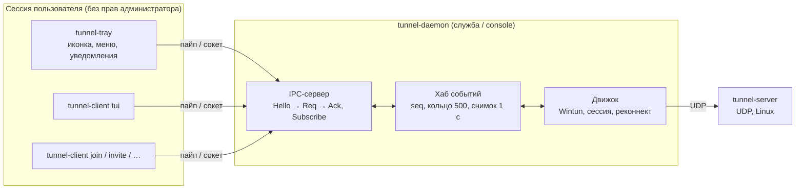

# Демон, служба и трей

Демон `tunnel-daemon` — единственный процесс, который владеет туннелем: поднимает
движок (Wintun-адаптер, соединение с сервером, реконнект, автовход в группы) и
отдаёт его состояние фронтендам по локальному IPC. Фронтенды — TUI
(`tunnel-client tui`), CLI (`tunnel-client join …`) и трей (`tunnel-tray`) —
подключаются к демону и не держат туннель сами. Поэтому туннель не падает при
закрытии окна TUI, а сами фронтенды работают без прав администратора. Если демона
нет, `tunnel-client tui` поднимает собственный движок (embedded-режим).

В этом документе: зачем нужен демон, режимы запуска, где лежат данные и логи,
возможности трея, правила single-instance, поведение TUI и CLI без демона,
детали Windows-службы, использование на Linux и macOS и решение типичных проблем.

Связанные документы: [INSTALL.md](INSTALL.md) (пошаговая установка),
[PROTOCOL.md](PROTOCOL.md) (протокол туннеля v3), [SERVER.md](SERVER.md)
(сервер), [PLAN.md](PLAN.md) (этап 7 — проектные решения), [TESTING.md](TESTING.md).

## Содержание

- [Статус реализации](#статус-реализации)
- [Зачем нужен демон](#зачем-нужен-демон)
- [Архитектура](#архитектура)
- [Режимы `tunnel-daemon`](#режимы-tunnel-daemon)
- [Данные и логи](#данные-и-логи)
- [Трей](#трей)
- [Single-instance и работа без демона](#single-instance-и-работа-без-демона)
- [Windows-служба](#windows-служба)
- [Linux и macOS: разработка через Unix-сокет](#linux-и-macos-разработка-через-unix-сокет)
- [IPC-протокол в двух словах](#ipc-протокол-в-двух-словах)
- [Устранение неполадок](#устранение-неполадок)

## Статус реализации

| Часть | Статус |
|---|---|
| Ядро демона: замок, лог с ротацией, хаб событий, IPC-сервер (`crates/daemon`, `crates/ipc`) | реализовано |
| `console`: настоящий движок по `client.json` каталога данных (`engine_backend`), а также `--fake` | реализовано |
| Служба Windows: `service`, `install`, `uninstall` (`crates/winsvc`, обёртка SCM, установка, ACL) | реализовано: `service` и `console` запускают настоящий движок (`DaemonEngine`); данные службы — `%ProgramData%\tunnel`, `wintun.dll` только рядом с exe; без настроенного сервера демон отвечает по IPC и ждёт `AddServer`, после пробуждения — немедленное переподключение |
| Трей: модель, IPC-бэкенд (`remote.rs`), Win32-оболочка (`crates/tray`) | реализовано; трей собирается только под Windows |
| TUI и CLI поверх IPC (тонкий режим, `tui --remote` / `--embedded`, `crates/client/src/{api,remote,remote_cli}.rs`) | реализовано (этап 7.4) |

Для деталей сверяйтесь с `tunnel-daemon help` и `tunnel-client help`.

## Зачем нужен демон

Без демона туннель живёт внутри процесса TUI или `run`. Из этого следуют три
проблемы:

1. **Закрыли окно — упал туннель.** Группы, пинги и игра в LAN пропадают вместе
   с процессом.
2. **TUI нужны права администратора.** Wintun создаёт адаптер и требует
   элевации, поэтому интерфейс запускался «от администратора» целиком.
3. **Конфликт сессий.** Сервер при новом HELLO снимает старую сессию того же
   ключа. Если CLI-команда поднимет второй движок с той же identity, она
   вытеснит работающий туннель.

Демон решает это разделением ролей:

- **Один привилегированный владелец туннеля** — `tunnel-daemon` (на Windows —
  служба LocalSystem). Он держит адаптер, сессию с сервером и реконнект.
- **Сколько угодно непривилегированных фронтендов** — TUI, CLI, трей. Они
  подключаются по IPC, читают снимок состояния и шлют команды. Закрытие любого из
  них не влияет на туннель.
- **Источник истины — демон.** Фронтенды не хранят состояние сверх своего
  (выбранная строка, тосты, тема интерфейса); группы, друзья, приглашения и
  статус связи берутся из снимков демона.

## Архитектура



Внутри демона:

- **Движок** (модуль `engine` крейта `tunnel-client`, подключается как библиотека) — протокол v3, адаптер, реконнект. Демон знает о
  нём только через трейт `Backend` (JSON-снимки, события, команды).
- **Хаб** (`crates/daemon/src/hub.rs`) — присваивает каждому событию монотонный
  `seq`, хранит последние 500 событий и раз в секунду (и сразу после изменений)
  рассылает снимок. Очередь на подписчика ограничена 256 сообщениями. Медленный
  клиент не тормозит ни движок, ни остальных: при переполнении он получает
  пропуск в `seq` и ждёт свежий снимок.
- **IPC-сервер** (`crates/daemon/src/server.rs`) — поток на соединение. Новый
  фронтенд сразу получает историю из кольца и текущий снимок.

## Режимы `tunnel-daemon`

```text
tunnel-daemon console [--debug] [--fake] [--data-dir <каталог>]
tunnel-daemon service [--data-dir <каталог>]
tunnel-daemon install
tunnel-daemon uninstall [--purge]
```

| Команда | Что делает | Где используется |
|---|---|---|
| `console` | Запускает демон в консоли с настоящим движком по `<каталог>/client.json` (нужны права администратора/root на TUN): лог и в консоль, и в файл. Останавливается по Ctrl+C или SIGTERM; при ошибке запуска движка выходит с ошибкой | разработка, отладка движка и хаба, Linux/macOS |
| `console --debug` | То же, с подробным логом (уровень `DEBUG`) | диагностика |
| `console --fake` | Бэкенд в памяти без движка и сети: три публичные группы («группа-1…3»), команды `Join`, `Leave`, `Create` работают локально | разработка фронтендов без сервера |
| `console --data-dir <каталог>` | Каталог данных вместо значения по умолчанию | несколько демонов на одной машине для тестов |
| `service` | Точка входа службы Windows. Запускает SCM, руками не вызывать | только служба |
| `install` | Устанавливает и запускает службу (от администратора) | только Windows |
| `uninstall [--purge]` | Удаляет службу. `--purge` дополнительно удаляет данные: identity, конфиг, логи | только Windows |

На не-Windows `service`, `install` и `uninstall` завершаются ошибкой «только Windows».

Пример разработки на Unix:

```bash
# терминал 1: демон с фейковым бэкендом
tunnel-daemon console --fake --debug

# терминал 2: TUI подключается к <данные>/daemon.sock как тонкий клиент
tunnel-client tui --remote
# или CLI-команда: уходит демону по IPC
tunnel-client groups
```

Остановка `console`: Ctrl+C. Демон сообщает фронтендам `Shutdown` с причиной
«демон остановлен», пишет в лог «демон остановлен» и освобождает замок.

## Данные и логи

### Каталоги данных

| Платформа | Каталог данных демона | Комментарий |
|---|---|---|
| Windows (служба) | `%ProgramData%\tunnel` | identity принадлежит машине, а не пользователю; у LocalSystem нет нормального `%APPDATA%` |
| Linux / macOS | `~/.tunnel-client` | тот же каталог, что у клиента, чтобы фронтенды нашли сокет |
| Любая ОС, `--data-dir` | указанный каталог | для тестов и нескольких демонов |

Содержимое каталога данных (основное):

| Файл или каталог | Назначение |
|---|---|
| `client.json` | конфиг: identity (ключи), серверы, друзья, группы, автовход. Секреты ключей по IPC не передаются |
| `daemon.lock` | файл замка single-instance на Unix; в нём записан PID. Открывается без перехода по символической ссылке и только как обычный файл без других жёстких ссылок |
| `daemon.sock` | Unix-сокет IPC (права `0600`) |
| `owner.sid` | SID установившего пользователя; нужен для ACL named pipe (только Windows) |
| `logs/` | логи демона |

Права каталога данных: на Unix демон создаёт его с правами `0700` — в самом
начале, до замка и до записи `client.json`. Если каталог принадлежит нашему
пользователю, но открыт для других, демон исправляет права на `0700`. Чужой
каталог демон не трогает, но замок в чужом каталоге, доступном на запись
группе или всем, не берётся.

На Windows DACL каталога `%ProgramData%\tunnel` даёт полный доступ только
SYSTEM и Administrators; наследование от `%ProgramData%` отключено. `console`
на Windows создаёт каталог данных с тем же DACL, а существующий каталог без
такой защиты (владелец не SYSTEM/Administrators или запись для обычных
пользователей) отказывается использовать: выполните `tunnel-daemon install`,
удалите каталог или укажите другой через `--data-dir`. Путь по умолчанию
берётся из known folder `ProgramData`, а не из переменной окружения.

### Логи

- Файл: `<данные>\logs\daemon.log` (Windows — `%ProgramData%\tunnel\logs\daemon.log`,
  Linux/macOS — `~/.tunnel-client/logs/daemon.log`).
- Формат строки: `2026-11-17 12:34:56.789Z INFO  текст`. Время в UTC.
- Уровни: `DEBUG`, `INFO`, `WARN`, `ERROR`. Без `--debug` пишутся `INFO` и выше.
- Ротация: при достижении 1 МиБ файл переименовывается, архивы сдвигаются.
  Хранится до 5 файлов: `daemon.log` (текущий), `daemon.log.1` … `daemon.log.4`
  (чем больше номер, тем старше). Итого не больше примерно 5 МиБ.
- Ошибки записи в лог не останавливают демон: строка просто теряется.
- В режиме `console` строки дублируются в stderr.
- Лог движка (`--debug` движка) пишется туда же, через колбэк, а не через
  `eprintln!`.

Просмотр на Unix:

```bash
tail -f ~/.tunnel-client/logs/daemon.log
```

Просмотр на Windows (PowerShell):

```powershell
Get-Content "$env:ProgramData\tunnel\logs\daemon.log" -Tail 100 -Wait
```

## Трей

`tunnel-tray.exe` — значок в области уведомлений Windows. Это IPC-клиент, а
не отдельный движок: он ничего не настраивает и не держит туннель. Запускается
автоматически при входе пользователя (ключ `HKCU\…\Run`, значение `TunnelTray`).
Режим `tunnel-tray --demo` показывает заглушку без демона; удобно для проверки
меню и уведомлений.

### Цвет иконки

| Цвет | Состояние | Что значит |
|---|---|---|
| зелёный | «подключён» | демон работает, сервер на связи |
| жёлтый | «переподключение…» | демон работает, связь с сервером восстанавливается |
| серый | «нет связи с сервером» или «служба недоступна» | сервер не настроен или недоступен, либо демон не отвечает по IPC |

Подсказка (tooltip) показывает статус связи, мои IP в группах (`10.x.y.z`) и
подпись текущего сервера. Длина ограничена 127 символами UTF-16.

### Меню

| Пункт | Действие | Доступность |
|---|---|---|
| Статус «Tunnel: …» | только информация | всегда |
| Открыть Tunnel | открывает `tunnel-client tui` | всегда |
| Группы | галочка «в группе» — переключатель: войти (`Join`) или выйти (`Leave`) | при живом демоне |
| Приглашения (N) | подменю: **Принять** (`Join`) и **Отклонить** (`DeclineInvite`) для каждого приглашения | при наличии приглашений и связи |
| Скопировать мой IP | копирует свой адрес | при наличии IP |
| Скопировать friend code | копирует мой код `TUN-…` | при наличии кода |
| Остановить туннель | останавливает туннель | только при живом демоне |
| Выход | закрывает только трей; туннель продолжает работать | всегда |

Выход из трея не останавливает демон. Остановка туннеля из трея — отдельный
пункт; права на неё определяются правилами этапа 7.5 (см.
[PLAN.md](PLAN.md)).

### Уведомления

Уведомления Windows (toast) приходят в четырёх случаях:

| Событие | Текст | Когда показывается |
|---|---|---|
| Новое приглашение | «Приглашение в группу» — «`<кто>` приглашает в «`<группа>`»» | только новые приглашения; стартовый список приглашений молча запоминается |
| Исключение или удаление группы | «Группа недоступна» — «Вы больше не в группе «…»» | только по событию демона; свой выход через CLI или TUI не уведомляет |
| Нет связи | «Нет связи» — «Tunnel не на связи больше 30 секунд» | один раз за эпизод, если связь была и пропала дольше 30 секунд; после своей остановки туннеля не показывается |
| Ошибка своего действия | «Tunnel: ошибка» — текст ответа демона | всегда, в любом режиме |

Режим уведомлений для приглашений, исключений и обрывов связи:

- `WhenTuiClosed` (по умолчанию) — молчим, пока открыт TUI: там приглашение и
  так видно в окне;
- `Always` — уведомления всегда.

Ошибки своих действий показываются при любом режиме, потому что в TUI о них
никто не скажет.

Уведомления приглашений и ошибок требуют AppUserModelID (`Tunnel.Tray`) — его
создаёт установщик через ярлык в меню «Пуск».

## Single-instance и работа без демона

В каждый момент движок туннеля может быть запущен только в одном процессе.
Замок берёт любой, кто поднимает движок: демон, `tunnel-client run`
или embedded-режим TUI.

| Платформа | Механизм | Поведение |
|---|---|---|
| Unix | `flock` на `<данные>/daemon.lock` | замок привязан к открытому файлу; падение процесса снимает его само; устаревший сокет `daemon.sock` удаляется только под этим замком |
| Windows | именованный мьютекс `Global\TunnelEngine` | занят, только если владелец существующего мьютекса — SYSTEM, Administrators или текущий пользователь. Создать объект в `Global\` может любой пользователь, поэтому мьютекс постороннего (захват имени) игнорируется. Наш мьютекс даёт всем аутентифицированным `READ_CONTROL`, чтобы владельца мог проверить и CLI без прав администратора |

Второй экземпляр демона на том же каталоге данных сразу завершается с
ошибкой «движок уже запущен (демон, TUI или run)». Единственность самой службы
гарантирует SCM, единственность сервера пайпа — `FILE_FLAG_FIRST_PIPE_INSTANCE`;
мьютекс лишь не даёт службе работать одновременно с embedded TUI, `run` или
`console`. CLI решает, куда идти, сначала по доступности пайпа или сокета
демона и только потом по замку. Проверка замка на Unix берёт общий `flock` на
миг, а запуск движка при занятом замке коротко повторяет попытку, поэтому
проверка из CLI не даёт ложного «занято».

### Фронтенды: тонкий режим и embedded-режим

Поведение (этап 7.4; реализовано в `tunnel-client`):

| Ситуация | TUI | CLI (`join`, `invite`, …) | Трей |
|---|---|---|---|
| Демон работает, пайп или сокет доступен | **тонкий (remote)**: интерфейс читает кэшированный снимок демона, права администратора не нужны; в шапке пометка `демон`; при потере связи — «демон недоступен» и переподключение раз в 1 с | команды уходят демону по IPC | работает |
| Демон не работает, замок свободен | **embedded**: движок внутри TUI; нужны права администратора (Wintun); в шапке пометка `embedded` | короткий сеанс с сервером, как раньше | «служба недоступна» |
| Демон не работает, замок занят (TUI embedded или `run`) | embedded уже запущен в другом процессе — отказ | отказ с сообщением «движок уже запущен без демона … закройте TUI / остановите run или установите службу»; свой HELLO не отправляется, чтобы не вытеснить сессию движка. Исключение — чтение локального конфига: `id`, `servers`, `friends` работают | «служба недоступна» |
| Пайп есть, но HELLO отвергнут (версия IPC не совпадает) | ошибка, **без** тихого перехода на embedded | ошибка | сообщение об ошибке |

Флаги `tunnel-client tui --embedded` и `tunnel-client tui --remote` принудительно
выбирают режим (`--remote` без демона — ошибка «демон не запущен»; флаги
взаимоисключающие и только для `tui`). Замок single-instance (`daemon.lock` /
`Global\TunnelEngine`, крейт `tunnel-ipc`) общий для демона, embedded TUI и `run`. Ошибки «пайп есть, но HELLO не прошёл» не маскируются
фолбэком: два движка с одной identity выбивают друг друга с сервера.

Команды, меняющие конфиг (`set-name`, `set-status`, `add-server`, `del-server`,
`add-friend`, `del-friend`, `alias`, `invisible`), при работающем демоне не пишут `client.json`
напрямую: демон сам перезаписывает конфиг, и правка из пользовательского
`%APPDATA%` до него бы не дошла. Такие команды отправляются демону как команды
движка. Настройки самого движка — `set-transport`, `set-mtu`, `dns` и
`import-identity` — при работающем демоне отказывают («недоступно … остановите
демон и повторите»): IPC-команд для них нет. `run` при демоне тоже отказывает.
`export-identity` локальная, но при работающем демоне сверяет identity: если
у демона она другая (служба Windows хранит свою в `%ProgramData%\tunnel`, а не в
`%APPDATA%`), команда отказывает и называет friend code демона — тот же, что
показывает `id`.
Тема TUI в тонком режиме хранится не в `client.json` (он принадлежит демону), а в
локальном `ui.json`.

### Что видно на Windows в режиме `console`

`tunnel-daemon console` на Windows не создаёт named pipe: пайп поднимает только
служба, потому что SID владельца для его ACL есть только после `install`. Значит,
TUI и CLI не подключатся к консольному демону на Windows: `tui` поднимется в
embedded-режиме (или получит отказ, если замок занят). Для проверки движка на
Windows используйте `console`, для работы фронтендов — службу.

## Windows-служба

### Параметры службы

| Параметр | Значение |
|---|---|
| Имя службы | `TunnelDaemon` |
| Отображаемое имя | «Tunnel daemon» |
| Исполняемый файл | `%ProgramFiles%\Tunnel\tunnel-daemon.exe service` |
| Учётная запись | LocalSystem |
| Запуск | автоматически, до входа пользователя в систему |
| Восстановление после сбоя | перезапуск через 5 с, затем через 10 с, затем через 30 с; счётчик сбоев обнуляется после 24 часов без сбоев |
| Описание | «Владелец туннеля Tunnel: Wintun-адаптер, соединение с сервером, IPC для трея и TUI» |

Учётная запись LocalSystem нужна, чтобы создавать Wintun-адаптер и держать
туннель без входа пользователя. Идентичность хранится в
`%ProgramData%\tunnel`, а не в профиле пользователя.

### Установка

`install` устанавливает службу, создаёт каталог данных и ярлык, а также
импортирует конфиг установившего пользователя (identity и друзья переезжают;
friend code не меняется):

- создаёт `%ProgramData%\tunnel` с DACL `O:BAD:PAI(A;OICI;FA;;;SY)(A;OICI;FA;;;BA)`
  (полный доступ SYSTEM и Administrators);
- копирует `%APPDATA%\tunnel\client.json` пользователя в
  `%ProgramData%\tunnel\client.json`;
- записывает SID установившего пользователя в `owner.sid`;
- регистрирует автозапуск трея (`HKCU\…\Run`, значение `TunnelTray`) и
  создаёт ярлык с AUMID `Tunnel.Tray`.

Если каталог данных уже существует, установка проверяет, что его владелец —
SYSTEM или Administrators. Каталог, созданный обычным пользователем заранее,
не принимается: иначе тот мог бы подменить `owner.sid` или конфиг.

### Пайп и доступ к нему

Пайп: `\\.\pipe\tunnel-daemon` (`DEFAULT_PIPE_NAME`).

Дескриптор безопасности (SDDL) пайпа:

```text
O:SYD:P(A;;GA;;;SY)(A;;GA;;;BA)(A;;0x12019b;;;<SID владельца из owner.sid>)
```

- SYSTEM и Administrators — полный доступ;
- объект пайпа принадлежит SYSTEM (`O:SY`);
- владелец-пользователь (SID из `owner.sid`) — чтение и запись (`0x12019b`), но без права создавать экземпляры пайпа;
- остальные пользователи доступа не имеют;
- удалённые клиенты отклоняются флагом `PIPE_REJECT_REMOTE_CLIENTS`;
- первый экземпляр пайпа создаётся с `FILE_FLAG_FIRST_PIPE_INSTANCE`: если
  пайп с таким именем уже есть (например, его подменил другой процесс), служба
  не стартует на нём.

Клиент (TUI, CLI, трей) перед работой проверяет, что сервер пайпа запущен от
SYSTEM. Так непривилегированный процесс, который успел занять имя пайпа до
старта службы, не получит данные.

### Обновление

Запустите `install.ps1` новой версии поверх установленной: служба останавливается,
exe заменяются, служба стартует снова. Фронтенды переподключаются сами. Если
версия протокола IPC изменилась, фронтенд покажет «несовместимая версия IPC»:
обновите остальные компоненты.

### Удаление

`uninstall` останавливает службу и удаляет её, удаляет адаптер Wintun, запись
автозапуска трея и ярлык. Конфиг в `%ProgramData%\tunnel` сохраняется, если не
указан `--purge`:

```powershell
tunnel-daemon uninstall          # служба и адаптер; конфиг остаётся
tunnel-daemon uninstall --purge  # ещё и %ProgramData%\tunnel: identity и друзья пропадут
```

Удаление с `--purge` необратимо: identity и friend code пропадают, восстановить
их нельзя, даже с той же машиной.

### DLL Wintun

Служба загружает `wintun.dll` только из каталога, где лежит её exe
(`%ProgramFiles%\Tunnel`). Пользовательский каталог и системный поиск
(`PATH`, `System32`) для службы не используются, иначе подменённая DLL
выполнилась бы с правами SYSTEM. Если `wintun.dll` рядом с exe нет, служба
не поднимает туннель.

Каталог exe, сам exe и `wintun.dll` должны быть доступны на запись только
SYSTEM, Administrators и TrustedInstaller (и принадлежать им), а каталоги выше
— не давать обычным пользователям переименовать или удалить потомка.
`tunnel-daemon install` иначе отказывает с подсказкой; служба при старте
проверяет то же и не загружает DLL. `infrastructure/windows/install.ps1`
копирует файлы в `%ProgramFiles%\Tunnel` и выставляет каталогу явные права
(SYSTEM и Administrators — полный доступ, Users — чтение, владелец —
Administrators). `console` тоже берёт `wintun.dll` только рядом со своим exe;
поле `dll` из `client.json` демон не читает.

## Linux и macOS: разработка через Unix-сокет

На Unix службы нет: демон запускается как `tunnel-daemon console`, а фронтенды
подключаются к Unix-сокету `<данные>/daemon.sock`, по умолчанию
`~/.tunnel-client/daemon.sock`. Это нужно для разработки и тестов, а не для
продакшена. Без `--fake` `console` поднимает настоящий движок (TUN Linux/macOS,
нужен root) тем же путём, что `tunnel-client run` (`engine::start`): один адрес
адаптера (маска /16) и маршрут `100.66.0.0/16`, DNS для `.vl` (на macOS —
`/etc/resolver/vl` и host-маршрут `100.66.0.53` в utun), интерфейс Linux по умолчанию — `voidlink0`.

```bash
# Демон с фейковым бэкендом, без сервера и без root
tunnel-daemon console --fake --debug

# Демон с настоящим движком (root; client.json в каталоге данных)
sudo tunnel-daemon console --data-dir <каталог>
```

Трей (`tunnel-tray`) есть только на Windows; `tunnel-tray --demo` показывает
заглушку без демона.

Сокет создаёт демон с правами `0600` в каталоге `0700`. Устаревший сокет после
падения демона удаляется при следующем старте, но только под замком
(`daemon.lock`). Второй демон на том же каталоге данных не стартует.

Интеграционный тест IPC (`crates/daemon/tests/ipc_e2e.rs`) использует тот же
Unix-сокет и заглушку вместо TUN-устройства, без root.

## IPC-протокол в двух словах

Фрейм: `u32` длина (little-endian) и JSON. Лимит фрейма 1 МиБ; битый JSON или
превышение лимита закрывают только это соединение, демон продолжает работать.

Порядок на соединении:

1. Фронтенд шлёт `Hello{proto, kind, ver}`; `kind` — `tui`, `tray` или `cli`.
2. Демон отвечает `Welcome{proto, daemon_ver, me}` или `Reject{reason}` и
   закрывает соединение. Несовпадение `proto` — `Reject` с текстом «обновите
   tunnel-client / демон».
3. Фронтенд шлёт `Subscribe{snapshots_ms}` и получает `Snapshot` и `Event`
   с `seq`.
4. Команды движка идут в `Req{id, cmd}`; демон отвечает `Ack{id, Ok | Err}`.
   `Ack` означает «принято или отклонено демоном» (неверный gid, нет сервера),
   а результат выполнения приходит событием (`GroupJoined`, `Error`).
5. Фронтенд отправляет `Bye` или просто закрывает соединение.

Таймауты: `Hello` ждётся 10 секунд (только на Unix); запись, застрявшая дольше
30 секунд (Unix), рвёт соединение. При остановке демон шлёт `Shutdown{reason}`
всем клиентам и даёт им до 500 мс на доставку.

Подробности версий и сообщений — в коде `crates/ipc/src/proto.rs`.

## Устранение неполадок

| Симптом | Причина | Что делать |
|---|---|---|
| Трей серый, «служба недоступна» | служба не запущена или пайп недоступен | Windows: `sc query TunnelDaemon`; при `STOPPED` — `sc start TunnelDaemon`. Проверьте `daemon.log` |
| Трей серый, «нет связи с сервером» | демон работает, сервер не настроен или недоступен | `tunnel-client servers`; `tunnel-client add-server …` или проверьте адрес сервера и сетевой доступ к UDP |
| Трей жёлтый долго | идёт реконнект к серверу | подождите; если не проходит — смотрите `daemon.log` на `WARN` и `ERROR` |
| TUI пишет «движок уже запущен» | занят замок: работает embedded TUI, `run` или другой демон | закройте другой TUI или `run`; либо остановите демон, если он запущен отдельно |
| CLI отказывает с сообщением про TUI / run | демона нет, замок занят embedded-процессом | закройте TUI / остановите `run` или установите службу |
| «несовместимая версия IPC» | фронтенд и демон собраны из разных версий протокола | обновите все три exe (демон, клиент, трей) одной сборкой |
| `install`: «каталог … небезопасен для службы» | exe лежит в каталоге, куда может писать обычный пользователь (Загрузки, рабочий стол, распакованный архив) | установите через `infrastructure\windows\install.ps1` или скопируйте файлы в `%ProgramFiles%\Tunnel` и запустите `install` оттуда |
| Служба не стартует или не поднимает туннель | не найден `wintun.dll` рядом с exe, права каталога установки небезопасны (см. `daemon.log`), либо каталог данных недоступен | проверьте `%ProgramFiles%\Tunnel\wintun.dll`, права `%ProgramFiles%\Tunnel` (перезапустите `install.ps1`) и `%ProgramData%\tunnel` |
| `console` на Windows: «каталог данных … не защищён» | `%ProgramData%\tunnel` создан без ACL службы (например, старым `console`) | `tunnel-daemon install`, удалите каталог или укажите `--data-dir` |
| Служба стартовала, но TUI не подключается | пайп занят или SID владельца в `owner.sid` не тот | переустановите службу (`install` поверх) |
| Приглашения не приходят в уведомления | открыт TUI, а режим по умолчанию `WhenTuiClosed` молчит при открытом TUI | закройте TUI; приглашение видно и в окне TUI |
| Нет уведомлений о приглашениях вообще | не создан ярлык с AUMID | переустановите службу или создайте ярлык `Tunnel` в меню «Пуск» |
| На Unix «Address already in use» при старте сокета | предыдущий демон не завершился | убедитесь, что процесс `tunnel-daemon` не запущен: `pgrep -l tunnel-daemon`; сокет удалится сам при следующем старте |
| `daemon.log` не растёт | демон остановлен или лог открыт в другом месте | проверьте `--data-dir` и путь из первой строки лога |

Где смотреть первым делом:

1. `daemon.log` — текущий и архивные файлы; в нём время старта, причины
   отказов IPC, ошибки движка и `Shutdown`.
2. `tunnel-client id` и `tunnel-client servers` — что видит клиент в своём
   конфиге.
3. Для Unix — `ls -l ~/.tunnel-client/` (права каталога `0700`, сокет `0600`).

Если проблема не решается по этой таблице, приложите фрагмент `daemon.log`
(без ключей и без адресов, которые вы не хотите раскрывать) к обращению.
