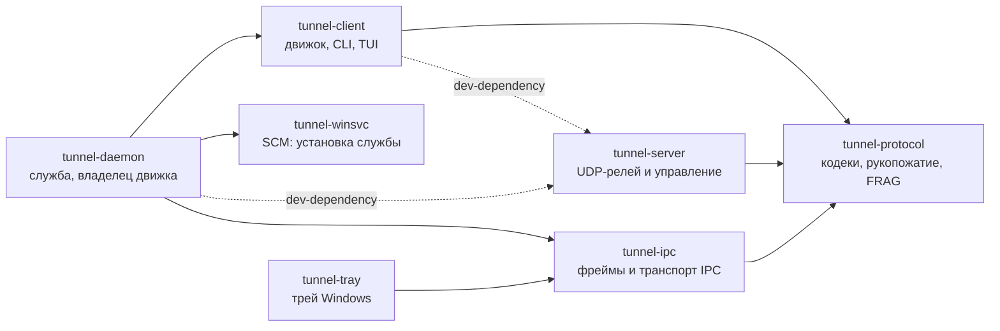

# Разработка VoidLink

Документ для тех, кто собирает, запускает и меняет VoidLink: настройка окружения,
устройство workspace, сборка и тесты по крейтам, локальный запуск сервера и
клиентов, кросс-проверка Windows-кода с macOS и Linux, политика fmt/clippy, CI,
добавление сообщения протокола и выпуск релиза. Что проверять перед релизом —
в [docs/TESTING.md](TESTING.md); как ставить готовый билд — в
[docs/INSTALL.md](INSTALL.md); формат проводного протокола — в
[docs/PROTOCOL.md](PROTOCOL.md).

## Содержание

1. [Окружение](#1-окружение)
2. [Структура workspace](#2-структура-workspace)
3. [Сборка](#3-сборка)
4. [Локальный запуск](#4-локальный-запуск)
5. [Тесты](#5-тесты)
6. [Кросс-проверка Windows-кода](#6-кросс-проверка-windows-кода)
7. [Политика fmt и clippy](#7-политика-fmt-и-clippy)
8. [CI](#8-ci)
9. [Зависимости: cargo-deny и cargo-audit](#9-зависимости-cargo-deny-и-cargo-audit)
10. [Стиль кода](#10-стиль-кода)
11. [Как добавить сообщение протокола](#11-как-добавить-сообщение-протокола)
12. [Выпуск релиза](#12-выпуск-релиза)

---

## 1. Окружение

| Что нужно | Зачем |
|-----------|-------|
| Rust **stable** (не ниже 1.88) | Workspace на **edition 2024**; используются let-цепочки (`if let … && let …`) |
| `rustup` с компонентами `rustfmt`, `clippy` | Форматирование и линт, как в CI |
| Windows (MSVC) | Сборка и запуск трея, службы и Wintun-драйвера; клиент и демон с реальным туннелем |
| Linux или macOS | Сервер, протокол, IPC, демон, клиент (TUN через `tun_linux.rs` / `tun_macos.rs`) |
| `cargo-deny`, `cargo-audit` | Опционально, локальная проверка зависимостей (см. [раздел 9](#9-зависимости-cargo-deny-и-cargo-audit)) |

Установка тулчейна:

```bash
rustup toolchain install stable
rustup component add rustfmt clippy
rustc --version    # должно быть 1.88 или новее
```

Что собирается на каком хосте:

| Крейт | Linux / macOS | Windows |
|-------|:-------------:|:-------:|
| `tunnel-protocol` | да | да |
| `tunnel-server` | да | да |
| `tunnel-ipc` | да (Unix-сокет) | да (именованный пайп) |
| `tunnel-client` | да (TUN: `tun_linux.rs`, `tun_macos.rs`) | да (Wintun) |
| `tunnel-daemon` | да (Unix-сокет, `--fake`, реальный движок) | да (служба) |
| `tunnel-tray` | нет | да |
| `tunnel-winsvc` | нет (только Windows-код) | да |

`wintun` и `windows-sys` подключены в `tunnel-client` только под `cfg(windows)`, на Unix
используется `libc`. Реальный TUN на Linux и macOS требует root (или `CAP_NET_ADMIN` на Linux);
e2e-тесты движка подставляют заглушку вместо адаптера и прав не требуют.

---

## 2. Структура workspace

Корневой `Cargo.toml` — `resolver = "2"` и семь участников. Общие версии
зависимостей вынесены в `[workspace.dependencies]` (`anyhow`, `blake3`,
`chacha20poly1305`, `crossterm`, `rand`, `ratatui`, `serde`, `serde_json`, `wintun`);
крейты подключают их через `dep.workspace = true`.



Пунктир — зависимость только для тестов: e2e-тесты движка поднимают настоящий
сервер в том же процессе. Демон владеет движком из `tunnel-client` через `EngineBackend`.

| Крейт | Путь | Роль | Версия |
|-------|------|------|--------|
| `tunnel-protocol` | `crates/protocol` | Проводной формат v4: заголовок, рукопожатие, ctrl-фреймы, FRAG, окно повторов, кодеки payload | 0.2.0 |
| `tunnel-server` | `crates/server` | Сервер: UDP-релей, группы, выдача IP, лимиты, персистентность `server.json`, TCP-фолбэк (`tcp.rs`) | 0.2.0 |
| `tunnel-client` | `crates/client` | Библиотека (`lib.rs`: движок `engine.rs`, хранилище `store.rs`, DNS `dns.rs`, IPv6 `ipv6.rs`, TCP-канал `tcp_link.rs`, TUN `tun.rs` / `tun_linux.rs` / `tun_macos.rs`, TUI `tui/`) и CLI (`main.rs`) | 0.2.0 |
| `tunnel-ipc` | `crates/ipc` | Протокол локального IPC между демоном и фронтендами: сообщения (`proto.rs`), кодек (`codec.rs`), клиент (`client.rs`), транспорт (пайп на Windows, Unix-сокет на Unix) | 0.1.0 |
| `tunnel-daemon` | `crates/daemon` | Демон: замок (`lock.rs`), лог (`log.rs`), хаб подписчиков (`hub.rs`), IPC-сервер (`server.rs`), `EngineBackend` (`engine_backend.rs`) и `FakeBackend` для разработки, режимы в `cli.rs` | 0.2.0 |
| `tunnel-winsvc` | `crates/winsvc` | Установка, запуск и удаление службы Windows (SCM) | 0.2.0 |
| `tunnel-tray` | `crates/tray` | Иконка в трее Windows, меню, уведомления | 0.2.0 |

Вспомогательные каталоги:

| Путь | Содержимое |
|------|-----------|
| `docs/` | Документация (этот файл, протокол, сервер, установка, тесты, план) |
| `infrastructure/linux/` | `install-server.sh`, юнит `tunnel-server.service` |
| `infrastructure/windows/` | `install.ps1`, `uninstall.ps1` |
| `infrastructure/netns/nat-lab.sh` | Лаборатория NAT на сетевых пространствах имён Linux |
| `infrastructure/scripts/` | Вспомогательные скрипты для лаборатории и ожидания хостов |
| `vendor/wintun/` | Подписанный `wintun.dll`. Сборка клиента копирует его рядом с exe |
| `.github/workflows/ci.yml` | Единственный workflow CI |

---

## 3. Сборка

Все команды выполняются из корня репозитория.

```bash
cargo build --workspace                  # отладочная сборка (на Windows — весь workspace)
cargo build --release --workspace        # релиз, как в CI
```

Сборка по крейтам:

| Команда | Где работает |
|---------|--------------|
| `cargo build -p tunnel-protocol` | везде |
| `cargo build --release -p tunnel-server` | Linux, macOS, Windows |
| `cargo build -p tunnel-ipc` | везде |
| `cargo build --release -p tunnel-client` | Linux, macOS, Windows |
| `cargo build -p tunnel-daemon` | Linux, macOS (`--fake` и реальный движок), Windows (служба) |
| `cargo build --release -p tunnel-tray` | только Windows |
| `cargo build -p tunnel-winsvc` | только Windows |

Статический сервер для VPS (кросс-сборка с macOS или Windows) описан в
[docs/SERVER.md](SERVER.md#сборка-под-linux):

```bash
cargo zigbuild --release -p tunnel-server --target x86_64-unknown-linux-musl
```

Про `wintun.dll`: файл лежит в `vendor/wintun/`, а `crates/client/build.rs`
копирует его в каталог профиля (`target/<profile>/wintun.dll`), чтобы клиент
находил драйвер без ручных шагов. Если DLL не найдена, сборка не падает: скрипт
просто пропускает копирование.

---

## 4. Локальный запуск

### 4.1. Сервер

На Linux или macOS сервер можно поднять прямо из `target/`:

```bash
cargo run -p tunnel-server -- 127.0.0.1:5555 --data ./tunnel-data
```

| Флаг | По умолчанию | Смысл |
|------|--------------|-------|
| `[адрес]` | `0.0.0.0:5555` | адрес прослушивания (UDP, и TCP на том же порту) |
| `--data <dir>` | `tunnel-data` | каталог состояния (`server.json`) |
| `--workers N` | `0` (по ядрам, не больше 8) | число потоков-воркеров |
| `-q`, `--quiet` | — | не печатать события и сводку |
| `--tcp` / `--no-tcp` | включён | TCP-фолбэк |
| `--metrics <addr>` | выключены | HTTP `/metrics` и `/healthz` |
| `--relay-rate` / `--relay-burst`, `--ctrl-rate` / `--ctrl-burst`, `--hello-rate` / `--hello-burst`, `--plain-rate` / `--plain-burst`, `--join-rate` / `--join-burst` | 4000/8000, 50/100, 5/20, 2000/4000, 1/10 | лимиты (`Limits` в `crates/server/src/lib.rs`) |
| `--session-timeout <сек>` | 30 | сессия без пакетов считается офлайн |
| `--max-owned-groups`, `--invite-ttl-days`, `--max-invites-per-group`, `--max-bans-per-group`, `--max-invites-per-target` | 16, 7, 256, 1024, 64 | лимиты групп и приглашений |

Отдельная подкоманда `tunnel-server rotate-key [--data <dir>]` меняет ключ сервера. Полный
список флагов и инструкции для VPS — в [docs/SERVER.md](SERVER.md). В e2e-тестах лимиты меняют
через `Config::limits` (функция `start_server_with`).

### 4.2. Демон без движка (`--fake`)

Чтобы отлаживать IPC и фронтенды без Wintun и прав администратора, демон
запускается в режиме `--fake` (бэкенд в памяти, см. `FakeBackend` в
`crates/daemon/src/fake.rs`):

```bash
cargo run -p tunnel-daemon -- console --fake --debug --data-dir /tmp/vl-a
```

На Unix фронтенды подключаются к `<data-dir>/daemon.sock`. Для второго экземпляра
берите другой `--data-dir`: одновременный запуск двух демонов на один каталог
отвергается замком (`flock`).

### 4.3. Клиент

Клиент с реальным туннелем требует прав: администратор на Windows (Wintun), root или
`CAP_NET_ADMIN` на Linux, `sudo` на macOS. Типичный сценарий из командной строки:

```powershell
tunnel-client.exe --dir C:\vl-a add-server 127.0.0.1:5555 <код-сервера> local
tunnel-client.exe --dir C:\vl-a set-name alice
tunnel-client.exe --dir C:\vl-a create "тестовая группа"
tunnel-client.exe --dir C:\vl-a run
```

Глобальные флаги `--dir`, `--profile <имя>`, `--debug`, `--server <N|addr|label>`, `--adapter`,
`--dll` (только Windows) перечислены в выводе `tunnel-client help`. Для второго клиента на той же машине
используйте другой `--dir` и другой адаптер (`--adapter`).

Пути хранилища: каталог из `--dir` содержит `client.json` с полями `Config`
(`crates/client/src/store.rs`): `identity`, `name`, `status`, `servers`, `friends`,
`autojoin`, `theme`, `lan_discovery`, `mtu`, `invisible`, `active_server`,
`autojoin_by_server`, `dns`, `transport`, `adapter`, `dll`. Ключи identity лежат в этом же файле в виде hex-строк
(`StoredIdentity`).

---

## 5. Тесты

### 5.1. Что где проверяется

| Крейт | Тесты | Где запускаются |
|-------|-------|-----------------|
| `tunnel-protocol` | юнит-тесты кодеков, рукопожатия, `ReplayWindow`, FRAG; фаззинг-подобный тест `fuzz_tests.rs` (мутации и мусор, декодеры не паникуют) | Linux, macOS, Windows |
| `tunnel-server` | юнит-тесты состояния групп, лимитов, персистентности; `tests/sigterm.rs` — корректная остановка по сигналу (Unix) | Linux, macOS, Windows |
| `tunnel-ipc` | `tests/unix_socket.rs` — транспорт поверх Unix-сокета | Linux, macOS |
| `tunnel-daemon` | `tests/ipc_e2e.rs` — демон с `FakeBackend` на настоящем Unix-сокете; `tests/engine_e2e.rs` — демон с настоящим движком; модуль `cli.rs` | Linux, macOS |
| `tunnel-client` | `src/engine_e2e.rs` — e2e-тесты движка: настоящий сервер и движки на loopback, TUN заменён заглушкой; юнит-тесты CLI, TUI, DNS, IPv6 | везде (в CI — ubuntu, macOS, Windows) |

Сводка по командам:

```bash
# протокол и сервер — везде
cargo test -p tunnel-protocol
cargo test -p tunnel-server

# IPC и демон — Linux и macOS (ipc_e2e помечен #![cfg(unix)])
cargo test -p tunnel-ipc
cargo test -p tunnel-daemon

# клиент и движок
cargo test -p tunnel-client
cargo test -p tunnel-client engine_e2e          # только e2e-тесты движка

# один тест по имени, с выводом
cargo test -p tunnel-daemon --test ipc_e2e -- --nocapture <имя_теста>
```

Весь workspace на Linux, как в CI (клиент там исключён, см. раздел 8):

```bash
cargo test --workspace --exclude tunnel-client --exclude tunnel-tray --exclude tunnel-winsvc
```

### 5.2. e2e-тесты движка (`engine_e2e.rs`)

Тесты поднимают сервер (`start_server`, `start_server_with`) и несколько узлов
`Node` в одном процессе. Каждый узел получает `TunDev`-заглушку вместо настоящего
адаптера, поэтому права администратора не нужны, но рукопожатие, группы,
ротация ключей и передача данных проходят настоящим кодом. Вспомогательные
функции: `deliver` (проверка доставки пакета между узлами), `wait_until` и
`Node::wait` (ожидание события с таймаутом, а не `sleep`), `LossyProxy` (прокси,
теряющий датаграммы по правилу `DropRule`).

Пишите новые сценарии в этом же стиле: через `wait`, а не `sleep`, и с
конкретным сообщением в таймауте, чтобы упавший тест было понятно читать.

### 5.3. e2e-тесты демона (`ipc_e2e.rs`)

Демон целиком (замок, лог, хаб, IPC-сервер) на `FakeBackend`. Тесты проверяют
сценарии IPC: Join и снимок у двух клиентов, отключение клиента не трогает
движок, медленный подписчик не тормозит демон, чужая версия протокола даёт
`Reject`, мусор и огромная длина дают разрыв соединения без падения демона.
Каталог данных создаётся функцией `data_dir()` в короткой временной папке:
на macOS лимит пути Unix-сокета около 104 байт.

### 5.4. Фаззинг и повторы

`crates/protocol/src/fuzz_tests.rs` — детерминированный прогон мутаций на каждом
`cargo test`. Длинный фаззинг запускается вручную и вне CI (см.
[docs/TESTING.md, раздел 2.7](TESTING.md)).

### 5.5. Лаборатория NAT и ручные проверки

`infrastructure/netns/nat-lab.sh` — сценарии NAT на Linux под root; запускается
отдельно от `cargo test`. Ручные чек-листы (Windows, служба, трей, сон и
пробуждение) — в [docs/TESTING.md](TESTING.md).

---

## 6. Кросс-проверка Windows-кода

Windows-код (`wintun`, `windows-sys`, `tray-icon`, `windows-service`) можно
проверить на macOS и Linux без линковки. Нужна цель `x86_64-pc-windows-msvc`:

```bash
rustup target add x86_64-pc-windows-msvc
cargo check --workspace --target x86_64-pc-windows-msvc --all-targets
cargo clippy --workspace --target x86_64-pc-windows-msvc --all-targets -- -D warnings
```

`cargo check` не линкует, поэтому системных библиотек Windows не требуется.
Ошибки «не найден ml64.exe» при сборке `blake3` выглядят так: `blake3` по
умолчанию собирает ассемблерные ядра, которым нужен MSVC-ассемблер. Чтобы
обойтись чистой Rust-реализацией, выставьте переменную окружения:

```bash
CARGO_FEATURE_PURE=1 cargo check --workspace --target x86_64-pc-windows-msvc --all-targets
```

Для кросс-проверки задайте отдельный `CARGO_TARGET_DIR`, чтобы не смешивать артефакты с
нативной сборкой. Переменную `CARGO_FEATURE_PURE` стоит ставить только для кросс-проверок:
нативная сборка на Windows использует стандартный путь `blake3`.

Итоговая проверка перед пушем Windows-правок — всё равно `windows` job в CI
(полная сборка и тесты на `windows-latest`).

---

## 7. Политика fmt и clippy

**rustfmt.** Команда: `cargo fmt --all`. Проверка: `cargo fmt --all -- --check`.
Сейчас job `fmt` в CI помечен `continue-on-error: true`: существующий код ещё не
прогнан через форматтер одним коммитом, и проверка информационная. После такого
коммита флаг снимается, и проверка становится блокирующей. Форматируйте свои
изменения сразу, даже пока job информационный.

**clippy.** Политика: `-D warnings` на всём, что запускается в CI.

```bash
# Linux: всё, что собирается на Linux
cargo clippy --workspace --exclude tunnel-client --exclude tunnel-tray --exclude tunnel-winsvc --all-targets -- -D warnings

# Windows: весь workspace
cargo clippy --workspace --all-targets -- -D warnings
```

На Windows шаг clippy помечен `continue-on-error`: в `tunnel-client` осталось
около 40 старых замечаний (`collapsible_if`, `manual_clamp` и др.). Новый код не
должен добавлять замечания: перед коммитом проверяйте clippy только на своём
крейте, если общий список ещё не вычищен.

**Предупреждения компилятора.** Новые предупреждения в своём коде не оставляйте,
даже если CI их не блокирует.

---

## 8. CI

Единственный файл — `.github/workflows/ci.yml`. Запускается на `pull_request` и
на `push` в `master`. Новый пуш в ту же ветку отменяет предыдущий прогон
(`concurrency`). Переменные окружения: `CARGO_TERM_COLOR=always`,
`RUST_BACKTRACE=1`.

| Job | ОС | Что делает | Блокирует? |
|-----|----|-----------|:----------:|
| `fmt` | ubuntu | `cargo fmt --all -- --check` | нет (`continue-on-error`) |
| `linux` | ubuntu | `cargo test --workspace --exclude tunnel-client --exclude tunnel-tray --exclude tunnel-winsvc`, затем `cargo clippy … -D warnings` | да |
| `windows` | windows | `cargo test --workspace`; clippy `-D warnings` | тесты — да, clippy — нет (`continue-on-error`) |
| `deny` | ubuntu | `EmbarkStudios/cargo-deny-action@v2`, `check --all-features` | да |
| `audit` | ubuntu | `rustsec/audit-check@v2` по `Cargo.lock` | да |
| `build-linux-server` | ubuntu | release `tunnel-server` (`x86_64-unknown-linux-gnu`) + `infrastructure/linux`; артефакт `tunnel-server-linux-x64` | после `linux` и `deny` |
| `build-windows` | windows | release всего workspace + `wintun.dll` + `infrastructure/windows/*.ps1`; артефакт `tunnel-windows-x64` | после `linux`, `windows` и `deny` |

Артефакты хранятся 14 дней.

Замечания о расхождениях, которые стоит знать:

* В `linux` клиент исключён из тестов (`--exclude tunnel-client`), хотя код клиента уже
  собирается на Linux. [PLAN.md, этап 7.7](PLAN.md) описывает более широкую матрицу; `ci.yml`
  под неё ещё не обновлён.
* Задача nat-lab из [TESTING.md](TESTING.md) в `ci.yml` пока не заведена.
* Шаг `smoke` службы Windows (`install` → `sc query` → `uninstall`) пока не
  добавлен.

Перед пушем полезно повторить локально то, что делает CI: тесты Linux-набора,
clippy с `-D warnings`, `cargo deny check`.

---

## 9. Зависимости: cargo-deny и cargo-audit

**cargo-deny** читает `deny.toml` и проверяет четыре вещи:

* `advisories` — уязвимости RustSec, ошибка; список `ignore` пуст. Исключение
  добавляется только с комментарием, почему это безопасно.
* `licenses` — allow-list: `MIT`, `Apache-2.0`, `Apache-2.0 WITH LLVM-exception`,
  `BSD-3-Clause`, `ISC`, `Unicode-3.0`, `Zlib`. Новая лицензия в дереве — ошибка CI.
  Сначала проверьте совместимость, потом добавляйте её в список.
* `bans` — `wildcards = "deny"` (версии `*` запрещены), дубли версий только
  предупреждение.
* `sources` — только crates.io, git-зависимости запрещены.

```bash
cargo install cargo-deny --locked
cargo deny check
```

**cargo-audit** проверяет `Cargo.lock` по базе RustSec. Локально:

```bash
cargo install cargo-audit --locked
cargo audit
```

Добавляя зависимость, сверяйтесь с allow-list лицензий и не тяните git-источники.
Версии для общих библиотек выносите в `[workspace.dependencies]`.

---

## 10. Стиль кода

* **Комментарии — по-русски**, как и остальной код. Документация публичного API
  (`///`, `//!`) тоже по-русски.
* **Тексты ошибок и сообщения пользователю — по-русски**, короткие и конкретные:
  что не получилось и что сделать. Для `anyhow` используйте `context(...)`
  и `bail!` с понятной фразой. Примеры из кода: `usage: create <имя> [--private]`,
  `--dir требует значение`, `usage: invisible on|off`.
* **Строки в CLI и help** — там же, в `usage()`. Новая команда сразу попадает в
  вывод `help`.
* **Edition 2024.** Используйте let-цепочки и современные идиомы, но не
  вводите нестабильные возможности.
* **Декодеры не паникуют.** Все разборы сетевых данных возвращают `Result`, а
  обрезка буфера — ошибку. Не выделяйте память по длине из сети больше, чем
  осталось в payload (см. заголовок `payloads.rs`).
* **Тесты рядом с кодом** (`#[cfg(test)] mod tests`) для юнитов, отдельный
  файл в `tests/` для сценариев через IPC или сокеты.
* **Платформенный код** помечайте `#[cfg(windows)]`, `#[cfg(unix)]` или
  `#[cfg(target_os = "macos")]`; файлы `tun_linux.rs` и `tun_macos.rs` подключаются
  через `mod` с условием.
* **Без эмодзи** в коде, сообщениях и логах.

---

## 11. Как добавить сообщение протокола

Порядок важен: сначала спецификация, потом код. Документ
[docs/PROTOCOL.md](PROTOCOL.md) — источник истины; при расхождении правится код.

1. **Спецификация.** Опишите новое сообщение в `docs/PROTOCOL.md`: тип (байт
   `typ`), направление, формат payload, поведение на ошибке, требования к
   размеру. Для ctrl-фреймов добавьте строку в таблицу §4, для фреймов группы —
   в §5–§7. Решите, нужен ли новый `PROTOCOL_VERSION`: если старые клиенты
   перестанут понимать сервер, версию поднимают, а несовместимость описывают в
   начале `PROTOCOL.md`.

2. **Константа типа.** В `crates/protocol/src/lib.rs` добавьте константу в
   нужный модуль: `ctrl` (клиент ↔ сервер, управление) или `grp` (фреймы группы).
   Свободные номера и диапазоны смотрите в том же файле, чтобы не занять
   существующий тип. Плоские фреймы без шифрования выносите в
   `is_plaintext`.

3. **Кодек.** В `crates/protocol/src/payloads.rs` добавьте пару `enc_*` / `dec_*`
   по образцу соседних функций (`enc_status`, `dec_status`). Декодер обязан
   отвергать обрезку и не выделять память по счётчику сверх остатка payload.

4. **Тесты кодека.** Рядом с кодеком в `payloads.rs`:
   * round-trip: `dec(enc(x)) == x`;
   * обрезка на каждом байте возвращает ошибку, а не панику;
   * для списков — лимит количества и отказ на превышение;
   * при необходимости добавьте случай в `fuzz_tests.rs`.

5. **Сервер.** Обработчик в `crates/server/src/lib.rs`: проверка прав (участник,
   владелец, админ), лимиты из `Limits`, ответ или `ERROR`, обновление состояния
   группы и ревизии (`rev`) при изменении. Изменения, меняющие группу, рассылаются
   дельтой `GROUP_UPDATE` с `rev = base_rev + 1`.

6. **Движок клиента.** Отправка и разбор в `crates/client/src/engine.rs`. Новое
   событие для UI — в `Event`, отображение — в TUI (`crates/client/src/tui/`) и в
   CLI (`main.rs`).

7. **e2e-тест.** Сценарий в `crates/client/src/engine_e2e.rs`: два или больше
   узла, настоящий сервер, ожидание через `wait`. Для IPC-команд добавьте
   сценарий в `crates/daemon/tests/ipc_e2e.rs`, если меняется `tunnel-ipc`.

8. **Документы.** Обновите `docs/TESTING.md` (строки чек-листа), при
   необходимости `docs/PLAN.md`.

9. **Проверка.** `cargo test -p tunnel-protocol -p tunnel-server`, `cargo test -p tunnel-client`, кросс-проверка `cargo check --target
   x86_64-pc-windows-msvc` с `CARGO_FEATURE_PURE=1`, `cargo fmt --all`, clippy.

Для IPC-сообщений между демоном и фронтендами порядок такой же, но спецификация
описана в [IPC.md](IPC.md), а источник истины — код `crates/ipc/src/proto.rs` и `codec.rs`, и менять её нужно совместно
с `PROTO_VERSION` в том же крейте.

---

## 12. Выпуск релиза

Релизные артефакты собирает тот же workflow, что и CI (jobs `build-linux-server`
и `build-windows`). Отдельного тега-триггера в `ci.yml` нет: артефакты появляются
в прогоне, а не при создании тега.

1. **Версии.** Поднимите версии в `Cargo.toml` затронутых крейтов. Протокол и
   сервер сейчас `0.2.0`, IPC `0.1.0`. Номер протокола (`PROTOCOL_VERSION`) меняется
   только при несовместимых изменениях.
2. **Проверки.** Пройдите критерии из [docs/TESTING.md, раздела 9](TESTING.md):
   тесты на обеих ОС, `cargo deny check`, `cargo audit`, ручной чек-лист.
   Для сервера дополнительно — сценарии лаборатории NAT, если они доступны.
3. **Сборка.** `cargo build --release --workspace` на Windows и
   `cargo build --release -p tunnel-server --target x86_64-unknown-linux-gnu`
   (или musl-вариант для VPS).
4. **Артефакты CI:**

   | Артефакт | Состав |
   |----------|--------|
   | `tunnel-server-linux-x64` | `tunnel-server`, каталог `linux/` (install-server.sh, systemd-юнит) |
   | `tunnel-windows-x64` | `tunnel-client.exe`, `tunnel-server.exe`, `tunnel-daemon.exe`, `tunnel-tray.exe` (те, что собрались), `wintun.dll`, `*.ps1` |

5. **Установка.** Инструкции для пользователей — [docs/INSTALL.md](INSTALL.md)
   (Windows: служба и трей; Linux/macOS: клиент из сборки), для сервера —
   [docs/SERVER.md](SERVER.md).
6. **Обновление сервера.** Перед заменой бинарника сохраните `server.json`
   (см. раздел «Резервная копия» в [docs/SERVER.md](SERVER.md)).

Публичного реестра и публикации в crates.io нет: все крейты помечены
`publish = false`.

---

## Связанные документы

* [README.md](../README.md) — обзор проекта и запуск
* [docs/PLAN.md](PLAN.md) — этапы развития и принятые решения
* [docs/PROTOCOL.md](PROTOCOL.md) — спецификация протокола v4
* [docs/SERVER.md](SERVER.md) — сервер: сборка, флаги, systemd
* [docs/INSTALL.md](INSTALL.md) — установка клиента
* [docs/IPC.md](IPC.md) — IPC между демоном и фронтендами
* [docs/TESTING.md](TESTING.md) — план тестирования и критерии релиза
