# Разработка VoidLink: архитектура, сборка, тесты и IPC

Разработка VoidLink: архитектура крейтов и потоков, сборка, тесты, IPC демона и глоссарий. Нормативный проводной формат — в [PROTOCOL.md](PROTOCOL.md), эксплуатация — в [SERVER.md](SERVER.md) и [CLIENT.md](CLIENT.md).

## Содержание

- [Архитектура](#архитектура)
  - [1. Компоненты и статус](#1-компоненты-и-статус)
  - [2. Граф зависимостей крейтов](#2-граф-зависимостей-крейтов)
  - [3. Плоскости: управление и данные](#3-плоскости-управление-и-данные)
  - [4. Сервер: процессы, потоки, блокировки](#4-сервер-процессы-потоки-блокировки)
  - [5. Клиент: движок и его потоки](#5-клиент-движок-и-его-потоки)
  - [6. Путь пакета](#6-путь-пакета)
  - [7. Владение состоянием](#7-владение-состоянием)
  - [8. Демон, IPC и трей (этап 7)](#8-демон-ipc-и-трей-этап-7)
  - [9. Ключевые решения и компромиссы](#9-ключевые-решения-и-компромиссы)
  - [10. Ограничения и открытые вопросы](#10-ограничения-и-открытые-вопросы)
- [Сборка и рабочий процесс](#сборка-и-рабочий-процесс)
  - [1. Окружение](#1-окружение)
  - [2. Структура workspace](#2-структура-workspace)
  - [3. Сборка](#3-сборка)
  - [4. Локальный запуск](#4-локальный-запуск)
  - [5. Тесты: что где проверяется](#5-тесты-что-где-проверяется)
  - [6. Кросс-проверка Windows-кода](#6-кросс-проверка-windows-кода)
  - [7. Политика fmt и clippy](#7-политика-fmt-и-clippy)
  - [8. CI](#8-ci)
  - [9. Зависимости: cargo-deny и cargo-audit](#9-зависимости-cargo-deny-и-cargo-audit)
  - [10. Стиль кода](#10-стиль-кода)
  - [11. Как добавить сообщение протокола](#11-как-добавить-сообщение-протокола)
  - [12. Выпуск релиза](#12-выпуск-релиза)
- [Тестирование](#тестирование)
  - [1. Как запускать](#1-как-запускать)
  - [2. Безопасность протокола v4](#2-безопасность-протокола-v4)
  - [3. NAT и пути трафика (лаборатория `nat-lab.sh`)](#3-nat-и-пути-трафика-лаборатория-nat-labsh)
  - [4. Три и более клиентов](#4-три-и-более-клиентов)
  - [5. Клиент на Linux/macOS, DNS, IPv6](#5-клиент-на-linuxmacos-dns-ipv6)
  - [6. Сервер: метрики, остановка, эксплуатация](#6-сервер-метрики-остановка-эксплуатация)
  - [7. Демон, IPC, трей, служба (PLAN, этап 7.7)](#7-демон-ipc-трей-служба-plan-этап-77)
  - [8. Регрессии этапов 1–6 (кратко)](#8-регрессии-этапов-16-кратко)
  - [9. Критерии релиза](#9-критерии-релиза)
  - [10. Этап 9: mesh, DHT, федерация и выбор пути](#10-этап-9-mesh-dht-федерация-и-выбор-пути)
- [IPC](#ipc)
  - [Обзор](#обзор)
  - [Транспорт](#транспорт)
  - [Фрейминг](#фрейминг)
  - [Сообщения](#сообщения)
  - [Рукопожатие и подписка](#рукопожатие-и-подписка)
  - [Команды (Req и Ack)](#команды-req-и-ack)
  - [Номера seq, пропуски и снимки](#номера-seq-пропуски-и-снимки)
  - [Формы команд и событий (JSON)](#формы-команд-и-событий-json)
  - [Версионирование](#версионирование)
  - [Таймауты и лимиты](#таймауты-и-лимиты)
  - [Ошибки](#ошибки)
  - [Пример клиента на Python (Unix)](#пример-клиента-на-python-unix)
  - [Пример клиента на Rust (IpcClient)](#пример-клиента-на-rust-ipcclient)
- [Глоссарий](#глоссарий)
  - [Идентичность и знакомства](#идентичность-и-знакомства)
  - [Группы и сеть](#группы-и-сеть)
  - [Ключи и безопасность](#ключи-и-безопасность)
  - [Соединение и NAT](#соединение-и-nat)
  - [Протокол и кадры](#протокол-и-кадры)
  - [Mesh, DHT и федерация (этап 9)](#mesh-dht-и-федерация-этап-9)
  - [Клиент, демон и интерфейсы](#клиент-демон-и-интерфейсы)
  - [Сеть ОС и имена](#сеть-ос-и-имена)
- [Документация](#документация)
  - [Как устроена документация](#как-устроена-документация)
  - [Порядок чтения по ролям](#порядок-чтения-по-ролям)
  - [Соглашения](#соглашения)

## Архитектура

### 1. Компоненты и статус

Workspace на Rust 2024 содержит семь крейтов. Статус отражает состояние
ветки на момент написания (детали — в [PLAN.md](archive/PLAN.md)).

Этап 9 добавляет к v4 mesh/DHT, пробу доступности сервера, федерацию и
таблицу путей. В `dev` уже работают контракт T1 (форматы кадров, таблица
путей, RTT до сервера), проба и офлайн-режим TUI (T2), mesh-сессии с RPC,
DHT, L2-релей и отображение путей в TUI (T3). Федерация (T4) — работает: `SRV_HELLO`/`ACK` с TOFU, репликация групп/адресов
и `FED_RELAY` (T4a/T4b1/T4b2/T4c).
Статусы по пунктам — [PLAN.md](archive/PLAN.md), §9; транспортные уровни —
[NETWORKING.md](CLIENT.md).

| Крейт | Роль | Статус |
|---|---|---|
| `crates/protocol` (`tunnel-protocol`) | Проводной формат v4 + расширения этапа 9: заголовки, рукопожатие, шифрование, фреймы групп, FRAG, payload'ы, окно повторов, mesh-кодеки и RPC (`mesh.rs`), диапазон федерации (`federation.rs`) | Готов: mesh-рукопожатие, `MESH_FORWARD` и RPC mesh-сессий, проба, `MESH_INFO`/`MESH_SEED`, `SERVER_HINT`/`JOIN_FED`/`FED_GROUPS`, mesh-секция `'MSH1'` |
| `crates/server` (`tunnel-server`) | Рандеву-сервер: identity, группы, выдача IP, приглашения, релей, персистентность `server.json` | Готов: TCP-фолбэк на том же порту (`tcp.rs`, `--tcp` / `--no-tcp`), метрики Prometheus (`metrics.rs`, `--metrics`) и корректная остановка по сигналу (`signals.rs`) подключены. Этап 9: `PROBE_REQ` без сессии, `MESH_INFO`→`MESH_SEED` с TTL 15 мин, mesh-хвост в `GROUP_STATE`/`GROUP_UPDATE`, федерация: `SRV_HELLO`/`ACK`, TOFU, репликация и `FED_RELAY` (T4) |
| `crates/client` (`tunnel-client`) | Движок (`engine.rs`), хранилище (`store.rs`), TUN, DNS, IPv6, TUI (ratatui), CLI | Библиотека (`lib.rs`) и бинарь CLI. Движок, TUN (Wintun, `tun_linux.rs`, `tun_macos.rs`), встроенный DNS, IPv6-оверлей, TCP-фолбэк, TUI. IPC-клиент (`remote.rs`, `remote_cli.rs`) и `EngineApi` (`api.rs`) для TUI и CLI поверх демона (этап 7.4). Этап 9: таблица путей (`path.rs`), проба (`probe.rs`), офлайн-движок TUI (`offline.rs`), mesh-сессии и L2-релей (`mesh.rs`), DHT (`dht.rs`), каркас федерации (`federation.rs`) |
| `crates/ipc` (`tunnel-ipc`) | Транспорт и сообщения IPC между демоном и фронтендами: фрейм `u32 LE + JSON`, named pipe / Unix-сокет | Библиотека готова; используется демоном и треем |
| `crates/daemon` (`tunnel-daemon`) | Ядро демона: хаб событий, IPC-сервер, замок single-instance, лог с ротацией, `FakeBackend` | Ядро, `EngineBackend` поверх `tunnel-client`, `console` с настоящим движком или `--fake`. `console` и `service` запускают настоящий движок (`DaemonEngine`); без сервера — режим ожидания `AddServer` |
| `crates/winsvc` (`tunnel-winsvc`) | Служба Windows: SCM-вход, установка и удаление, ACL каталога данных | SCM-вход, установка и удаление службы, ACL каталога данных; подключены в `tunnel-daemon` (`service`, `install`, `uninstall`) |
| `crates/tray` (`tunnel-tray`) | Значок в области уведомлений: IPC-клиент демона, меню, уведомления | IPC-бэкенд, Win32-оболочка и `--demo`; трей не зависит от `tunnel-client` и читает JSON-снимок. Собирается только под Windows |

Ключевые процессы в целевой раскладке:

| Процесс | Где работает | Права | Что делает |
|---|---|---|---|
| `tunnel-server` | Linux-хост с публичным UDP-портом | Системный пользователь `tunnel` (юнит systemd) | Рандеву, группы, релей |
| `tunnel-daemon` (служба) | Windows, Session 0 | LocalSystem | Владеет адаптером Wintun, движком и пайпом IPC |
| `tunnel-client tui` / CLI | Сессия пользователя | Тонкий клиент демона по IPC (права администратора не нужны) или, без демона, свой движок (`--embedded`, нужны права на адаптер) | Фронтенд |
| `tunnel-tray` | Сессия пользователя | Без прав администратора | Значок, меню, уведомления |

---


### 2. Граф зависимостей крейтов

Зависимости между крейтами намеренно узкие. Протокол не знает ни о сервере,
ни о клиенте. Сервер и клиент разделяют только `tunnel-protocol`. IPC не
зависит от движка: снимки и команды передаются как JSON, поэтому трей
компилируется без `tunnel-client`; демон подключает `tunnel-client` как
библиотеку.

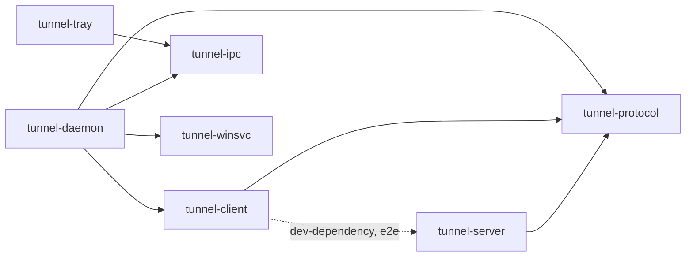

Пунктир на графе: `client` зависит от `server` только в тестах (e2e). Движок
остался в `crates/client` и подключается к демону как библиотека
(`tunnel_client::engine`); демон работает с ним через трейт `Backend`
(`EngineBackend`, см. раздел 8). Отдельного крейта `tunnel-engine` нет.

---


### 3. Плоскости: управление и данные

Весь трафик делится на две плоскости, и у них разные требования к
шифрованию, нагрузке и потерям.

| Плоскость | Что передаёт | Шифрование | Надёжность | Где обрабатывается |
|---|---|---|---|---|
| Управление (control) | HELLO3/CHALLENGE/WELCOME, ctrl-фреймы: группы, состав, приглашения, администрирование, RTT | Рукопожатие открытым текстом, подписи ed25519 и X25519 (static-static + ephemeral); ctrl-фреймы — ChaCha20-Poly1305 с сеансовыми ключами | Повторы на уровне движка (LEAVE, DECLINE, INVITE_SYNC), FRAG для больших payload'ов | Клиент: `engine` (состояние сессии); сервер: воркеры |
| Данные (data) | Фреймы групп: `DATA` (IP-пакеты), `PING`/`PONG`, `PUNCH`, `KEEPALIVE` | ChaCha20-Poly1305 ключом группы эпохи `epoch`, открытый заголовок (gid, src_ip, dst_ip, epoch) | Без повторов: потерянный IP-пакет — как в обычной сети; окно повторов против replay | Клиент: `rx` (приём), `tun` (отправка); сервер: `relay_group` |

Важное следствие: **сервер никогда не расшифровывает данные групп**. Он
проверяет открытый заголовок (участник ли отправитель, совпадает ли `src_ip`
со своим адресом в группе) и пересылает датаграмму дальше. Это позволяет
релею работать на тех же ресурсах, что и рандеву, а компрометация сервера не
раскрывает содержимого (при условии, что он не получил ключей группы через
управляющую плоскость; состав и ключи группы сервер знает, поэтому
конфиденциальность от оператора сервера — ограниченная, см. раздел 9).

---


### 4. Сервер: процессы, потоки, блокировки

Сервер — один процесс с пулом воркеров и одним фоновым потоком (плюс отдельные потоки TCP-фолбэка и HTTP-метрик, если они включены). Все потоки
работают с одним UDP-сокетом. Точка входа — `Server::start` в
`crates/server/src/lib.rs`, разбор аргументов — в `main.rs`.

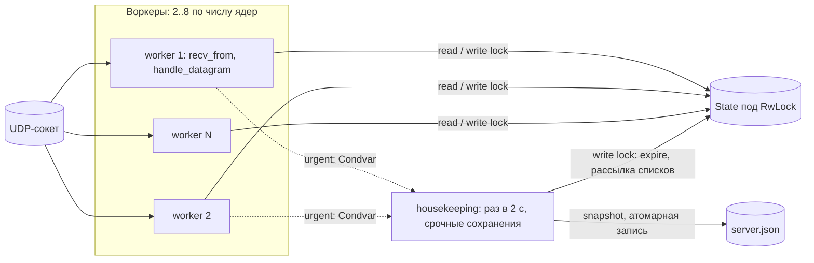

#### Потоки

| Поток | Число | Что делает | Блокирует |
|---|---|---|---|
| `worker` | `available_parallelism` в диапазоне 2..8 | `recv_from` на общем сокете, разбор, обработка, отправка ответов | `State` (чтение или запись), `Session.rx` / `relay` / `ctrl` (Mutex на сессию), `per_ip` (шард), `plain` |
| `housekeeping` | 1 | Каждые `HOUSEKEEPING_EVERY` = 2 с: истечение сессий и приглашений, рассылка `GROUP_LIST` (если `list_dirty`), очистка лимитера по IP, сохранение раз в `SAVE_EVERY` = 3 с, сводка раз в 5 мин | `State` на запись на короткий срок; сохранение — вне блокировки состояния |
| Основной поток | 1 | Запуск, ожидание остановки, финальный persist | — |

Срочные сохранения (кик, бан, выход, удаление группы) не ждут 3 с: воркер
выставляет флаг `urgent` и будит `housekeeping` через `Condvar`. Частота
таких записей ограничена `URGENT_SAVE_GAP` = 200 мс, поэтому поток команд не
превращается в поток записей на диск.

#### Блокировки и правила

- **`RwLock<State>`** — единственная блокировка состояния. Релей, PING, LIST и
  GET_GROUP берут её на чтение и не мешают друг другу. JOIN, LEAVE, создание и
  удаление группы и подобные изменения — на запись.
- **Ответы собираются, потом уходят.** Воркер собирает исходящие датаграммы
  под блокировкой, а отправляет через `sh.flush(out)` уже после её снятия.
  Так `send_to` не держит `State`.
- **Шифрование ответа под чтением.** Счётчики отправки сессии атомарные, окно
  повторов защищено своим `Mutex` (`rx`). Поэтому шифрование ответа не требует
  записи в `State`.
- **Индексы под той же блокировкой.** `by_pub` (identity → адрес сессии) и
  `by_ip` (IP участника в группе → identity) меняются только вместе с сессией и группой,
  иначе релей за O(1) вернул бы устаревший адрес.
- **Лимитеры** — отдельно от `State`: `per_ip` (16 шардов, на каждый шард
  свой `Mutex`, IPv6 — по /64) и `plain` (общий бюджет открытых ответов). Так
  поток HELLO с одного адреса не блокирует остальные воркеры.
- **Проба не берёт `State`.** `PROBE_REQ` обрабатывается до HELLO и до
  сессии (`probe.rs`): проверяются длина, свежесть `ts_ms`, `allow_ip` и
  общий `plain`-бюджет, ответ `PROBE_RESP` (24/56 байт) уходит через
  `send_plain` без блокировки состояния. Пробующий не занимает ни адрес, ни
  слот сессии.
- **Mesh-метаданные — под записью, отправка — после.** `MESH_INFO` меняет
  `Session.x_pub/caps` под `RwLock` на запись, заодно собирает дельты
  участникам и `MESH_SEED` в `Outbox`; `flush` идёт после снятия блокировки.
  `MESH_SEED` — до 16 ближайших онлайн-сессий по XOR `ed`-ключей; невидимки
  в семя не попадают (их endpoint — то, что скрывает `invisible`).
  Публикация живёт 15 мин без повтора (`MESH_TTL_MS`): клиент шлёт
  `MESH_INFO` раз в 5 мин, а выключивший mesh перестаёт попадать в семя и
  mesh-секцию.
- **Федеративные кадры обрабатываются отдельно.** `0x40..=0x4F` уходят в
  `federation::on_frame`: `SRV_HELLO`/`ACK` — рукопожатие, `0x42..=0x48` —
  только внутри установленной AEAD-сессии; чужому серверу `RESET` не
  отправляется.
- **Персистентность.** `written` и `rotated` — маленькие `Mutex`, на которых
  стоят отпечаток `server.json` и ключ, сменённый `rotate-key` во время работы
  сервера.

#### Путь датаграммы в воркере

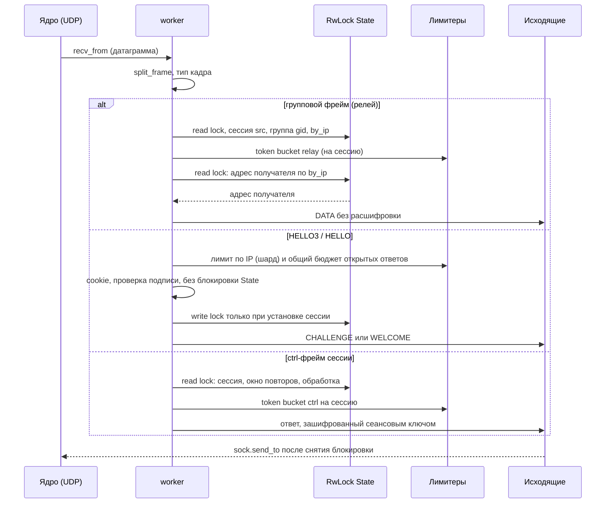

Проба (`PROBE_REQ`, этап 9) отвечается до ветки HELLO и без `State`: сервер
проверяет длину (64), свежесть `ts_ms` (120 с), лимит по IP и `plain`-бюджет,
затем отправляет `PROBE_RESP` 24/56 байт — не длиннее запроса и без сессии.
Mesh-кадры (`0x30..=0x3F`) серверу не адресованы и отбрасываются до
ctrl-разбора; федеративные (`0x40..=0x4F`) уходят в `federation::on_frame`
и обрабатываются федеративной сессией.

Мусор и чужие фреймы отбрасываются без записи в лог (счётчик `dropped`
растёт, сводка раз в 5 минут это показывает).

#### Дополнительные модули сервера

- `tcp.rs` — TCP-фолбэк на том же порту, что UDP (включён по умолчанию,
  `--no-tcp` выключает): тот же кадр, рамка `u16 LE длина`.
- `metrics.rs` — атомарные счётчики и HTTP-эндпоинт `/metrics` (Prometheus) и
  `/healthz` (только std). Включается флагом `--metrics <addr>`; **18 метрик**
  (`Metrics::entries` → `[_; 18]`, `crates/server/src/metrics.rs:134`):
  сессии и группы — `voidlink_sessions`, `voidlink_groups`, `voidlink_members`,
  `voidlink_invites_pending`, `voidlink_leases`; релей и рукопожатие —
  `voidlink_relayed_frames_total`, `voidlink_dropped_frames_total`,
  `voidlink_bytes_relayed_total`, `voidlink_hello_total`,
  `voidlink_challenge_total`, `voidlink_ctrl_frames_total`; аренды и проба —
  `voidlink_leases_expired_total`, `voidlink_probes_total`; федерация —
  `voidlink_fed_peers`, `voidlink_fed_groups`, `voidlink_fed_addr_claims`,
  `voidlink_fed_relayed_total`, `voidlink_fed_hint_rejected_total`.
- `probe.rs` — проба доступности (`PROBE_REQ` → `PROBE_RESP`, этап 9):
  открытым текстом, без сессии, ровно 64 байта запроса, ответ 24/56 байт
  (не длиннее запроса), разброс времени 120 с, лимит по IP и `plain`-бюджет,
  метрика `voidlink_probes_total`.
- `MESH_INFO`/`MESH_SEED` и mesh-секция (`lib.rs`, этап 9): сервер хранит
  `x_pub`/`caps` в сессии и публикует их, пока не истёк `MESH_TTL_MS`
  (15 мин без повтора; клиент повторяет `MESH_INFO` раз в 5 мин). `MESH_SEED`
  — до 16 ближайших онлайн-сессий по XOR, невидимки исключены. Смена
  контакта поднимает ревизию и рассылает дельту.
- `federation.rs` — федерация (этап 9, T4): `SRV_HELLO`/`ACK` с TOFU,
  `SERVER_HINT` как недоверенная подсказка, репликация групп/адресов,
  `FED_RELAY` + `ACK`/`NACK` и `JOIN_FED` → `GROUP_STATE`.
- `signals.rs` — корректная остановка по SIGTERM/SIGINT (Windows: Ctrl+C):
  воркеры останавливаются, состояние сохраняется, код выхода 0.

---


### 5. Клиент: движок и его потоки

Движок (`crates/client/src/engine.rs`) — это набор потоков, которые общаются
через каналы и общее состояние группы. UI ничего не знает о сети: он читает
состояние и шлёт команды.

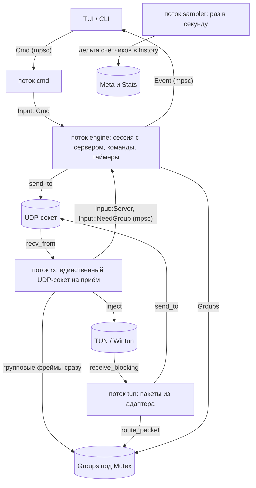

#### Потоки клиента

| Поток | Что делает | Ждёт | Общее состояние |
|---|---|---|---|
| `rx` | `recv_from` на сокете. Групповые фреймы (DATA, PING, PONG, PUNCH, KEEPALIVE) обрабатывает сам, сразу, по правилам приёма. Управляющие фреймы сервера отдаёт движку | `recv_from` с таймаутом `RX_POLL` = 250 мс | `Groups` (Mutex), `Stats` (атомики) |
| `engine` | Состояние сессии (`State`), команды UI, таймеры, рукопожатие, реконнект | `recv_timeout(TICK)` = 100 мс на `Input` | `Groups`, `Meta`, `Config`, `server` |
| `cmd` | Переносит `Cmd` из канала UI в общий входной канал движка | `recv` на `cmd_rx` | — |
| `tun` (Wintun на Windows, TUN на Linux, utun на macOS) | Читает IP-пакеты из адаптера и отправляет их пирам | `receive_blocking` | `Groups` (короткий захват), сокет |
| `sampler` | Раз в секунду переводит дельту `rx_bytes` / `tx_bytes` в историю для спарклайна | `sleep(1 с)` | `Meta` |
| `probe` (по требованию) | Отправляет `PROBE_REQ` и принимает `PROBE_RESP` на **своём** UDP-сокете и с эфемерного порта: проба не занимает сокет сессии и работает без движка | `recv` с шагом 50 мс, таймаут 3 с, 2 попытки | `ProbeState` (Mutex) |
| `offline-worker` (офлайн-TUI) | Раз в 500 мс ищет демона с живым движком; нашёл — отправляет очередь `ui-pending.json` по порядку | `sleep(500 мс)` | очередь (Mutex), общий `Config` |

Mesh и DHT отдельных потоков не заводят: рукопожатия, RPC, пересылка
`MESH_FORWARD`, таймеры сессий и DHT-поиски исполняются в потоке `engine`
шагом `MESH_EVERY`; сеть — общим сокетом через `env.send`. Это сохраняет
правило «одно изменяемое состояние — один поток»: `MeshState` и `Dht` под
`Mutex` захватываются на время шага, отправка — после снятия блокировки.

Сокет один на всё время работы процесса. При реконнекте и смене сервера
движок шлёт новый HELLO3 с того же адреса, поэтому NAT-маппинги и прямые
каналы с пирами не рвутся.

#### Таймеры

Все таймеры идут по часам (`Instant`), а не по паузам в приёме: под потоком
входящих пакетов они не «замерзают». Это исправляет ошибку этапа 6, когда
постоянный спам мешал движку пинговать сервер.

| Таймер | Значение | Назначение |
|---|---|---|
| `TICK` | 100 мс | Период `engine_loop` |
| `RTT_EVERY` | 2 с | RTT-зонд онлайн-пиров (прямым — держит NAT, остальным — через релей) |
| `PUNCH_EVERY` | 5 с | Раунд NAT-пробития |
| `PING_EVERY` | 5 с | CTRL_PING серверу |
| `LIST_EVERY` | 15 с | Обновление списка групп |
| `SERVER_TIMEOUT` | 20 с | Сервер молчит — переподключение |
| `RECONNECT_MAX` | 30 с | Потолок задержки реконнекта |
| `LEAVE_RETRY` / `DECLINE_RETRY` | 1 с | Повтор LEAVE и DECLINE до подтверждения |
| `INVITE_SYNC_RETRY` | 3 с | Сверка списка приглашений |
| `GET_GROUP_EVERY` | 1 с | Не чаще запроса состояния группы на группу |
| `CAND_EVERY` | 60 с | Обновление кандидатов для NAT |
| `PATHS_EVERY` | 10 с | Пересчёт таблицы путей (этап 9); при падении прямого канала — сразу |
| `rtt_interval` | 5 с (2–20 с) | RTT-пробы `PING` пирам из конфига (`rtt_interval_ms`, issue #16); от интервала масштабируются `direct_timeout = max(12 с, 3 × интервал)` и свежесть e2e-замера сервера |
| `PUNCH_EVERY` | 5 с → 60 с | PUNCH пирам без прямого канала, с бэкоффом 5 → 10 → 20 → 40 → 60 с (issue #16); прямой канал сбрасывает счётчик |
| `MESH_EVERY` | 1 с | Шаг mesh: рукопожатия, RPC, PING сессий, повторы `MESH_FORWARD`, DHT-поиски |
| `INFO_EVERY_MS` | 5 мин | Публикация `MESH_INFO` серверу (и сразу после WELCOME) |
| `DHT_PING_EVERY` | 5 мин | `MESH_PING` 8 ближайшим контактам DHT |
| `PING_EVERY_MS` (mesh) | 30 с | `MESH_PING` живой mesh-сессии; ответа ждём 10 с, без кадров 120 с — сессия мертва |
| `PROBE_INTERVAL` | 500 мс | Автопроба серверов на экране «Серверы» (TUI, по одному адресу) |

#### Дополнительные модули клиента

- `dns.rs` — встроенный DNS-ответчик на `100.66.0.53:53` (имена
  `<member>.vl`, `<member>.<group>.vl`, TTL ответа 30 с) и настройка split-DNS
  ОС для `.vl` (NRPT на Windows, `/etc/resolver/vl` на macOS, `resolvectl` на
  Linux). Включается полем конфига `dns` (по умолчанию `true`).
- `ipv6.rs` — IPv6-оверлей: ULA-подсеть `fd66:766c:696e::/64`; участник
  `100.66.<a>.<b>` получает `fd66:766c:696e::<a>:<b>` (например,
  `100.66.7.42` → `fd66:766c:696e::7:2a`), на адаптере — один адрес `/64`.
- `tcp_link.rs` — TCP-канал до сервера. Режим задаёт поле конфига `transport`:
  `auto` (UDP, при молчании сервера — TCP), `udp` или `tcp`; p2p с пирами
  всегда по UDP.
- `invites.rs`, `profile.rs`, `snapshot.rs` — неотвеченные приглашения,
  экспорт/импорт identity, сериализуемый снимок состояния для демона.
- `path.rs` (этап 9) — таблица путей доставки: измеренные RTT (end-to-end для
  серверного пути), стоимость, гистерезис с удержанием, метрики джиттера и
  потерь, авто-откат с карантином, ручные закрепления и события
  `PathChanged`/`PathLost`/`PathReverted`.
- `probe.rs` (этап 9) — проба доступности сервера: свой UDP-сокет и поток,
  ожидающие nonce, RTT, сверка `ed_pub` с закреплённым ключом
  (`ProbeResult`); таймаут 3 с, две попытки. Работает и без движка
  (офлайн-TUI): результат приходит событием в обоих режимах.
- `mesh.rs` (этап 9) — mesh-сессии: рукопожатие `MESH_HELLO`/`ACK` с
  эфемерными X25519, ключи `i2r`/`r2i`, RPC `0x32..=0x3E` под AEAD и окном
  повторов, приём и пересылка `MESH_FORWARD` с TTL/`visited`, учёт бюджета
  релея (10-секундное окно, ≤ 8 пиров) и счётчики `relay_bytes`.
- `dht.rs` (этап 9) — таблица Kademlia 32 × 8: контакты `ed`/`x`/`addr`,
  TTL 15 мин, пинг 8 ближайших раз в 5 мин, поиск `find_node` (α = 3, два
  раунда, ≤ 32 поисков), персистенция в `client.json` → `mesh.contacts`.
  При старте движка таблица **загружается** из `mesh.contacts` (`Dht::load_at`,
  до первого `MESH_SEED` — данные сервера перебивают кэш): записи старше TTL
  получают «полу-TTL», иначе первый `expire` через ≤ 10 с вычистил бы кэш.
  При сохранении кэш прунится: ≤ 256 записей и не старше 7 суток. Входа в
  сеть без сервера кэш не даёт — см. ниже про ключи групп.
- `offline.rs` (этап 9) — `ResilientEngine` для TUI без движка: правки
  применяются к общему `Config` и сохраняются, очередь `ui-pending.json`
  уходит демону, когда тот появляется; фон пробует демона раз в 500 мс;
  проба сервера работает, сетевые команды — отказ.
- `federation.rs` (этап 9) — каркас клиентской части федерации: безопасный
  разбор диапазона `0x40..=0x4F`, `FED_GROUPS`/`JOIN_FED` — T4.

#### Таблица путей и выбор доставки (этап 9)

`path::PathTable` — отдельное состояние под `Mutex`, которое считает путь до
каждого участника по измеренной стоимости, а не по фиксированному приоритету:

```text
cost(direct) = rtt_direct
cost(server) = rtt_server_e2e + 5   (до первого e2e — плечо rtt_server_leg + 5)
cost(peer R) = rtt(us→R) + rtt(R→dst) + 15 + 10 * load(R)
```

RTT серверного пути — **честный end-to-end** (issue #15): метка в групповом
`PING`, ответ `PONG`, обработчик в `handle_group_frame` кладёт замер в таблицу
(`record_direct_rtt` для прямого канала, `record_server_path_rtt` для маршрута
через сервер). Плечо `CTRL_PONG` (`record_server_rtt`) — только стоимость до
первого e2e и отдельное поле снимка (`PathSnap.leg_ms`); `PathTable::current_rtt`
плечо не возвращает.

* Пересчёт — раз в 10 с (`PATHS_EVERY`) и немедленно при падении прямого
  канала (`record_failure` + `paths_round`).
* **Гистерезис: относительный + абсолютный** (issue #17): путь меняется,
  только если новый дешевле текущего и на ≥ 20 %, и на `path_hysteresis_ms`
  (по умолчанию 15 мс), и текущий путь удерживается не меньше
  `path_dwell_ms` (по умолчанию 10 с). Мёртвый текущий путь переключается
  сразу, без порогов и удержания; ручное закрепление им не подчиняется.
* **Проверка нового пути** (issue #26): 5 с после автопереключения
  (`VERIFY_MS`) таблица сравнивает новый путь со старым по стоимости,
  потерям и джиттеру; если новый хуже — откат, `PathChange::Reverted` и
  карантин альтернативы на 60 с (`QUARANTINE_MS`).
* Свежесть замеров: прямой — `max(12 с, 3 × интервал проб)`, сервер и пир —
  30 с, e2e сервера — `max(30 с, 2 × интервал)`; устаревший замер не
  участвует в выборе.
* **Ручное закрепление** (`Cmd::PinPath`, `client.json` → `pinned_paths`) сильнее
  автоматики. Закреплённый, но недоступный путь даёт `PathLost` и откат на
  автоматику; само закрепление сохраняется и снова действует, когда путь
  оживёт.
* Таблица не знает про UI и сеть: она возвращает `PathChange`, движок
  превращает его в `Event::PathChanged` (с флагом `manual` — изменение из
  `Cmd::PinPath`/`UnpinPath`), `Event::PathLost` или `Event::PathReverted` и
  отправляет после снятия `Mutex` (события копятся в векторе, каналы и
  сокет — вне блокировки). Офлайн-участник цели в таблице не имеет:
  `paths_round` снимает её (`clear_target`), `PeerSnap::from_sess` отдаёт
  `path: None` (issue #14).
* Отправка исполняет выбор: `route_packet` спрашивает `PathTable::choose`,
  идёт на `direct_addr` (L0), через `MESH_FORWARD` выбранного реле (L2) или
  на сервер (L1). Отказ выбранного пути (`record_failure` + `PathLost`) —
  следующий кандидат: до трёх реле по очереди, затем сервер. Стоимость L2
  приходит из `MESH_ROUTE`: сосед отвечает `ROUTE_OK` с `up_ms`/`down_ms`/
  `load`.

---


### 6. Путь пакета

#### 6.1. Отправка: TUN → движок → шифрование → прямой канал или релей

Функция `route_packet` берёт IPv4-пакет из адаптера, по адресу назначения
определяет группу (в IP `gid` не закодирован: ищется своя группа, где есть
участник с таким адресом; при нескольких — с живым прямым каналом, затем
с онлайн-пиром, затем с наименьшим gid), выбирает
адрес получателя и шифрует пакет ключом текущей эпохи группы.

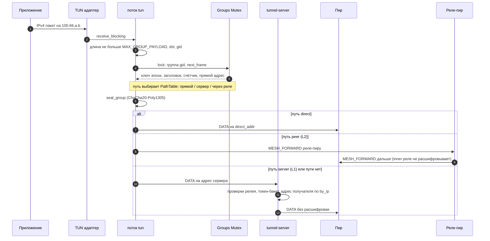

Если выбранный путь отказывает (нет прямого канала, реле не приняло кадр,
кончился бюджет), движок помечает путь сломанным (`record_failure` +
`PathLost`) и отправляет кадр сервером — пакет не теряется. Если пир
отвечает напрямую, движок на приёме заводит прямой канал (см. 6.2), и
следующие пакеты пойдут мимо релея.

**Дублирование (issue #25).** После выбора пути `route_packet` спрашивает
`engine::dup_plan`: если `mesh.duplicate` включён, получатель объявил
`caps::DUP`, цель не закреплена, пакет не больше `mesh.duplicate_max_pkt`,
EWMA скорости цели ниже `mesh.duplicate_max_kbps` и `PathTable::fallbacks`
даёт ≥ 2 пути с ценой не выше 1.5× лучшего, кадр уходит ещё и по следующим
`mesh.duplicate_paths() - 1` путям. Кадр при этом **не перезапечатывается**:
копии — те же байты (`seal_group` вызван один раз), поэтому счётчик (nonce)
один на все пути. На приёме вторая копия попадает в кольцо дедупа
(`KeyState.dedup`, 64 seq × 64 потока, TTL 2 с), не инжектится и
подтверждается ACK — в том числе в L2, иначе дубликат снимал бы здоровый
путь. Подробности — [PROTOCOL.md](PROTOCOL.md) §7 и
[NETWORKING.md](CLIENT.md).

Этап 9 вводит уровни доставки L0–L3 ([NETWORKING.md](CLIENT.md)): L0 —
прямой канал, L1 — релей сервера, L2 — релей через участника (mesh), L3 —
кросс-серверный релей (федерация). `PathTable` считает стоимость L0–L2,
применяет гистерезис 20 % и ручные закрепления, а `route_packet` исполняет
выбор: `Direct` — на `direct_addr`, `PeerRelay` — `MESH_FORWARD` через одного
из до трёх ближайших реле-кандидатов, `Server`/`None` — на сервер. L3
реализован на сервере (федерация); клиент видит его как серверный релей.

#### 6.2. Приём: rx → проверки → окно повторов → inject

Приём идёт в потоке `rx`. Фрейм принимается только при выполнении всех
условий из раздела 7 [PROTOCOL.md](PROTOCOL.md):

1. группа известна; эпоха текущая или прошлая в пределах grace (новая эпоха —
   запрос `GET_GROUP`, не чаще раза в секунду на группу);
2. расшифровка успешна и `dst_ip` — наш адрес;
3. `src_ip` — текущий участник группы, не мы сами;
4. счётчик проходит окно повторов (на связку gid, epoch, src_ip);
5. фрейм пришёл через релей **или** с UDP-адреса, известного от сервера;
6. для `DATA`: IPv4-источник внутреннего пакета совпадает с `src_ip`.

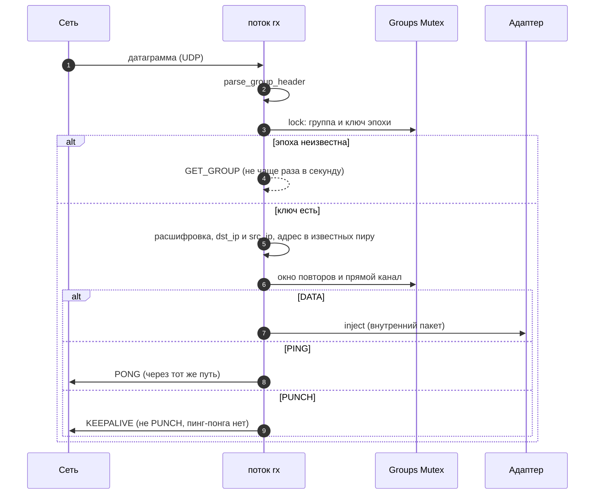

Два правила, которые стоят за последними строками диаграммы:

- **PUNCH отвечает KEEPALIVE, а KEEPALIVE не отвечается.** До исправления
  этапа 6 два клиента отвечали друг другу PUNCH бесконечно (около 10 000
  пакетов в секунду на клиента). Сейчас цепочка обрывается на втором шаге.
- **Через релей PUNCH не отвечается.** Пробитие нужно только прямому каналу.

Прямой канал включается на том адресе, с которого первым пришёл верный
фрейм, и не переписывается по последующим фреймам с другого адреса.

---


### 7. Владение состоянием

Правило простое: каждое изменяемое состояние принадлежит одному потоку или
защищено одной блокировкой. Смешанное владение (несколько `Mutex` на одну
сущность) не допускается.

#### Сервер

| Состояние | Где живёт | Кто меняет | Защита |
|---|---|---|---|
| `sessions`, `by_pub`, `by_ip` | `State` | Воркеры (HELLO, JOIN, LEAVE), `housekeeping` (истечение) | `RwLock<State>` |
| `Session.transport` + реестр TCP | `State`, `TcpSender` | Создание сессии, приём TCP-соединения | `RwLock<State>` + фильтр приёма: адрес живого UDP-клиента не занимает TCP и наоборот |
| `groups`, `next_gid`, `invite_ttl_ms` | `State` | Воркеры (администрирование), `housekeeping` (истечение приглашений) | `RwLock<State>` |
| Ключ сервера, `links` (цепочка ротации) | `Shared` | Только при старте и `rotate-key` | Неизменны при работе: подпись и DH без блокировки |
| Счётчики сессии (отправка) | `Session` | Воркеры | Атомики |
| Окно повторов, лимиты сессии | `Session` | Воркеры | `Mutex` на поле |
| Лимит HELLO по IP | `per_ip` | Воркеры | 16 `Mutex` (шарды) |
| Отпечаток `server.json`, ключ `rotate-key` | `Shared` | `housekeeping`, `rotate-key` | Маленькие `Mutex` |
| Счётчики `relayed`, `dropped`, `probes_total` | `Shared` | Воркеры | Атомики |
| Mesh-контакт сессии (`x_pub`, `caps`, `mesh_last_seen`) | `Session` | Воркеры (`MESH_INFO`), `housekeeping` (истечение сессии) | Под `RwLock<State>` |

`server.json` содержит identity, группы, `user_ips` (постоянный адрес identity,
один на все её группы), `lease_seen` (unix мс последнего продления аренды
адреса — по нему истекает `--lease-ttl-days`), баны, приглашения и цепочку
ротации. Номера `epoch` и `rev` растут монотонно, и при загрузке к ним
добавляется `LOAD_MARGIN` = 65 536: состояние сохраняется раз в 3 секунды, и
после падения номера, уже выданные клиентам, не должны повторяться.

#### Клиент

| Состояние | Где живёт | Кто меняет | Защита |
|---|---|---|---|
| `GroupSess` (ключи эпох, окна повторов, участники, прямые каналы) | `Groups` = `Arc<Mutex<HashMap<gid, GroupSess>>>` | `rx`, `tun`, `engine` | `Mutex` |
| `Meta` (история для спарклайна, время старта, сводка) | `Arc<Mutex<Meta>>` | `sampler`, `engine` | `Mutex` |
| `Stats` (`rx_bytes`, `tx_bytes`, `rx_pkts` и т. п.) | `Arc<Stats>` | `rx`, `tun`, `sampler` | Атомики |
| `Config` (identity, друзья, серверы, автовход) | `Arc<Mutex<Config>>` | `engine` (команды), UI (через команды) | `Mutex`, сохранение через `save` |
| Адрес сервера | `Mutex<SocketAddr>` | `engine` (смена сервера) | `Mutex` |
| Сессия с сервером (`CtrlSession`, ключи, счётчики) | `State` в потоке `engine` | Только `engine` | Владение одним потоком, без блокировки |
| Ключи групп и счётчики | Только в памяти | `rx`, `tun`, `engine` | Через `Groups` |
| Таблица путей (`PathTable`) | `Arc<PathTable>` | `engine` (тик путей, RTT, пины), `rx` (прямые RTT/падения) | `Mutex` внутри таблицы |
| Пробы (`ProbeState`) | `Arc<ProbeState>` | Свой поток (`probe.rs`), результат читает `engine`/офлайн-движок | `Mutex` на карту nonce, очередь результатов |
| Mesh-состояние (`MeshState`) | `Arc<Mutex<MeshState>>` | `engine` (шаг `MESH_EVERY`: сессии, RPC, forward), `rx` (входящие mesh-кадры) | `Mutex`; сессии, ключи, бюджеты релея и счётчики под ним |
| DHT-таблица (`Dht`) | `Arc<Mutex<Dht>>` | `engine` (`MESH_SEED`, поиски, пинг, `mesh.contacts`) | `Mutex` |
| Очередь офлайн-правок (`ui-pending.json`) | `VecDeque<Cmd>` под `Mutex` в `ResilientEngine` | `offline-worker` (отправка демону), TUI (добавление) | `Mutex` + атомарная запись файла |
| Конфиг mesh и пины | `Config.mesh`, `Config.pinned_paths` | `engine` (команды), UI (через команды) | Общий `Mutex<Config>`, `save` |
| Флаг выхода | `Env.quit` | Все потоки | `AtomicBool` |

**Ответы после снятия lock.** Правило общее для клиента и сервера: под
блокировкой собираются данные и исходящие кадры, а отправка (сокет, каналы,
события UI) идёт после её снятия. В движке `paths_round` копит `PathChange` и
шлёт события после `Mutex`; `handle_group_frame` собирает RTT/падения, обновляет
таблицу коротким захватом и только затем отправляет кадры и события. Шаг mesh
возвращает `MeshOut` (кому и что послать, что отдать движку) и отдаёт его
наружу уже без `Mutex<MeshState>`; пересылка `MESH_FORWARD` и ответы
`FORWARD_ACK`/`NACK` уходят тем же путём. В сервере `sh.flush(out)`
вызывается после `State`; проба вообще не берёт `State`, а `MESH_SEED`
собирается из уже прочитанного снимка сессий. Поэтому медленный сокет или
заблокировавшийся фронтенд не держат состояние.

Ключи групп и счётчики клиент **не сохраняет**: после перезапуска HELLO3
участника ротирует ключи всех его групп. Поэтому повторное использование
счётчика под тем же ключом (после потерянного LEAVE) продолжает счётчик, а не
начинает с нуля.

Отсюда же следствие для «работы без сервера»: ключи групп (они ротируются и
отзываются), состав групп и свой `my_ip` (поле `GROUP_STATE`) клиент получает
только от сервера. Кэш DHT в `mesh.contacts` хранит лишь адреса и x-ключи
пиров, поэтому вход в сеть без сервера невозможен: движок не стартует без
`WELCOME`, а mesh-рукопожатие требует членства в группе. Уже установленные
mesh-сессии и прямые каналы живут без сервера, пока работает процесс
([NETWORKING.md](CLIENT.md#dht-и-mesh-что-живёт-без-сервера)).

#### Снимки для UI

UI не читает `Groups` напрямую каждый кадр: это нарушило бы работу `rx`
(см. историю этапа 6, «лаги интерфейса»). Для демона состояние
сериализуется в `Snapshot` (`crates/client/src/snapshot.rs`), который
`EngineBackend` строит по флагу «изменилось». Снимок несёт и данные этапа 9:
путь до участника (`PeerSnap.path`), RTT до сервера по метке
(`MetaSnap.server_rtt_ms`), счётчики mesh (`mesh_enabled`, `relay_bytes`,
`mesh_sessions`) и офлайн-состояние (`meta.offline`, `offline_reason`,
`pending_edits`). Фронтенд (TUI) работает с движком через трейт `EngineApi`
(`crates/client/src/api.rs`): `LocalEngine` — движок в своём процессе
(embedded), `IpcEngine` (`remote.rs`) — тонкий клиент демона с кэшем
снимка, `ResilientEngine` (`offline.rs`) — офлайн-режим с очередью правок,
который сам переключается на `IpcEngine`, когда демон появляется.

---


### 8. Демон, IPC и трей (этап 7)

Цель этапа: один привилегированный процесс владеет туннелем, а фронтенды
подключаются к нему по IPC и не требуют прав администратора. Демон, IPC, трей
и TUI/CLI поверх IPC (этап 7.4) реализованы. Без демона движок живёт внутри
процесса `run` или embedded `tui`: закрыли окно — туннель упал. CLI-команды с той
же identity посылают собственный HELLO и вытеснили бы сессию работающего движка
(сервер снимает старую сессию этого публичного ключа), поэтому при демоне они идут
через него, а при занятом замке отказывают (`remote_cli.rs`).

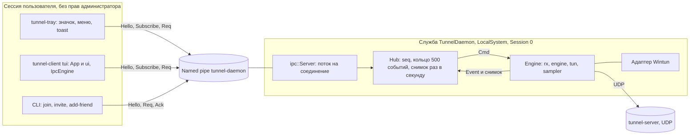

На Unix тот же протокол идёт через Unix-сокет `<данные>/daemon.sock` (`0600`) в
каталоге `0700`; его поднимает `tunnel-daemon console`. Так разрабатывают и
тестируют демон на Linux и macOS.

#### Протокол IPC

| Направление | Сообщение | Смысл |
|---|---|---|
| Клиент → демон | `Hello{proto, kind, ver}` | Первое сообщение; `kind` — `Tui`, `Tray` или `Cli` |
| Клиент → демон | `Subscribe{snapshots_ms}` | Подписка: история из кольца, снимок, дальше поток событий |
| Клиент → демон | `Req{id, cmd}` | Команда движка (JSON-форма `Cmd`) |
| Клиент → демон | `Bye` | Корректное закрытие |
| Демон → клиент | `Welcome{proto, daemon_ver, me}` или `Reject` | Ответ на Hello; при несовпадении мажорной версии — закрытие |
| Демон → клиент | `Ack{id, Ok или Err}` | Принято или отклонено демоном (неверный gid, нет сервера). Результат операции приходит событием |
| Демон → клиент | `Event{seq, ev}`, `Snapshot{seq, snap}` | Поток событий и снимки |
| Демон → клиент | `Shutdown{reason}` | Остановка демона |

Кодек: `u32 LE` длина и JSON, лимит кадра 1 МиБ. Битые данные дают разрыв
соединения, но не панику. Выбор JSON вместо бинарного формата сделан ради
читаемости: трафик IPC — порядка 1–2 КБ/с.

#### Хаб событий демона

`Hub` владеет бэкендом и раздаёт его события подписчикам:

- каждое событие получает монотонный `seq` без повторов;
- очередь на подписчика ограничена; при переполнении подписчик пропускает
  события, видит дырку в `seq` и получает снимок. Остальные подписчики и движок
  не ждут медленного;
- пока подписчик ждёт снимок, события ему не шлются: снимок покрывает их;
- снимок строится вне мьютекса хаба, чтобы IPC-потоки не ждали движок;
- кольцо последних 500 событий: новый подписчик сразу получает историю лога.

#### Single-instance и безопасность

- Замок движка берёт любой, кто его поднимает (демон, embedded TUI, `run`):
  Unix — `flock` на `daemon.lock`, Windows — именованный мьютекс
  `Global\TunnelEngine`. Два движка с одной identity одновременно невозможны.
- Named pipe на Windows `\\.\pipe\tunnel-daemon`: SDDL
  `O:SYD:P(A;;GA;;;SY)(A;;GA;;;BA)(A;;0x12019b;;;<SID владельца>)` у службы
  и `O:BAD:…` у `console` от администратора, удалённые
  клиенты отклонены флагом `PIPE_REJECT_REMOTE_CLIENTS`,
  `FILE_FLAG_FIRST_PIPE_INSTANCE` против подмены. Клиент проверяет, что процесс
  сервера пайпа — служба (SYSTEM) или повышенный процесс этого же пользователя.
  Пайп поднимают служба и `console` от администратора (одно имя — второй
  получает «пайп занят»); embedded TUI IPC не открывает.
- Секреты identity не покидают служебный процесс: снимок и IPC содержат
  только публичные данные.
- Конфиг службы — `%ProgramData%\tunnel\client.json` (ACL: SYSTEM и
  Administrators). Identity принадлежит машине, а не пользователю:
  `%APPDATA%` для LocalSystem не подходит.

#### Обязанности процессов

| Процесс | Владеет | Не делает |
|---|---|---|
| Демон | Адаптером, сокетом, движком, `client.json`, IPC-сервером, логом | Не рисует UI |
| TUI | Выбором строки, темой (`ui.json` в тонком режиме), очередью окон приглашений | В тонком режиме не пишет `client.json`: конфиг меняется командами демона |
| CLI | Разбор аргументов | При работающем демоне не открывает движок: команда уходит демону |
| Трей | Значком и уведомлениями | Не владеет состоянием: всё берётся из снимков |

Поведение этапа 7.4 (см. [PLAN.md](archive/PLAN.md)): если демона нет, а замок
single-instance (`tunnel-ipc::lock`, общий для демона, embedded TUI и `run`)
занят, CLI не поднимает второй движок, а сообщает причину (кроме чтения
локального конфига: `id`, `servers`, `friends`). Если демон есть, но правки
конфига он не принимает (заглушка `{"engine": null, "error"}` — битый
`client.json`), TUI работает офлайн на своей копии. Режимы TUI выбираются
флагами `tui --remote`, `tui --embedded`, `tui --offline`, а без флагов —
каскадом «демон → свой движок → офлайн»; при работающем демоне настройки
движка (`set-transport`, `set-mtu`, `dns`, `import-identity`) и `run`
отказывают. Переподключение `IpcEngine` — раз в 1 с, пока пайп недоступен
(«демон недоступен»).

---


### 9. Ключевые решения и компромиссы

| Решение | Почему | Цена |
|---|---|---|
| UDP как основной транспорт, TCP — фолбэк | Низкая задержка и NAT-пробитие; TCP нужен там, где режут UDP | Два пространства адресов (`Peer::Tcp` и UDP), сложнее сессии сервера |
| Рукопожатие с cookie, ответ не длиннее запроса | Сервер не становится усилителем DDoS: открытые ответы уходят только на подтверждённый адрес | Лишний обмен на каждое новое рукопожатие |
| Сеансовые ключи через static-static и ephemeral-ephemeral X25519 | Прямая секретность управляющих сессий | Более сложное рукопожатие и тесты |
| Сервер не расшифровывает данные групп | Релей дешевле, компрометация сервера не раскрывает пакеты | Сервер знает состав и ключи групп, поэтому конфиденциальность от оператора ограничена |
| Пул воркеров, `RwLock` вместо async-рантайма | Проект на std-потоках, без зависимости от tokio; релей идёт под чтением | Блокировка записи на JOIN и LEAVE влияет на все воркеры |
| Отправка ответов после снятия блокировки | `send_to` не держит состояние | Нужен буфер исходящих на время обработки |
| Один сокет на весь клиент | NAT-маппинги и прямые каналы не рвутся при реконнекте | Один поток `rx` — узкое место при очень высокой нагрузке |
| Таймеры по часам, а не по паузам приёма | Поток входящих пакетов не замораживает таймеры (ошибка этапа 6) | Больше внимания к состоянию таймеров при тестах |
| Ключи групп и счётчики не сохраняются на клиенте | Компрометация диска не раскрывает ключи | После перезапуска клиента ключи всех групп ротируются |
| Сохранение `server.json` раз в 3 с плюс срочные сохранения | Не пишем на диск на каждый пакет | Окно потери до 3 с; срочные события (кик, бан) сохраняются с задержкой не больше 200 мс; при падении номера сдвигаются через `LOAD_MARGIN` |
| Список групп рассылается раз в 2 с по флагу | Одна команда не разносит N кадров по всем сессиям | Задержка обновления списка до 2 с |
| Лимиты token bucket по сессии, по IP и общие | Защита от флуда без блокировки всего сервера | Нужна настройка под нагрузку (флаги `--relay-rate` и другие) |
| Демон владеет туннелем, фронтенды — IPC | Туннель живёт при закрытом окне; фронтенды без прав администратора | Новый уровень: протокол IPC, версии, пайп с SDDL |
| IPC в JSON, без async | Читаемость, отладка, минимум зависимостей | Больше трафика, чем у бинарного формата (трафик мал) |
| `tunnel-tray` не зависит от `tunnel-client` | Трей собирается отдельно и не тянет TUI и движок | Имена полей снимка дублируются в трее и должны совпадать |
| Стоимость пути вместо фиксированного приоритета (этап 9) | Прямой канал не всегда быстрее сервера; решение принимается по измеренному RTT и надбавкам | Нужны свежие замеры, гистерезис и защита от дребезга (20 %) |
| Новые возможности не меняют версию протокола | Старые v4-клиенты и серверы остаются совместимыми; mesh включается данными (`MESH_INFO`/`'MSH1'`) | Возможность включается неявно, поэтому статус приходится проверять по данным, а не по версии |
| Mesh-якорь доверия — состав группы | Новый канал доверия не нужен: `ed`-ключ пира уже известен из `MemberInfo` | Отзыв доступа запаздывает на время доставки `GROUP_STATE`: кикнутый пир ещё может принять mesh-сессию у тех, кто не получил обновление |
| Федерация — TOFU-пиннинг ключей серверов | Просто и без PKI; подмена сервера на пути видна после первого рукопожатия | Первое знакомство уязвимо к MITM; федерация расширяет круг операторов, которым доверяет группа |

---


### 10. Ограничения и открытые вопросы

- **Движок живёт в `crates/client`.** Отдельный крейт `tunnel-engine` не
  создавался: демон подключает `tunnel-client` как библиотеку и работает с ним
  через `Backend`.
- **Служба проверена только компиляцией.** `tunnel-daemon service` запускает
  настоящий движок, но SCM, Wintun и события питания на живой Windows не прогонялись.
- **Настройки движка при демоне.** IPC-команд для `set-transport`, `set-mtu`, `dns`
  и `import-identity` нет: при работающем демоне их меняют, остановив демон.
- **Единая identity на машину.** Служба одна, поэтому несколько пользователей
  на одной машине делят identity. Вариант «служба на пользователя» не выбран.
- **Ограниченная конфиденциальность от оператора сервера.** Сервер видит
  состав групп, адреса и ключи групп через управляющий канал. Поэтому
  приватность данных внутри групп держится на доверии к серверу, а не на
  сквозном шифровании.
- **Сон и пробуждение.** Служба должна делать немедленный HELLO после
  выхода из сна (`POWEREVENT`); для этого в демоне есть `ResumeSignal`, но
  подключение к движку службы зависит от подключения движка к `service`.
- **Этап 9: готово.** Проба и офлайн-TUI (T2), mesh-сессии с RPC, DHT,
  L2-релей и TUI-отображение путей (T3), федерация серверов (T4a/T4b1/T4b2/
  T4c) в коде и в `dev`. Контракт T1, транспорт T3 и федерация покрыты
  юнит- и e2e-тестами; ручной NAT для L0–L2 ещё не прогонялся.
  Подробный статус — [PLAN.md](archive/PLAN.md), §9.

Если в этом документе описано поведение, которого нет в коде, верен код:
исправьте документ и сообщите в [PLAN.md](archive/PLAN.md), где отмечено, что ещё
не сделано.


## Сборка и рабочий процесс

### 1. Окружение

| Что нужно | Зачем |
|-----------|-------|
| Rust **stable** (не ниже 1.88) | Workspace на **edition 2024**; используются let-цепочки (`if let … && let …`) |
| `rustup` с компонентами `rustfmt`, `clippy` | Форматирование и линт, как в CI |
| Windows (MSVC) | Сборка и запуск трея, службы и Wintun-драйвера; клиент и демон с реальным туннелем |
| Linux или macOS | Сервер, протокол, IPC, демон, клиент (TUN через `tun_linux.rs` / `tun_macos.rs`) |
| `cargo-deny`, `cargo-audit` | Опционально, локальная проверка зависимостей (см. [раздел 9](#9-зависимости-cargo-deny-и-cargo-audit)) |

Установка тулчейна:

```bash
rustup toolchain install stable
rustup component add rustfmt clippy
rustc --version    # должно быть 1.88 или новее
```

Что собирается на каком хосте:

| Крейт | Linux / macOS | Windows |
|-------|:-------------:|:-------:|
| `tunnel-protocol` | да | да |
| `tunnel-server` | да | да |
| `tunnel-ipc` | да (Unix-сокет) | да (именованный пайп) |
| `tunnel-client` | да (TUN: `tun_linux.rs`, `tun_macos.rs`) | да (Wintun) |
| `tunnel-daemon` | да (Unix-сокет, `--fake`, реальный движок) | да (служба) |
| `tunnel-tray` | нет | да |
| `tunnel-winsvc` | нет (только Windows-код) | да |

`wintun` и `windows-sys` подключены в `tunnel-client` только под `cfg(windows)`, на Unix
используется `libc`. Реальный TUN на Linux и macOS требует root (или `CAP_NET_ADMIN` на Linux);
e2e-тесты движка подставляют заглушку вместо адаптера и прав не требуют.

---


### 2. Структура workspace

Корневой `Cargo.toml` — `resolver = "2"` и семь участников. Общие версии
зависимостей вынесены в `[workspace.dependencies]` (`anyhow`, `blake3`,
`chacha20poly1305`, `crossterm`, `rand`, `ratatui`, `serde`, `serde_json`, `wintun`);
крейты подключают их через `dep.workspace = true`.

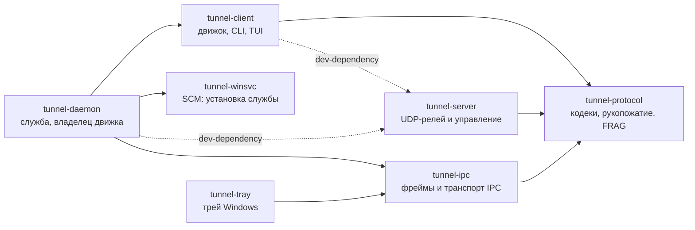

Пунктир — зависимость только для тестов: e2e-тесты движка поднимают настоящий
сервер в том же процессе. Демон владеет движком из `tunnel-client` через `EngineBackend`.

| Крейт | Путь | Роль | Версия |
|-------|------|------|--------|
| `tunnel-protocol` | `crates/protocol` | Проводной формат v4: заголовок, рукопожатие, ctrl-фреймы, FRAG, окно повторов, кодеки payload | 0.2.0 |
| `tunnel-server` | `crates/server` | Сервер: UDP-релей, группы, выдача IP, лимиты, персистентность `server.json`, TCP-фолбэк (`tcp.rs`) | 0.2.0 |
| `tunnel-client` | `crates/client` | Библиотека (`lib.rs`: движок `engine.rs`, хранилище `store.rs`, DNS `dns.rs`, IPv6 `ipv6.rs`, TCP-канал `tcp_link.rs`, TUN `tun.rs` / `tun_linux.rs` / `tun_macos.rs`, TUI `tui/`) и CLI (`main.rs`) | 0.2.0 |
| `tunnel-ipc` | `crates/ipc` | Протокол локального IPC между демоном и фронтендами: сообщения (`proto.rs`), кодек (`codec.rs`), клиент (`client.rs`), транспорт (пайп на Windows, Unix-сокет на Unix) | 0.1.0 |
| `tunnel-daemon` | `crates/daemon` | Демон: замок (`lock.rs`), лог (`log.rs`), хаб подписчиков (`hub.rs`), IPC-сервер (`server.rs`), `EngineBackend` (`engine_backend.rs`) и `FakeBackend` для разработки, режимы в `cli.rs` | 0.2.0 |
| `tunnel-winsvc` | `crates/winsvc` | Установка, запуск и удаление службы Windows (SCM) | 0.2.0 |
| `tunnel-tray` | `crates/tray` | Иконка в трее Windows, меню, уведомления | 0.2.0 |

Вспомогательные каталоги:

| Путь | Содержимое |
|------|-----------|
| `docs/` | Документация (этот файл, протокол, сервер, установка, тесты, план) |
| `infrastructure/linux/` | `install-server.sh`, юнит `tunnel-server.service` |
| `infrastructure/windows/` | `install.ps1`, `uninstall.ps1` |
| `infrastructure/netns/nat-lab.sh` | Лаборатория NAT на сетевых пространствах имён Linux |
| `infrastructure/scripts/` | Вспомогательные скрипты для лаборатории и ожидания хостов |
| `vendor/wintun/` | Подписанный `wintun.dll`. Сборка клиента копирует его рядом с exe |
| `.github/workflows/ci.yml` | Единственный workflow CI |

---


### 3. Сборка

Все команды выполняются из корня репозитория.

```bash
cargo build --workspace                  # отладочная сборка (на Windows — весь workspace)
cargo build --release --workspace        # релиз, как в CI
```

Сборка по крейтам:

| Команда | Где работает |
|---------|--------------|
| `cargo build -p tunnel-protocol` | везде |
| `cargo build --release -p tunnel-server` | Linux, macOS, Windows |
| `cargo build -p tunnel-ipc` | везде |
| `cargo build --release -p tunnel-client` | Linux, macOS, Windows |
| `cargo build -p tunnel-daemon` | Linux, macOS (`--fake` и реальный движок), Windows (служба) |
| `cargo build --release -p tunnel-tray` | только Windows |
| `cargo build -p tunnel-winsvc` | только Windows |

Статический сервер для VPS (кросс-сборка с macOS или Windows) описан в
[docs/SERVER.md](SERVER.md#сборка-под-linux):

```bash
cargo zigbuild --release -p tunnel-server --target x86_64-unknown-linux-musl
```

Про `wintun.dll`: файл лежит в `vendor/wintun/`, а `crates/client/build.rs`
копирует его в каталог профиля (`target/<profile>/wintun.dll`), чтобы клиент
находил драйвер без ручных шагов. Если DLL не найдена, сборка не падает: скрипт
просто пропускает копирование.

---


### 4. Локальный запуск

#### 4.1. Сервер

На Linux или macOS сервер можно поднять прямо из `target/`:

```bash
cargo run -p tunnel-server -- 127.0.0.1:5555 --data ./tunnel-data
```

| Флаг | По умолчанию | Смысл |
|------|--------------|-------|
| `[адрес]` | `0.0.0.0:5555` | адрес прослушивания (UDP, и TCP на том же порту) |
| `--data <dir>` | `tunnel-data` | каталог состояния (`server.json`) |
| `--workers N` | `0` (по ядрам, не больше 8) | число потоков-воркеров |
| `-q`, `--quiet` | — | не печатать события и сводку |
| `--tcp` / `--no-tcp` | включён | TCP-фолбэк |
| `--metrics <addr>` | выключены | HTTP `/metrics` и `/healthz` |
| `--relay-rate` / `--relay-burst`, `--ctrl-rate` / `--ctrl-burst`, `--hello-rate` / `--hello-burst`, `--plain-rate` / `--plain-burst`, `--join-rate` / `--join-burst` | 4000/8000, 50/100, 5/20, 2000/4000, 1/10 | лимиты (`Limits` в `crates/server/src/lib.rs`) |
| `--session-timeout <сек>` | 30 | сессия без пакетов считается офлайн |
| `--max-owned-groups`, `--invite-ttl-days`, `--max-invites-per-group`, `--max-bans-per-group`, `--max-invites-per-target` | 16, 7, 256, 1024, 64 | лимиты групп и приглашений |

Отдельная подкоманда `tunnel-server rotate-key [--data <dir>]` меняет ключ сервера. Полный
список флагов и инструкции для VPS — в [docs/SERVER.md](SERVER.md). В e2e-тестах лимиты меняют
через `Config::limits` (функция `start_server_with`).

#### 4.2. Демон без движка (`--fake`)

Чтобы отлаживать IPC и фронтенды без Wintun и прав администратора, демон
запускается в режиме `--fake` (бэкенд в памяти, см. `FakeBackend` в
`crates/daemon/src/fake.rs`):

```bash
cargo run -p tunnel-daemon -- console --fake --debug --data-dir /tmp/vl-a
```

На Unix фронтенды подключаются к `<data-dir>/daemon.sock`. Для второго экземпляра
берите другой `--data-dir`: одновременный запуск двух демонов на один каталог
отвергается замком (`flock`).

#### 4.3. Клиент

Клиент с реальным туннелем требует прав: администратор на Windows (Wintun), root или
`CAP_NET_ADMIN` на Linux, `sudo` на macOS. Типичный сценарий из командной строки:

```powershell
tunnel-client.exe --dir C:\vl-a add-server 127.0.0.1:5555 <код-сервера> local
tunnel-client.exe --dir C:\vl-a set-name alice
tunnel-client.exe --dir C:\vl-a create "тестовая группа"
tunnel-client.exe --dir C:\vl-a run
```

Глобальные флаги `--dir`, `--profile <имя>`, `--debug`, `--server <N|addr|label>`, `--adapter`,
`--dll` (только Windows) перечислены в выводе `tunnel-client help`. Для второго клиента на той же машине
используйте другой `--dir` и другой адаптер (`--adapter`).

Пути хранилища: каталог из `--dir` содержит `client.json` с полями `Config`
(`crates/client/src/store.rs`): `identity`, `name`, `status`, `servers`, `friends`,
`autojoin`, `theme`, `lan_discovery`, `mtu`, `invisible`, `active_server`,
`autojoin_by_server`, `dns`, `transport`, `adapter`, `dll`. Ключи identity лежат в этом же файле в виде hex-строк
(`StoredIdentity`).

---


### 5. Тесты: что где проверяется

Команды запуска, счёт для бейджа и e2e-сценарии — в разделе [Тестирование](#тестирование).

#### 5.1. Что где проверяется

| Крейт | Тесты | Где запускаются |
|-------|-------|-----------------|
| `tunnel-protocol` | юнит-тесты кодеков, рукопожатия, `ReplayWindow`, FRAG; фаззинг-подобный тест `fuzz_tests.rs` (мутации и мусор, декодеры не паникуют) | Linux, macOS, Windows |
| `tunnel-server` | юнит-тесты состояния групп, лимитов, персистентности; `tests/sigterm.rs` — корректная остановка по сигналу (Unix) | Linux, macOS, Windows |
| `tunnel-ipc` | `tests/unix_socket.rs` — транспорт поверх Unix-сокета | Linux, macOS |
| `tunnel-daemon` | `tests/ipc_e2e.rs` — демон с `FakeBackend` на настоящем Unix-сокете; `tests/engine_e2e.rs` — демон с настоящим движком; модуль `cli.rs` | Linux, macOS |
| `tunnel-client` | `src/engine_e2e.rs` — e2e-тесты движка: настоящий сервер и движки на loopback, TUN заменён заглушкой; юнит-тесты CLI, TUI, DNS, IPv6 | везде (в CI — ubuntu, macOS, Windows) |

Сводка по командам:

```bash
# протокол и сервер — везде
cargo test -p tunnel-protocol
cargo test -p tunnel-server

# IPC и демон — Linux и macOS (ipc_e2e помечен #![cfg(unix)])
cargo test -p tunnel-ipc
cargo test -p tunnel-daemon

# клиент и движок
cargo test -p tunnel-client
cargo test -p tunnel-client engine_e2e          # только e2e-тесты движка

# один тест по имени, с выводом
cargo test -p tunnel-daemon --test ipc_e2e -- --nocapture <имя_теста>
```

Весь workspace на Linux, как в CI (клиент там исключён, см. раздел 8):

```bash
cargo test --workspace --exclude tunnel-client --exclude tunnel-tray --exclude tunnel-winsvc
```

#### 5.2. e2e-тесты движка (`engine_e2e.rs`)

Тесты поднимают сервер (`start_server`, `start_server_with`) и несколько узлов
`Node` в одном процессе. Каждый узел получает `TunDev`-заглушку вместо настоящего
адаптера, поэтому права администратора не нужны, но рукопожатие, группы,
ротация ключей и передача данных проходят настоящим кодом. Вспомогательные
функции: `deliver` (проверка доставки пакета между узлами), `wait_until` и
`Node::wait` (ожидание события с таймаутом, а не `sleep`), `LossyProxy` (прокси,
теряющий датаграммы по правилу `DropRule`).

Пишите новые сценарии в этом же стиле: через `wait`, а не `sleep`, и с
конкретным сообщением в таймауте, чтобы упавший тест было понятно читать.

#### 5.3. e2e-тесты демона (`ipc_e2e.rs`)

Демон целиком (замок, лог, хаб, IPC-сервер) на `FakeBackend`. Тесты проверяют
сценарии IPC: Join и снимок у двух клиентов, отключение клиента не трогает
движок, медленный подписчик не тормозит демон, чужая версия протокола даёт
`Reject`, мусор и огромная длина дают разрыв соединения без падения демона.
Каталог данных создаётся функцией `data_dir()` в короткой временной папке:
на macOS лимит пути Unix-сокета около 104 байт.

#### 5.4. Фаззинг и повторы

`crates/protocol/src/fuzz_tests.rs` — детерминированный прогон мутаций на каждом
`cargo test`. Длинный фаззинг запускается вручную и вне CI (см.
[Тестирование, раздел 2](#2-безопасность-протокола-v4)).

#### 5.5. Лаборатория NAT и ручные проверки

`infrastructure/netns/nat-lab.sh` — сценарии NAT на Linux под root; запускается
отдельно от `cargo test`. Ручные чек-листы (Windows, служба, трей, сон и
пробуждение) — в [Тестирование](#тестирование).

---


### 6. Кросс-проверка Windows-кода

Windows-код (`wintun`, `windows-sys`, `tray-icon`, `windows-service`) можно
проверить на macOS и Linux без линковки. Нужна цель `x86_64-pc-windows-msvc`:

```bash
rustup target add x86_64-pc-windows-msvc
cargo check --workspace --target x86_64-pc-windows-msvc --all-targets
cargo clippy --workspace --target x86_64-pc-windows-msvc --all-targets -- -D warnings
```

`cargo check` не линкует, поэтому системных библиотек Windows не требуется.
Ошибки «не найден ml64.exe» при сборке `blake3` выглядят так: `blake3` по
умолчанию собирает ассемблерные ядра, которым нужен MSVC-ассемблер. Чтобы
обойтись чистой Rust-реализацией, выставьте переменную окружения:

```bash
CARGO_FEATURE_PURE=1 cargo check --workspace --target x86_64-pc-windows-msvc --all-targets
```

Для кросс-проверки задайте отдельный `CARGO_TARGET_DIR`, чтобы не смешивать артефакты с
нативной сборкой. Переменную `CARGO_FEATURE_PURE` стоит ставить только для кросс-проверок:
нативная сборка на Windows использует стандартный путь `blake3`.

Итоговая проверка перед пушем Windows-правок — всё равно `windows` job в CI
(полная сборка и тесты на `windows-latest`).

---


### 7. Политика fmt и clippy

**rustfmt.** Команда: `cargo fmt --all`. Проверка: `cargo fmt --all -- --check`.
Сейчас job `fmt` в CI помечен `continue-on-error: true`: существующий код ещё не
прогнан через форматтер одним коммитом, и проверка информационная. После такого
коммита флаг снимается, и проверка становится блокирующей. Форматируйте свои
изменения сразу, даже пока job информационный.

**clippy.** Политика: `-D warnings` на всём, что запускается в CI.

```bash
# Linux: всё, что собирается на Linux
cargo clippy --workspace --exclude tunnel-client --exclude tunnel-tray --exclude tunnel-winsvc --all-targets -- -D warnings

# Windows: весь workspace
cargo clippy --workspace --all-targets -- -D warnings
```

На Windows шаг clippy помечен `continue-on-error`: в `tunnel-client` осталось
около 40 старых замечаний (`collapsible_if`, `manual_clamp` и др.). Новый код не
должен добавлять замечания: перед коммитом проверяйте clippy только на своём
крейте, если общий список ещё не вычищен.

**Предупреждения компилятора.** Новые предупреждения в своём коде не оставляйте,
даже если CI их не блокирует.

---


### 8. CI

Единственный файл — `.github/workflows/ci.yml`. Запускается на `pull_request` и
на `push` в `master`. Новый пуш в ту же ветку отменяет предыдущий прогон
(`concurrency`). Переменные окружения: `CARGO_TERM_COLOR=always`,
`RUST_BACKTRACE=1`.

| Job | ОС | Что делает | Блокирует? |
|-----|----|-----------|:----------:|
| `fmt` | ubuntu | `cargo fmt --all -- --check` | нет (`continue-on-error`) |
| `linux` | ubuntu | `cargo test --workspace --exclude tunnel-client --exclude tunnel-tray --exclude tunnel-winsvc`, затем `cargo clippy … -D warnings` | да |
| `windows` | windows | `cargo test --workspace`; clippy `-D warnings` | тесты — да, clippy — нет (`continue-on-error`) |
| `deny` | ubuntu | `EmbarkStudios/cargo-deny-action@v2`, `check --all-features` | да |
| `audit` | ubuntu | `rustsec/audit-check@v2` по `Cargo.lock` | да |
| `build-linux-server` | ubuntu | release `tunnel-server` (`x86_64-unknown-linux-gnu`) + `infrastructure/linux`; артефакт `tunnel-server-linux-x64` | после `linux` и `deny` |
| `build-windows` | windows | release всего workspace + `wintun.dll` + `infrastructure/windows/*.ps1`; артефакт `tunnel-windows-x64` | после `linux`, `windows` и `deny` |

Артефакты хранятся 14 дней.

Замечания о расхождениях, которые стоит знать:

* В `linux` клиент исключён из тестов (`--exclude tunnel-client`), хотя код клиента уже
  собирается на Linux. [PLAN.md, этап 7.7](archive/PLAN.md) описывает более широкую матрицу; `ci.yml`
  под неё ещё не обновлён.
* Задача nat-lab из [TESTING.md](DEVELOPMENT.md) в `ci.yml` пока не заведена.
* Шаг `smoke` службы Windows (`install` → `sc query` → `uninstall`) пока не
  добавлен.

Перед пушем полезно повторить локально то, что делает CI: тесты Linux-набора,
clippy с `-D warnings`, `cargo deny check`.

---


### 9. Зависимости: cargo-deny и cargo-audit

**cargo-deny** читает `deny.toml` и проверяет четыре вещи:

* `advisories` — уязвимости RustSec, ошибка; список `ignore` пуст. Исключение
  добавляется только с комментарием, почему это безопасно.
* `licenses` — allow-list: `MIT`, `Apache-2.0`, `Apache-2.0 WITH LLVM-exception`,
  `BSD-3-Clause`, `ISC`, `Unicode-3.0`, `Zlib`. Новая лицензия в дереве — ошибка CI.
  Сначала проверьте совместимость, потом добавляйте её в список.
* `bans` — `wildcards = "deny"` (версии `*` запрещены), дубли версий только
  предупреждение.
* `sources` — только crates.io, git-зависимости запрещены.

```bash
cargo install cargo-deny --locked
cargo deny check
```

**cargo-audit** проверяет `Cargo.lock` по базе RustSec. Локально:

```bash
cargo install cargo-audit --locked
cargo audit
```

Добавляя зависимость, сверяйтесь с allow-list лицензий и не тяните git-источники.
Версии для общих библиотек выносите в `[workspace.dependencies]`.

---


### 10. Стиль кода

* **Комментарии — по-русски**, как и остальной код. Документация публичного API
  (`///`, `//!`) тоже по-русски.
* **Тексты ошибок и сообщения пользователю — по-русски**, короткие и конкретные:
  что не получилось и что сделать. Для `anyhow` используйте `context(...)`
  и `bail!` с понятной фразой. Примеры из кода: `usage: create <имя> [--private]`,
  `--dir требует значение`, `usage: invisible on|off`.
* **Строки в CLI и help** — там же, в `usage()`. Новая команда сразу попадает в
  вывод `help`.
* **Edition 2024.** Используйте let-цепочки и современные идиомы, но не
  вводите нестабильные возможности.
* **Декодеры не паникуют.** Все разборы сетевых данных возвращают `Result`, а
  обрезка буфера — ошибку. Не выделяйте память по длине из сети больше, чем
  осталось в payload (см. заголовок `payloads.rs`).
* **Тесты рядом с кодом** (`#[cfg(test)] mod tests`) для юнитов, отдельный
  файл в `tests/` для сценариев через IPC или сокеты.
* **Платформенный код** помечайте `#[cfg(windows)]`, `#[cfg(unix)]` или
  `#[cfg(target_os = "macos")]`; файлы `tun_linux.rs` и `tun_macos.rs` подключаются
  через `mod` с условием.
* **Без эмодзи** в коде, сообщениях и логах.

---


### 11. Как добавить сообщение протокола

Порядок важен: сначала спецификация, потом код. Документ
[docs/PROTOCOL.md](PROTOCOL.md) — источник истины; при расхождении правится код.

1. **Спецификация.** Опишите новое сообщение в `docs/PROTOCOL.md`: тип (байт
   `typ`), направление, формат payload, поведение на ошибке, требования к
   размеру. Для ctrl-фреймов добавьте строку в таблицу §4, для фреймов группы —
   в §5–§7. Решите, нужен ли новый `PROTOCOL_VERSION`: если старые клиенты
   перестанут понимать сервер, версию поднимают, а несовместимость описывают в
   начале `PROTOCOL.md`.

2. **Константа типа.** В `crates/protocol/src/lib.rs` добавьте константу в
   нужный модуль: `ctrl` (клиент ↔ сервер, управление) или `grp` (фреймы группы).
   Свободные номера и диапазоны смотрите в том же файле, чтобы не занять
   существующий тип. Плоские фреймы без шифрования выносите в
   `is_plaintext`.

3. **Кодек.** В `crates/protocol/src/payloads.rs` добавьте пару `enc_*` / `dec_*`
   по образцу соседних функций (`enc_status`, `dec_status`). Декодер обязан
   отвергать обрезку и не выделять память по счётчику сверх остатка payload.

4. **Тесты кодека.** Рядом с кодеком в `payloads.rs`:
   * round-trip: `dec(enc(x)) == x`;
   * обрезка на каждом байте возвращает ошибку, а не панику;
   * для списков — лимит количества и отказ на превышение;
   * при необходимости добавьте случай в `fuzz_tests.rs`.

5. **Сервер.** Обработчик в `crates/server/src/lib.rs`: проверка прав (участник,
   владелец, админ), лимиты из `Limits`, ответ или `ERROR`, обновление состояния
   группы и ревизии (`rev`) при изменении. Изменения, меняющие группу, рассылаются
   дельтой `GROUP_UPDATE` с `rev = base_rev + 1`.

6. **Движок клиента.** Отправка и разбор в `crates/client/src/engine.rs`. Новое
   событие для UI — в `Event`, отображение — в TUI (`crates/client/src/tui/`) и в
   CLI (`main.rs`).

7. **e2e-тест.** Сценарий в `crates/client/src/engine_e2e.rs`: два или больше
   узла, настоящий сервер, ожидание через `wait`. Для IPC-команд добавьте
   сценарий в `crates/daemon/tests/ipc_e2e.rs`, если меняется `tunnel-ipc`.

8. **Документы.** Обновите `docs/TESTING.md` (строки чек-листа), при
   необходимости `docs/PLAN.md`.

9. **Проверка.** `cargo test -p tunnel-protocol -p tunnel-server`, `cargo test -p tunnel-client`, кросс-проверка `cargo check --target
   x86_64-pc-windows-msvc` с `CARGO_FEATURE_PURE=1`, `cargo fmt --all`, clippy.

Для IPC-сообщений между демоном и фронтендами порядок такой же, но спецификация
описана в [IPC.md](DEVELOPMENT.md), а источник истины — код `crates/ipc/src/proto.rs` и `codec.rs`, и менять её нужно совместно
с `PROTO_VERSION` в том же крейте.

---


### 12. Выпуск релиза

Релизные артефакты собирает тот же workflow, что и CI (jobs `build-linux-server`
и `build-windows`). Отдельного тега-триггера в `ci.yml` нет: артефакты появляются
в прогоне, а не при создании тега.

1. **Версии.** Поднимите версии в `Cargo.toml` затронутых крейтов. Протокол и
   сервер сейчас `0.2.0`, IPC `0.1.0`. Номер протокола (`PROTOCOL_VERSION`) меняется
   только при несовместимых изменениях.
2. **Проверки.** Пройдите критерии из [docs/TESTING.md, раздела 9](DEVELOPMENT.md):
   тесты на обеих ОС, `cargo deny check`, `cargo audit`, ручной чек-лист.
   Для сервера дополнительно — сценарии лаборатории NAT, если они доступны.
3. **Сборка.** `cargo build --release --workspace` на Windows и
   `cargo build --release -p tunnel-server --target x86_64-unknown-linux-gnu`
   (или musl-вариант для VPS).
4. **Артефакты CI:**

   | Артефакт | Состав |
   |----------|--------|
   | `tunnel-server-linux-x64` | `tunnel-server`, каталог `linux/` (install-server.sh, systemd-юнит) |
   | `tunnel-windows-x64` | `tunnel-client.exe`, `tunnel-server.exe`, `tunnel-daemon.exe`, `tunnel-tray.exe` (те, что собрались), `wintun.dll`, `*.ps1` |

5. **Установка.** Инструкции для пользователей — [docs/INSTALL.md](CLIENT.md)
   (Windows: служба и трей; Linux/macOS: клиент из сборки), для сервера —
   [docs/SERVER.md](SERVER.md).
6. **Обновление сервера.** Перед заменой бинарника сохраните `server.json`
   (см. раздел «Резервная копия» в [docs/SERVER.md](SERVER.md)).

Публичного реестра и публикации в crates.io нет: все крейты помечены
`publish = false`.

---


## Тестирование

### 1. Как запускать

```bash
# весь workspace (как в CI); счёт тестов для бейджа README:
cargo test --workspace -- --list     # 712 на Windows (+39 unix-only на Linux/macOS; на Linux — 751)
cargo test --workspace
cargo clippy --workspace --all-targets -- -D warnings

# быстрее: только протокол и сервер
cargo test -p tunnel-protocol -p tunnel-server

# лаборатория NAT (Linux, root)
cargo build --release -p tunnel-server -p tunnel-client
sudo infrastructure/netns/nat-lab.sh list
sudo infrastructure/netns/nat-lab.sh run cone        # код возврата: 0 PASS, 1 FAIL, 2 нет TUN, 3 XFAIL
for s in $(infrastructure/netns/nat-lab.sh list); do
    sudo infrastructure/netns/nat-lab.sh run "$s" || echo "rc=$?: $s"
done
```

Команда для бейджа — именно `cargo test --workspace -- --list` (в cargo 1.100
нет `cargo test --list`; нужен `--` перед аргументами тест-раннера). Счёт
зависит от ОС: файлы с `#![cfg(unix)]` (демон на Unix-сокете) на Windows не
компилируются, зато часть платформенных тестов Windows не собирается на
Unix. Бейдж — 712: значение на Windows, где шла проверка этапа 9 и фикс пайпа; точные
числа по ОС даёт CI.

Каждый `run`/`up` начинает с чистого состояния: каталоги `c1`, `c2`, `srv` и
логи прошлого прогона в `$WORK` удаляются, так что сценарии независимы.

**Состояние.** `tunnel-client` собирается на Linux (`wintun` — только под
`cfg(windows)`), движок лежит в `crates/client` (отдельного крейта
`tunnel-engine` нет, см. [ARCHITECTURE.md](DEVELOPMENT.md)), TUN на Linux
реализован (`tun_linux.rs`). Лаборатория запускает клиентов с правами root.
Код 2 из `check` («нет интерфейса TUN») означает, что интерфейс не поднялся:
проверьте права и `/dev/net/tun`.
Пути к бинарникам переопределяются `SERVER_BIN` / `CLIENT_BIN`.

Лаборатория — локальная: нужен Linux и root (`iproute2`, `nftables`, `ping`,
`ss`). В CI джобы `nat-lab` нет; сценарии прогоняются вручную на отдельной
машине или ВМ, результат фиксируется в отчёте. Смысл лаборатории — проверить
пробитие NAT и пути L0–L2, которые e2e на loopback не воспроизводят.

Для сценариев `hairpin*` в nat1 нужна утилита `conntrack` (пакет
`conntrack`) или `/proc/net/nf_conntrack`: публичный порт клиента берётся из
записи conntrack потока к серверу, а не принимается равным локальному. Для
`*-nolan` нужен `python3` (правка `client.json`).

---


### 2. Безопасность протокола v4

#### 2.1 HELLO3, cookie, повторы рукопожатия (§2)

| # | Проверка | Ожидается | Уровень |
|---|----------|-----------|---------|
| 1 | HELLO3 без cookie | только `CHALLENGE` (16 байт cookie), сессии нет, подпись не проверялась (счётчик проверок подписи не растёт) | U, E |
| 2 | Размер ответа на HELLO3 без cookie | `CHALLENGE` строго короче запроса — нет усиления | U |
| 3 | HELLO3 с cookie, выданным для другого `ip:port` | снова `CHALLENGE`, сессии нет | U |
| 4 | HELLO3 с cookie под другой `eph_pub` | `CHALLENGE` | U |
| 5 | Cookie предыдущего 30-секундного bucket | принят; позапрошлого — `CHALLENGE` | U (подменяемые часы) |
| 6 | Один клиент через IPv4- и dual-stack-сокет (`::ffff:a.b.c.d`) | одинаковый cookie | U |
| 7 | Перехваченный HELLO3 (с cookie) повторён **с другого адреса** | `CHALLENGE`, живая сессия жертвы не тронута | E |
| 8 | Тот же HELLO3 повторён **с того же адреса** при живой сессии | тот же WELCOME (тот же `server_eph`), заново GROUP_STATE/GROUP_LIST/INVITE_LIST; без ротации ключей групп, без дельт другим, ctrl-счётчики сессии не сброшены | E |
| 9 | Тот же `ed_pub`, новый `eph_pub` | новая сессия, старая закрыта, ключи всех групп ротированы (`epoch+1`, `revoke_prev = false`) | E |
| 10 | Неверная подпись при верном cookie | молча отброшен, ответа нет | U |
| 11 | `version != 3`, v2 `HELLO = 0x01` | `UNSUPPORTED` (версия сервера + текст), без жетона лимита — без ответа | U |
| 12 | Строгий разбор HELLO3/CHALLENGE/WELCOME: обрезка на каждом байте и +1 лишний байт | отброшено, без паники | U (цикл по длинам) |
| 13 | `cookie_len` ∉ {0, 16} | отброшено | U |
| 14 | Малопорядковые точки X25519 в `x_pub`/`eph_pub` (нулевой `ss`/`ee`) | сервер молча отбрасывает HELLO3; клиент отбрасывает WELCOME с такими ключами | U |
| 15 | WELCOME под чужой `client_eph` / задержанный от прошлой попытки | клиент игнорирует; принимает только первый WELCOME под текущий `eph_pub` | U, E |
| 16 | Лимит HELLO по IP (5/с, burst 20): 1000 HELLO3 с одного IP | ответов ≤ 20 + 5·t; другой IP обслуживается | E |
| 17 | Не больше одного HELLO3 с cookie на один CHALLENGE | второй — без ответа | U |
| 18 | Таймаут рукопожатия против сервера v2 | понятная ошибка «сервер старой версии» | E (фейковый v2-ответчик) |

#### 2.2 Ключ сервера и ротация (§2 WELCOME, §8)

| # | Проверка | Ожидается | Уровень |
|---|----------|-----------|---------|
| 1 | `rotate-key` один раз, клиент с закреплённым старым ключом | WELCOME принят, `Event::ServerKeyRotated`, `client.json` перезаписан новым ключом | E |
| 2 | Цепочка из 3 ротаций, клиент знает ключ до первой | перезакреплён | E |
| 3 | Разрыв цепочки (`old_ed` ≠ предыдущему `new_ed`), битая `link_sig`, последнее `new_x ≠ server_x` | «ключ сервера не совпадает», ключ не перезаписан | U |
| 4 | `n_links > 8` | WELCOME отброшен | U |
| 5 | Ключ клиента не из цепочки (чужой сервер) | ошибка, подключения нет | E |

#### 2.3 Шифрованные ctrl-фреймы и окно повторов (§3)

| # | Проверка | Ожидается | Уровень |
|---|----------|-----------|---------|
| 1 | Повтор ранее принятого ctrl-фрейма (тот же counter) | отброшен на обеих сторонах | U (`ReplayWindow`), E |
| 2 | Counter ниже `max − 1023` | отброшен; `max − 1023` и неувиденные внутри окна — приняты | U |
| 3 | Перестановка порядка в пределах окна | все приняты ровно по разу | U |
| 4 | Фрейм с битым тегом и counter = `max + 10⁶` | отброшен, **окно не сдвинулось** (следующий честный фрейм принят) | U |
| 5 | Заголовок (`typ`, `body_len`) изменён при верном шифротексте | не расшифровывается (aad = hdr) | U |
| 6 | Фрейм `c2s`-ключом обратно клиенту (отражение) | не расшифровывается (направленные ключи) | U |
| 7 | Сессии нет → `RESET`; поддельный RESET при живой сессии | клиент переподключается не раньше 2 с после последнего подлинного фрейма сервера; поток RESET-ов не держит клиента в цикле переподключений | E |
| 8 | Лимит ctrl (50/с, burst 100) на сессию | лишнее отброшено, сессия жива, у других сессий задержек нет | E |

#### 2.4 FRAG (§3)

| # | Проверка | Ожидается | Уровень |
|---|----------|-----------|---------|
| 1 | GROUP_STATE на 253 участника с максимальными полями (~214 КБ) | собран, применён | U, E |
| 2 | Куски в обратном/случайном порядке, дубли | собран один раз | U |
| 3 | `count = 0`, `count > 256`, `idx ≥ count` | кусок отброшен | U |
| 4 | Не последний кусок ≠ 1100 байт; последний 0 или > 1100 байт | сборка выброшена | U |
| 5 | Другой `count`/`inner_typ` в том же `msg_id`; `inner_typ = FRAG` | сборка выброшена | U |
| 6 | 9 одновременных сборок | вытеснена самая старая; память ≤ 8 × 281 600 байт | U |
| 7 | Недостающий кусок | сборка выброшена через 5 с; группа починена сверкой GROUP_LIST ≤ 15 с | U, E (потеря кусков в прокси) |
| 8 | Обёртка `msg_id` u32 | после 2³²−1 сборка продолжается с 0 | U |

#### 2.5 Ключи групп, ревизии, GROUP_UPDATE (§5)

| # | Проверка | Ожидается | Уровень |
|---|----------|-----------|---------|
| 1 | JOIN нового участника | остальным kind 1 + `epoch+1`, `revoke_prev = false`; вошедшему GROUP_STATE | E |
| 2 | LEAVE / KICK / BAN | остальным kind 2 + `epoch+1`, `revoke_prev = true`; ушедший больше не расшифровывает трафик группы (фреймы под новой эпохой) | E |
| 3 | Старый ключ после ротации без revoke | принимается ≤ 10 с (`PREV_KEY_GRACE`), затем отвергается | U (часы), E |
| 4 | Старый ключ после ротации с revoke | отвергается сразу | U, E |
| 5 | Кикнутый продолжает слать под старой эпохой через релей | релей отвергает (не участник); напрямую — пиры отвергают (эпоха отозвана, `src_ip` не участник) | E |
| 6 | Дельта с `base_rev ≠` своей ревизии | не применена, `GET_GROUP`, после него состояние = серверному | U, E |
| 7 | Дельта с `rev ≤` своей ревизии (запоздавший повтор) | отброшена **без** `GET_GROUP` | U |
| 8 | Неизвестный `kind` | `GET_GROUP` | U |
| 9 | Потеря дельты (прокси выбрасывает 1 датаграмму) | расхождение `rev` в GROUP_LIST → `GET_GROUP`, восстановлено ≤ 15 с | E |
| 10 | Одно изменение — одна дельта, `rev = base_rev + 1`; инициатор STATUS/CANDIDATES/PRESENCE/RENAME/TRANSFER_OWNER тоже получает дельту | ревизии у всех участников совпадают с сервером после серии из 100 случайных операций | E (свойство) |
| 11 | CANDIDATES с тем же списком, PRESENCE без смены, повторный JOIN участника | `rev` не меняется | E |
| 12 | `epoch`/`rev` после перезапуска сервера | продолжаются из `server.json`, не сбрасываются | E |
| 13 | GET_GROUP на удалённую группу / не участником | `deleted = true` / `ERROR` | E |
| 14 | `KICKED` | клиент удаляет группу по gid; сообщение «кикнули»/«забанили» по флагу | E |
| 15 | Invisible-участник | другим `online = false`, endpoint и кандидаты пустые; релей для него работает | E |

#### 2.6 Фреймы группы и релей (§7)

| # | Проверка | Ожидается | Уровень |
|---|----------|-----------|---------|
| 1 | Релей: отправитель не участник / `src_ip` ≠ его адресу в группе (**spoofing src_ip**) | релей отбрасывает, счётчик `dropped` растёт | E |
| 2 | Напрямую: `src_ip` чужого участника, но ключ группы верный (злой участник подделывает отправителя) | nonce/aad включают `src_ip` — расшифровка проходит только для честного `src_ip`; UDP-источник не из адресов этого пира → отброшено (п. 5) | E |
| 3 | `dst_ip ≠ my_ip` | отброшено | U |
| 4 | `src_ip == my_ip`, `src_ip` не участник | отброшено | U |
| 5 | Повтор фрейма группы (окно на `(gid, epoch, src_ip)`) | отброшен; разные `src_ip` с одинаковым counter — оба приняты | U |
| 6 | `epoch` больше текущего | отброшен, `GET_GROUP` не чаще 1/с на группу (поток 1000 таких фреймов → ≤ 1 запрос/с) | U, E |
| 7 | Прямой фрейм с UDP-адреса, которого нет среди endpoint + кандидатов пира | отброшен, адрес пира **не** переписан | E |
| 8 | **Внутренний src**: DATA, у которого IPv4-источник внутреннего пакета ≠ `src_ip` | отброшен (не попадает в TUN) | U, E |
| 9 | Счётчик под тем же ключом после повторного получения ключа (потерянный LEAVE, запоздавший GROUP_STATE) | продолжается, не начинается с 0 (нет повторного nonce) | U |
| 10 | Лимит релея 4000/8000 на сессию | лишнее отброшено, другие сессии не страдают | E |

#### 2.7 Фаззинг (непрерывно, вне CI)

`cargo fuzz` по разборщикам: HELLO3, CHALLENGE, WELCOME, GROUP_STATE,
GROUP_UPDATE, FRAG-сборщик (последовательность кусков), MemberInfo,
CANDIDATES, ADMIN_INFO, а с этапа 9 — `MESH_HELLO`/`MESH_HELLO_ACK`,
`MESH_FORWARD`, mesh-секция `'MSH1'` в `GROUP_STATE`/`GROUP_UPDATE`,
`MESH_INFO`, `MESH_SEED`, `SERVER_HINT`, `PROBE_REQ`/`PROBE_RESP`,
`FED_GROUPS`, `SRV_HELLO`/`SRV_HELLO_ACK`, `FED_GROUP_PUSH`/`DELTA`,
`FED_ADDR_PUSH`/`REVOKE`, `FED_RELAY`/`ACK`/`NACK`. Критерий — нет паник/переполнений, разбор ограничен по
памяти (длины из заголовков не аллоцируются вслепую).

#### 2.8 Этап 9: mesh, проба, федерация, пути (форматы — PROTOCOL §10–§13)

| # | Проверка | Ожидается | Уровень |
|---|----------|-----------|---------|
| 1 | `MESH_HELLO`/`ACK` туда-обратно, ровно 153 байта | подпись сходится, чужой `ed`, просроченный `ts_ms` и обрезанное тело — отказ | U |
| 2 | Эфемерный ключ малого порядка в `MESH_HELLO` | DH отвергнут, сессии нет | U |
| 3 | `MESH_FORWARD`: `hops > 3`, `visited > 8`, `hops != visited`, `dst`/`src` в `visited`, `inner` не TNL2 или длиннее `MAX_GROUP_PAYLOAD` | разбор/сборка — ошибка, без паники и без аллокации «по счётчику из сети» | U |
| 4 | mesh-секция `'MSH1'` в `GROUP_STATE`/`GROUP_UPDATE` | свой хвост разбирается; чужой хвост и его отсутствие — пустой mesh; `n = 255` — предел, больше не кодируется; старый декодер хвост игнорирует | U |
| 5 | `MESH_INFO` → `MESH_SEED` | в семя до 16 записей, ближайших по XOR; невидимка не попадает; повтор `MESH_INFO` не плодит дельты; `x_pub`/`caps` видны в `GROUP_STATE` только у онлайн-участников | U, E |
| 6 | `PROBE_REQ` 64 байта, ответ 24/56 | ответ не длиннее запроса, сессия не создаётся, адрес не занимается; просроченный `ts_ms` и неверная длина — молчаливый отброс | U, E |
| 7 | `PROBE_RESP` на клиенте | nonce совпадает, RTT считается, `key_match` = `true`/`false`/`None` по закреплённому ключу; повтор и мусор ожидание не съедают | U |
| 8 | `SERVER_HINT`, `FED_GROUPS` | `n ≤ 8` / `n ≤ 255`, `9` в заголовке — ошибка, неразборчивый адрес выбрасывается, обрезка — ошибка | U |
| 9 | Диапазоны не пересекаются | `0x30..=0x3F` — не ctrl-плейнтекст, не группа, не федерация; `0x40..=0x4F` — не mesh, не ctrl, не группа | U |
| 10 | Диспетчеризация | mesh-кадр от пира обрабатывается до проверки «только от сервера»; `PROBE_RESP` от любого сервера (не только текущего) принимается; федеративный кадр молча отбрасывается, `RESET` не отправляется | E |
| 11 | `CTRL_PONG` с меткой | 8 байт возвращаются как есть; пустой payload — пустой ответ («RTT неизвестен»); прочая длина ожидание не трогает | U, E |
| 12 | Таблица путей | стоимость и гистерезис 20 %; прямой замер жив 12 с, сервер/пир — 30 с; `Lost` при недоступном пути; закрепление сохраняется после отката; ошибка «у реле нет ключа» для `relay:00…0` | U |
| 13 | Пути при мёртвом сервере | `recalc(server_up = false)` не выбирает сервер; уже установленные прямые каналы продолжают работать; `PathLost` — только когда путей нет | U, E |

Статус: пункты 1–13 — тесты T1–T3 (зелёные, включая mesh-сессии, DHT и
L2-релей); TUI-часть (10, 12) покрыта юнит-тестами `tui/app.rs` и
`tui/servers.rs`. Федерация (T4) проверяется целиком: `SRV_HELLO`/`ACK`,
TOFU, репликация групп/адресов, `FED_RELAY`, `JOIN_FED` — ✅.

---


### 3. NAT и пути трафика (лаборатория `nat-lab.sh`)

Топология и реализация NAT — в шапке скрипта. Путь определяется по счётчику
датаграмм на порт сервера во время `ping`: прирост ≥ числа ping — релей.

| Сценарий | Схема | Ожидается |
|----------|-------|-----------|
| `cone` | c1, c2 за разными port-restricted cone NAT | прямой канал ≤ 5 с после старта; ping 0% потерь; после смены пути трафик через сервер не идёт |
| `symmetric` | оба за symmetric NAT (`masquerade fully-random`) | пробитие не удаётся, ping идёт через релей без потерь; клиент не спамит PUNCH бесконечно (интервал растёт) |
| `mixed` | cone + symmetric | релей (или прямой, если реализовано предсказание портов — тогда поправить ожидание) |
| `samenat` | оба за одним NAT, hairpin выключен | прямой канал по LAN-кандидатам (10.1.0.x); ответ пришёл с кандидата — на нём и канал |
| `samenat-nolan` | как `samenat`, `lan_discovery: false` у обоих | релей (нет кандидатов, hairpin нет) |
| `hairpin` | один NAT, hairpin включён | прямой: по LAN-кандидату или через публичный endpoint, путь фиксируется первым ответом; оба варианта — PASS |
| `hairpin-nolan` | как `hairpin`, `lan_discovery: false` у обоих | прямой только через публичный endpoint (hairpin) — единственный сценарий, реально проверяющий hairpin-путь |
| `udpblock` | у c1 весь UDP наружу режется | после потери UDP — фолбэк на TCP (если реализован), туннель восстановлен ≤ 30 с; до реализации TCP — ожидается явное «сервер недоступен», без падения: `check` возвращает 3 (XFAIL), если ping не прошёл, но движок c1 жив и в логе есть сообщение о недоступности |

Дополнительно в лаборатории:

* **Смена NAT-маппинга** — `exec nat1 conntrack -F` (или перезапуск
  nft-таблицы) посреди ping: прямой канал падает, трафик уходит на релей
  без разрыва TCP-сессии поверх туннеля, затем прямой поднимается снова.
* **Таймаут маппинга** — `sysctl net.netfilter.nf_conntrack_udp_timeout=10`
  в nat1: keepalive должен держать канал (интервал keepalive < 10 с), иначе
  отметить минимальный поддерживаемый таймаут.
* **Потери/задержка** — `exec wan tc qdisc add dev br0 root netem loss 5%
  delay 50ms`: рукопожатие проходит (повторы HELLO3), FRAG-сообщения
  догоняются сверкой ревизий, ping < 10% потерь.
* **SIGTERM** — `down` шлёт SIGTERM и ждёт до `STOP_WAIT` (3 с) до KILL;
  по каждому процессу печатает «остановлен по SIGTERM» или «KILL», и есть ли
  `server.json`. Ожидается штатная остановка всех процессов (см. 6).

---


### 4. Три и более клиентов

| # | Проверка | Ожидается | Уровень |
|---|----------|-----------|---------|
| 1 | 3 клиента в группе (cone + cone + symmetric) | полный граф: c1↔c2 прямой, c3 с обоими через релей; ping каждый с каждым | E, M |
| 2 | 10 клиентов в одной группе, JOIN по одному | у всех одинаковый состав и `rev`; ключ ротирован 9 раз; ни один не застрял на старой эпохе > 10 с | E |
| 3 | Кик одного из 5 посреди трафика | остальные 4 без потерь > 1 с; кикнутый не шлёт и не получает | E |
| 4 | Один клиент в 3 группах, перезапуск клиента | ротация во всех трёх, дельты всем участникам | E |
| 5 | 64 клиента × 4 группы, 10 мин (soak) | нет роста памяти сервера, `rev` сходятся, нет паник | E (ночной прогон) |
| 6 | Два пользователя в двух общих группах; выход из одной | у каждого один адрес во всех группах; после выхода из одной ping между ними идёт через оставшуюся | E |
| 7 | Выход из всех групп, повторный вход, рестарт сервера; миграция `server.json` v3 | адрес identity прежний; v3 без `user_ips` берёт адрес из группы с наименьшим gid | E |

---


### 5. Клиент на Linux/macOS, DNS, IPv6

| # | Проверка | Ожидается | Уровень |
|---|----------|-----------|---------|
| 1 | `tunnel-client run` на Linux (TUN, root или CAP_NET_ADMIN) | интерфейс поднят, адрес и маршрут оверлея выставлены, ping к Windows-пиру | M, L |
| 2 | macOS (utun) | то же; имя интерфейса `utunN` выбирается системой | M |
| 3 | Без прав | понятная ошибка, а не паника | M |
| 4 | Остановка (Ctrl+C / SIGTERM) | интерфейс и маршруты убраны, LEAVE не шлётся (автовход сохраняется) | M |
| 5 | DNS-имя сервера в `add-server` (`vpn.example.org:5555`) | резолвится при подключении; смена A-записи — подхватывается при следующем переподключении; нерезолвящееся имя — ошибка без паники и с повтором | E (локальный резолвер), M |
| 6 | Имена пиров в оверлее (если реализованы: `<имя>.<группа>.vl`) | резолвятся на всех ОС, конфликт имён разрешается детерминированно | M |
| 7 | IPv6-адрес сервера (`[2001:db8::1]:5555`) и dual-stack сокет | рукопожатие, cookie совпадает с v4-mapped (2.1 #6) | E |
| 8 | Кандидаты и endpoint IPv6 в MemberInfo | разбираются, PUNCH уходит, неразборчивые — выброшены | U, E |
| 9 | IPv6 **внутри** оверлея (если реализован) | ping6 между пирами; проверка внутреннего src (2.6 #8) — и для IPv6 | E, M |

---


### 6. Сервер: метрики, остановка, эксплуатация

| # | Проверка | Ожидается | Уровень |
|---|----------|-----------|---------|
| 1 | SIGTERM / SIGINT | рабочие потоки останавливаются ≤ 1 с, `server.json` сохранён атомарно (tmp + rename), код выхода 0 | E (`kill -TERM`), L (`down`) |
| 2 | `kill -9` посреди сохранения | следующий старт читает целый `server.json` (старый или новый, не обрезанный) | M |
| 3 | Метрики (если реализован эндпоинт): сессии, группы, relayed, dropped, hello/ctrl rate-limited | значения растут согласованно с нагрузкой; эндпоинт слушает только заданный адрес | E |
| 4 | `--workers N` | при N = 1 и N = 8 одинаковое поведение тестов из 2–4 | E |
| 5 | systemd-юнит: `systemctl restart` | клиенты переподключаются сами ≤ 35 с (session timeout + повтор) | M |
| 6 | `rotate-key` на остановленном сервере | 2.2 #1–2 с реальными клиентами | M |

---


### 7. Демон, IPC, трей, служба (PLAN, этап 7.7)

#### 7.1 Автоматически (`crates/daemon/tests/ipc_e2e.rs`, Unix-сокет, `TunDev`-заглушка)

- [ ] Два IPC-клиента: Join от первого → у обоих `GroupJoined` и снимок с группой.
- [ ] Отключение IPC-клиента не трогает движок (сессия на сервере та же, ctrl-счётчики продолжаются).
- [ ] Медленный подписчик (не читает сокет) не тормозит движок и других: у него дырка в `seq`, затем снимок.
- [ ] Чужая мажорная версия IPC в `Hello` → `Reject` и закрытие.
- [ ] Мусорный JSON, битая длина, длина > 1 МиБ → разрыв этого клиента без паники, демон жив.
- [ ] Второй экземпляр демона не стартует (`flock` на `daemon.lock`).
- [ ] Устаревший сокет после `kill -9` демона не мешает старту (удаляется только под замком).
- [ ] Embedded-движок держит замок без сокета: CLI отказывает с сообщением и **не** шлёт HELLO (проверить: на сервере нет новой сессии).
- [ ] `IpcEngine` против `LocalEngine`: один сценарий — одинаковые снимки (`pending_invites` включительно).
- [ ] Новый фронтенд получает кольцо последних ≤ 500 событий.
- [ ] Сиды ключей не появляются ни в одном IPC-сообщении (поиск по сериализованному потоку).
- [ ] Сокет создан с правами `0600`.

#### 7.2 Вручную (Windows)

- [ ] Чистая Windows → `install` → перезагрузка → туннель поднят до входа пользователя; трей появился после входа.
- [ ] Пайп недоступен другому (неадмин) пользователю; удалённое подключение к пайпу отклонено.
- [ ] Подмена пайпа: непривилегированный процесс создаёт `\\.\pipe\tunnel-daemon` до старта службы → клиент отказывается (сервер пайпа — не служба и не повышенный демон этого пользователя).
- [ ] `tunnel-daemon console` **от администратора** → в логе «IPC: пайп \\.\pipe\tunnel-daemon»; `tunnel-client tui --remote` подключается, видит снимок демона, «нет сервера» до `AddServer`.
- [ ] `tunnel-daemon console` **без прав администратора** → «IPC выключен», фронтенды не подключаются (и подсказка в логе, почему).
- [ ] Служба и `console` одновременно: второй пишет «пайп занят» с подсказкой, а не подменяет пайп.
- [ ] `tunnel-daemon console --seed-config` на пустом `%ProgramData%\tunnel` переносит identity/серверы из `%APPDATA%\tunnel\client.json`; повторный запуск — «переносить нечего».
- [ ] `tunnel-client` без демона поднимает свой движок (нужен админ); из обычного (неповышенного) шелла — офлайн-TUI с причиной «нужны права администратора».
- [ ] Серверы из `%APPDATA%` доезжают до демона при подключении тонкого клиента (тост «серверы … перенесены»), совпавший адрес не перезаписывается.
- [ ] `--dll` из пользовательского каталога в службе — ошибка; нет `wintun.dll` рядом с exe — ошибка, без поиска по PATH.
- [ ] `%ProgramData%\tunnel` — ACL только SYSTEM и Administrators; identity импортирована, friend code не изменился.
- [ ] TUI и второй TUI одновременно видят одно и то же; join из одного — тост и группа у второго; закрытие TUI не рвёт ping.
- [ ] Трей и TUI одновременно: приглашение принято из трея — видно в TUI; отклонено — исчезает у обоих сразу.
- [ ] Иконка трея: зелёная / жёлтая (реконнект) / серая (демон остановлен); подсказка — мой IP и сервер.
- [ ] Перезапуск explorer — иконка трея не теряется.
- [ ] Toast на Invite / Kicked / Disconnected > 30 с (AUMID из ярлыка).
- [ ] Сон/пробуждение → немедленный HELLO, ping восстановлен ≤ 5 с.
- [ ] Обновление поверх работающей службы: `stop` → замена exe → `start`; фронтенды переподключились сами; несовпадение версий IPC — понятное сообщение.
- [ ] CLI при живом демоне (`join`, `invite`, `set-name`, `add-server`…) идёт через IPC и не пишет `client.json` напрямую.
- [ ] CLI при embedded TUI — отказ «закройте TUI / остановите run или установите службу».
- [ ] `uninstall` не оставляет службы, адаптера, `Run`-ключа, ярлыка; конфиг удалён только с `--purge`.
- [ ] Восстановление службы: `taskkill /f` процесса демона → рестарт через 5 с.
- [ ] CI-smoke: `install` → `sc query TunnelDaemon` RUNNING → `uninstall`.

Автоматически то же самое проверяют `crates/ipc/tests/windows_pipe.rs`
(пайп `console`-режима: Hello→Req→Ack, занятое имя, отсутствующий пайп) и
`crates/daemon/tests/windows_pipe_e2e.rs` (демон поверх настоящего пайпа:
снимок, событие, `Ack`, освобождение имени после остановки). Оба требуют
повышенного процесса и без него пропускаются с сообщением.

---


### 8. Регрессии этапов 1–6 (кратко)

- [ ] Мышь и клавиатура в TUI, экран первичной настройки, тосты приглашений.
- [ ] Приглашения: `INVITE_SYNC_GRACE` (2 с) и `INVITE_DECLINE_MEMORY` (5 с) — отклонённое не возвращается запоздавшим списком.
- [ ] Администрирование: UNBAN → свежий `ADMIN_INFO`; TRANSFER_OWNER и лимит `max_owned_groups`; истечение `invite_ttl`.
- [ ] Лимиты из §9 соответствуют значениям по умолчанию и меняются флагами.


### 9. Критерии релиза

1. Все U и E зелёные на ubuntu и windows в CI.
2. `nat-lab.sh run` — PASS для `cone`, `symmetric`, `mixed`, `samenat`, `samenat-nolan`, `hairpin`, `hairpin-nolan`; `udpblock` — XFAIL (3) до TCP-фолбэка, PASS после.
3. Чек-лист 7.2 пройден на чистой Windows 10 и Windows 11.
4. Фаззинг разборщиков ≥ 1 ч на каждый без находок.
5. Этап 9: §2.8 зелёный; e2e 1–7 (§10.1) зелёные; e2e 4 (федерация) ✅;
   ручной NAT для путей L0–L2 (§10.2) пройден.

---


### 10. Этап 9: mesh, DHT, федерация и выбор пути

Сценарии ниже описывают приёмку этапа 9. Сделаны e2e 1–7 (T2/T3/T4).
Форматы и таблица путей проверяются ещё и юнит-тестами (§2.8).

#### 10.1. e2e-сценарии (1–7)

| # | Сценарий | Где | Ожидается | Уровень | Статус |
|---|----------|-----|-----------|---------|--------|
| 1 | Релей через третьего при **остановленном** сервере | `crates/client/src/mesh_e2e.rs`, `e2e_релей_через_третьего_при_мёртвом_сервере` | `MESH_FORWARD` доходит от A к C через B; `inner` не расшифровывается реле; `hops` растёт, `visited` не зацикливается; счётчик группы на приёме тот же, что при релее сервера | E | ✅ T3 |
| 2 | DHT переживает мёртвый сервер и смену адреса пира | `mesh_e2e.rs`, `e2e_dht_переживает_мёртвый_сервер_и_смену_адреса` | контакт находится по DHT после падения сервера и после смены адреса; таблица берётся из `mesh.contacts` после рестарта | E | ✅ T3 |
| 3 | Переключение пути закреплением | `mesh_e2e.rs`, `e2e_переключение_пути_закреплением` | `PinPath`/`UnpinPath` переключают путь (`direct`/`server`/`peer`), события `PathChanged`/`PathLost` без дублей, пин переживает рестарт | E | ✅ T3 |
| 4 | Федерация: два сервера, репликация, `JOIN_FED`, `FED_RELAY` | `crates/client/src/engine_e2e.rs`, `e2e_федерация_репликация_join_fed_и_релей_до_tun` | `SRV_HELLO` с TOFU-ключом, `FED_GROUP_PUSH`/`DELTA` сходятся, `JOIN_FED` по uuid даёт `GROUP_STATE`, `FED_RELAY` доставляет кадр; чужой ключ пира — отказ | E | ✅ T4 |
| 5 | Проба: доступный сервер, молчащий порт, ответ с чужим ключом | `crates/client/tests/probe_e2e.rs` (`проба_настоящего_сервера_сверяет_ключ`, `проба_молчащего_порта_недоступна`, `движок_пробует_сервер_событием`) | RTT и `available` верные; `key_match = false` — предупреждение, не отказ; сессия не создаётся; недоступный — `available = false` без таймаута движка | E | ✅ T2 |
| 6 | Офлайн-режим TUI и очередь правок | `crates/daemon/tests/offline_e2e.rs`, `crates/client/tests/offline_ipc_e2e.rs` | `tui` без движка открывается, правит конфиг, `ui-pending.json` уходит демону и очищается; причина «демон без движка» видна; сетевые команды дают ошибку, интерфейс не падает | E, M | ✅ T2, **unix-only** |
| 7 | `SwitchServer` не теряет DHT/mesh-контакты | `mesh_e2e.rs`, `e2e_switch_server_не_теряет_dht` | смена сервера сохраняет контакты и mesh-сессии; после переключения путь/связь не рвутся | E | ✅ T3 |

Сценарий «мёртвый сервер» отдельным e2e не вынесен: его проверяют 1 и 2
(сервер останавливается внутри теста) плюс юнит-тесты `PathTable`
(`recalc(server_up = false)`) в §2.8, п. 13.

E2E-тесты 1–5 и 7 кроссплатформенные (UDP + loopback, `TunDev`-заглушка);
6 — unix-only, потому что демон в e2e общается через Unix-сокет
(`#![cfg(unix)]`); на Windows его роль выполняют ручные проверки 7.2.

#### 10.2. Ручной NAT (лаборатория `nat-lab.sh`)

- [ ] `cone`: в TUI у пира путь `direct`, `PathChanged` показывает `direct` и
  RTT; после `conntrack -F` — `PathChanged` на `server`, затем снова `direct`.
- [ ] `symmetric`: путь `server` (не `peer`), ping 0 % потерь; проба сервера
  даёт RTT; mesh не пытается «пробить» симметричный NAT бесконечно.
- [ ] `samenat`: прямой канал по LAN-кандидату; путь `direct`; в логе нет
  циклов `PathChanged`.
- [ ] Реле-пир выключен (`mesh.relay_enabled = false`) у B: A и C остаются на
  сервере, `PathChanged` не выбирает B; включение возвращает L2 на следующем
  пересчёте.
- [ ] Закрепление `pinned_paths` на недоступный `relay:<hex>`: `PathLost` и
  откат на автоматику, закрепление в конфиге остаётся; после появления пира
  путь снова закреплён.
- [ ] Бюджет релея `relay_budget_kbps`: при превышении полоса режется
  (отказ `BUDGET`, путь откатывается на сервер), остальной трафик клиента не
  страдает; девятый реле-пир получает отказ.
- [ ] Офлайн-TUI на чистой Windows: `tui` без службы открывается, правки
  сохраняются, бейдж `⏳ ожидает применения`; после `service install` +
  `start` очередь уходит демону и бейдж исчезает; при `tui --offline` демон
  не ищется.
- [ ] Проба на экране серверов: автопроба по одному серверу раз в 500 мс,
  `p` — проверить выбранный; у недоступного `✗`, у сервера с чужим ключом
  `✗` в колонке «ключ» и предупреждение в строке статуса.

Методика та же, что в §3: путь определяется по счётчику датаграмм на порт
сервера во время `ping`, плюс колонка «путь» в TUI.


## IPC

### Обзор

Потребители протокола: трей (`crates/tray`), TUI и CLI (`tunnel-client`:
`IpcEngine` в `remote.rs` держит соединение, кэширует снимок и переподключается раз
в секунду; `remote_cli.rs` выполняет однострочные команды через демона). Замок
single-instance (`tunnel-ipc::lock`) общий для демона, embedded TUI и `run`.
Подробнее — [DAEMON.md](CLIENT.md).

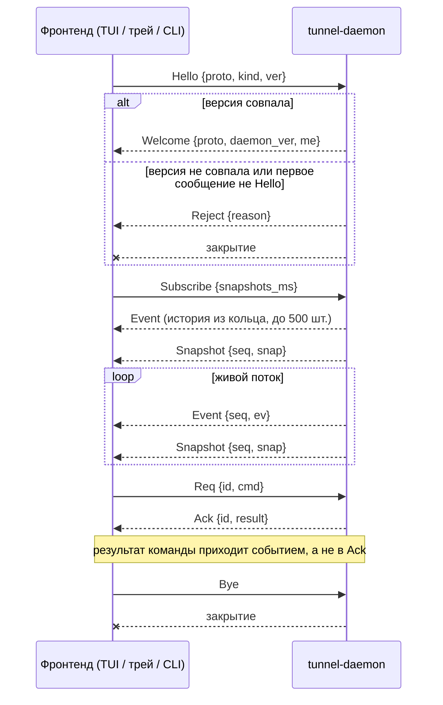

Главное:

- Первое сообщение соединения — `Hello`. Без него демон отвечает `Reject` и закрывает соединение.
- `Ack` говорит только о том, принял ли демон команду (`Ok`) или отверг (`Err` с текстом). Фактический результат (`GroupJoined`, `Error`, `Notice`…) приходит как `Event`.
- Состояние для интерфейса строится из `Snapshot`. События нужны, чтобы показать ленту и реагировать на происходящее; лента — не источник правды.
- Каждое соединение независимо: медленный или упавший клиент не задерживает ни движок, ни других клиентов.


### Транспорт

Крейт `tunnel-ipc` экспортирует `Listener` (сторона демона), `Conn` (соединение, `Read + Write`, `try_clone()`) и `connect(name)`. Имя `name` зависит от платформы.

| Платформа | Конечная точка | Значение по умолчанию | Кто создаёт |
|---|---|---|---|
| Unix (Linux, macOS) | Unix-сокет (путь) | `<каталог данных>/daemon.sock` (`transport::DEFAULT_SOCKET_FILE`) | демон в режиме `console` |
| Windows | named pipe | `\\.\pipe\tunnel-daemon` (`transport::DEFAULT_PIPE_NAME`) | служба (`tunnel-daemon service`) |

Каталог данных по умолчанию: на Unix `$HOME/.tunnel-client`, на Windows `%ProgramData%\tunnel`. Путь можно задать ключом `--data-dir` у `tunnel-daemon`.

#### Unix-сокет

- Демон проверяет каталог сокета до `bind`: он должен принадлежать текущему пользователю (euid) и не давать доступа группе и остальным (`mode & 0o077 == 0`). Если каталог создаётся заново — права `0700`. Если каталог существует, но открыт (например `0755`) и принадлежит тому же пользователю, демон выставляет `0700` и пишет предупреждение в лог. Чужой каталог демон не трогает и отказывается стартовать.
- Файл сокета создаётся, затем получает права `0600`. Между `bind` и `chmod` сокет на короткое время имеет права по umask, поэтому закрытость каталога — обязательное условие.
- Устаревший сокет (к нему никто не подключён, `ECONNREFUSED`) удаляется перед стартом, но только под замком демона (`daemon.lock`). Если по пути лежит не сокет — демон не трогает файл и не стартует.
- При остановке слушатель удаляет свой файл сокета (проверка по `dev`/`ino`, чужой сокет не удаляется).
- Клиент просто вызывает `connect(path)`. Дополнительной проверки личности сервера на Unix нет: права каталога и файла защищают сокет.

#### Windows named pipe

Сервер создаётся с флагами:

- `PIPE_ACCESS_DUPLEX | FILE_FLAG_OVERLAPPED`; на первом экземпляре ещё `FILE_FLAG_FIRST_PIPE_INSTANCE`. Если пайп с таким именем уже поднят кем-то другим, `bind` падает, а не подключается к чужому.
- `PIPE_TYPE_BYTE | PIPE_READMODE_BYTE | PIPE_WAIT | PIPE_REJECT_REMOTE_CLIENTS`: только локальные клиенты.
- `PIPE_UNLIMITED_INSTANCES`, буферы по 64 KiB в каждую сторону.

Дескриптор безопасности задаётся явным SDDL, который собирает `transport::pipe_sddl(owner, client_sid)`. Владелец объекта зависит от того, кто поднимает пайп:

```text
служба (LocalSystem):  O:SYD:P(A;;GA;;;SY)(A;;GA;;;BA)(A;;0x12019b;;;<SID владельца>)
console (администратор): O:BAD:P(A;;GA;;;SY)(A;;GA;;;BA)(A;;0x12019b;;;<SID пользователя>)
```

- `O:SY` — владелец объекта SYSTEM; поставить такого владельца может только SYSTEM.
- `O:BA` — владелец объекта Administrators; поставить его может только процесс с включённой группой Administrators (в UAC-фильтрованном токене BA — deny-only, `CreateNamedPipeW` отказал бы). Поэтому `tunnel-daemon console` поднимает пайп только от администратора.
- `SY` и `BA` (SYSTEM и Administrators) — полный доступ.
- SID владельца-пользователя записывается при установке службы (`owner.sid`). Ему выдаётся `0x12019b` = `FILE_GENERIC_READ | FILE_GENERIC_WRITE` без права создавать экземпляры пайпа (бит `0x4`). Без этого любой процесс пользователя мог бы поднять свой экземпляр серверной стороны.
- Без SID владельца (`bind` без него) пользователю доступа нет вообще.
- Значение SID проверяется на допустимые символы (`S-1-…`, только цифры и дефисы), чтобы в SDDL нельзя было ничего подмешать.

Клиент (`connect`) открывает пайп с маской `0x12019b`, `FILE_SHARE_NONE`, `SECURITY_IDENTIFICATION` и `FILE_FLAG_OVERLAPPED`. При `ERROR_PIPE_BUSY` ждёт до 5 раз по 2 с (`WaitNamedPipeW`).

Главное правило доверия: **клиент проверяет, что сервер пайпа — служба (SYSTEM) или демон от администратора того же пользователя.** Проверка идёт так (`decide_trust`):

1. `GetNamedPipeServerProcessId` — PID процесса-сервера.
2. Токен этого процесса (`OpenProcess` + `OpenProcessToken`): SID пользователя и `TokenElevation`.
   - пользователь — LocalSystem → служба, доверяем;
   - пользователь — текущий **и** процесс повышен → `tunnel-daemon console`, доверяем.
3. Если токен открыть нельзя (`ERROR_ACCESS_DENIED`), проверяется владелец объекта пайпа (`GetSecurityInfo`): SYSTEM (`O:SY` у службы) или Administrators (`O:BA` у `console`; такого владельца ставит только процесс с включённой группой Administrators).

Если сервер не подошёл ни под одно правило, `connect` возвращает `PermissionDenied`. Неповышенный процесс того же пользователя, занявший имя пайпа, отвергается: токен читается, но `TokenElevation` = 0. Служба и `console` делят одно имя — второй пайп не поднимется (`FIRST_PIPE_INSTANCE`). Подробности и модель угроз — [SECURITY.md](SECURITY.md), раздел 13.

Таймаутов у пайпа нет (нет `set_read_timeout`). Поэтому ожидание `Hello` на стороне демона и ожидание `Welcome`/`Ack` на стороне клиента реализованы через поток чтения и очередь (см. [клиентский раздел](#пример-клиента-на-rust-ipcclient)).


### Фрейминг

Каждое сообщение — один фрейм:

```text
+----------------------+----------------------------------+
| длина, u32 LE (4 Б)  | тело: UTF-8 JSON (длина байт)    |
+----------------------+----------------------------------+
```

- Длина — little-endian `u32`, длина тела без самого заголовка.
- Тело — JSON-объект сообщения (`ClientMsg` или `DaemonMsg`), кодировка UTF-8.
- Лимит тела — **1 МиБ** (`MAX_FRAME = 1 << 20`). Тело ровно в 1 МиБ допустимо.
- Длина `0` недопустима: пустой фрейм не бывает валидным JSON.
- Отправитель записывает заголовок и тело одной операцией записи. Если тело больше лимита, `write_msg` возвращает `CodecError::TooLarge` и ничего не пишет.
- Получатель проверяет длину до выделения памяти.

Ошибки чтения фрейма, кроме таймаута, — повод закрыть соединение:

| Ситуация | Что происходит |
|---|---|
| Пир закрыл соединение на границе фрейма | `CodecError::Closed` (нормальное завершение) |
| Обрыв посреди фрейма | `CodecError::Truncated` |
| Длина `0` | `CodecError::BadLength` |
| Длина больше 1 МиБ | `CodecError::TooLarge(n)` |
| Тело не разбирается как сообщение | `CodecError::Json` |

Демон при любой такой ошибке закрывает только это соединение, остальные работают.


### Сообщения

Сообщения — JSON-объекты с полем-тегом `t` (внутренняя разметка serde, `rename_all = "snake_case"`).

#### Фронтенд → демон (`ClientMsg`)

| `t` | Поля | Смысл |
|---|---|---|
| `hello` | `proto` (u32), `kind` (`tui` / `tray` / `cli`), `ver` (строка) | первое сообщение соединения |
| `req` | `id` (u64), `cmd` (любое JSON-значение, форма `Cmd`) | команда движку, ответ — `ack` с тем же `id` |
| `subscribe` | `snapshots_ms` (u32) | подписка на события и снимки |
| `bye` | — | вежливое закрытие |

#### Демон → фронтенд (`DaemonMsg`)

| `t` | Поля | Смысл |
|---|---|---|
| `welcome` | `proto`, `daemon_ver`, `me` | ответ на подходящий `hello` |
| `reject` | `reason` | отказ на `hello`, после него закрытие |
| `ack` | `id`, `result` (`"ok"` или `{"err": "текст"}`) | команда принята или отклонена демоном |
| `event` | `seq` (u64), `ev` (JSON события движка) | событие движка |
| `snapshot` | `seq` (u64), `snap` (JSON снимка) | полное состояние |
| `shutdown` | `reason` | демон завершается; после него соединение закрывается |

#### Примеры

Все примеры — тела фреймов (без заголовка длины).

Hello:

```json
{"t": "hello", "proto": 1, "kind": "tui", "ver": "0.4.2"}
```

Welcome:

```json
{"t": "welcome", "proto": 1, "daemon_ver": "0.4.2", "me": {"my_pub": "9f3a…(64 hex)…", "my_code": "TUN-…"}}
```

Reject (версия не совпала):

```json
{"t": "reject", "reason": "несовместимая версия IPC: клиент 2, демон 1 — обновите tunnel-client / демон"}
```

Subscribe:

```json
{"t": "subscribe", "snapshots_ms": 1000}
```

Req (команда `RefreshList` без аргументов и `Join` с аргументом):

```json
{"t": "req", "id": 1, "cmd": "RefreshList"}
```

```json
{"t": "req", "id": 2, "cmd": {"Join": 2}}
```

Ack, принято:

```json
{"t": "ack", "id": 2, "result": "ok"}
```

Ack, отклонено:

```json
{"t": "ack", "id": 2, "result": {"err": "нет группы 2"}}
```

Event:

```json
{"t": "event", "seq": 12, "ev": {"GroupJoined": {"gid": 2, "name": "dev", "my_ip": 167772162}}}
```

Snapshot (поля снимка показаны частично, полная схема — `Snapshot` в `crates/client/src/snapshot.rs`):

```json
{"t": "snapshot", "seq": 12, "snap": {"groups": [], "meta": {"connected": true}, "stats": {}, "cfg": {}, "pending_invites": []}}
```

Shutdown:

```json
{"t": "shutdown", "reason": "демон остановлен"}
```

Bye:

```json
{"t": "bye"}
```

Замечания по разбору:

- Лишние поля в JSON игнорируются (serde по умолчанию), так что добавление полей не ломает старый клиент.
- Неизвестное значение `t` — ошибка разбора, и соединение закрывается.


### Рукопожатие и подписка

1. Клиент открывает соединение и отправляет `hello`.
2. Демон проверяет `proto`:
   - совпало — отвечает `welcome`, в котором `me` берётся из `Backend::me()` (как минимум `my_pub` и `my_code`);
   - не совпало — `reject`, затем закрытие;
   - первым пришло не `hello` — `reject` с причиной «первым сообщением должен быть Hello», затем закрытие.
3. Повторный `hello` на том же соединении — закрытие.
4. Клиент отправляет `subscribe`. Сразу после этого демон шлёт:
   - историю — последние события из кольца (до 500 штук, по возрастанию `seq`), как `event`;
   - снимок на момент подписки, как `snapshot`;
   - дальше живой поток `event` и `snapshot`.
5. Повторный `subscribe` игнорируется (записывается в лог).
6. `req` можно слать и до `subscribe`, и после. Подписка нужна только для потока событий.

Таймаут на `hello` на стороне демона — 10 с (только Unix; у пайпа таймаутов нет). Клиент задаёт свой таймаут на весь handshake аргументом `timeout` в `IpcClient::connect`.


### Команды (Req и Ack)

`req` несёт `id` и `cmd`. `id` выбирает клиент; он должен быть уникальным на соединении, чтобы сопоставить `ack`. Демон не проверяет уникальность, но `IpcClient` выдаёт `id` по порядку, начиная с 1.

Что означает `ack`:

- `ok` — команда передана движку (`Backend::send` вернул `Ok`).
- `{"err": "…"}` — команда отвергнута до движка: не разобрана, неверный аргумент (например, нет такой группы), нет сервера. Текст — для показа пользователю.

`ack` **не** говорит, что команда выполнена. Результат придёт событием, например `GroupJoined`, `Error`, `Notice`. Поэтому интерфейс не должен ждать `ack` как подтверждения действия: отображать результат по событиям.

Если демон завершается, пока команда ждёт ответа, клиент получает `shutdown` вместо `ack`.


### Номера seq, пропуски и снимки

#### Что такое seq

- `seq` события — монотонный номер с 1, без повторов, в пределах одного запуска демона. После перезапуска демона нумерация начинается заново. Клиент должен держать `last_seq` для **каждого соединения** отдельно и сбрасывать его при переподключении.
- `seq` снимка — номер последнего события, которое уже учтено в состоянии снимка. Снимок с `seq = S` описывает состояние после события `S`.

#### Правила клиента

Минимально корректный клиент ведёт себя так:

1. Состояние (то, что рисуется) заменяется целиком на каждый `snapshot`. Лента событий отдельно.
2. Историю из кольца (события сразу после `subscribe`) не нужно проигрывать для восстановления состояния. Историю берите для показа ленты или лога; состояние берите из снимка.
3. Событие с `seq <= last_seq` — повтор, его игнорировать.
4. Событие с `seq == last_seq + 1` — применить и обновить `last_seq`.
5. Событие с `seq > last_seq + 1` — **пропуск**. Клиент отмечает, что состояние может быть неполным, и до ближайшего `snapshot` события не применяет (только показывает, если нужно). Демон сам пришлёт снимок, который покрывает пропуск.
6. `snapshot` с `seq = S` — заменить состояние, `last_seq = max(last_seq, S)`, сбросить признак пропуска. События с `seq <= S` после этого игнорируются.

#### Когда демон шлёт снимки

- Сразу после `subscribe` — один снимок.
- Раз в секунду (`SNAPSHOT_EVERY`), даже без изменений, и сразу при изменении состояния (`Backend::changed`).
- Клиенту, у которого был пропуск (переполнение его очереди на стороне демона), снимок досылается на ближайшем такте хаба, пока не влезет в очередь.
- Снимок без новых событий, но при изменении состояния, не чаще, чем раз в `snapshots_ms` мс. Снимок, в котором есть новые события, шлётся без задержки.
- Пока клиент ждёт снимок после пропуска, события ему не шлются. Их состояние покрывает снимок.

#### Диаграмма пропуска

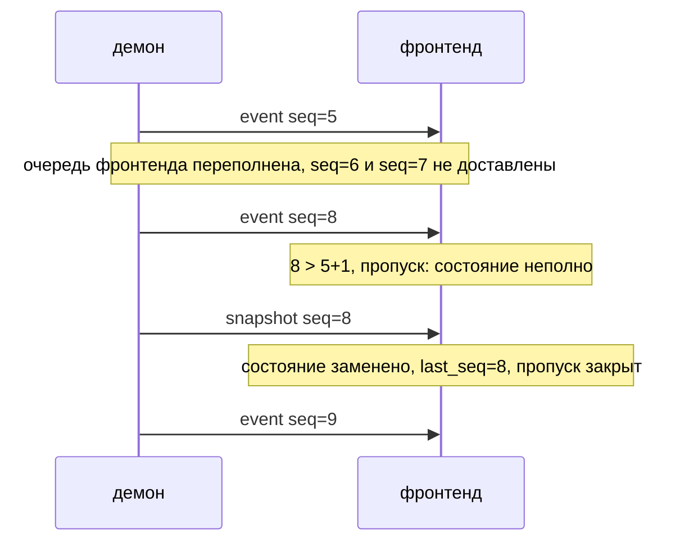


### Формы команд и событий (JSON)

#### Команды (`cmd`)

Команды — это `Cmd` движка (`crates/client/src/engine.rs`). Демон передаёт `cmd` в `Backend::send` как `serde_json::Value`; разбор в `Cmd` делает бэкенд. Форма — стандартная внешне помеченная (externally tagged) форма serde:

| Вариант `Cmd` | JSON | Примечание |
|---|---|---|
| `RefreshList` | `"RefreshList"` | без аргументов, строка |
| `Create { name, private }` | `{"Create": {"name": "dev", "private": false}}` | структурный вариант |
| `Join(gid)` | `{"Join": 2}` | `gid` — u32 |
| `Leave(gid)` | `{"Leave": 2}` | |
| `Delete(gid)` | `{"Delete": 2}` | |
| `Rename(gid, name)` | `{"Rename": [2, "новое имя"]}` | кортеж: массив |
| `Invite(gid, pubkey)` | `{"Invite": [2, [ …32 числа… ]]}` | `pubkey` — `[u8; 32]` |
| `DeclineInvite(gid)` | `{"DeclineInvite": 2}` | |
| `Kick(gid, pubkey)` / `Ban(gid, pubkey)` / `Unban(gid, pubkey)` / `Transfer(gid, pubkey)` | `{"Ban": [2, [ …32 числа… ]]}` | по аналогии с `Invite` |
| `GroupAdmin(gid)` | `{"GroupAdmin": 2}` | ответ — событие `AdminInfo` |
| `SetName(name)` | `{"SetName": "вася"}` | |
| `SetStatus(text)` | `{"SetStatus": "в сети"}` | |
| `SetInvisible(bool)` | `{"SetInvisible": true}` | |
| `SwitchServer { addr, pubkey, label }` | `{"SwitchServer": {"addr": "203.0.113.5:7000", "pubkey": [ …32 числа… ], "label": "main"}}` | |
| `ToggleAutojoin(gid)` | `{"ToggleAutojoin": 2}` | |
| `FriendGroups(pubkey)` | `{"FriendGroups": [ …32 числа… ]}` | |
| `AddFriend { pubkey, alias }` | `{"AddFriend": {"pubkey": [ …32 числа… ], "alias": "вася"}}` | правка конфига на стороне демона |
| `DelFriend(pubkey)` | `{"DelFriend": [ …32 числа… ]}` | |
| `SetAlias { pubkey, alias }` | `{"SetAlias": {"pubkey": [ …32 числа… ], "alias": "вася"}}` | |
| `AddServer { addr, pubkey, label }` | `{"AddServer": {"addr": "203.0.113.5:5555", "pubkey": [ …32 числа… ], "label": "main"}}` | `addr` — строка `ip:port` |
| `DelServer { idx }` | `{"DelServer": {"idx": 1}}` | текущий сервер движка не удаляется |
| `SetPrimaryServer { idx }` | `{"SetPrimaryServer": {"idx": 0}}` | |
| `Quit` | `"Quit"` | демон отвечает `ack` с ошибкой «демон не завершается по команде фронтенда»: остановки демона через IPC протокол не предусматривает |

Замечания:

- Форма `[u8; 32]` и `SocketAddr` — по умолчанию serde: массив из 32 чисел и строка `ip:port`. `Cmd` и `Event` имеют derive `Serialize`/`Deserialize`; точный список вариантов — в `crates/client/src/engine.rs`.
- Бэкенд на живом движке (`EngineBackend`) разбирает `cmd` в `Cmd`; неразобранная команда — `ack` с ошибкой «неверная команда: …». Команды правки конфига (`AddFriend`, `DelFriend`, `SetAlias`, `AddServer`, `DelServer`, `SetPrimaryServer`) проверяются до отправки движку (`check_cfg_cmd`), отказ приходит в `ack`.
- Рабочий пример формы команд есть в `crates/daemon/src/fake.rs`: `FakeBackend` разбирает `"RefreshList"`, `{"Join": gid}`, `{"Leave": gid}`, `{"Create": {...}}`, `{"SetName": "…"}`.

#### События (`ev`)

`ev` — это `Event` движка, в той же внешне помеченной форме. Основные варианты (остальные — в `enum Event`):

| Вариант `Event` | JSON |
|---|---|
| `Connected(addr)` | `{"Connected": "127.0.0.1:7000"}` |
| `GroupJoined { gid, name, my_ip }` | `{"GroupJoined": {"gid": 2, "name": "dev", "my_ip": 167772162}}` |
| `GroupLeft { gid, name }` | `{"GroupLeft": {"gid": 2, "name": "dev"}}` |
| `Notice(text)` | `{"Notice": "список групп обновлён"}` |
| `Error(text)` | `{"Error": "уже в группе 2"}` |
| `Disconnected(reason)` | `{"Disconnected": "нет ответа"}` |
| `GroupDeleted { gid, name }` | `{"GroupDeleted": {"gid": 2, "name": "dev"}}` |
| `Kicked { gid, name, banned }` | `{"Kicked": {"gid": 2, "name": "dev", "banned": false}}` |
| `Invite { gid, group_name, from_pubkey, from_name, expires_in }` | приглашение в группу |
| `InviteDeclined`, `InviteRevoked`, `InvitesSynced`, `AdminInfo`, `FriendGroups` | ответы на приглашения, `GroupAdmin`, `FriendGroups` |
| `PeerOnline`, `PeerOffline`, `Direct`, `DirectLost` | состояние участников и p2p-каналов |
| `ServerKeyRotated`, `ServerSwitched` | смена ключа или сервера |

Полный список вариантов — `enum Event` в `crates/client/src/engine.rs`. Новые варианты добавляются без смены версии протокола: старый клиент их не знает, но разбирает `ev` как JSON. Интерфейс должен показывать неизвестные события как нейтральную строку, а не падать.

#### Снимок (`snap`)

Снимок — структура `Snapshot` из `crates/client/src/snapshot.rs`: `groups` (по возрастанию gid), `meta` (соединение, сервер, список групп), `stats` (счётчики трафика), `cfg` (представление конфига), `pending_invites` (неотвеченные приглашения). Снимок целиком заменяет состояние интерфейса.


### Версионирование

Есть две версии, их не смешивать:

- **`PROTO_VERSION`** (сейчас `1`) — версия этого IPC-протокола. Проверяется при `hello`. Точное совпадение обязательно: иначе `reject`.
- **`ver`** в `hello` и **`daemon_ver`** в `welcome` — версии программ. Они нужны для логов и текста ошибки, на совместимость не влияют.

Что считать совместимым изменением:

| Изменение | Нужно ли менять `PROTO_VERSION` |
|---|---|
| Новый вариант `Event` или `Cmd` | нет (клиент видит его как JSON) |
| Новое необязательное поле в `snap`, `ev`, `cmd` | нет, если старый клиент его не требует |
| Новое поле в `hello`/`welcome`/`req`/`ack`/`event`/`snapshot`, которое старый клиент не может проигнорировать | да |
| Новый тип сообщения (новое значение `t`) | да |
| Переименование или смысл поля | да |
| Изменение фрейминга или лимитов | да |

При изменении версии клиент и демон должны обновляться вместе: старый демон отвечает `reject` новому клиенту и наоборот. Текст `reject` подсказывает, что обновить.


### Таймауты и лимиты

Константы из кода:

| Константа | Значение | Где | Смысл |
|---|---|---|---|
| `MAX_FRAME` | 1 МиБ | `codec` | лимит тела фрейма |
| `HELLO_TIMEOUT` | 10 с | демон, Unix | ждать `hello` от нового соединения |
| `WRITE_TIMEOUT` | 30 с | демон, Unix | запись, застрявшая дольше, рвёт соединение |
| `SHUTDOWN_GRACE` | 500 мс | демон | сколько ждать доставки `shutdown` перед разрывом |
| `RING_CAP` | 500 | хаб | сколько последних событий хранится для новых подписчиков |
| `DEFAULT_QUEUE` | 256 | хаб | очередь сообщений на подписчика |
| `SNAPSHOT_EVERY` | 1 с | хаб | период снимков без изменений |
| `TICK` | 50 мс | хаб | такт цикла хаба |
| `CLIENT_QUEUE` | 1024 | клиент | сообщений демона, которые буферизует поток чтения клиента |
| `PIPE_BUF` | 64 KiB | Windows | буферы пайпа |
| `BUSY_RETRIES` / `BUSY_WAIT_MS` | 5 / 2000 мс | Windows, клиент | ожидание занятого экземпляра пайпа |

Медленный подписчик не тормозит движок и других клиентов: хаб отправляет через `try_send` и при переполнении очереди пропускает события этому клиенту, см. [пропуски](#номера-seq-пропуски-и-снимки).


### Ошибки

Ошибки клиентской библиотеки (`ClientError`):

| Вариант | Когда |
|---|---|
| `Connect(io::Error)` | демона нет, нет прав, сервер пайпа не служба и не повышенный демон этого пользователя |
| `Rejected(reason)` | демон отказал на `hello` (версия и т.п.) |
| `Timeout` | ответ не пришёл в срок |
| `Shutdown(reason)` | демон завершается |
| `Closed(None \| Some(CodecError))` | соединение закрыто или испорчено |
| `Protocol(msg)` | пришло не то, что ожидалось (например, не `welcome` после `hello`) |

Ошибки кодека (`CodecError`) перечислены в [фрейминге](#фрейминг).


### Пример клиента на Python (Unix)

Пример показывает handshake, подписку, команду и обработку пропусков по правилам из [раздела про seq](#номера-seq-пропуски-и-снимки). Он работает с Unix-сокетом.

Для Windows Python-клиент не подходит для доверенного использования: в нём нет проверки сервера пайпа (SYSTEM или повышенный демон этого пользователя). Используйте Rust-клиент `IpcClient` (ниже), который эту проверку делает.

```python
import json
import os
import socket
import struct

MAX_FRAME = 1 << 20


def send(sock, msg):
    body = json.dumps(msg, ensure_ascii=False).encode("utf-8")
    if not 0 < len(body) <= MAX_FRAME:
        raise ValueError(f"размер тела {len(body)} вне допустимого диапазона")
    sock.sendall(struct.pack("<I", len(body)) + body)


def recv_exact(sock, n):
    buf = bytearray()
    while len(buf) < n:
        chunk = sock.recv(n - len(buf))
        if not chunk:
            raise EOFError("соединение закрыто" if not buf else "обрыв посреди фрейма")
        buf.extend(chunk)
    return bytes(buf)


def recv(sock):
    (n,) = struct.unpack("<I", recv_exact(sock, 4))
    if n == 0 or n > MAX_FRAME:
        raise ValueError(f"неверная длина фрейма: {n}")
    return json.loads(recv_exact(sock, n))


def main():
    path = os.path.join(os.path.expanduser("~"), ".tunnel-client", "daemon.sock")
    with socket.socket(socket.AF_UNIX, socket.SOCK_STREAM) as sock:
        sock.settimeout(5)
        sock.connect(path)
        send(sock, {"t": "hello", "proto": 1, "kind": "cli", "ver": "example-0.1"})
        welcome = recv(sock)
        if welcome["t"] == "reject":
            raise SystemExit(f"демон отказал: {welcome['reason']}")
        print("демон", welcome["daemon_ver"], "me =", welcome["me"])

        sock.settimeout(None)
        send(sock, {"t": "subscribe", "snapshots_ms": 1000})
        send(sock, {"t": "req", "id": 1, "cmd": "RefreshList"})

        last_seq = 0       # на каждое соединение свой
        gap = False        # был пропуск, ждём snapshot
        while True:
            m = recv(sock)
            if m["t"] == "ack":
                print("ack", m["id"], m["result"])
            elif m["t"] == "snapshot":
                # состояние заменяется целиком; история не проигрывается
                last_seq = max(last_seq, m["seq"])
                gap = False
                print("snapshot до seq", m["seq"])
            elif m["t"] == "event":
                if m["seq"] <= last_seq:
                    continue                  # повтор
                if gap or m["seq"] != last_seq + 1:
                    gap = True                # пропуск: ждём snapshot
                    continue
                last_seq = m["seq"]
                print("event", m["seq"], m["ev"])
            elif m["t"] == "shutdown":
                print("демон завершается:", m["reason"])
                break

        send(sock, {"t": "bye"})


if __name__ == "__main__":
    main()
```

Проверка синтаксиса без запуска демона: `python3 -m py_compile ipc_client.py`.


### Пример клиента на Rust (IpcClient)

`IpcClient` из `tunnel-ipc` делает всё, что описано выше: handshake с таймаутом, проверку SYSTEM на Windows, буферизацию событий во время ожидания `ack`. Пример — отдельный крейт, которому нужны зависимости:

```toml
[dependencies]
tunnel-ipc = { path = "crates/ipc" }
serde_json = "1"
```

```rust
use std::time::Duration;

use serde_json::json;
use tunnel_ipc::{ClientKind, DaemonMsg, IpcClient};

/// Unix: путь к сокету. Windows: имя пайпа.
#[cfg(unix)]
fn endpoint() -> std::path::PathBuf {
    let home = std::env::var("HOME").expect("HOME не задан");
    std::path::Path::new(&home).join(".tunnel-client").join("daemon.sock")
}

#[cfg(windows)]
fn endpoint() -> std::ffi::OsString {
    tunnel_ipc::transport::DEFAULT_PIPE_NAME.into()
}

fn main() -> Result<(), Box<dyn std::error::Error>> {
    // Handshake: Hello -> Welcome, не дольше 5 с.
    let mut c = IpcClient::connect(
        endpoint(),
        ClientKind::Cli,
        env!("CARGO_PKG_VERSION"),
        Duration::from_secs(5),
    )?;
    println!("демон {}, me = {}", c.daemon_ver(), c.me());

    c.subscribe(1000)?;

    // Команда и её Ack (не дольше 3 с). Результат придёт событием.
    let ack = c.request(json!("RefreshList"), Duration::from_secs(3))?;
    println!("ack: {ack:?}");

    // Читаем, пока демон не завершится.
    loop {
        match c.recv(None)? {
            DaemonMsg::Event { seq, ev } => println!("event {seq}: {ev}"),
            DaemonMsg::Snapshot { seq, .. } => println!("snapshot до seq {seq}"),
            DaemonMsg::Shutdown { reason } => {
                println!("демон завершается: {reason}");
                break;
            }
            other => println!("прочее: {other:?}"),
        }
    }
    c.bye();
    Ok(())
}
```

Что важно помнить при использовании `IpcClient`:

- `request` возвращает `AckResult` (`Ok` или `Err(String)`), а не результат команды. Результат смотрите в событиях.
- Во время ожидания `ack` пришедшие события и снимки не теряются: их отдаст следующий `recv`.
- `recv(None)` ждёт бесконечно. Для интерфейса с циклом отрисовки используйте `recv(Some(t))` или `try_recv()`.
- `Shutdown` приходит и как сообщение `recv`, и как `ClientError::Shutdown` из `request`.
- Для правил seq (пропуски, снимки) `IpcClient` ничего не делает: их нужно реализовать в интерфейсе, как в примере на Python.


## Глоссарий

### Идентичность и знакомства

| Термин | Определение |
|---|---|
| **Identity** | Пара ключей клиента: ed25519 (подпись, идентификатор) и X25519 (обмен ключами). Создаётся при первом запуске и хранится в локальном конфиге клиента (`client.json`). См. [PLAN.md](archive/PLAN.md), этап 1. |
| **Pubkey** | Публичный ed25519-ключ identity — 32 байта, главный идентификатор участника. В интерфейсе и логах показывается коротко. |
| **Friend code** | Код для обмена знакомствами: base32 (Crockford) от публичного ключа, вида `TUN-XXXXXXXX-…`: 52 символа после префикса, группами по 8 через дефис. Вставка кода в `add-friend` или окно «добавить друга» (`a`) **отправляет заявку** — связь появляется только после принятия. |
| **Друг (friend)** | Запись в локальном конфиге: публичный ключ и локальное имя (alias). Видна только у вас, не на сервере. |
| **Alias** | Локальное имя друга или участника, задаваемое владельцем конфига (`alias`, `:alias`). Перекрывает ник: показывается первым. |
| **Ник (nick)** | Имя друга, пришедшее с сервера (`FRIEND_LIST`, кадр 0x97) и сохранённое в `client.json` как кэш: сервер ников не хранит, он берёт имя из живой сессии или групп в момент отправки кадра. Показывается, когда ручного алиаса нет; если нет и ника — короткий код (первые 4 байта ключа). Правило: **alias → ник → короткий код**. |
| **Заявка в друзья** | Кадр `FRIEND_REQ` (0x1B) и хранимая сервером запись `requests` в `server.json`. Дружба появляется только после принятия (`FRIEND_ACCEPT`); заявка живёт `friend_req_ttl` (7 дней), повтор продлевает срок, встречная заявка принимается автоматически. |
| **Пара друзей (edge)** | Принятая дружба: упорядоченная пара pubkey (`min`, `max`) в `server.json → friends.edges`. Одна запись на двоих, поэтому снятие с любой стороны снимает её у обоих. |
| **Сервер (server)** | Процесс `tunnel-server`: рандеву, релей, хранение групп и выдача IP. Клиент подключается к одному или нескольким серверам. |
| **Код сервера (server key)** | Публичный ключ сервера, закреплённый (pinned) клиентом при первом подключении. Подменённый сервер с другим ключом отвергается. При ротации новый ключ подписывается старым (см. [ротация ключа сервера](#ключи-и-безопасность)). |
| **Активный сервер** | Сервер, к которому относится список автовхода и который используется по умолчанию. Задаётся в настройках TUI или `Config.active_server`. |
| **Автовход (autojoin)** | Список групп, в которые клиент входит автоматически при старте `run` / `tui`. |
| **Невидимка (invisible)** | Режим, в котором другие участники видят клиента офлайн. Передаётся флагом `HELLO3` и фреймом `PRESENCE`. |
| **Статус (status)** | Короткая строка, которую видят участники группы рядом с именем. |


### Группы и сеть

| Термин | Определение |
|---|---|
| **Группа (group)** | Отдельная виртуальная сеть с собственным ключом и списком участников. Управляется владельцем. |
| **gid** | Номер группы, от 1 до 254 (`GID_MAX`). В IP-адрес не входит: адрес участника один на все его группы. |
| **Публичная группа** | Видна всем в списке публичных групп; вход по желанию (`j` в TUI, `join`). |
| **Приватная группа** | Видна только участникам; вход по приглашению владельца. |
| **Владелец (owner)** | Identity, создавшая группу. Может приглашать, кикать, банить и передавать владение (`TRANSFER_OWNER`). |
| **Участник (member)** | Identity, состоящая в группе. Адрес — общий для всех групп пользователя на сервере. |
| **Lease** | Постоянный оверлейный адрес identity на сервере: один на все её группы, хранится в `user_ips` (`server.json`) и сохраняется после выхода из групп и рестарта. Освобождается только когда пул исчерпан и identity не состоит ни в одной группе. |
| **IP участника (src_ip / dst_ip)** | Адрес участника в оверлее (`100.66.<a>.<b>`), выдаётся сервером. Клиент сам адрес не выбирает. |
| **Приглашение (invite)** | Запрос владельца вступить в приватную группу. Живёт до ответа или срока `invite_ttl` (по умолчанию 7 дней). Принимается, отклоняется или откладывается. |
| **Окно приглашений (invite window)** | Окно в TUI, показывающее приглашение: кто пригласил, группа, очередь. Принять, отклонить или отложить (`Позже`). |
| **Бан (ban)** | Запрет входа в группу для identity. Снимается командой `UNBAN`. |
| **Кик (kick)** | Удаление участника из группы. Для приглашённого, но ещё не вошедшего, кик означает отзыв приглашения. |
| **Тема (theme)** | Цветовая схема TUI: `dark`, `light`, `contrast`, `amber`, `fjord`. Задаётся в настройках (F3) или `Config.theme`. |
| **Виджеты / бейджи** | Элементы статус-бара TUI: счётчики приглашений, соединения, невидимости, транспорта и пиров (direct/relay). |


### Ключи и безопасность

| Термин | Определение |
|---|---|
| **Cookie** | Одноразовый токен, который сервер выдаёт в `CHALLENGE` на первый `HELLO3`. Клиент повторяет `HELLO3` с cookie; так сервер отличает реального отправителя от подменённого адреса и не выделяет состояние без проверки. |
| **Эфемерный ключ (eph key)** | X25519-ключ, создаваемый заново на каждую попытку подключения. Обеспечивает прямую секретность: компрометация долгосрочного ключа не раскрывает прошлый трафик. |
| **Сеансовые ключи (c2s / s2c)** | Ключи шифрования управляющего канала, выведенные из статических и эфемерных ключей. Клиент шлёт `c2s`, сервер — `s2c`. |
| **Replay window (окно повторов)** | Окно из 1024 счётчиков, защищающее от повтора фреймов. Ctrl-фреймы — окно на сессию; групповые — на пару (ключ группы, `src_ip`). Сдвигается только после успешной расшифровки. |
| **Counter (счётчик)** | Номер фрейма в nonce ChaCha20-Poly1305. У отправителя строго растёт. |
| **Epoch (эпоха)** | Номер ключа группы. Растёт при каждой ротации (вход, выход, кик, бан, новая сессия участника). Фрейм несёт `epoch` в открытом заголовке. |
| **Ключ группы** | Симметричный ключ, которым шифруется payload групповых фреймов. Генерируется сервером и выдаётся участникам по защищённому каналу. |
| **Прошлый ключ (prev)** | Предыдущий ключ группы, который принимается несколько секунд после ротации, чтобы не терять пакеты в полёте. Отзывается при выходе или кике. |
| **Revoke / отзыв** | Ротация ключа с отзывом прежнего: выход, кик или бан участника. Отозванный ключ больше не принимается. |
| **Rev (ревизия)** | Номер версии состояния группы (участники, имя, владелец). Монотонен, сохраняется на сервере. Клиент отбрасывает устаревшее состояние по `rev`. |
| **Ротация ключа сервера** | Смена identity сервера командой `tunnel-server rotate-key`. Старый ключ подписывает новый, цепочка звеньев передаётся клиентам в `WELCOME`, и клиенты перезакрепляются сами. |
| **WELCOME** | Ответ сервера после успешной проверки подписи HELLO3. Несёт эфемерный ключ сервера, подпись и цепочку ротаций. |
| **Forward secrecy (прямая секретность)** | Свойство, которое обеспечивают эфемерные ключи: прошлые сеансы остаются защищёнными при утечке долгосрочного ключа. |


### Соединение и NAT

| Термин | Определение |
|---|---|
| **Relay (релей)** | Пересылка групповых фреймов через сервер, когда прямой канал недоступен. Сервер читает только открытый заголовок (gid, src_ip, dst_ip, epoch) и не расшифровывает payload. |
| **Direct (прямой канал)** | P2P-соединение между двумя участниками по UDP, найденное после пробития NAT. В интерфейсе отмечено зелёным цветом. |
| **Candidate (кандидат)** | Адрес `ip:port`, который клиент сообщает серверу и через который можно достучаться до клиента: LAN-адрес или адрес, виденный сервером. Отправляется фреймом `CANDIDATES` (не больше 4). |
| **Punch (пробитие NAT)** | Обмен фреймами `PUNCH` и `KEEPALIVE` с пиром, чтобы открыть отображение в NAT на обеих сторонах. Прямой канал поднимается на том адресе, с которого первым пришёл ответ. |
| **Keepalive** | Периодический пустой фрейм, поддерживающий открытое NAT-отображение и показывающий, что пир жив. |
| **RTT-зонд (PING/PONG)** | Измерение задержки до пира раз в 2 секунды; результат показывается в списке участников. |
| **Транспорт (transport)** | UDP (по умолчанию) или TCP-резерв. `Config.transport`: `auto`, `udp`, `tcp`. В режиме `auto` TCP включается, когда UDP-рукопожатие не проходит; p2p с пирами остаётся UDP. |
| **Session (сессия)** | Состояние одного подключения на сервере: identity, адрес, сеансовые ключи, группы. Снимается после тишины (30 с по умолчанию). |
| **Реконнект (reconnect)** | Повторное подключение к серверу с экспоненциальной паузой от 0,5 до 30 с, пока сервер недоступен. |
| **LAN discovery** | Передача серверу локальных адресов клиента (`CANDIDATES`), чтобы пиры в одной сети соединялись напрямую. Отключается `lan_discovery: false`. |
| **MTU** | Максимальный размер пакета адаптера. По умолчанию 1400, допустимо 576–1500 (`Config.mtu`, команда `set-mtu`). |


### Протокол и кадры

| Термин | Определение |
|---|---|
| **Frame (фрейм, кадр)** | Единица протокола: общий заголовок `magic "TNL2"`, тип, длина, тело. См. раздел 1 [PROTOCOL.md](PROTOCOL.md). |
| **HELLO3** | Первый фрейм клиента при подключении (протокол v4): версия, cookie, ключи, имя, флаги, подпись. |
| **CHALLENGE** | Ответ сервера на `HELLO3` без верного cookie: несёт cookie, ничего больше. |
| **UNSUPPORTED** | Ответ сервера на фрейм неизвестной версии. Не длиннее запроса. |
| **RESET** | Открытый фрейм сервера, означающий «нет сессии, переподключитесь». Не аутентифицирован, поэтому клиент не реагирует на него чаще установленного интервала. |
| **CTRL_PING / CTRL_PONG** | Проверка живости управляющего канала. Клиент шлёт PING раз в 5 с. |
| **GROUP_STATE** | Полное состояние группы: участники, ключи, владелец, имя, `rev`. Приходит после входа, по запросу `GET_GROUP` или при сверке. |
| **GROUP_UPDATE (delta, дельта)** | Изменение состояния группы без полного снимка: переименование, передача владения, изменение участника. Экономит трафик и не требует полного пересчёта. |
| **GET_GROUP** | Запрос полного `GROUP_STATE` по gid. Сервер отвечает только запросившему. |
| **GROUP_LIST / GroupSummary** | Список публичных групп и их краткие сведения. |
| **FRAG (фрагментация)** | Фрейм, которым сервер режет ответ длиннее 1100 байт на куски. Сборка по `msg_id`, предел 256 кусков. |
| **INVITE_RCVD** | Фрейм «вас пригласили» с данными приглашения. |
| **INVITE_LIST / LIST_INVITES** | Окно неотвеченных приглашений (по 16 штук). `LIST_INVITES` запрашивает окно без побочных эффектов. |
| **DECLINE_INVITE** | Отказ от приглашения; идемпотентен. Владелец получает `INVITE_DECLINED`, если онлайн. |
| **KICKED** | Фрейм, которым сервер сообщает удалённому участнику, что он выгнан из группы (по gid, без разбора текста ошибки). Клиент удаляет группу локально. |
| **ERROR** | Текстовый ответ сервера с описанием ошибки (например, «уже участник группы»). |
| **ADMIN_INFO / GROUP_ADMIN** | Сведения для владельца о группе: баны и приглашения. Запрос только от владельца. |
| **TRANSFER_OWNER** | Передача владения группой участнику. |
| **PRESENCE** | Фрейм, которым клиент сообщает серверу, видим он или невидим. Передача повторяется, пока не подтверждено. |
| **Лимит (rate limit, token bucket)** | Ограничение частоты фреймов: на сессию, на IP, на сервер и на группу. Значения — в разделе 9 [PROTOCOL.md](PROTOCOL.md) и в [SERVER.md](SERVER.md). |
| **Совместимость v3 / v4** | Протоколы несовместимы (адреса теперь на пользователя, а не на группу). Клиент v3 на сервере v4 получает `UNSUPPORTED` («сервер VoidLink v4: обновите клиент»); клиент v4 на сервере другой версии — ошибку «сервер другой версии протокола: vN, клиент v4». |


### Mesh, DHT и федерация (этап 9)

| Термин | Определение |
|---|---|
| **Mesh** | Прямой канал между участниками группы без сервера: RPC, DHT и релей чужого трафика. Кадры `0x30..=0x3F`, версия протокола остаётся `4`. Работает с T3. |
| **MESH_HELLO / MESH_HELLO_ACK** | Подписанное рукопожатие mesh (0x30/0x31): `ed_pub`, эфемерный X25519, nonce, время, `flags`, подпись. Тело ровно 153 байта; ACK повторяет nonce инициатора. |
| **Mesh-сессия** | Пара пиров с ключами `i2r`/`r2i`, выведенными из общего секрета эфемерных X25519 (blake3 с доменами направлений); RPC `0x32..=0x3E` под AEAD со своим окном повторов. PING 30 с, простой 120 с — сессия мертва. |
| **caps** | Маска возможностей пира: `MESH = 1`, `RELAY = 2`, `ACCEPT_RELAY = 4`, `DUP = 8` (умеет дедупликацию копий, issue #25). |
| **MESH_FORWARD** | Кадр релея через пира (0x3B): `dst_ed`, `src_ed`, `hops`, `visited`, `inner`. `inner` — исходный групповой кадр, зашифрованный ключом группы. ≤ 3 хопов, ≤ 8 `visited`; ACK/NACK по `seq = blake3(inner)`. |
| **L0 / L1 / L2 / L3** | Уровни доставки: L0 — прямой канал, L1 — релей сервера, L2 — релей через участника (mesh), L3 — кросс-серверный релей (федерация, T4). |
| **Стоимость пути (path cost)** | Оценка задержки доставки: `direct = rtt_direct`, `server = rtt_server + 5`, `peer = rtt(us→R) + rtt(R→dst) + 15 + 10 * load(R)`, мс. |
| **Гистерезис** | Порог 20 %: путь меняется, только если новый дешевле текущего на 20 %+ или текущий мёртв. Защита от дребезга. |
| **Закрепление пути (pin)** | Ручной выбор пути (`client.json` → `pinned_paths`, в TUI — `p` в участниках): `direct`, `server` или `relay:<hex>`. Сильнее автоматики; недоступный пин откатывается, но сохраняется. |
| **DHT** | Распределённая таблица контактов: идентификатор — ed25519-ключ, расстояние — XOR (Kademlia), 32 корзины × 8 контактов. Поиск `find_node`: α = 3, 2 раунда; контакт живёт 15 мин без подтверждения. **Дополняет сервер, а не заменяет**: кэш `mesh.contacts` (≤ 256 записей, ≤ 7 суток) грузится при старте, но ключи групп и `my_ip` по-прежнему выдаёт сервер, поэтому без него вход в сеть невозможен. |
| **XOR-расстояние, корзина** | `a XOR b`; корзина — старшие 5 бит расстояния (0–31). Порядок массива по расстоянию — лексикографический. |
| **MESH_INFO / MESH_SEED** | Публикация mesh-контакта клиентом (`x_pub`, `caps`; живёт 15 мин без повтора) и семя DHT от сервера: до 16 ближайших онлайн-сессий (невидимки исключены). При первом входе `MESH_SEED` — **единственный** источник bootstrap: своих контактов у клиента нет, кэш `mesh.contacts` только ускоряет повторный старт. |
| **MSH1** | Магия mesh-секции в `GROUP_STATE` (`ip \| x_pub \| caps`) и `GROUP_UPDATE` kind 1 (`x_pub \| caps`). Нет магии — нет mesh-метаданных. |
| **Проба (probe)** | `PROBE_REQ`/`PROBE_RESP` (0x92/0x93) открытым текстом: доступность и RTT сервера без сессии; ответ не длиннее запроса. С клиента — свой сокет, 2 попытки по 3 с. Подсказка, не доказательство подлинности. |
| **`key_match`** | Результат сверки `ed_pub` из `PROBE_RESP` с закреплённым ключом сервера: `true`/`false`/`None` (сверять не с чем). В TUI — `✓`/`✗`/`—`. |
| **Бюджет релея** | Лимит отдачи чужого трафика: `relay_budget_kbps` на пира в окне 10 с, ≤ 8 реле-пиров; занятость полосы (`load`) входит в стоимость L2. |
| **Поток (flow)** | Пара `(gid, src_ip)` на выходе: получатель адресуется только по `dst_ip`, и на приёме `dst_ip` — всегда свой. Ключ окон повторов и кольца дедупа; seq потока — счётчик AEAD группы. |
| **Дедупликация** | Отбрасывание второго экземпляра уже доставленного кадра: кольцо 64 seq на поток, TTL 2 с, ≤ 64 потоков на ключ. Заполняется только после AEAD; повтор не инжектится, но подтверждается ACK (issue #25). |
| **Дублирование путей** | Режим `mesh.duplicate`: маленький пакет уходит по нескольким путям одной и той же датаграммой (без перезапечатки). Только при `caps::DUP` у получателя, ≤ `duplicate_paths` путей, ≤ 8 целей; цена — двойная полоса (issue #25). |
| **Федерация** | Обмен между серверами (0x40..=0x4F): репликация групп и адресов, кросс-серверный релей. Черновик T4 — пока только безопасный отброс кадров. |
| **SRV_HELLO / SRV_HELLO_ACK** | Подписанное рукопожатие серверов (0x40/0x41); якорь — закреплённый ключ пира. T4. |
| **TOFU (trust on first use)** | Доверие ключу при первом знакомстве: ключ сервера-пира запоминается в `server.json`. Первое знакомство уязвимо к MITM. T4. |
| **SERVER_HINT / JOIN_FED / FED_GROUPS** | Кандидаты-серверы от клиента (0x18), вход в федерированную группу по uuid (0x19), список федерированных групп (0x95). T4. |
| **Офлайн-режим TUI** | Интерфейс открывается без демона/сервера: правки применяются и сохраняются, копятся в очереди `ui-pending.json` и уходят демону, когда он появится. `--offline` — не искать демона. |


### Клиент, демон и интерфейсы

| Термин | Определение |
|---|---|
| **Engine (движок)** | Ядро клиента без интерфейса: соединение, туннель, таймеры, события и команды. Модуль `crates/client/src/engine.rs`. |
| **Event / Cmd** | Каналы между движком и интерфейсом: события (подключение, приглашение, пир онлайн) и команды (вход, выход, отказ от приглашения). |
| **TunDev** | Абстракция TUN-устройства: Wintun на Windows, `tun_linux` и `tun_macos` на соответствующих ОС, тестовая заглушка в e2e-тестах. |
| **TUI** | Текстовый интерфейс на ratatui: подкоманда `tui` (алиас `ui`). |
| **CLI** | Командный режим: `run` (консольный журнал) и однострочные команды (`join`, `invite`, `decline`, `invites` и др.). |
| **Embedded (встроенный режим)** | Движок работает внутри процесса фронтенда (`run`, `tui`). Закрытие окна останавливает туннель. |
| **Remote (удалённый режим)** | Фронтенд работает с движком демона через IPC и не держит собственной сессии. Фронтенд можно закрыть, не разрывая туннель. |
| **Daemon (демон, `tunnel-daemon`)** | Привилегированный процесс (служба или консоль), владеющий туннелем. Единственный держатель сессии identity; через IPC отдаёт состояние фронтендам. |
| **IPC** | Обмен между демоном и фронтендами: длина + JSON, Unix-сокет или именованный канал Windows. Крейт `tunnel-ipc`. |
| **Snapshot (снимок)** | Сериализуемое состояние клиента (группы, пиры, приглашения, статистика), которое демон отдаёт фронтендам. |
| **Tray (трей, `tunnel-tray`)** | Иконка в области уведомлений с меню и тостами. Работает через IPC, сам туннель не держит. |
| **Служба (service)** | Фоновый запуск демона: Windows Service (`tunnel-daemon service`, установка через `tunnel-winsvc`) или systemd на Linux. |
| **Профиль (profile)** | Отдельный каталог конфига и identity, выбираемый флагом `--profile`. Позволяет держать несколько identity на одной машине. |
| **Экспорт / импорт identity** | Перенос identity в файл, защищённый парольной фразой. Файл создаётся с правами `0600`. |
| **Тост (toast)** | Короткое уведомление в TUI, гаснет через 5 секунд. |
| **Лог (log)** | Журнал событий клиента; в демоне — ротируемый файл. |
| **Метрики (metrics)** | HTTP-эндпоинт сервера: `/metrics` (счётчики `voidlink_*`) и `/healthz`, включается флагом `--metrics <addr>`. |


### Сеть ОС и имена

| Термин | Определение |
|---|---|
| **Wintun** | Драйвер TUN-адаптера для Windows, на котором работает клиент. Библиотека `wintun.dll` загружается только из каталога рядом с программой. |
| **TUN (tun_linux / tun_macos)** | TUN-устройство на Linux (`voidlink0` по умолчанию) и macOS (`utunN`). |
| **netsh / ip / ifconfig** | Системные утилиты, которыми клиент назначает адреса и маршруты: `netsh` на Windows, `ip` на Linux, `route` и системные вызовы на macOS. |
| **NRPT** | Name Resolution Policy Table в Windows. Правило, по которому резолвер направляет запросы домена `.vl` во встроенный DNS клиента. Правило помечено и идемпотентно. |
| **`.vl`** | Служебный домен для имён участников: `<member>.vl` и `<member>.<group>.vl`. |
| **DNS-ответчик** | Встроенный DNS-сервер клиента на адресе `100.66.0.53:53`, отвечающий по текущим участникам своих групп. |
| **IPv6-оверлей** | Адресация IPv6 внутри оверлея: IPv4 `100.66.<a>.<b>` ↔ `fd66:766c:696e::<a>:<b>/64` (например, `100.66.7.42` ↔ `fd66:766c:696e::7:2a`). Пакеты проверяются по адресу участника, как и IPv4. |
| **Resolvectl / `/etc/resolver/vl`** | Способы настроить резолвер для `.vl` на Linux (systemd-resolved) и macOS соответственно. |
| **ULA** | Unique Local Address: диапазон `fd00::/8`, из которого взят IPv6-оверлей. |
| **Sampler (сэмплер)** | Фоновый поток клиента, который раз в секунду записывает скорость трафика для спарклайна. |
| **Конфиг сервера (`server.json`)** | Состояние сервера: identity, группы, участники, адреса пользователей (`user_ips`), приглашения, цепочка ротаций. Пишется атомарно. |
| **Файл клиента (`client.json`)** | Конфиг клиента: identity, имя, статус, серверы, друзья, автовход, тема, параметры сети. |


## Документация

### Как устроена документация

Документы разделены по темам, а не по крейтам. Пользовательские инструкции
(INSTALL, CLIENT, TUI, CONFIG, FAQ) не требуют знания кода. Серверные и сетевые
документы (SERVER, NETWORKING) описывают эксплуатацию. Документы для разработчиков
(ARCHITECTURE, PROTOCOL, DEVELOPMENT, IPC) описывают внутреннее устройство и
спецификацию. Служебные документы (TESTING, PLAN, CHANGELOG, GLOSSARY) связывают
остальные между собой.

Каждый документ начинается с краткого описания на одном абзаце. Если документ
длиннее примерно 150 строк, в начале есть содержание со ссылками на разделы. Таблицы
используются для справочных данных (флаги, команды, клавиши, поля конфигурации),
а пошаговые инструкции оформлены нумерованными списками.

Спецификация протокола — источник истины для поведения на проводе. Если код и
описание расходятся, это ошибка, которую нужно исправить в одном из мест, а не
терпеть молча. Для вопросов о текущем состоянии функций смотрите
[PLAN](archive/PLAN.md): там отмечено, что уже реализовано, а что ещё в работе.


### Порядок чтения по ролям

Короткие маршруты по аудиториям; каждый шаг можно пропустить, если тема уже знакома.

#### Пользователь: подключиться к сети

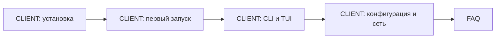

#### Администратор сервера: развернуть и сопровождать

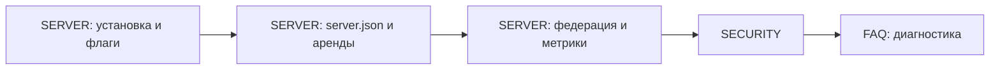

#### Разработчик: понять и изменить код

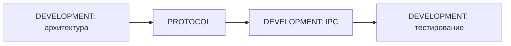

#### Ревьюер безопасности: оценить модель угроз

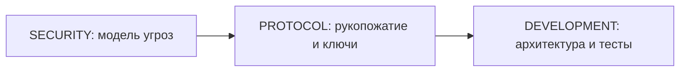

### Соглашения

- **Язык.** Документация на русском языке. Имена команд, флагов, файлов, крейтов и
  полей протокола пишутся так, как они есть в коде, без перевода.
- **Примеры команд.** Команды оболочки оформляются блоками с указанием языка:
  `bash` для Linux и macOS, `powershell` для Windows, `json` для конфигурации,
  `text` для вывода и разметки.
- **Ссылки.** Между документами используются относительные ссылки вида
  `[TUI](CLIENT.md)`. Ссылки на разделы внутри документа ведут на его заголовки.
- **Статусы функций.** Функции, которые ещё не выпущены, отмечаются в тексте
  явно (например, «⏳ в работе»), чтобы их не принимали за готовые.
- **Адреса.** В примерах используются документационные значения: `203.0.113.10` для
  сервера, `100.66.<a>.<b>` для адресов участников, `TUN-…` для friend code и
  Server code.
- **Изменения.** Значимые изменения поведения фиксируются в [CHANGELOG](CHANGELOG.md),
  а изменения протокола — также в [PROTOCOL](PROTOCOL.md).
