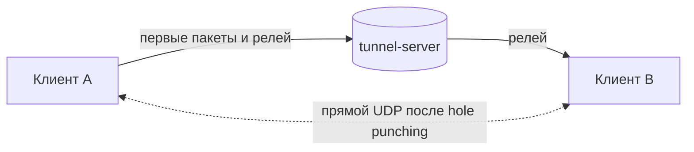
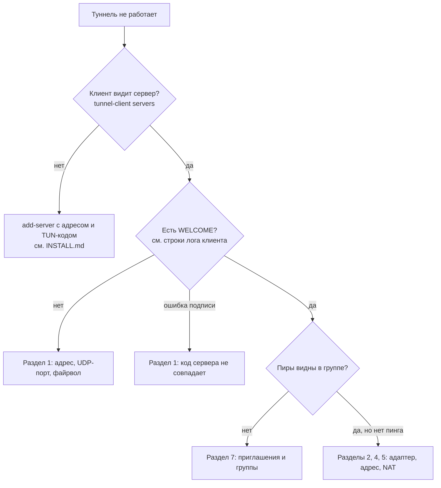
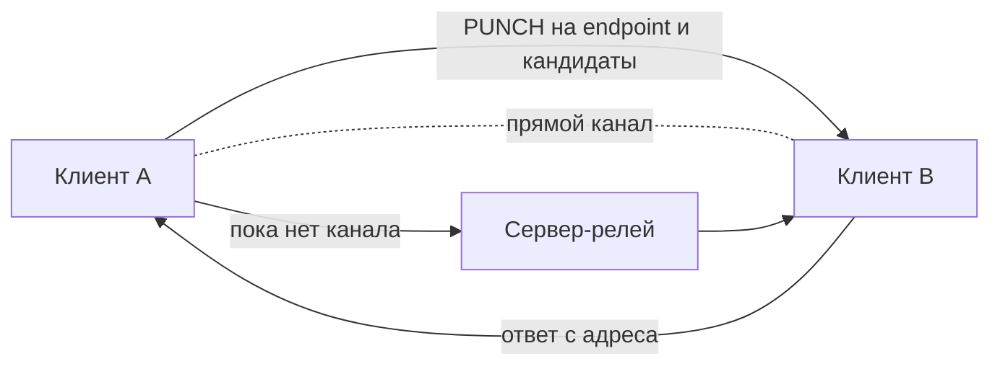

# Частые вопросы и решение проблем

Короткие ответы на частые вопросы и диагностика по симптомам: сеть, группы, демон, служба Windows, установка и обновление. Нормативные детали — в [PROTOCOL.md](PROTOCOL.md) и [SECURITY.md](SECURITY.md), эксплуатация сервера — в [SERVER.md](SERVER.md).

## Содержание

- [Общее](#общее)
  - [1. Что такое VoidLink?](#1-что-такое-voidlink)
  - [2. Чем VoidLink отличается от Hamachi?](#2-чем-voidlink-отличается-от-hamachi)
  - [3. Чем VoidLink отличается от ZeroTier?](#3-чем-voidlink-отличается-от-zerotier)
  - [4. Чем VoidLink отличается от Tailscale?](#4-чем-voidlink-отличается-от-tailscale)
  - [5. Чем VoidLink отличается от WireGuard?](#5-чем-voidlink-отличается-от-wireguard)
  - [6. Можно ли выводить через VoidLink весь интернет?](#6-можно-ли-выводить-через-voidlink-весь-интернет)
- [Безопасность и данные](#безопасность-и-данные)
  - [7. Может ли сервер читать мой трафик?](#7-может-ли-сервер-читать-мой-трафик)
  - [8. Что видит сервер?](#8-что-видит-сервер)
  - [9. Что хранит сервер на диске?](#9-что-хранит-сервер-на-диске)
  - [10. Что такое identity и friend code?](#10-что-такое-identity-и-friend-code)
  - [11. Что делать, если утёк ключ или скомпрометирован сервер?](#11-что-делать-если-утёк-ключ-или-скомпрометирован-сервер)
- [Сеть](#сеть)
  - [12. Какие порты нужно открыть?](#12-какие-порты-нужно-открыть)
  - [13. Нужен ли мне белый IP или права на роутере?](#13-нужен-ли-мне-белый-ip-или-права-на-роутере)
  - [14. Почему трафик иногда идёт через сервер, а не напрямую?](#14-почему-трафик-иногда-идёт-через-сервер-а-не-напрямую)
  - [15. Работает ли VoidLink, если блокируют UDP?](#15-работает-ли-voidlink-если-блокируют-udp)
  - [16. Поддерживается ли IPv6?](#16-поддерживается-ли-ipv6)
  - [17. Можно ли обращаться к участникам по имени?](#17-можно-ли-обращаться-к-участникам-по-имени)
  - [18. Нужны ли права администратора?](#18-нужны-ли-права-администратора)
- [Группы и лимиты](#группы-и-лимиты)
  - [19. Сколько участников в одной группе?](#19-сколько-участников-в-одной-группе)
  - [20. Сколько групп может быть на одном сервере?](#20-сколько-групп-может-быть-на-одном-сервере)
  - [21. Сколько групп может создать один человек?](#21-сколько-групп-может-создать-один-человек)
  - [22. Публичная и приватная группа: в чём разница?](#22-публичная-и-приватная-группа-в-чём-разница)
  - [23. Как работают приглашения, если получатель не в сети?](#23-как-работают-приглашения-если-получатель-не-в-сети)
  - [24. Что значит «владелец» и как передать группу?](#24-что-значит-владелец-и-как-передать-группу)
  - [25. Чем отличаются кик и бан?](#25-чем-отличаются-кик-и-бан)
  - [26. Что такое «невидимка»?](#26-что-такое-невидимка)
- [Использование](#использование)
  - [27. Подходит ли VoidLink для игр и LAN-вечеринок?](#27-подходит-ли-voidlink-для-игр-и-lan-вечеринок)
  - [28. Работает ли VoidLink на телефонах?](#28-работает-ли-voidlink-на-телефонах)
  - [29. Можно ли одну identity использовать на двух устройствах?](#29-можно-ли-одну-identity-использовать-на-двух-устройствах)
  - [30. Что такое профили и как перенести identity?](#30-что-такое-профили-и-как-перенести-identity)
- [Сервер и эксплуатация](#сервер-и-эксплуатация)
  - [31. Можно ли поднять сервер на VPS или Raspberry Pi?](#31-можно-ли-поднять-сервер-на-vps-или-raspberry-pi)
  - [32. Что будет с группами, если сервер перезапустили?](#32-что-будет-с-группами-если-сервер-перезапустили)
  - [33. Сколько живёт приглашение?](#33-сколько-живёт-приглашение)
  - [34. Лицензия и самостоятельный хостинг](#34-лицензия-и-самостоятельный-хостинг)
  - [35. Работает ли VoidLink без сервера?](#35-работает-ли-voidlink-без-сервера)
  - [36. Как серверы узнают друг о друге?](#36-как-серверы-узнают-друг-о-друге)
- [Диагностика](#диагностика)
  - [Быстрая диагностика](#быстрая-диагностика)
  - [1. Не подключается к серверу](#1-не-подключается-к-серверу)
  - [2. Windows: wintun, права и адаптер](#2-windows-wintun-права-и-адаптер)
  - [3. Служба, демон и трей](#3-служба-демон-и-трей)
  - [4. Адреса оверлея, DNS и IPv6](#4-адреса-оверлея-dns-и-ipv6)
  - [5. Пиры идут только через релей](#5-пиры-идут-только-через-релей)
  - [6. Высокая задержка и обрывы](#6-высокая-задержка-и-обрывы)
  - [7. Приглашения](#7-приглашения)
  - [8. Исключение и бан](#8-исключение-и-бан)
  - [Логи и отладка](#логи-и-отладка)
  - [Сбор диагностики для баг-репорта](#сбор-диагностики-для-баг-репорта)
  - [Частые проблемы установки](#частые-проблемы-установки)
  - [Устранение неполадок демона](#устранение-неполадок-демона)
  - [Диагностика сети](#диагностика-сети)

## Общее

### 1. Что такое VoidLink?

VoidLink создаёт виртуальную сеть уровня 3 (L3) поверх интернета. Участники объединяются в
**группы**, каждый получает постоянный адрес вида `100.66.<a>.<b>` (один на сервере для всех
его групп), и внутри группы компьютеры
видят друг друга как в одной локальной сети: `ping` проходит, игры и сервисы работают по IP.

Состав проекта: сервер `tunnel-server` (его поднимает владелец сети), клиент `tunnel-client`
(CLI и текстовый интерфейс TUI), фоновая служба и трей для Windows. Подробнее: [README.md](../README.md).

### 2. Чем VoidLink отличается от Hamachi?

Hamachi, как и VoidLink, создаёт виртуальную L3-сеть для группы участников. Главные различия:

| | Hamachi | VoidLink |
|---|---|---|
| Кто управляет | коммерческий сервис вендора (LogMeIn) | вы поднимаете свой сервер |
| Исходный код | проприетарный | исходники собираются из репозитория (лицензия: см. вопрос 34) |
| Где хранятся группы | на стороне вендора | в `server.json` на вашем сервере |
| Платформы | Windows, macOS, Linux, мобильные | клиенты для Windows (служба и трей), Linux и macOS; мобильных клиентов нет |

Hamachi зрелее и проверен большим числом пользователей. VoidLink проще по устройству и полностью
под вашим контролем, но он молодой и менее проверен.

### 3. Чем VoidLink отличается от ZeroTier?

ZeroTier тоже строит виртуальные сети и умеет работать через NAT. Его контроллер можно
использовать как облачный сервис или поднять самому. Клиенты есть для многих систем, включая мобильные.

VoidLink устроен проще: один сервер одновременно выполняет роль рандеву-точки, релея и хранилища
групп, а протокол собственный (кадры `TNL2`, рукопожатие на X25519 и ed25519). ZeroTier значительно
шире по платформам и функциям. VoidLink подходит, если нужна небольшая сеть на одном сервере и
нужно понимать и контролировать каждый компонент.

### 4. Чем VoidLink отличается от Tailscale?

Tailscale строит mesh-сеть на базе WireGuard, использует координационный сервер (облачный или
совместимый с Headscale) и предоставляет SSO, ACL, маршрутизацию подсетей и клиенты для всех
основных систем, включая мобильные.

VoidLink не использует WireGuard, не поддерживает SSO, ACL и маршрутизацию чужих подсетей:
он даёт связность только между участниками одной группы. Зато весь сервер помещается в один
бинарник и один UDP-порт, без внешних сервисов.

### 5. Чем VoidLink отличается от WireGuard?

WireGuard это протокол и реализация туннеля «точка-точка». Он не занимается обнаружением пиров,
пробиванием NAT и выдачей адресов: эти вещи настраиваются вручную.

VoidLink добавляет всё, чего нет в WireGuard: группы, выдачу адресов сервером, обнаружение
участников, пробивание NAT (UDP hole punching) и релей через сервер, если прямой канал не
установился. Собственного шифрования VoidLink при этом не придумывает: он использует
ChaCha20-Poly1305 и X25519, но формат кадров и рукопожатия у него свой, а не WireGuard.

### 6. Можно ли выводить через VoidLink весь интернет?

Нет. VoidLink создаёт связность только между участниками группы и не маршрутизирует чужие
подсети и не работает как VPN для выхода в интернет. Это сознательное ограничение (см.
[README.md](../README.md)).

---


## Безопасность и данные

### 7. Может ли сервер читать мой трафик?

Коротко: **да, технически может, и это надо учитывать при выборе сервера.** Честный ответ такой.

- Содержимое кадров группы шифруется ChaCha20-Poly1305. Ключ группы генерирует сервер и
  передаёт его участникам по защищённому каналу. Значит, сервер знает ключ группы.
- Сервер-релей видит открытый заголовок кадра группы: `gid`, `src_ip`, `dst_ip`, `epoch`.
  Содержимое IP-пакета при релее сервер не расшифровывает, но ключ у него есть.
- Прямой трафик между участниками (P2P) сервер не видит, пока не работает релей.
  Но ключ групп от сервера, поэтому конфиденциальность P2P тоже опирается на доверие к серверу.
- Защита от перехвата в сети (провайдер, Wi-Fi, наблюдатель на пути) работает. Защита от
  оператора сервера, который хочет читать трафик, **не** обеспечивается: им нужно доверять.

Поэтому держите сервер на своём VPS или у людей, которым доверяете. Если нужна модель, где
сервер ничего не может расшифровать, VoidLink её сейчас не даёт.

### 8. Что видит сервер?

Сервер видит метаданные и служебные данные:

- публичный IP и UDP-порт каждого клиента, время его пребывания в сети;
- открытый ключ (pubkey) и имя, статус, список групп и состав участников;
- для релея: `gid`, адреса `src_ip` и `dst_ip` внутри группы, размеры и частоту пакетов;
- приглашения, отказы, баны, кики и выходы;
- **дружбы**: заявки в друзья и принятые пары pubkey (с какого времени), без
  ников и без привязки к группам.

Раньше список друзей был только у клиента. С появлением заявок (issue #24)
сервер **хранит социальный граф**: без этого взаимность для офлайн-цели
недостижима — заявка должна ждать на сервере, пока адресат подключится, а
принятая пара должна пережить рестарт обоих. Что именно видит сервер: кто с
кем в друзьях и когда это произошло; ники он не хранит (имя приходит из живой
сессии или групп в момент отправки кадра), адреса оверлея и содержимое
переписки — тоже нет. Если такая модель угроз не подходит, сервер надо
держать у себя: он и так видит состав групп и метаданные релея.

### 9. Что хранит сервер на диске?

Всё состояние лежит в одном файле `server.json` в каталоге данных (`--data`, в systemd-юните
это `/var/lib/tunnel`). В нём:

- identity сервера (приватный ключ, от которого зависит Server code);
- группы: имена, приватность, владелец, состав, постоянные адреса пользователей (`user_ips`);
- баны и неотвеченные приглашения;
- принятые пары pubkey и неотвеченные заявки в друзья (секция `friends`; у заявки — имя инициатора до её истечения);
- цепочка ротаций ключа сервера (поле `rotations`).

Содержимого трафика на диске нет. Запись атомарная (через временный файл и rename), сохранение
происходит примерно раз в 3 с, если состояние изменилось. Подробности: [SERVER.md](SERVER.md).

### 10. Что такое identity и friend code?

Identity клиента это пара ключей ed25519 (подписи, «лицо» пира) и x25519 (канальный ключ).
Friend code это base32 (Crockford) от публичного ключа ed25519 в виде `TUN-XXXX…`. Его можно
отправить другу, и он добавит вас командой `add-friend`. Код показывает `tunnel-client id`.

Friend code не содержит приватного ключа: это публичная часть, безопасно пересылать в любом мессенджере.
Приватные ключи лежат в конфиге клиента (`client.json`), и их не стоит никому передавать.
Если кто-то получит ваш `client.json`, он сможет выдавать себя за вас, поэтому храните файл
так же бережно, как пароль.

### 11. Что делать, если утёк ключ или скомпрометирован сервер?

- **Утёк ключ клиента.** Сейчас отдельной команды отзыва identity нет. Создайте новую identity
  (новый конфиг в другом каталоге `--dir`), добавьте её в группы заново и попросите владельцев
  выгнать старую identity через `kick` или `ban`.
- **Скомпрометирован сервер.** Поднимите новый сервер, восстановите группы из резервной копии
  `server.json` (если она у вас есть) и переподключите клиентов через `del-server` и `add-server`.
  Чтобы сменить ключ сервера, не теряя клиентов, используйте `tunnel-server rotate-key`: старый
  ключ подписывает новый, и клиенты перезакрепляют его сами, см. [SERVER.md](SERVER.md).

Регулярное резервное копирование `server.json` описано в [SERVER.md](SERVER.md), раздел «Резервная копия».

---


## Сеть

### 12. Какие порты нужно открыть?

На сервере нужен **один порт**, по умолчанию `5555`: UDP (основной) и, для TCP-фолбэка, тот же номер по TCP. Пример для ufw:

```bash
sudo ufw allow 5555/udp
sudo ufw allow 5555/tcp   # TCP-фолбэк (если не отключён --no-tcp)
```

Клиентам ничего открывать не нужно: они сами устанавливают исходящие UDP-соединения. Прямые
каналы между клиентами используют случайные UDP-порты, которые NAT пробивает через
hole punching. Если пробить не удалось, трафик идёт через релей сервера, и открытых портов
у клиента тоже не требуется.

### 13. Нужен ли мне белый IP или права на роутере?

Клиенту белый IP не нужен, так как он работает за NAT. Серверу нужен адрес, доступный из
интернета, например VPS с белым IPv4. Настраивать проброс портов на домашнем роутере не нужно,
хотя при симметричном NAT прямой канал не установится и трафик пойдёт через сервер.

### 14. Почему трафик иногда идёт через сервер, а не напрямую?

Схема такая:



Первые пакеты всегда идут через релей сервера, поэтому связь работает сразу. Параллельно
клиенты пробивают NAT (PUNCH), и как только прямой канал установлен, трафик идёт напрямую.
Если от пира 12 с нет прямых пакетов, трафик возвращается на релей.

Релей остаётся запасным путём и при симметричном NAT. Посмотреть, какой путь используется,
можно в TUI: в таблице участников колонка связи показывает `direct` или `relay`.

### 15. Работает ли VoidLink, если блокируют UDP?

Да, с оговорками. Клиент с транспортом `auto` (по умолчанию) начинает с UDP, а если рукопожатие с
сервером не проходит (три неудачи подряд или 10 с молчания), переходит на TCP-фолбэк к серверу на
том же порту. Транспорт можно зафиксировать: `tunnel-client set-transport auto|udp|tcp`. На сервере
фолбэк включён по умолчанию (`--no-tcp` отключает). Прямые каналы между пирами всегда UDP, поэтому
при заблокированном UDP трафик идёт через релей сервера по TCP, с большей задержкой.
См. [SERVER.md](SERVER.md#tcp-фолбэк).

### 16. Поддерживается ли IPv6?

Внутри оверлея да: каждый участник дополнительно получает IPv6-адрес из ULA-подсети
`fd66:766c:696e::/64`. Участник с IPv4 `100.66.<a>.<b>` получает `fd66:766c:696e::<a>:<b>`
(например, `100.66.7.42` → `fd66:766c:696e::7:2a`); на адаптере один адрес `/64`. Доставка
до сервера по-прежнему идёт по IPv4/UDP (или TCP). Если IPv6 у вас не работает, ориентируйтесь на
IPv4-адреса группы (см. [TROUBLESHOOTING.md](FAQ.md#4-адреса-оверлея-dns-и-ipv6)).

### 17. Можно ли обращаться к участникам по имени?

Да. В клиенте есть встроенный DNS-ответчик на `100.66.0.53`, он отвечает на запросы
`<участник>.vl` и `<участник>.<группа>.vl` (регистр не важен), а ОС настраивается на split-DNS, так
что через туннель идут только имена `.vl` (Windows: NRPT, Linux: `resolvectl`, macOS:
`/etc/resolver/vl`). Включён по умолчанию, отключается командой `tunnel-client dns off`
(поле `dns` в `client.json`). Если имя не резолвится, используйте адрес `100.66.<a>.<b>`.

### 18. Нужны ли права администратора?

Зависит от способа запуска.

- **Служба на Windows** (рекомендуемый вариант, [INSTALL.md](CLIENT.md)): установка требует
  прав администратора один раз. После этого TUI и CLI работают без них и подключаются к службе
  (`tunnel-client tui --remote` требует именно демон, `--embedded` — свой движок).
- **Переносной режим** (`tunnel-client run` или `tui` в консоли): на Windows нужен администратор
  (адаптер Wintun), на Linux — root или `CAP_NET_ADMIN`, на macOS — `sudo`.

---


## Группы и лимиты

### 19. Сколько участников в одной группе?

До **253** участников. Адрес участника не зависит от группы: он выдаётся сервером из пула
`100.66.1.1` … `100.66.255.254` (последний октет не `.0` и не `.255`), `100.66.0.0/24` зарезервирована.

### 20. Сколько групп может быть на одном сервере?

До **254**, номера `gid` от 1 до 254. Номер группы в IP-адрес не входит: адрес один на пользователя
и общий для всех его групп (всего 64 770 адресов на сервер).

### 21. Сколько групп может создать один человек?

По умолчанию до **16** групп на одну identity (лимит `max_owned_groups`, флаг сервера `--max-owned-groups`). Это ограничение
владельца: он касается только создания групп, а не входа в чужие.

### 22. Публичная и приватная группа: в чём разница?

- **Публичная** (`create <имя>`): войти может любой, у кого есть доступ к серверу, и кто нашёл
  группу в списке.
- **Приватная** (`create <имя> --private`): только по приглашению владельца.

Публичная группа подходит для открытой «комнаты», приватная для постоянного круга друзей.

### 23. Как работают приглашения, если получатель не в сети?

Приглашение хранится на сервере, поэтому доставляется при следующем входе получателя.
Онлайн-получатель получает его сразу, офлайн-получатель увидит его после HELLO, когда сервер
пришлёт список неотвеченных приглашений.

В TUI приглашение открывает окно с кнопками `Принять`, `Отклонить` и `Позже`. В CLI список
показывает команда `invites`, принять можно через `join <gid>`, отклонить через `decline <gid>`.
Отклонение сообщит владельцу, если тот в сети.

### 24. Что значит «владелец» и как передать группу?

Владелец это identity, которая создала группу. Он может приглашать, исключать, банить, переименовывать
и удалять группу. Передать группу другому участнику можно командой:

```bash
tunnel-client transfer <gid> <peer>
```

`peer` это friend code (`TUN-…`), hex-ключ или alias из списка друзей. Новый владелец сразу
получает права. Висящие приглашения остаются, а отправителем в них становится новый владелец.

### 25. Чем отличаются кик и бан?

- **`kick <gid> <peer>`**: исключает участника из группы. Он может зайти обратно, если группа
  публичная или есть новое приглашение.
- **`ban <gid> <peer>`**: исключает и блокирует вход. Посмотреть баны можно через `bans <gid>`,
  снять через `unban <gid> <peer>`.

Оба действия владелец выполняет через CLI или TUI (клавиши `k` и `b` в TUI).

### 26. Что такое «невидимка»?

Режим `invisible on` скрывает вас от других: в списке участников вы отображаетесь офлайн, хотя
туннель работает. Выключается командой `invisible off`. Если вы в невидимке, остальные не видят
ваш статус в сети, но сами соединения работают по тем же правилам.

---


## Использование

### 27. Подходит ли VoidLink для игр и LAN-вечеринок?

Да, для этого он и задумывался: участники группы видят друг друга по IP и могут заходить в игры,
которые умеют подключаться по адресу. Совет: подключайтесь по адресу `100.66.<a>.<b>`, так надёжнее.

Чего не гарантируем: широковещательный и multicast-трафик, на котором многие игры ищут сервер
в локальной сети, в документации не описан. Проверьте свою игру отдельно. Для задержки важен
прямой канал: при работе через релей пинг заметно выше. Ориентиром служит колонка RTT в TUI.

### 28. Работает ли VoidLink на телефонах?

Нет, мобильных клиентов в проекте нет. Клиент работает на Windows (Wintun, служба и трей), Linux
(TUN-интерфейс) и macOS (utun).

### 29. Можно ли одну identity использовать на двух устройствах?

Одновременно нет. Сервер допускает одну сессию на identity, и если вы запустите клиент с той же
identity на втором устройстве, он вытеснит первое соединение. Команды CLI тоже вытесняют сеанс
запущенного `run` или TUI с той же identity.

Если нужно работать с двух машин, создайте для каждой машины свою identity и добавьте её в группы
(приглашение) или перенесите identity через `export-identity` / `import-identity` (вопрос 30).

### 30. Что такое профили и как перенести identity?

- **Профили.** Глобальный флаг `--profile <имя>` использует каталог `<dir>/profiles/<имя>`, так
  что на одной машине можно держать несколько независимых identity. Каталог конфига целиком
  меняет `--dir <путь>`.
- **Перенос identity.** `tunnel-client export-identity <файл> [--passphrase <p>|--passphrase-stdin] [--force]`
  выгружает identity (с парольной фразой файл шифруется; без неё не зашифрован, храните его в
  секрете). `tunnel-client import-identity <файл> [--passphrase …] [--force]` загружает её на другой
  машине; `--force` заменяет текущую identity. Импорт проверяет, что friend code совпадает с ключами.

Помните, что на одной identity одновременно работает только одна сессия (вопрос 29).

---


## Сервер и эксплуатация

### 31. Можно ли поднять сервер на VPS или Raspberry Pi?

На VPS с Linux: да, это основной сценарий. Инструкция по установке через systemd есть в
[SERVER.md](SERVER.md). Нужен один UDP-порт и каталог состояния.

Сборка для VPS без зависимости от glibc:

```bash
rustup target add x86_64-unknown-linux-musl
cargo zigbuild --release -p tunnel-server --target x86_64-unknown-linux-musl
```

На Raspberry Pi теоретически подойдёт ARM-сборка (например, `aarch64-unknown-linux-musl`), так как
сервер написан на Rust без платформенных зависимостей. Проверенной инструкции в проекте пока нет,
так что проверяйте сборку и запуск на своём устройстве. Для домашнего сервера понадобится проброс
UDP-порта на роутере и стабильный внешний адрес или DDNS.

### 32. Что будет с группами, если сервер перезапустили?

Состояние групп, адреса, баны и приглашения восстанавливаются из `server.json`. Клиенты после
рестарта получают `RESET` и переподключаются в течение нескольких секунд. Они заново отправляют
статус, входят в группы из автовхода и повторно запрашивают список групп.

Пока сервер недоступен, работают только уже установленные прямые каналы между клиентами
(и mesh-сессии: см. [вопрос 35](#35-работает-ли-voidlink-без-сервера)). Релей
и новые входы в группы появятся после переподключения.

Остановка штатная: `SIGTERM`/`SIGINT` (`systemctl stop`) останавливают воркеры и сохраняют состояние
перед выходом, см. [SERVER.md](SERVER.md#остановка).

### 33. Сколько живёт приглашение?

По умолчанию 7 дней. Срок меняется флагом сервера `--invite-ttl-days N`
(см. [SERVER.md](SERVER.md#флаги)). Истёкшие приглашения исчезают; повторное приглашение продлевает срок.

### 34. Лицензия и самостоятельный хостинг

Самостоятельный хостинг это основная модель использования: вы собираете сервер из исходников,
запускаете его у себя и не зависите от сторонних сервисов. Лицензия проекта в репозитории
не указана. Уточняйте её у автора проекта до того, как использовать код вне своей сети.

### 35. Работает ли VoidLink без сервера?

Нет: для входа в сеть сервер обязателен. Он не VPN-шлюз, но остаётся единственным источником
того, без чего клиент не начнёт работу: ключи групп (они ротируются и отзываются), состав групп
и собственный адрес участника (`my_ip`). Движок к тому же не стартует без `WELCOME`: запуск при
мёртвом сервере завершается ошибкой «нет WELCOME от сервера».

Что **не** зависит от сервера, пока клиент запущен:

* уже установленные прямые каналы (L0) и mesh-сессии живут на своих таймерах, и трафик по ним
  продолжает доставляться, даже если сервер упал;
* таблица DHT: адреса пиров сохраняются в `client.json` → `mesh.contacts` (≤ 256 записей,
  ≤ 7 суток) и загружаются при следующем старте как подсказка, а пира, сменившего адрес, можно
  найти через `MESH_FIND_NODE`/`MESH_GET_CONTACT`.

Чего кэш не даёт — перезапуска без сервера. После рестарта ключей групп и состава нет (хранить
ключи нельзя: ротация и отзыв — часть модели безопасности), поэтому mesh не поднимется и вход
в группы не произойдёт до восстановления сервера; прямые каналы тоже переустанавливаются заново.
При этом DHT **не ищет серверы**: его контакты — участники групп, а серверы узнают друг о друге
через федерацию (см. вопрос 36).
Подробнее — [NETWORKING.md](CLIENT.md#dht-и-mesh-что-живёт-без-сервера).

### 36. Как серверы узнают друг о друге?

Федерация (`--federate`) — отдельная подсистема, DHT ею не занимается. Два пути:

* **явный пин** — `--peer <addr>` (можно повторять) и `--fed-pool <addr>` для общего пула адресов;
* **подсказка клиента** — `SERVER_HINT` (≤ 8 кандидатов: серверы из `client.json.servers` и
  контакты DHT). Сервер не доверяет подсказке: кандидат — только повод послать `SRV_HELLO`,
  ключ проверяется подписью в `SRV_HELLO`/`ACK` и закрепляется по TOFU в
  `server.json → federation.peers` (≤ 64).

Без `--federate` серверы изолированы: пользователи чужого сервера не видны. С федерацией клиент
получает `FED_GROUPS`, группы помечаются `[федерация]`, вход — `:joinfed <uuid|gid>`, а трафик
и ping до участника чужого сервера идут через `FED_RELAY` (L3: клиент A → сервер A → сервер B →
клиент B). Если блокируют и участок сервер ↔ сервер, L3 не спасёт — останется только L2-релей
через пира (≤ 3 хопов), если такой пир есть в группе.

Подробнее — [SERVER.md](SERVER.md#проба-mesh-и-федерация-этап-9), [PROTOCOL.md](PROTOCOL.md) §12,
[NETWORKING.md](CLIENT.md#dht-и-mesh-что-живёт-без-сервера).

---

Если вашего вопроса здесь нет, загляните в [PLAN.md](archive/PLAN.md) (план и статус этапов),
[PROTOCOL.md](PROTOCOL.md) (формат протокола) или [TESTING.md](DEVELOPMENT.md) (как проверяется работа).


## Диагностика

### Быстрая диагностика

Прежде чем разбирать конкретный симптом, выполните три проверки. Они отвечают на вопросы:
«знает ли клиент сервер», «доходит ли до него сеть» и «что говорит сервер».



| Проверка | Команда | Что ожидать |
|---|---|---|
| Сервер добавлен и выбран | `tunnel-client servers` | строка с адресом и меткой; текущий сервер помечен |
| Своя identity создана | `tunnel-client id` | friend code вида `TUN-…` |
| Группы видны | `tunnel-client groups` | список групп текущего сервера |
| Сервер жив (на сервере) | `systemctl status tunnel-server` | `active (running)` |
| Лог сервера (на сервере) | `journalctl -u tunnel-server -n 50` | события и сводка раз в 5 минут |


### 1. Не подключается к серверу

| Симптом | Причина | Что делать |
|---|---|---|
| `нет WELCOME от сервера (адрес/код сервера верны?)` | Клиент не получил ответ сервера: неверный адрес или порт, закрыт UDP-порт, сервер не запущен, код сервера не совпадает | 1) Проверьте адрес: `tunnel-client servers`. 2) На сервере: `systemctl status tunnel-server`, `ss -ulpn \| grep 5555`. 3) Откройте UDP-порт в файрволе сервера и в панели хостинга (`ufw allow 5555/udp`). 4) Сверьте код сервера (см. ниже) |
| `WELCOME: подпись не от закреплённого сервера (неверный код сервера?)` | Клиент закрепил ключ другого сервера: сервер переустановлен без `server.json` (новая identity), либо на том же адресе работает другой сервер, либо код введён с ошибкой | Получите актуальный код сервера: `journalctl -u tunnel-server \| grep TUN-` (код печатается при старте, см. [SERVER.md](SERVER.md#флаги), флаг `-q` его скрывает). Затем замените запись: `del-server <адрес>` и `add-server <адрес> <TUN-код>`. Если сервер переустановлен, восстановите `server.json` из резервной копии, и код снова станет прежним |
| `сервер другой версии протокола: vN, клиент v4` | Клиент и сервер говорят на разных версиях протокола | Обновите и клиент, и сервер до одной версии. Клиент — повторным запуском `install.ps1` новой версии (Windows) или пересборкой `cargo build --release -p tunnel-client`. Сервер — повторным запуском `install-server.sh` с новым бинарником |
| `сервер VoidLink v4: обновите клиент` (текст `UNSUPPORTED`) | Клиент v3 подключается к серверу v4 | Обновите клиент до v4; клиент и сервер обновляются вместе |
| `сервер старой версии протокола (v2): нужен сервер v4` | На сервере старая сборка, которая отвечает на HELLO3 сбросом сессии (RESET) | Установите сервер v4 из текущей сборки; см. [SERVER.md](SERVER.md#сборка-под-linux) |
| `[engine] ключ сервера … сменён по цепочке ротации, закреплён новый: TUN-…` | Не ошибка. Сервер сменил ключ, и клиент перезакрепил новый ключ по цепочке ротации | Ничего делать не нужно. Если клиент сообщает `подпись не от закреплённого сервера`, значит цепочка прервана (клиент слишком долго не подключался или старый ключ давно вытеснен). Тогда добавьте сервер заново с кодом, который напечатала ротация |
| Туннель не поднимается по UDP, но TCP-порт сервера доступен | Провайдер, корпоративная сеть или NAT режут UDP | В режиме `transport: auto` клиент переходит на TCP после трёх неудачных UDP-рукопожатий подряд или после 10 секунд молчания UDP (`should_fallback` в `crates/client/src/tcp_link.rs`). Можно выбрать транспорт явно: `tunnel-client set-transport tcp`. На сервере TCP-фолбэк включён по умолчанию на том же порту, что UDP (флаг `--no-tcp` его отключает, см. [SERVER.md](SERVER.md#tcp-фолбэк)); проверьте, что он не выключен и порт открыт и для TCP. Прямые каналы между пирами и при TCP до сервера остаются UDP |
| Сервер не запускается, в `journalctl` есть `bad listen addr` | В `TUNNEL_ARGS` указан неизвестный флаг, любой неизвестный аргумент считается адресом | Уберите неизвестный флаг из `/etc/default/tunnel-server`; допустимые флаги перечислены в [SERVER.md](SERVER.md#флаги). Служба уходит в цикл перезапусков, пока флаг не исправлен |
| Сервер не стартует, в логе сообщение о повреждённом `server.json` | Файл состояния повреждён. Сервер намеренно не создаёт новую identity, чтобы не потерять всех клиентов | Восстановите `server.json` из резервной копии (процедура в [SERVER.md](SERVER.md#резервная-копия-serverjson)) |
| `add-server`: `сервер <адрес> уже добавлен` | Сервер уже есть в списке | Используйте `servers` и `del-server <N\|адрес\|метка>`, затем повторите `add-server` |
| Связь есть, но в сетевых логах много `RESET` и переподключений | Сервер перезапускался, либо клиент получил сброс сессии от неизвестного адреса | Нормально на короткое время после рестарта сервера (переподключение за несколько секунд). Если повторяется постоянно, проверьте, не запущено ли два сервера на одном порту и не меняется ли IP клиента |


### 2. Windows: wintun, права и адаптер

Туннель на Windows работает через драйвер Wintun. Для него нужны `wintun.dll` рядом с exe
и права администратора на создание адаптера.

| Симптом | Причина | Что делать |
|---|---|---|
| `wintun.dll not found (положи рядом с exe или укажи --dll)` | DLL не найдена рядом с `tunnel-client.exe` | Положите `wintun.dll` из архива сборки в ту же папку, что и exe. Для разового запуска можно указать путь: `tunnel-client.exe --dll C:\путь\wintun.dll run`. Служба берёт DLL только из каталога `%ProgramFiles%\Tunnel`, рядом с `tunnel-daemon.exe` |
| `cannot load <путь>` | DLL найдена, но не загружается: не та разрядность, повреждённый или подменённый файл | Возьмите `wintun.dll` из того же архива, что и exe, и той же разрядности (x64) |
| `не удалось создать/открыть wintun-адаптер (запуск от администратора?)` | Клиент запущен без прав администратора | Запустите терминал от имени администратора (режим `run`/`tui` без службы). Либо установите службу через `install.ps1`, и тогда CLI и TUI работают без прав администратора |
| `set adapter address` или `netsh add address failed` | Адрес оверлея конфликтует с другим адаптером или маршрутом (другой VPN, Hyper-V, WSL) | Выполните `ipconfig /all` и `route print` и найдите конфликтующий адрес. Отключите конфликтующий адаптер или выберите другое имя адаптера через `--adapter <имя>` (по умолчанию `TunnelVPN`) |
| `set mtu` | Драйвер отверг значение MTU | Уменьшите MTU: `tunnel-client set-mtu <N>` (допустимо 576..1500, по умолчанию 1400; поле `mtu` в `client.json`), перезапустите туннель |
| Туннель пропадает после закрытия окна | Запущен переносной режим (`tunnel-client run` или `tui`), туннель живёт внутри процесса | Установите службу (см. [INSTALL.md](CLIENT.md#windows-служба-и-трей-рекомендуется)). Не запускайте переносной режим одновременно со службой: одна identity — одна сессия на сервере |
| Служба `TunnelDaemon` не стартует или не поднимает туннель | Нет `wintun.dll` рядом с `tunnel-daemon.exe`, права каталога установки небезопасны («каталог … небезопасен для службы» в логе), либо ошибка конфига | `sc query TunnelDaemon`, затем `%ProgramData%\tunnel\logs\daemon.log` (см. [Логи](#логи-и-отладка)); при небезопасном каталоге — переустановите через `install.ps1` |
| `tunnel-daemon install`: «каталог … небезопасен для службы» | exe запущен из каталога, куда может писать обычный пользователь | Установите через `infrastructure\windows\install.ps1` (копирует в `%ProgramFiles%\Tunnel` и выставляет права) |
| Адаптер остался после удаления | Удаление прервано, адаптер не снят | Запустите `uninstall.ps1` из `%ProgramFiles%\Tunnel` от администратора повторно. Адаптер Wintun также можно удалить вручную в «Сетевые подключения» |


### 3. Служба, демон и трей

Фронтенды (CLI, TUI, трей) подключаются к демону через именованный канал
`\\.\pipe\tunnel-daemon`. Если демон недоступен, фронтенд сообщает об этом явно.

| Симптом | Причина | Что делать |
|---|---|---|
| `демон недоступен: …` (CLI или TUI) | Служба не запущена или пайп не создан | `sc query TunnelDaemon`, при необходимости `sc start TunnelDaemon`. Если служба не ставилась, запустите `tunnel-client.exe run` или `tui` от администратора |
| `демон отказал: …` с упоминанием версии | Несовпадение версии IPC между фронтендом и демоном, так бывает после частичного обновления | Обновите все exe из одного архива: `install.ps1` поверх работающей службы заменит файлы и перезапустит службу |
| `демон не ответил вовремя` | Демон завис или перегружен | Перезапустите службу: `sc stop TunnelDaemon` и `sc start TunnelDaemon`. Если повторяется, сохраните `daemon.log` и приложите его к отчёту |
| `pipe access denied` или `Access is denied` при подключении CLI | Доступ к пайпу выдан только владельцу службы (SID из `%ProgramData%\tunnel\owner.sid`) и администраторам. Пользователь, который не установил службу, не может подключиться | Работайте из-под пользователя, который устанавливал службу. Либо переустановите службу из-под нужного пользователя (`uninstall.ps1`, затем `install.ps1`). Не меняйте ACL пайпа вручную |
| `демон завершается: …` | Служба останавливается (выключение, обновление, `sc stop`) | Дождитесь запуска службы или повторите команду |
| В шапке TUI «○ демон недоступен» | Тонкий TUI потерял связь с демоном; он переподключается раз в секунду | Проверьте, что демон жив (`sc query TunnelDaemon` / `tunnel-daemon console`); после запуска TUI подключится сам |
| `демон не запущен (…); без --remote tui поднимет свой движок` | `tui --remote` без демона | Запустите демон или уберите `--remote` |
| `движок уже запущен без демона (embedded TUI или run): …` | CLI-команда, пока работает embedded TUI или `run`: свой HELLO вытеснил бы сессию движка | Закройте TUI / остановите `run` или установите службу. Читают конфиг и работают `id`, `servers`, `friends` |
| `<команда>: при работающем демоне недоступно …` | `set-transport`, `set-mtu`, `dns` и `import-identity` меняют настройки движка, IPC-команд для них нет | Остановите демон, выполните команду, запустите демон. `run` при демоне тоже отказывает |
| Команды трея: `Служба Tunnel недоступна — действие не выполнено` | Служба не работает, трей не может передать команду | Запустите службу: `sc start TunnelDaemon` |
| Иконка трея пропала после перезапуска `explorer.exe` | Панель задач пересоздала область уведомлений, а трей не восстановился | Перезапустите `tunnel-tray.exe`. Проверьте стрелку «Скрытые значки» в области уведомлений. Трей запускается при входе пользователя по ключу `Run` и работает независимо от туннеля |
| Трей не показывает состояние и не отвечает | Трей не подключился к демону (пайп недоступен) | См. строки про `демон недоступен` и `pipe access denied` выше |


### 4. Адреса оверлея, DNS и IPv6

Каждому участнику сервер назначает один IPv4-адрес вида `100.66.<a>.<b>`, общий для всех его групп на этом
сервере (после выхода из групп и рестарта сервера адрес сохраняется). Адрес можно проверить командой
`ping`, например `ping 100.66.<a>.<b>`. На адаптере стоит один адрес с маской `/16`.

| Симптом | Причина | Что делать |
|---|---|---|
| Адрес участника не пингуется, хотя пир онлайн | Конфликт адреса оверлея, неверный маршрут, файрвол блокирует ICMP на стороне пира | Проверьте адрес через `groups` и `ipconfig` (Windows) или `ip addr` (Linux). Разрешите ICMP в файрволе пира |
| Имена пиров не резолвятся (`<member>.vl`, `<member>.<group>.vl`) | Настройка split-DNS для `.vl` не применилась, либо DNS отключён в конфиге (`dns` в `client.json`, по умолчанию включён). | Проверьте, что DNS включён (`tunnel-client dns on`), и перезапустите туннель. Имена строятся из отображаемых имён участников (`set-name`) по правилам нормализации, поэтому имя может отличаться от того, что видно в интерфейсе. Список участников: `groups` |
| Имена не резолвятся на Windows | NRPT-правило для `.vl` не создано | В PowerShell: `Get-DnsClientNrptRule`. Правило создаётся при старте туннеля (best effort). При ошибке в логе будет уведомление с текстом сбоя |
| Имена не резолвятся на Linux | `resolvectl` не настроил домен `vl` на интерфейсе туннеля | `resolvectl status` (нужна строка с доменом `~vl` у интерфейса туннеля). Проверьте, что `systemd-resolved` запущен |
| Имена не резолвятся на macOS | Файл `/etc/resolver/vl` не создан или не читается, либо нет маршрута на `100.66.0.53` через utun | `cat /etc/resolver/vl`, `scutil --dns` и `route -n get 100.66.0.53` (интерфейс должен быть `utunN` туннеля; маршрут ставится при входе в группу). Для записи в `/etc/resolver` и маршрута нужен root |
| `Без прав` (Linux, macOS) | Для создания TUN-интерфейса и маршрутов нужен root или `CAP_NET_ADMIN` | Запустите через `sudo`. Ошибка должна быть понятной, а не паникой |
| IPv6 внутри оверлея не работает | IPv6-адрес `fd66:766c:696e::<a>:<b>/64` (например, `100.66.7.42` → `fd66:766c:696e::7:2a`) назначается отдельно от IPv4 и может не применяться в версии клиента | Проверьте IPv4 через `ping`. Для IPv6 проверьте адрес на интерфейсе (`ipconfig` / `ip -6 addr`) и `ping6` до адреса пира |
| Сервер доступен по имени, но не рукопожатие | Имя резолвится в старый адрес | Проверьте `nslookup` или `getent hosts <имя>`. Переподключение подхватит новый адрес |


### 5. Пиры идут только через релей

Релей — штатный путь, который сервер использует, пока прямой канал между клиентами не пробит.
Трафик через релей работает, но обычно с большей задержкой и с ограничением скорости на сервере.
Признак релея: в интерфейсе пир помечен как «relay» или не появился «direct» (в TUI — счётчики
direct и relay в строке состояния).



| Симптом | Причина | Что делать |
|---|---|---|
| Пиры всегда через релей | Symmetric NAT хотя бы на одной стороне: порт меняется для каждого адреса, пробитие не работает | Ожидаемое поведение. Разрешите проброс UDP-порта на роутере (тогда пир станет доступен напрямую) или смиритесь с релеем |
| Оба пира за одним NAT, прямого канала нет | Роутер не делает hairpin (петлю NAT) для адреса того же внешнего IP, а LAN-кандидаты не используются | Включите `lan_discovery` (по умолчанию включён, отключается `lan_discovery: false` в `client.json`). Пиры из одной сети обменяются локальными адресами (CANDIDATES) и соединятся напрямую. Если Wi-Fi включил изоляцию клиентов, LAN-канал не заработает, и это ожидаемо |
| LAN-кандидаты не используются даже в одной подсети | Изоляция клиентов в Wi-Fi, VLAN, разные подсети | Проверьте, что устройства видят друг друга по локальным адресам (`ping`). Без этого остаётся релей |
| Прямой канал был, потом пропал | Изменился NAT-маппинг или таймаут NAT сработал раньше keepalive | Клиент сам переходит на релей и пробивает заново. Если таймаут NAT короткий, уменьшите интервалы пингов на роутере или держите соединение активным |
| Прямой канал не устанавливается до 10 секунд и дольше | Пробитие повторяется раз в 5 секунд, на каждом раунде отправляется PUNCH на endpoint и все кандидаты | Подождите 10–15 секунд после подключения. Если канала нет, это релей, и проблема в NAT |
| Файрвол Windows блокирует входящий UDP | Правило для `tunnel-client`/`tunnel-daemon` не разрешает входящий UDP | Разрешите входящий UDP для исполняемого файла в брандмауэре Windows (или для всех частных сетей) |
| Пир появился в списке, но не отвечает | Пир невидим (`invisible`) или не подключён к серверу | Невидимый пир (режим `invisible on`) считается офлайн, это штатно. Попросите пира подключиться |

Количество кандидатов ограничено четырьмя адресами. Сервер отбрасывает непригодные кандидаты
(нулевой адрес или порт, multicast и broadcast). Подробности — в [PROTOCOL.md](PROTOCOL.md#кандидаты-для-пробития-nat).


### 6. Высокая задержка и обрывы

| Симптом | Причина | Что делать |
|---|---|---|
| Задержка 100 мс и больше на связи через релей | Пакеты идут до сервера и обратно. Чем дальше сервер, тем выше задержка | Выберите сервер географически ближе к участникам. Проверьте `ping <адрес сервера>` с клиента |
| Задержка скачет, пинг иногда пропадает | Потери на UDP-пути или переход на TCP-фолбэк, где потеря одного пакета задерживает все следующие | Если UDP доступен, держите транспорт `auto` или `udp`. TCP — запасной путь, он не рекомендуется для игр и звонков |
| Большие пакеты теряются, маленькие ходят | Проблема MTU: пакеты больше пути не проходят | Уменьшите MTU: `tunnel-client set-mtu 1280` и перезапустите туннель (по умолчанию 1400) |
| Игра или TCP-соединение зависают на несколько секунд | Превышен лимит релея на сессии (4000 кадров в секунду, всплеск до 8000) или сервер перегружен | Проверьте сводку сервера раз в 5 минут (`journalctl -u tunnel-server`): строки с пакетами в секунду и количеством отброшенных |
| Туннель часто переподключается | Нестабильный интернет, сон компьютера, потеря сессии (сервер не получил пакетов 30 секунд) | Проверьте стабильность канала до сервера. Переподключение после сна происходит автоматически за несколько секунд |
| Сервер загружен на одном ядре | Низкое число воркеров или большое число сессий | Укажите `--workers N` (0 — по числу ядер, не больше 8) в `TUNNEL_ARGS` |


### 7. Приглашения

Приглашения хранятся на сервере и привязаны к конкретному серверу. Приглашение, созданное на
одном сервере, не видно на другом.

| Симптом | Причина | Что делать |
|---|---|---|
| Приглашение не приходит | Получатель не подключён к тому же серверу; неверный friend code; получатель забанен в группе | Проверьте, что получатель выбрал тот же сервер (`servers`) и подключён. Неотвеченные приглашения повторно приходят при каждом подключении клиента. Убедитесь, что friend code получателя верный (`id` у получателя) |
| `приглашать может только владелец` | Приглашение отправляет не владелец группы | Владелец отправляет приглашение, либо передаёт группу командой `transfer <gid> <peer>` |
| `уже участник группы` | Получатель уже в группе | Ничего не нужно |
| `лимит приглашений в группе` | В группе достигнут лимит неотвеченных приглашений | Дождитесь ответов или отзовите лишние приглашения (`kick <gid> <peer>`). Лимит задаётся на сервере |
| `группа приватная, нужно приглашение` | Группа приватная, вход без приглашения запрещён | Получите приглашение от владельца и примите его через `join <gid>` |
| Приглашение исчезло из списка | Срок жизни истёк (по умолчанию 7 дней, на сервере `--invite-ttl-days`) или приглашение отозвано | Попросите владельца отправить приглашение заново. Срок видно в `bans <gid>` у владельца (поле «истекает через») |
| `список приглашений не получен (потеря пакетов) — повторите` | Сервер не ответил на запрос списка | Повторите `invites`. Ошибка связана с потерей UDP-пакетов, а не с отсутствием приглашений |
| `сервер не подтвердил отказ — повторите` | Отказ от приглашения не подтверждён сервером (потеря пакетов) | Повторите `decline <gid>` |


### 8. Исключение и бан

| Симптом | Причина | Что делать |
|---|---|---|
| `вас исключили из группы` или `вас забанили и исключили` | Владелец или администратор удалил участника | Для повторного входа в приватную группу нужно новое приглашение. Публичную группу можно снова открыть через `join <gid>`, если не забанены |
| `вы забанены в этой группе` при `join` | Участник забанен владельцем | Владелец снимает бан: `unban <gid> <peer>`. Список банов: `bans <gid>` |
| Исключённая группа ещё пару секунд отображается | После исключения клиент помнит кик 60 секунд и отбрасывает запоздавшие состояния и списки группы | Подождите; если группа не исчезает, обновите список (`r` в TUI, `groups` в CLI) и приложите лог с `--debug` |
| `цель забанена` при `kick`/`invite` | Владелец пытается пригласить или исключить забаненного участника | Сначала снимите бан: `unban <gid> <peer>` |
| Группа исчезла после смены сервера | Группы и баны принадлежат конкретному серверу | Переключитесь на нужный сервер через `--server <N\|адрес\|метка>` или выберите его в `servers` |


### Логи и отладка

| Компонент | Где лог | Как получить больше подробностей |
|---|---|---|
| Служба Windows (`tunnel-daemon service`) | `%ProgramData%\tunnel\logs\daemon.log`. Ротация: 1 МиБ, до 5 файлов (`daemon.log`, `daemon.log.1`…`daemon.log.4`) | Для подробного лога запустите `tunnel-daemon console --debug` от администратора (остановите службу, чтобы не было двух экземпляров) |
| Консольный демон (`tunnel-daemon console`) | Вывод в консоль и тот же `daemon.log` в каталоге данных | Флаг `--debug` включает подробный уровень. Для отладки на Linux и macOS используйте `--data-dir` |
| Клиент CLI и переносной режим (`run`, `tui`) | Вывод в stderr с префиксом `[engine]`. В TUI — панель лога внутри окна | Глобальный флаг `--debug` включает подробный вывод движка |
| Сервер (systemd) | `journalctl -u tunnel-server`. Сводка раз в 5 минут | Уберите `-q` из `TUNNEL_ARGS`, чтобы видеть события. С `-q` сводка и строка `Server code` не печатаются |
| Конфиг клиента | Windows: `%APPDATA%\tunnel\client.json` (переносной режим) или `%ProgramData%\tunnel\client.json` (служба). Linux и macOS: `~/.tunnel-client/client.json` | Каталог меняется глобальным флагом `--dir <путь>` |
| Состояние сервера | `/var/lib/tunnel/server.json` (identity, группы, баны, приглашения) | Не меняйте файл вручную, пока сервер запущен. Используйте резервную копию |

Полезные команды:

```bash
# Сервер (Linux): последние события и поиск Server code
journalctl -u tunnel-server -n 200 --no-pager
journalctl -u tunnel-server | grep TUN-

# Клиент (Linux/macOS): подробный лог при подключении
tunnel-client --debug --server 0 run
```

```powershell
# Windows: состояние службы и последние строки лога
sc query TunnelDaemon
Get-Content "$env:ProgramData\tunnel\logs\daemon.log" -Tail 200

# Переносной режим с подробным логом (окно администратора)
.\tunnel-client.exe --debug run
```


### Сбор диагностики для баг-репорта

Если проблема не решается по таблицам, соберите данные и приложите их к отчёту. Перед отправкой
проверьте, что в данных нет личного: файл `client.json` содержит закрытый ключ identity и
не должен попадать в отчёт. Friend code и публичные ключи можно указывать.

**Что указать в отчёте:**

1. Версии: клиент, демон, сервер (по архиву сборки или коммиту).
2. Операционная система и версия (Windows 10/11, Linux, macOS).
3. Тип сети: домашний роутер, мобильный интернет, корпоративная сеть, Wi-Fi с изоляцией клиентов.
4. Симптом и точное время, когда он произошёл. Шаги, которые воспроизводят проблему.
5. Фрагмент лога с `--debug` и отметкой времени.
6. Вывод команд ниже.

**Клиент (CLI):**

```bash
tunnel-client servers
tunnel-client groups
tunnel-client id
```

**Сервер (Linux):**

```bash
systemctl status tunnel-server --no-pager
journalctl -u tunnel-server --since "1 hour ago" --no-pager > server.log
ss -ulpn | grep 5555
```

**Windows:**

```powershell
sc query TunnelDaemon
ipconfig /all
route print
Get-Content "$env:ProgramData\tunnel\logs\daemon.log" -Tail 500
```

**Linux и macOS (сеть):**

```bash
ip addr && ip route          # Linux
ifconfig && netstat -rn      # macOS
resolvectl status            # Linux, DNS
scutil --dns                 # macOS, DNS
```

Если проблема связана с NAT, опишите модель роутера и то, работает ли пробитие между двумя
клиентами в одной сети. Сценарии, которые уже проверены, перечислены в [TESTING.md](DEVELOPMENT.md#3-nat-и-пути-трафика-лаборатория-nat-labsh).


### Частые проблемы установки

| Симптом | Что проверить |
|---|---|
| «нет сервера» | не выполнен `add-server`; проверьте `tunnel-client servers` |
| Server code не совпадает | сервер переустановлен без `server.json` (новая identity). Восстановите файл на сервере или выполните `add-server` заново с актуальным кодом |
| `Не найден <файл>` при установке | в архиве нет нужного exe или `wintun.dll`; возьмите полный артефакт |
| Служба не стартует | `%ProgramData%\tunnel\logs\daemon.log`, `sc query TunnelDaemon`; есть ли `wintun.dll` рядом с `tunnel-daemon.exe` |
| Нет адаптера или отказ в доступе (Linux, macOS) | запуск без root или без `CAP_NET_ADMIN`; отсутствует `/dev/net/tun` |
| Конфиг «пропал» после `sudo` | `HOME` указывал на `/root`; запускайте с `--dir` |
| Ping не отвечает | сервер доступен по UDP; участники состоят в одной группе; адрес взят из нужной группы |
| Имя `.vl` не разрешается | DNS-настройка не применилась (см. журнал клиента); используйте адрес `100.66.x.x` |
| Прямой связи нет | трафик идёт через релей сервера, это штатно; проверьте UDP-порт сервера |
| Другие неполадки | [TROUBLESHOOTING.md](FAQ.md), [FAQ.md](FAQ.md) |

Для подробного журнала запустите клиент с флагом `--debug`: `tunnel-client --debug run`
на Linux и macOS, либо `tunnel-daemon console --debug` из консоли администратора
на Windows (предварительно остановив службу). Сценарии проверки см. в
[TESTING.md](DEVELOPMENT.md).


### Устранение неполадок демона

| Симптом | Причина | Что делать |
|---|---|---|
| Трей серый, «служба недоступна» | служба не запущена или пайп недоступен | Windows: `sc query TunnelDaemon`; при `STOPPED` — `sc start TunnelDaemon`. Проверьте `daemon.log` |
| Трей серый, «нет связи с сервером» | демон работает, сервер не настроен или недоступен | `tunnel-client servers`; `tunnel-client add-server …` или проверьте адрес сервера и сетевой доступ к UDP |
| Трей жёлтый долго | идёт реконнект к серверу | подождите; если не проходит — смотрите `daemon.log` на `WARN` и `ERROR` |
| TUI пишет «движок уже запущен» | занят замок: работает embedded TUI, `run` или другой демон | закройте другой TUI или `run`; либо остановите демон, если он запущен отдельно |
| CLI отказывает с сообщением про TUI / run | демона нет, замок занят embedded-процессом | закройте TUI / остановите `run` или установите службу |
| «несовместимая версия IPC» | фронтенд и демон собраны из разных версий протокола | обновите все три exe (демон, клиент, трей) одной сборкой |
| `install`: «каталог … небезопасен для службы» | exe лежит в каталоге, куда может писать обычный пользователь (Загрузки, рабочий стол, распакованный архив) | установите через `infrastructure\windows\install.ps1` или скопируйте файлы в `%ProgramFiles%\Tunnel` и запустите `install` оттуда |
| Служба не стартует или не поднимает туннель | не найден `wintun.dll` рядом с exe, права каталога установки небезопасны (см. `daemon.log`), либо каталог данных недоступен | проверьте `%ProgramFiles%\Tunnel\wintun.dll`, права `%ProgramFiles%\Tunnel` (перезапустите `install.ps1`) и `%ProgramData%\tunnel` |
| `console` на Windows: «каталог данных … не защищён» | `%ProgramData%\tunnel` создан без ACL службы (например, старым `console`) | `tunnel-daemon install`, удалите каталог или укажите `--data-dir` |
| Служба стартовала, но TUI не подключается | пайп занят или SID владельца в `owner.sid` не тот | переустановите службу (`install` поверх) |
| Приглашения не приходят в уведомления | открыт TUI, а режим по умолчанию `WhenTuiClosed` молчит при открытом TUI | закройте TUI; приглашение видно и в окне TUI |
| Нет уведомлений о приглашениях вообще | не создан ярлык с AUMID | переустановите службу или создайте ярлык `Tunnel` в меню «Пуск» |
| На Unix «Address already in use» при старте сокета | предыдущий демон не завершился | убедитесь, что процесс `tunnel-daemon` не запущен: `pgrep -l tunnel-daemon`; сокет удалится сам при следующем старте |
| `daemon.log` не растёт | демон остановлен или лог открыт в другом месте | проверьте `--data-dir` и путь из первой строки лога |

Где смотреть первым делом:

1. `daemon.log` — текущий и архивные файлы; в нём время старта, причины
   отказов IPC, ошибки движка и `Shutdown`.
2. `tunnel-client id` и `tunnel-client servers` — что видит клиент в своём
   конфиге.
3. Для Unix — `ls -l ~/.tunnel-client/` (права каталога `0700`, сокет `0600`).

Если проблема не решается по этой таблице, приложите фрагмент `daemon.log`
(без ключей и без адресов, которые вы не хотите раскрывать) к обращению.


### Диагностика сети

#### Что видно в интерфейсе

В строке состояния TUI показываются счётчики путей:

| Индикатор | Значение |
|---|---|
| `◆ N прямых` | N пиров связаны напрямую (прямой канал жив) |
| `◇ N через релей` | N пиров идут через сервер |

Состояние каждого пира (онлайн, путь, RTT) хранится в снимке движка: адрес `endpoint`, признак `direct`, время с последнего фрейма на прямом канале и RTT в миллисекундах. RTT серверного пути — честный end-to-end, плечо «мы→сервер» лежит отдельным полем `PathSnap.leg_ms` (issue #15). Метрики текущего пути — `PathSnap.jitter_ms` (EWMA |ΔRTT|), `loss_pm` (промилле проб без ответа по последним 10 пробам) и `hist` (последние замеры для спарклайна) (issue #26). У офлайн-участника пути нет вовсе: `PeerSnap.path = None`, в UI — «—» (issue #14). Событие `DirectLost` означает, что прямой канал пропал и трафик вернулся на релей.

Этап 9 добавил в интерфейс:

* колонку «путь» у участника — `◆ прямой`, `◇ сервер`, `⇄ через <реле>` и
  RTT (`PeerSnap.path`), а в карточке участника — «закреплено»;
* закрепление пути клавишей `p` (участники): `0` авто, `1` прямой,
  `2` сервер, `3` реле (`client.json` → `pinned_paths`);
* RTT до сервера по `CTRL_PONG` с 8-байтовой меткой
  (`MetaSnap.server_rtt_ms`) — в том числе для TCP-фолбэка;
* экран серверов (`F4`): колонки «доступен» (`✓`/`✗`), RTT и «ключ»
  (`✓` совпал с закреплённым, `✗` чужой, `—` сверять не с чем). Проба
  запускается автоматически при открытии экрана (по одному серверу раз в
  500 мс) и вручную клавишей `p`;
* счётчик отданного релея `реле <байты>` и число живых mesh-сессий в
  статус-баре.

Проба — подсказка о доступности и задержке, а не доказательство
подлинности: см. [SECURITY.md](SECURITY.md).

#### Журнал

Глобальный флаг `--debug` включает подробный журнал движка:

```bash
tunnel-client --debug run
```

В журнале видно рукопожатие (CHALLENGE, WELCOME), отправку `PUNCH`, получение `KEEPALIVE` и смену пути (прямой / релей).

#### Типичные симптомы

| Симптом | Вероятная причина | Что делать |
|---|---|---|
| Все пиры «через релей» | симметричный NAT, закрытый UDP, LAN-обнаружение выключено | проверьте `lan_discovery`; для симметричного NAT прямого канала не будет |
| Прямой канал появляется и пропадает | NAT закрывает неактивную дыру; сменился адрес пира | убедитесь, что RTT-зонды доходят (раз в `rtt_interval_ms`, по умолчанию 5 с); `DirectLost` с последующим возвратом — норма |
| Нет связи ни с кем | сервер недоступен по UDP | проверьте порт 5555/udp на сервере и файрвол; при блокировке UDP клиент в режиме `auto` сам перейдёт на TCP; можно задать `set-transport tcp` |
| Имена `*.vl` не резолвятся | ОС не настроила резолвер | проверьте NRPT (Windows), `resolvectl status` (Linux), `/etc/resolver/vl` (macOS) |
| Большие пакеты не доходят, мелкие — да | MTU слишком велик для канала | уменьшите MTU адаптера (1400 по умолчанию, минимум 576) |
