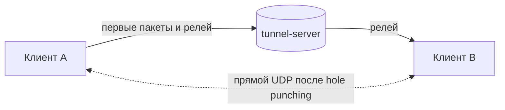

# Частые вопросы (FAQ)

Ответы на вопросы о VoidLink: чем он отличается от похожих инструментов, что видит сервер,
как устроены группы и приглашения, какие порты открыть, что работает, а что пока в разработке.
Если нужного ответа нет, загляните в [README.md](../README.md), [SERVER.md](SERVER.md),
[INSTALL.md](INSTALL.md) или [PROTOCOL.md](PROTOCOL.md).

Статусы в ответах: **работает**: функция есть в текущей версии. **в разработке**: код или заготовка
есть, но пользовательская часть ещё дорабатывается, детали могут измениться.

## Содержание

- [Общее](#общее)
  - [1. Что такое VoidLink?](#1-что-такое-voidlink)
  - [2. Чем VoidLink отличается от Hamachi?](#2-чем-voidlink-отличается-от-hamachi)
  - [3. Чем VoidLink отличается от ZeroTier?](#3-чем-voidlink-отличается-от-zerotier)
  - [4. Чем VoidLink отличается от Tailscale?](#4-чем-voidlink-отличается-от-tailscale)
  - [5. Чем VoidLink отличается от WireGuard?](#5-чем-voidlink-отличается-от-wireguard)
  - [6. Можно ли выводить через VoidLink весь интернет?](#6-можно-ли-выводить-через-voidlink-весь-интернет)
- [Безопасность и данные](#безопасность-и-данные)
  - [7. Может ли сервер читать мой трафик?](#7-может-ли-сервер-читать-мой-трафик)
  - [8. Что видит сервер?](#8-что-видит-сервер)
  - [9. Что хранит сервер на диске?](#9-что-хранит-сервер-на-диске)
  - [10. Что такое identity и friend code?](#10-что-такое-identity-и-friend-code)
  - [11. Что делать, если утёк ключ или скомпрометирован сервер?](#11-что-делать-если-утёк-ключ-или-скомпрометирован-сервер)
- [Сеть](#сеть)
  - [12. Какие порты нужно открыть?](#12-какие-порты-нужно-открыть)
  - [13. Нужен ли мне белый IP или права на роутере?](#13-нужен-ли-мне-белый-ip-или-права-на-роутере)
  - [14. Почему трафик иногда идёт через сервер, а не напрямую?](#14-почему-трафик-иногда-идёт-через-сервер-а-не-напрямую)
  - [15. Работает ли VoidLink, если блокируют UDP?](#15-работает-ли-voidlink-если-блокируют-udp)
  - [16. Поддерживается ли IPv6?](#16-поддерживается-ли-ipv6)
  - [17. Можно ли обращаться к участникам по имени?](#17-можно-ли-обращаться-к-участникам-по-имени)
  - [18. Нужны ли права администратора?](#18-нужны-ли-права-администратора)
- [Группы и лимиты](#группы-и-лимиты)
  - [19. Сколько участников в одной группе?](#19-сколько-участников-в-одной-группе)
  - [20. Сколько групп может быть на одном сервере?](#20-сколько-групп-может-быть-на-одном-сервере)
  - [21. Сколько групп может создать один человек?](#21-сколько-групп-может-создать-один-человек)
  - [22. Публичная и приватная группа: в чём разница?](#22-публичная-и-приватная-группа-в-чём-разница)
  - [23. Как работают приглашения, если получатель не в сети?](#23-как-работают-приглашения-если-получатель-не-в-сети)
  - [24. Что значит «владелец» и как передать группу?](#24-что-значит-владелец-и-как-передать-группу)
  - [25. Чем отличаются кик и бан?](#25-чем-отличаются-кик-и-бан)
  - [26. Что такое «невидимка»?](#26-что-такое-невидимка)
- [Использование](#использование)
  - [27. Подходит ли VoidLink для игр и LAN-вечеринок?](#27-подходит-ли-voidlink-для-игр-и-lan-вечеринок)
  - [28. Работает ли VoidLink на телефонах?](#28-работает-ли-voidlink-на-телефонах)
  - [29. Можно ли одну identity использовать на двух устройствах?](#29-можно-ли-одну-identity-использовать-на-двух-устройствах)
  - [30. Что такое профили и как перенести identity?](#30-что-такое-профили-и-как-перенести-identity)
- [Сервер и эксплуатация](#сервер-и-эксплуатация)
  - [31. Можно ли поднять сервер на VPS или Raspberry Pi?](#31-можно-ли-поднять-сервер-на-vps-или-raspberry-pi)
  - [32. Что будет с группами, если сервер перезапустили?](#32-что-будет-с-группами-если-сервер-перезапустили)
  - [33. Сколько живёт приглашение?](#33-сколько-живёт-приглашение)
  - [34. Лицензия и самостоятельный хостинг](#34-лицензия-и-самостоятельный-хостинг)

---

## Общее

### 1. Что такое VoidLink?

VoidLink создаёт виртуальную сеть уровня 3 (L3) поверх интернета. Участники объединяются в
**группы**, каждый получает постоянный адрес вида `100.66.<a>.<b>` (один на сервере для всех
его групп), и внутри группы компьютеры
видят друг друга как в одной локальной сети: `ping` проходит, игры и сервисы работают по IP.

Состав проекта: сервер `tunnel-server` (его поднимает владелец сети), клиент `tunnel-client`
(CLI и текстовый интерфейс TUI), фоновая служба и трей для Windows. Подробнее: [README.md](../README.md).

### 2. Чем VoidLink отличается от Hamachi?

Hamachi, как и VoidLink, создаёт виртуальную L3-сеть для группы участников. Главные различия:

| | Hamachi | VoidLink |
|---|---|---|
| Кто управляет | коммерческий сервис вендора (LogMeIn) | вы поднимаете свой сервер |
| Исходный код | проприетарный | исходники собираются из репозитория (лицензия: см. вопрос 34) |
| Где хранятся группы | на стороне вендора | в `server.json` на вашем сервере |
| Платформы | Windows, macOS, Linux, мобильные | клиенты для Windows (служба и трей), Linux и macOS; мобильных клиентов нет |

Hamachi зрелее и проверен большим числом пользователей. VoidLink проще по устройству и полностью
под вашим контролем, но он молодой и менее проверен.

### 3. Чем VoidLink отличается от ZeroTier?

ZeroTier тоже строит виртуальные сети и умеет работать через NAT. Его контроллер можно
использовать как облачный сервис или поднять самому. Клиенты есть для многих систем, включая мобильные.

VoidLink устроен проще: один сервер одновременно выполняет роль рандеву-точки, релея и хранилища
групп, а протокол собственный (кадры `TNL2`, рукопожатие на X25519 и ed25519). ZeroTier значительно
шире по платформам и функциям. VoidLink подходит, если нужна небольшая сеть на одном сервере и
нужно понимать и контролировать каждый компонент.

### 4. Чем VoidLink отличается от Tailscale?

Tailscale строит mesh-сеть на базе WireGuard, использует координационный сервер (облачный или
совместимый с Headscale) и предоставляет SSO, ACL, маршрутизацию подсетей и клиенты для всех
основных систем, включая мобильные.

VoidLink не использует WireGuard, не поддерживает SSO, ACL и маршрутизацию чужих подсетей:
он даёт связность только между участниками одной группы. Зато весь сервер помещается в один
бинарник и один UDP-порт, без внешних сервисов.

### 5. Чем VoidLink отличается от WireGuard?

WireGuard это протокол и реализация туннеля «точка-точка». Он не занимается обнаружением пиров,
пробиванием NAT и выдачей адресов: эти вещи настраиваются вручную.

VoidLink добавляет всё, чего нет в WireGuard: группы, выдачу адресов сервером, обнаружение
участников, пробивание NAT (UDP hole punching) и релей через сервер, если прямой канал не
установился. Собственного шифрования VoidLink при этом не придумывает: он использует
ChaCha20-Poly1305 и X25519, но формат кадров и рукопожатия у него свой, а не WireGuard.

### 6. Можно ли выводить через VoidLink весь интернет?

Нет. VoidLink создаёт связность только между участниками группы и не маршрутизирует чужие
подсети и не работает как VPN для выхода в интернет. Это сознательное ограничение (см.
[README.md](../README.md)).

---

## Безопасность и данные

### 7. Может ли сервер читать мой трафик?

Коротко: **да, технически может, и это надо учитывать при выборе сервера.** Честный ответ такой.

- Содержимое кадров группы шифруется ChaCha20-Poly1305. Ключ группы генерирует сервер и
  передаёт его участникам по защищённому каналу. Значит, сервер знает ключ группы.
- Сервер-релей видит открытый заголовок кадра группы: `gid`, `src_ip`, `dst_ip`, `epoch`.
  Содержимое IP-пакета при релее сервер не расшифровывает, но ключ у него есть.
- Прямой трафик между участниками (P2P) сервер не видит, пока не работает релей.
  Но ключ групп от сервера, поэтому конфиденциальность P2P тоже опирается на доверие к серверу.
- Защита от перехвата в сети (провайдер, Wi-Fi, наблюдатель на пути) работает. Защита от
  оператора сервера, который хочет читать трафик, **не** обеспечивается: им нужно доверять.

Поэтому держите сервер на своём VPS или у людей, которым доверяете. Если нужна модель, где
сервер ничего не может расшифровать, VoidLink её сейчас не даёт.

### 8. Что видит сервер?

Сервер видит метаданные и служебные данные:

- публичный IP и UDP-порт каждого клиента, время его пребывания в сети;
- открытый ключ (pubkey) и имя, статус, список групп и состав участников;
- для релея: `gid`, адреса `src_ip` и `dst_ip` внутри группы, размеры и частоту пакетов;
- приглашения, отказы, баны, кики и выходы.

Список друзей хранится только у клиента и на сервер не уходит. Поэтому сервер не знает ваш
социальный граф, кроме состава групп.

### 9. Что хранит сервер на диске?

Всё состояние лежит в одном файле `server.json` в каталоге данных (`--data`, в systemd-юните
это `/var/lib/tunnel`). В нём:

- identity сервера (приватный ключ, от которого зависит Server code);
- группы: имена, приватность, владелец, состав, постоянные адреса пользователей (`user_ips`);
- баны и неотвеченные приглашения;
- цепочка ротаций ключа сервера (поле `rotations`).

Содержимого трафика на диске нет. Запись атомарная (через временный файл и rename), сохранение
происходит примерно раз в 3 с, если состояние изменилось. Подробности: [SERVER.md](SERVER.md).

### 10. Что такое identity и friend code?

Identity клиента это пара ключей ed25519 (подписи, «лицо» пира) и x25519 (канальный ключ).
Friend code это base32 (Crockford) от публичного ключа ed25519 в виде `TUN-XXXX…`. Его можно
отправить другу, и он добавит вас командой `add-friend`. Код показывает `tunnel-client id`.

Friend code не содержит приватного ключа: это публичная часть, безопасно пересылать в любом мессенджере.
Приватные ключи лежат в конфиге клиента (`client.json`), и их не стоит никому передавать.
Если кто-то получит ваш `client.json`, он сможет выдавать себя за вас, поэтому храните файл
так же бережно, как пароль.

### 11. Что делать, если утёк ключ или скомпрометирован сервер?

- **Утёк ключ клиента.** Сейчас отдельной команды отзыва identity нет. Создайте новую identity
  (новый конфиг в другом каталоге `--dir`), добавьте её в группы заново и попросите владельцев
  выгнать старую identity через `kick` или `ban`.
- **Скомпрометирован сервер.** Поднимите новый сервер, восстановите группы из резервной копии
  `server.json` (если она у вас есть) и переподключите клиентов через `del-server` и `add-server`.
  Чтобы сменить ключ сервера, не теряя клиентов, используйте `tunnel-server rotate-key`: старый
  ключ подписывает новый, и клиенты перезакрепляют его сами, см. [SERVER.md](SERVER.md).

Регулярное резервное копирование `server.json` описано в [SERVER.md](SERVER.md), раздел «Резервная копия».

---

## Сеть

### 12. Какие порты нужно открыть?

На сервере нужен **один порт**, по умолчанию `5555`: UDP (основной) и, для TCP-фолбэка, тот же номер по TCP. Пример для ufw:

```bash
sudo ufw allow 5555/udp
sudo ufw allow 5555/tcp   # TCP-фолбэк (если не отключён --no-tcp)
```

Клиентам ничего открывать не нужно: они сами устанавливают исходящие UDP-соединения. Прямые
каналы между клиентами используют случайные UDP-порты, которые NAT пробивает через
hole punching. Если пробить не удалось, трафик идёт через релей сервера, и открытых портов
у клиента тоже не требуется.

### 13. Нужен ли мне белый IP или права на роутере?

Клиенту белый IP не нужен, так как он работает за NAT. Серверу нужен адрес, доступный из
интернета, например VPS с белым IPv4. Настраивать проброс портов на домашнем роутере не нужно,
хотя при симметричном NAT прямой канал не установится и трафик пойдёт через сервер.

### 14. Почему трафик иногда идёт через сервер, а не напрямую?

Схема такая:



Первые пакеты всегда идут через релей сервера, поэтому связь работает сразу. Параллельно
клиенты пробивают NAT (PUNCH), и как только прямой канал установлен, трафик идёт напрямую.
Если от пира 12 с нет прямых пакетов, трафик возвращается на релей.

Релей остаётся запасным путём и при симметричном NAT. Посмотреть, какой путь используется,
можно в TUI: в таблице участников колонка связи показывает `direct` или `relay`.

### 15. Работает ли VoidLink, если блокируют UDP?

Да, с оговорками. Клиент с транспортом `auto` (по умолчанию) начинает с UDP, а если рукопожатие с
сервером не проходит (три неудачи подряд или 10 с молчания), переходит на TCP-фолбэк к серверу на
том же порту. Транспорт можно зафиксировать: `tunnel-client set-transport auto|udp|tcp`. На сервере
фолбэк включён по умолчанию (`--no-tcp` отключает). Прямые каналы между пирами всегда UDP, поэтому
при заблокированном UDP трафик идёт через релей сервера по TCP, с большей задержкой.
См. [SERVER.md](SERVER.md#tcp-фолбэк).

### 16. Поддерживается ли IPv6?

Внутри оверлея да: каждый участник дополнительно получает IPv6-адрес из ULA-подсети
`fd66:766c:696e::/64`. Участник с IPv4 `100.66.<a>.<b>` получает `fd66:766c:696e::<a>:<b>`
(например, `100.66.7.42` → `fd66:766c:696e::7:2a`); на адаптере один адрес `/64`. Доставка
до сервера по-прежнему идёт по IPv4/UDP (или TCP). Если IPv6 у вас не работает, ориентируйтесь на
IPv4-адреса группы (см. [TROUBLESHOOTING.md](TROUBLESHOOTING.md#4-адреса-оверлея-dns-и-ipv6)).

### 17. Можно ли обращаться к участникам по имени?

Да. В клиенте есть встроенный DNS-ответчик на `100.66.0.53`, он отвечает на запросы
`<участник>.vl` и `<участник>.<группа>.vl` (регистр не важен), а ОС настраивается на split-DNS, так
что через туннель идут только имена `.vl` (Windows: NRPT, Linux: `resolvectl`, macOS:
`/etc/resolver/vl`). Включён по умолчанию, отключается командой `tunnel-client dns off`
(поле `dns` в `client.json`). Если имя не резолвится, используйте адрес `100.66.<a>.<b>`.

### 18. Нужны ли права администратора?

Зависит от способа запуска.

- **Служба на Windows** (рекомендуемый вариант, [INSTALL.md](INSTALL.md)): установка требует
  прав администратора один раз. После этого TUI и CLI работают без них и подключаются к службе
  (`tunnel-client tui --remote` требует именно демон, `--embedded` — свой движок).
- **Переносной режим** (`tunnel-client run` или `tui` в консоли): на Windows нужен администратор
  (адаптер Wintun), на Linux — root или `CAP_NET_ADMIN`, на macOS — `sudo`.

---

## Группы и лимиты

### 19. Сколько участников в одной группе?

До **253** участников. Адрес участника не зависит от группы: он выдаётся сервером из пула
`100.66.1.1` … `100.66.255.254` (последний октет не `.0` и не `.255`), `100.66.0.0/24` зарезервирована.

### 20. Сколько групп может быть на одном сервере?

До **254**, номера `gid` от 1 до 254. Номер группы в IP-адрес не входит: адрес один на пользователя
и общий для всех его групп (всего 64 770 адресов на сервер).

### 21. Сколько групп может создать один человек?

По умолчанию до **16** групп на одну identity (лимит `max_owned_groups`, флаг сервера `--max-owned-groups`). Это ограничение
владельца: он касается только создания групп, а не входа в чужие.

### 22. Публичная и приватная группа: в чём разница?

- **Публичная** (`create <имя>`): войти может любой, у кого есть доступ к серверу, и кто нашёл
  группу в списке.
- **Приватная** (`create <имя> --private`): только по приглашению владельца.

Публичная группа подходит для открытой «комнаты», приватная для постоянного круга друзей.

### 23. Как работают приглашения, если получатель не в сети?

Приглашение хранится на сервере, поэтому доставляется при следующем входе получателя.
Онлайн-получатель получает его сразу, офлайн-получатель увидит его после HELLO, когда сервер
пришлёт список неотвеченных приглашений.

В TUI приглашение открывает окно с кнопками `Принять`, `Отклонить` и `Позже`. В CLI список
показывает команда `invites`, принять можно через `join <gid>`, отклонить через `decline <gid>`.
Отклонение сообщит владельцу, если тот в сети.

### 24. Что значит «владелец» и как передать группу?

Владелец это identity, которая создала группу. Он может приглашать, исключать, банить, переименовывать
и удалять группу. Передать группу другому участнику можно командой:

```bash
tunnel-client transfer <gid> <peer>
```

`peer` это friend code (`TUN-…`), hex-ключ или alias из списка друзей. Новый владелец сразу
получает права. Висящие приглашения остаются, а отправителем в них становится новый владелец.

### 25. Чем отличаются кик и бан?

- **`kick <gid> <peer>`**: исключает участника из группы. Он может зайти обратно, если группа
  публичная или есть новое приглашение.
- **`ban <gid> <peer>`**: исключает и блокирует вход. Посмотреть баны можно через `bans <gid>`,
  снять через `unban <gid> <peer>`.

Оба действия владелец выполняет через CLI или TUI (клавиши `k` и `b` в TUI).

### 26. Что такое «невидимка»?

Режим `invisible on` скрывает вас от других: в списке участников вы отображаетесь офлайн, хотя
туннель работает. Выключается командой `invisible off`. Если вы в невидимке, остальные не видят
ваш статус в сети, но сами соединения работают по тем же правилам.

---

## Использование

### 27. Подходит ли VoidLink для игр и LAN-вечеринок?

Да, для этого он и задумывался: участники группы видят друг друга по IP и могут заходить в игры,
которые умеют подключаться по адресу. Совет: подключайтесь по адресу `100.66.<a>.<b>`, так надёжнее.

Чего не гарантируем: широковещательный и multicast-трафик, на котором многие игры ищут сервер
в локальной сети, в документации не описан. Проверьте свою игру отдельно. Для задержки важен
прямой канал: при работе через релей пинг заметно выше. Ориентиром служит колонка RTT в TUI.

### 28. Работает ли VoidLink на телефонах?

Нет, мобильных клиентов в проекте нет. Клиент работает на Windows (Wintun, служба и трей), Linux
(TUN-интерфейс) и macOS (utun).

### 29. Можно ли одну identity использовать на двух устройствах?

Одновременно нет. Сервер допускает одну сессию на identity, и если вы запустите клиент с той же
identity на втором устройстве, он вытеснит первое соединение. Команды CLI тоже вытесняют сеанс
запущенного `run` или TUI с той же identity.

Если нужно работать с двух машин, создайте для каждой машины свою identity и добавьте её в группы
(приглашение) или перенесите identity через `export-identity` / `import-identity` (вопрос 30).

### 30. Что такое профили и как перенести identity?

- **Профили.** Глобальный флаг `--profile <имя>` использует каталог `<dir>/profiles/<имя>`, так
  что на одной машине можно держать несколько независимых identity. Каталог конфига целиком
  меняет `--dir <путь>`.
- **Перенос identity.** `tunnel-client export-identity <файл> [--passphrase <p>|--passphrase-stdin] [--force]`
  выгружает identity (с парольной фразой файл шифруется; без неё не зашифрован, храните его в
  секрете). `tunnel-client import-identity <файл> [--passphrase …] [--force]` загружает её на другой
  машине; `--force` заменяет текущую identity. Импорт проверяет, что friend code совпадает с ключами.

Помните, что на одной identity одновременно работает только одна сессия (вопрос 29).

---

## Сервер и эксплуатация

### 31. Можно ли поднять сервер на VPS или Raspberry Pi?

На VPS с Linux: да, это основной сценарий. Инструкция по установке через systemd есть в
[SERVER.md](SERVER.md). Нужен один UDP-порт и каталог состояния.

Сборка для VPS без зависимости от glibc:

```bash
rustup target add x86_64-unknown-linux-musl
cargo zigbuild --release -p tunnel-server --target x86_64-unknown-linux-musl
```

На Raspberry Pi теоретически подойдёт ARM-сборка (например, `aarch64-unknown-linux-musl`), так как
сервер написан на Rust без платформенных зависимостей. Проверенной инструкции в проекте пока нет,
так что проверяйте сборку и запуск на своём устройстве. Для домашнего сервера понадобится проброс
UDP-порта на роутере и стабильный внешний адрес или DDNS.

### 32. Что будет с группами, если сервер перезапустили?

Состояние групп, адреса, баны и приглашения восстанавливаются из `server.json`. Клиенты после
рестарта получают `RESET` и переподключаются в течение нескольких секунд. Они заново отправляют
статус, входят в группы из автовхода и повторно запрашивают список групп.

Пока сервер недоступен, работают только уже установленные прямые каналы между клиентами. Релей
и новые входы в группы появятся после переподключения.

Остановка штатная: `SIGTERM`/`SIGINT` (`systemctl stop`) останавливают воркеры и сохраняют состояние
перед выходом, см. [SERVER.md](SERVER.md#остановка).

### 33. Сколько живёт приглашение?

По умолчанию 7 дней. Срок меняется флагом сервера `--invite-ttl-days N`
(см. [SERVER.md](SERVER.md#флаги)). Истёкшие приглашения исчезают; повторное приглашение продлевает срок.

### 34. Лицензия и самостоятельный хостинг

Самостоятельный хостинг это основная модель использования: вы собираете сервер из исходников,
запускаете его у себя и не зависите от сторонних сервисов. Лицензия проекта в репозитории
не указана. Уточняйте её у автора проекта до того, как использовать код вне своей сети.

---

Если вашего вопроса здесь нет, загляните в [PLAN.md](PLAN.md) (план и статус этапов),
[PROTOCOL.md](PROTOCOL.md) (формат протокола) или [TESTING.md](TESTING.md) (как проверяется работа).
