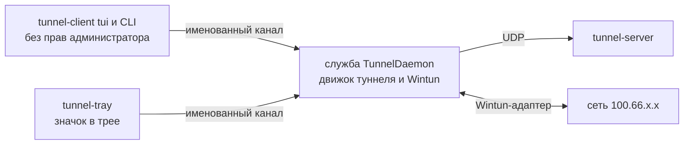

# Установка и обновление VoidLink

VoidLink — виртуальная локальная сеть: клиенты подключаются к серверу
(`tunnel-server`), вступают в группы и получают адреса вида
`100.66.<a>.<b>` (один адрес на пользователя на сервере), как в Hamachi или ZeroTier. Нужны два компонента: **сервер**
(один на сеть, открыт один порт: UDP, а для TCP-фолбэка — тот же номер по TCP) и **клиент** на каждой машине, которая
участвует в сети. Эта страница описывает установку клиента под Windows, Linux и
macOS и отсылает к установке сервера.

Порядок обычно такой: поднять сервер, получить его **Server code** (`TUN-…`),
установить клиент, добавить сервер в клиент, проверить связь.

## Содержание

- [Что понадобится](#что-понадобится)
- [Сервер](#сервер)
- [Windows: служба и трей (рекомендуется)](#windows-служба-и-трей-рекомендуется)
- [Windows: переносной режим](#windows-переносной-режим)
- [Первый запуск: мастер настройки](#первый-запуск-мастер-настройки)
- [Linux: клиент](#linux-клиент)
- [macOS: клиент](#macos-клиент)
- [Проверка работы](#проверка-работы)
- [Обновление](#обновление)
- [Удаление](#удаление)
- [Частые проблемы](#частые-проблемы)

## Что понадобится

| Что | Зачем |
|---|---|
| Адрес и UDP-порт сервера (по умолчанию `5555`) | точка встречи и релей |
| Server code сервера (`TUN-…`) | проверка подлинности сервера при подключении |
| Права администратора на машине клиента | создание TUN/Wintun-адаптера |
| Исходящий UDP с клиента на сервер | обычно достаточно; если UDP режут, клиент сам переходит на TCP (`set-transport`, см. [NETWORKING.md](NETWORKING.md)) |

Клиенту не нужны открытые входящие порты: соединение устанавливает клиент с
сервера. Трафик между участниками идёт напрямую, когда это возможно, иначе через
релей сервера.

## Сервер

Установка сервера под Linux (systemd, системный пользователь `tunnel`, юнит,
обновление поверх) описана в **[SERVER.md](SERVER.md)**. После запуска сервер
печатает строку `Server code: TUN-…`, её передают участникам:

```bash
journalctl -u tunnel-server | grep TUN-
```

Откройте порт сервера в файрволе: `ufw allow 5555/udp` и (для TCP-фолбэка)
`ufw allow 5555/tcp`. Флаги сервера и обновление — в [SERVER.md](SERVER.md).

## Windows: служба и трей (рекомендуется)

Служба `TunnelDaemon` держит туннель, поэтому он работает до входа пользователя
в систему и не падает при закрытии окон. Трей показывает статус и уведомления.
Трей, TUI и CLI подключаются к службе через именованный канал
`\\.\pipe\tunnel-daemon` и работают **без прав администратора**: `tunnel-client tui`
при запущенной службе становится тонким клиентом (в шапке «демон»). Без службы
`tui` и `run` поднимают туннель сами и требуют прав администратора (см.
«Переносной режим»). Если сервер ещё не добавлен, служба ждёт первой настройки:
`add-server` из обычной консоли передаётся ей, подробнее — [DAEMON.md](DAEMON.md).

### Что в архиве

Артефакт `tunnel-windows-x64` собирает CI (вкладка **Actions**, запуск
*build · windows release*, раздел **Artifacts**; хранится 14 дней). Собрать самим
можно командой `cargo build --release --workspace`.

| Файл | Назначение |
|---|---|
| `tunnel-daemon.exe` | служба, владелец движка туннеля |
| `tunnel-client.exe` | CLI и TUI |
| `tunnel-tray.exe` | значок в трее |
| `tunnel-server.exe` | сервер, нужен только для отладки на Windows |
| `wintun.dll` | драйвер адаптера Wintun (из `vendor/wintun`) |
| `install.ps1`, `uninstall.ps1` | установка и удаление |

`install.ps1` требует `tunnel-daemon.exe`, `tunnel-tray.exe`, `tunnel-client.exe`
и `wintun.dll`. Если файла нет, скрипт останавливается с ошибкой
`Не найден <файл>`, поэтому берите полный артефакт.

### Установка

1. Распакуйте архив в любую папку, например `C:\Downloads\tunnel`.
2. Откройте PowerShell в этой папке и выполните:

   ```powershell
   powershell -ExecutionPolicy Bypass -File .\install.ps1
   ```

3. Подтвердите запрос UAC. Скрипт перезапустит себя с правами администратора.

`install.ps1` делает следующее:

- копирует файлы в `%ProgramFiles%\Tunnel`. Туда пишет только администратор, а
  `wintun.dll` служба загружает только из этого каталога;
- выполняет `tunnel-daemon install`: регистрирует службу `TunnelDaemon`
  (LocalSystem, автозапуск, перезапуск при сбое) и создаёт конфиг
  `%ProgramData%\tunnel\client.json` с ограниченными правами;
- если у текущего пользователя есть `%APPDATA%\tunnel\client.json`, импортирует
  его: identity, друзья и friend code сохраняются;
- настраивает автозапуск трея при входе и запускает службу и трей.

Флаг `-NoTray` оставляет трей незапущенным:

```powershell
powershell -ExecutionPolicy Bypass -File .\install.ps1 -NoTray
```

Команды консоли (`create`, `invite`, `groups` и т. д.) при работающей службе
уходят ей по IPC; настройки движка (`set-transport`, `set-mtu`, `dns`,
`import-identity`) при службе отказывают. Подробнее — [CLIENT.md](CLIENT.md).

### Как устроены компоненты



## Windows: переносной режим

Без службы туннель запускается из консоли **с правами администратора**:

```powershell
cd "$env:ProgramFiles\Tunnel"        # или папка с распакованным архивом
.\tunnel-client.exe tui              # или: .\tunnel-client.exe run
```

`wintun.dll` должна лежать рядом с `tunnel-client.exe`. Конфиг берётся из
`%APPDATA%\tunnel\client.json`. Туннель живёт, пока открыто окно, и падает при
его закрытии.

Не запускайте переносной режим одновременно со службой: одна identity даёт одну
сессию на сервере. Замок single-instance это проверяет: `tui` при работающей
службе сам станет тонким клиентом, а `run` откажет. Режим можно выбрать флагами
`tui --embedded` / `tui --remote`.

## Первый запуск: мастер настройки

Если в конфиге не заданы имя или сервер, `tunnel-client tui` сначала открывает
экран первичной настройки. Он спрашивает:

1. **Имя**: как вас видят другие участники. Его можно поменять позже.
2. **Сервер**: адрес `ip:порт` и Server code (`TUN-…`).
3. **Адаптер** и **путь к `wintun.dll`**: заполняются значениями по умолчанию,
   обычно их менять не нужно.

Клавиша **Enter** применяет настройки, **Esc** отменяет. Если отменить мастер,
TUI закрывается, и ту же настройку можно выполнить командами CLI:

```powershell
.\tunnel-client.exe add-server 203.0.113.10:5555 TUN-XXXX-XXXX-XXXX main
.\tunnel-client.exe set-name alpha
```

Аргументы `add-server`: адрес, код сервера и необязательная метка.

Свой friend code (`TUN-…`, по нему вас добавляют в друзья и приглашают в группы):

```powershell
.\tunnel-client.exe id
```

Чтобы сменить сервер, используйте `servers`, `del-server <N|addr|label>` и
`add-server`.

## Linux: клиент

Сборка: `cargo build --release -p tunnel-client`, бинарник появится в
`target/release/tunnel-client`. Туннель использует TUN-устройство `/dev/net/tun`,
поэтому нужны:

- **root** или capability `CAP_NET_ADMIN` на бинарнике;
- утилита `ip` (пакет `iproute2`);
- для DNS по именам: `systemd-resolved` с командой `resolvectl`.

Запуск от root:

```bash
sudo ./target/release/tunnel-client tui
```

Либо выдать бинарнику только нужную capability, и тогда `sudo` не нужен:

```bash
sudo setcap cap_net_admin+ep ./target/release/tunnel-client
```

Имя интерфейса задаёт глобальный флаг `--adapter` (по умолчанию `voidlink0`),
например `--adapter vl1`; то же можно сохранить в конфиге (поле `adapter`).
Флаг `--dll` относится только к Windows.

Конфиг по умолчанию лежит в `~/.tunnel-client/client.json`. **При запуске через
`sudo` учтите:** `HOME` может указывать на `/root`, и конфиг окажется в другом
месте. Чтобы всегда использовать один каталог, укажите его явно:

```bash
sudo ./target/release/tunnel-client --dir "$HOME/.tunnel-client" tui
```

Дальше настройка и команды такие же, как в
[мастере настройки](#первый-запуск-мастер-настройки).

## macOS: клиент

Сборка та же: `cargo build --release -p tunnel-client`. Туннель использует
системный интерфейс `utun`, номер (`utunN`) система выбирает сама. Один адрес
(маска /16) и маршрут `100.66.0.0/16` клиент настраивает через `ifconfig` и `route`, поэтому нужен
`sudo`:

```bash
sudo ./target/release/tunnel-client --dir "$HOME/.tunnel-client" tui
```

Здесь `--dir` тоже полезен по той же причине, что и в разделе про Linux.

Для macOS службы пока нет: клиент работает, пока открыт терминал. Для работы в
фоне можно использовать `tmux` или `screen`.

## Проверка работы

Проверяйте по шагам: сначала связь с сервером, потом группа, потом пинг и имя.

1. **Сервер принимает клиента.** В строке состояния TUI виден статус соединения.
   В CLI:

   ```bash
   tunnel-client servers
   tunnel-client groups
   ```

   На Windows вместо `tunnel-client` пишите `.\tunnel-client.exe`.

2. **Есть общая группа.** Создайте группу (`create <имя>`, при желании с
   `--private`), пригласите друга (`invite <gid> <peer>`). Друг принимает
   приглашение через `invites` и `join <gid>`. Peer можно указать friend code
   (`TUN-…`), hex или псевдоним.

3. **Пинг участника по адресу.** Адрес участника в группе имеет вид
   `100.66.<a>.<b>`: сервер выдаёт пользователю один адрес, общий для всех его
   групп на этом сервере. Адреса видны в TUI, в списке участников группы:

   ```bash
   ping 100.66.<a>.<b>
   ```

   Ответ на ping означает, что туннель работает. Если прямого пути между
   участниками нет, трафик идёт через релей сервера, и это штатная работа.

4. **Имя вместо адреса.** Встроенный DNS-сервер туннеля (`100.66.0.53`) отвечает
   на имена участников вида `<участник>.vl` и `<участник>.<группа>.vl`, регистр
   не важен. Клиент сам настраивает системный резолвер для зоны `.vl`: NRPT на
   Windows, `resolvectl` на Linux, файл `/etc/resolver/vl` на macOS. Проверка:

   ```bash
   ping alpha.vl
   ping alpha.<группа>.vl
   ```

   Если имя не разрешается, а адрес `100.66.x.x` отвечает, значит, DNS-настройка
   не применилась. Проверьте, что она не отключена в конфиге (параметр `dns`), и
   посмотрите предупреждение о резолвере в журнале клиента.

## Обновление

Конфиг и identity при обновлении сохраняются.

**Windows, служба.** Запустите `install.ps1` из новой распаковки поверх старой
установки. Служба и трей останавливаются, exe-файлы заменяются, служба
запускается снова. Интерфейсы переподключаются сами.

```powershell
powershell -ExecutionPolicy Bypass -File .\install.ps1
```

**Linux и macOS.** Остановите клиент (`Ctrl+C` в окне TUI), соберите новую версию
и замените бинарник. Каталог `~/.tunnel-client` не трогается.

**Сервер.** Повторный запуск `install-server.sh` выполняет обновление: служба
останавливается, бинарник заменяется, `server.json` (identity сервера) не
меняется. Подробности в [SERVER.md](SERVER.md).

Совместимость определяется версией протокола (сейчас v4, см.
[PROTOCOL.md](PROTOCOL.md)). Если сервер обновили с изменением протокола,
обновите и клиентов. Ключ сервера можно менять без переустановки клиентов:
`tunnel-server rotate-key` (см. [SERVER.md](SERVER.md)).

## Удаление

**Windows.** Скрипт `uninstall.ps1` лежит в `%ProgramFiles%\Tunnel`, его копирует
`install.ps1`. Можно запустить и из распакованного архива. Скрипт запросит UAC
сам:

```powershell
powershell -ExecutionPolicy Bypass -File "$env:ProgramFiles\Tunnel\uninstall.ps1"
```

Скрипт останавливает трей и клиенты, удаляет службу, адаптер Wintun, автозапуск
трея и каталог `%ProgramFiles%\Tunnel`. Конфиг в `%ProgramData%\tunnel`
(identity, друзья, серверы) **сохраняется**: при повторной установке friend code
останется прежним.

Чтобы удалить и конфиг, добавьте `-Purge`:

```powershell
powershell -ExecutionPolicy Bypass -File "$env:ProgramFiles\Tunnel\uninstall.ps1" -Purge
```

> **Внимание:** `-Purge` безвозвратно удаляет identity. Friend code изменится,
> и участники, которые добавили вас по старому коду, потеряют связь. Переносной
> конфиг `%APPDATA%\tunnel\client.json` скрипт не трогает, его можно удалить
> вручную.

**Linux и macOS.** Остановите клиент, затем удалите бинарник и каталог конфига:

```bash
rm -f /usr/local/bin/tunnel-client          # путь, куда вы его положили
rm -rf ~/.tunnel-client                     # identity и серверы будут потеряны
```

Удаление сервера описано в [SERVER.md](SERVER.md).

## Частые проблемы

| Симптом | Что проверить |
|---|---|
| «нет сервера» | не выполнен `add-server`; проверьте `tunnel-client servers` |
| Server code не совпадает | сервер переустановлен без `server.json` (новая identity). Восстановите файл на сервере или выполните `add-server` заново с актуальным кодом |
| `Не найден <файл>` при установке | в архиве нет нужного exe или `wintun.dll`; возьмите полный артефакт |
| Служба не стартует | `%ProgramData%\tunnel\logs\daemon.log`, `sc query TunnelDaemon`; есть ли `wintun.dll` рядом с `tunnel-daemon.exe` |
| Нет адаптера или отказ в доступе (Linux, macOS) | запуск без root или без `CAP_NET_ADMIN`; отсутствует `/dev/net/tun` |
| Конфиг «пропал» после `sudo` | `HOME` указывал на `/root`; запускайте с `--dir` |
| Ping не отвечает | сервер доступен по UDP; участники состоят в одной группе; адрес взят из нужной группы |
| Имя `.vl` не разрешается | DNS-настройка не применилась (см. журнал клиента); используйте адрес `100.66.x.x` |
| Прямой связи нет | трафик идёт через релей сервера, это штатно; проверьте UDP-порт сервера |
| Другие неполадки | [TROUBLESHOOTING.md](TROUBLESHOOTING.md), [FAQ.md](FAQ.md) |

Для подробного журнала запустите клиент с флагом `--debug`: `tunnel-client --debug run`
на Linux и macOS, либо `tunnel-daemon console --debug` из консоли администратора
на Windows (предварительно остановив службу). Сценарии проверки см. в
[TESTING.md](TESTING.md).
