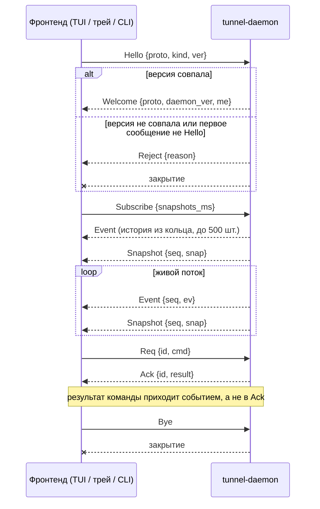
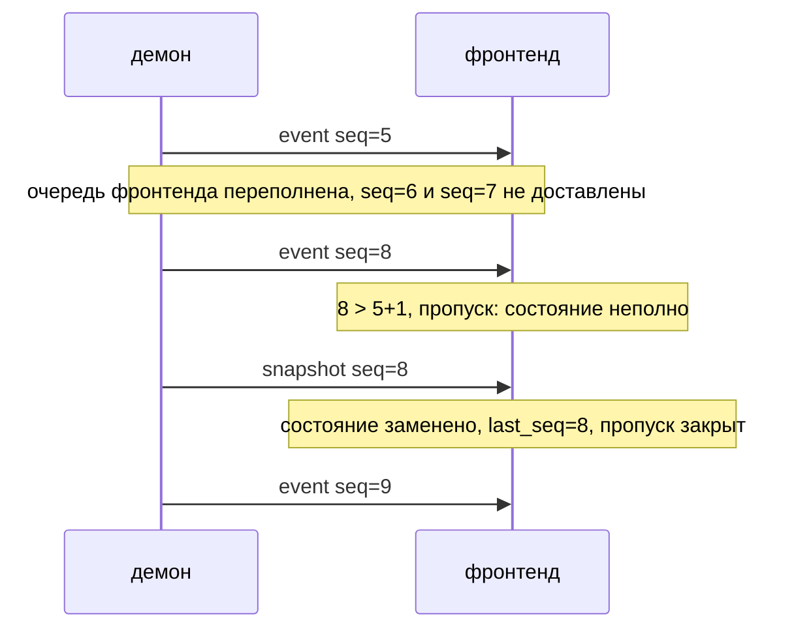

# IPC демона: справочник разработчика

Этот документ описывает протокол между `tunnel-daemon` и фронтендами (TUI, трей, CLI) — то, что реализовано в крейте `crates/ipc` (`tunnel-ipc`), и то, как демон и клиенты его используют. Демон держит движок VoidLink и публикует его состояние и события; фронтенд подключается к локальному сокету или named pipe, подписывается на поток и отправляет команды. Транспорт локальный, без async-рантайма, кодек — `u32` длина и JSON.

Здесь описано, как писать клиент. Протокол туннеля между клиентами и сервером — в [docs/PROTOCOL.md](PROTOCOL.md). Общий план этапа 7 (демон, IPC, TUI поверх IPC) — в [docs/PLAN.md](PLAN.md). Как запускать и тестировать — в [docs/TESTING.md](TESTING.md).

## Содержание

- [Обзор](#обзор)
- [Транспорт](#транспорт)
- [Фрейминг](#фрейминг)
- [Сообщения](#сообщения)
- [Рукопожатие и подписка](#рукопожатие-и-подписка)
- [Команды (Req и Ack)](#команды-req-и-ack)
- [Номера seq, пропуски и снимки](#номера-seq-пропуски-и-снимки)
- [Формы команд и событий (JSON)](#формы-команд-и-событий-json)
- [Версионирование](#версионирование)
- [Таймауты и лимиты](#таймауты-и-лимиты)
- [Ошибки](#ошибки)
- [Пример клиента на Python (Unix)](#пример-клиента-на-python-unix)
- [Пример клиента на Rust (IpcClient)](#пример-клиента-на-rust-ipcclient)

## Обзор

Потребители протокола: трей (`crates/tray`), TUI и CLI (`tunnel-client`:
`IpcEngine` в `remote.rs` держит соединение, кэширует снимок и переподключается раз
в секунду; `remote_cli.rs` выполняет однострочные команды через демона). Замок
single-instance (`tunnel-ipc::lock`) общий для демона, embedded TUI и `run`.
Подробнее — [DAEMON.md](DAEMON.md).



Главное:

- Первое сообщение соединения — `Hello`. Без него демон отвечает `Reject` и закрывает соединение.
- `Ack` говорит только о том, принял ли демон команду (`Ok`) или отверг (`Err` с текстом). Фактический результат (`GroupJoined`, `Error`, `Notice`…) приходит как `Event`.
- Состояние для интерфейса строится из `Snapshot`. События нужны, чтобы показать ленту и реагировать на происходящее; лента — не источник правды.
- Каждое соединение независимо: медленный или упавший клиент не задерживает ни движок, ни других клиентов.

## Транспорт

Крейт `tunnel-ipc` экспортирует `Listener` (сторона демона), `Conn` (соединение, `Read + Write`, `try_clone()`) и `connect(name)`. Имя `name` зависит от платформы.

| Платформа | Конечная точка | Значение по умолчанию | Кто создаёт |
|---|---|---|---|
| Unix (Linux, macOS) | Unix-сокет (путь) | `<каталог данных>/daemon.sock` (`transport::DEFAULT_SOCKET_FILE`) | демон в режиме `console` |
| Windows | named pipe | `\\.\pipe\tunnel-daemon` (`transport::DEFAULT_PIPE_NAME`) | служба (`tunnel-daemon service`) |

Каталог данных по умолчанию: на Unix `$HOME/.tunnel-client`, на Windows `%ProgramData%\tunnel`. Путь можно задать ключом `--data-dir` у `tunnel-daemon`.

### Unix-сокет

- Демон проверяет каталог сокета до `bind`: он должен принадлежать текущему пользователю (euid) и не давать доступа группе и остальным (`mode & 0o077 == 0`). Если каталог создаётся заново — права `0700`. Если каталог существует, но открыт (например `0755`) и принадлежит тому же пользователю, демон выставляет `0700` и пишет предупреждение в лог. Чужой каталог демон не трогает и отказывается стартовать.
- Файл сокета создаётся, затем получает права `0600`. Между `bind` и `chmod` сокет на короткое время имеет права по umask, поэтому закрытость каталога — обязательное условие.
- Устаревший сокет (к нему никто не подключён, `ECONNREFUSED`) удаляется перед стартом, но только под замком демона (`daemon.lock`). Если по пути лежит не сокет — демон не трогает файл и не стартует.
- При остановке слушатель удаляет свой файл сокета (проверка по `dev`/`ino`, чужой сокет не удаляется).
- Клиент просто вызывает `connect(path)`. Дополнительной проверки личности сервера на Unix нет: права каталога и файла защищают сокет.

### Windows named pipe

Сервер создаётся с флагами:

- `PIPE_ACCESS_DUPLEX | FILE_FLAG_OVERLAPPED`; на первом экземпляре ещё `FILE_FLAG_FIRST_PIPE_INSTANCE`. Если пайп с таким именем уже поднят кем-то другим, `bind` падает, а не подключается к чужому.
- `PIPE_TYPE_BYTE | PIPE_READMODE_BYTE | PIPE_WAIT | PIPE_REJECT_REMOTE_CLIENTS`: только локальные клиенты.
- `PIPE_UNLIMITED_INSTANCES`, буферы по 64 KiB в каждую сторону.

Дескриптор безопасности задаётся явным SDDL, который собирает `transport::pipe_sddl(owner, client_sid)`. Владелец объекта зависит от того, кто поднимает пайп:

```text
служба (LocalSystem):  O:SYD:P(A;;GA;;;SY)(A;;GA;;;BA)(A;;0x12019b;;;<SID владельца>)
console (администратор): O:BAD:P(A;;GA;;;SY)(A;;GA;;;BA)(A;;0x12019b;;;<SID пользователя>)
```

- `O:SY` — владелец объекта SYSTEM; поставить такого владельца может только SYSTEM.
- `O:BA` — владелец объекта Administrators; поставить его может только процесс с включённой группой Administrators (в UAC-фильтрованном токене BA — deny-only, `CreateNamedPipeW` отказал бы). Поэтому `tunnel-daemon console` поднимает пайп только от администратора.
- `SY` и `BA` (SYSTEM и Administrators) — полный доступ.
- SID владельца-пользователя записывается при установке службы (`owner.sid`). Ему выдаётся `0x12019b` = `FILE_GENERIC_READ | FILE_GENERIC_WRITE` без права создавать экземпляры пайпа (бит `0x4`). Без этого любой процесс пользователя мог бы поднять свой экземпляр серверной стороны.
- Без SID владельца (`bind` без него) пользователю доступа нет вообще.
- Значение SID проверяется на допустимые символы (`S-1-…`, только цифры и дефисы), чтобы в SDDL нельзя было ничего подмешать.

Клиент (`connect`) открывает пайп с маской `0x12019b`, `FILE_SHARE_NONE`, `SECURITY_IDENTIFICATION` и `FILE_FLAG_OVERLAPPED`. При `ERROR_PIPE_BUSY` ждёт до 5 раз по 2 с (`WaitNamedPipeW`).

Главное правило доверия: **клиент проверяет, что сервер пайпа — служба (SYSTEM) или демон от администратора того же пользователя.** Проверка идёт так (`decide_trust`):

1. `GetNamedPipeServerProcessId` — PID процесса-сервера.
2. Токен этого процесса (`OpenProcess` + `OpenProcessToken`): SID пользователя и `TokenElevation`.
   - пользователь — LocalSystem → служба, доверяем;
   - пользователь — текущий **и** процесс повышен → `tunnel-daemon console`, доверяем.
3. Если токен открыть нельзя (`ERROR_ACCESS_DENIED`), проверяется владелец объекта пайпа (`GetSecurityInfo`): SYSTEM (`O:SY` у службы) или Administrators (`O:BA` у `console`; такого владельца ставит только процесс с включённой группой Administrators).

Если сервер не подошёл ни под одно правило, `connect` возвращает `PermissionDenied`. Неповышенный процесс того же пользователя, занявший имя пайпа, отвергается: токен читается, но `TokenElevation` = 0. Служба и `console` делят одно имя — второй пайп не поднимется (`FIRST_PIPE_INSTANCE`). Подробности и модель угроз — [SECURITY.md](SECURITY.md), раздел 13.

Таймаутов у пайпа нет (нет `set_read_timeout`). Поэтому ожидание `Hello` на стороне демона и ожидание `Welcome`/`Ack` на стороне клиента реализованы через поток чтения и очередь (см. [клиентский раздел](#пример-клиента-на-rust-ipcclient)).

## Фрейминг

Каждое сообщение — один фрейм:

```text
+----------------------+----------------------------------+
| длина, u32 LE (4 Б)  | тело: UTF-8 JSON (длина байт)    |
+----------------------+----------------------------------+
```

- Длина — little-endian `u32`, длина тела без самого заголовка.
- Тело — JSON-объект сообщения (`ClientMsg` или `DaemonMsg`), кодировка UTF-8.
- Лимит тела — **1 МиБ** (`MAX_FRAME = 1 << 20`). Тело ровно в 1 МиБ допустимо.
- Длина `0` недопустима: пустой фрейм не бывает валидным JSON.
- Отправитель записывает заголовок и тело одной операцией записи. Если тело больше лимита, `write_msg` возвращает `CodecError::TooLarge` и ничего не пишет.
- Получатель проверяет длину до выделения памяти.

Ошибки чтения фрейма, кроме таймаута, — повод закрыть соединение:

| Ситуация | Что происходит |
|---|---|
| Пир закрыл соединение на границе фрейма | `CodecError::Closed` (нормальное завершение) |
| Обрыв посреди фрейма | `CodecError::Truncated` |
| Длина `0` | `CodecError::BadLength` |
| Длина больше 1 МиБ | `CodecError::TooLarge(n)` |
| Тело не разбирается как сообщение | `CodecError::Json` |

Демон при любой такой ошибке закрывает только это соединение, остальные работают.

## Сообщения

Сообщения — JSON-объекты с полем-тегом `t` (внутренняя разметка serde, `rename_all = "snake_case"`).

### Фронтенд → демон (`ClientMsg`)

| `t` | Поля | Смысл |
|---|---|---|
| `hello` | `proto` (u32), `kind` (`tui` / `tray` / `cli`), `ver` (строка) | первое сообщение соединения |
| `req` | `id` (u64), `cmd` (любое JSON-значение, форма `Cmd`) | команда движку, ответ — `ack` с тем же `id` |
| `subscribe` | `snapshots_ms` (u32) | подписка на события и снимки |
| `bye` | — | вежливое закрытие |

### Демон → фронтенд (`DaemonMsg`)

| `t` | Поля | Смысл |
|---|---|---|
| `welcome` | `proto`, `daemon_ver`, `me` | ответ на подходящий `hello` |
| `reject` | `reason` | отказ на `hello`, после него закрытие |
| `ack` | `id`, `result` (`"ok"` или `{"err": "текст"}`) | команда принята или отклонена демоном |
| `event` | `seq` (u64), `ev` (JSON события движка) | событие движка |
| `snapshot` | `seq` (u64), `snap` (JSON снимка) | полное состояние |
| `shutdown` | `reason` | демон завершается; после него соединение закрывается |

### Примеры

Все примеры — тела фреймов (без заголовка длины).

Hello:

```json
{"t": "hello", "proto": 1, "kind": "tui", "ver": "0.4.2"}
```

Welcome:

```json
{"t": "welcome", "proto": 1, "daemon_ver": "0.4.2", "me": {"my_pub": "9f3a…(64 hex)…", "my_code": "TUN-…"}}
```

Reject (версия не совпала):

```json
{"t": "reject", "reason": "несовместимая версия IPC: клиент 2, демон 1 — обновите tunnel-client / демон"}
```

Subscribe:

```json
{"t": "subscribe", "snapshots_ms": 1000}
```

Req (команда `RefreshList` без аргументов и `Join` с аргументом):

```json
{"t": "req", "id": 1, "cmd": "RefreshList"}
```

```json
{"t": "req", "id": 2, "cmd": {"Join": 2}}
```

Ack, принято:

```json
{"t": "ack", "id": 2, "result": "ok"}
```

Ack, отклонено:

```json
{"t": "ack", "id": 2, "result": {"err": "нет группы 2"}}
```

Event:

```json
{"t": "event", "seq": 12, "ev": {"GroupJoined": {"gid": 2, "name": "dev", "my_ip": 167772162}}}
```

Snapshot (поля снимка показаны частично, полная схема — `Snapshot` в `crates/client/src/snapshot.rs`):

```json
{"t": "snapshot", "seq": 12, "snap": {"groups": [], "meta": {"connected": true}, "stats": {}, "cfg": {}, "pending_invites": []}}
```

Shutdown:

```json
{"t": "shutdown", "reason": "демон остановлен"}
```

Bye:

```json
{"t": "bye"}
```

Замечания по разбору:

- Лишние поля в JSON игнорируются (serde по умолчанию), так что добавление полей не ломает старый клиент.
- Неизвестное значение `t` — ошибка разбора, и соединение закрывается.

## Рукопожатие и подписка

1. Клиент открывает соединение и отправляет `hello`.
2. Демон проверяет `proto`:
   - совпало — отвечает `welcome`, в котором `me` берётся из `Backend::me()` (как минимум `my_pub` и `my_code`);
   - не совпало — `reject`, затем закрытие;
   - первым пришло не `hello` — `reject` с причиной «первым сообщением должен быть Hello», затем закрытие.
3. Повторный `hello` на том же соединении — закрытие.
4. Клиент отправляет `subscribe`. Сразу после этого демон шлёт:
   - историю — последние события из кольца (до 500 штук, по возрастанию `seq`), как `event`;
   - снимок на момент подписки, как `snapshot`;
   - дальше живой поток `event` и `snapshot`.
5. Повторный `subscribe` игнорируется (записывается в лог).
6. `req` можно слать и до `subscribe`, и после. Подписка нужна только для потока событий.

Таймаут на `hello` на стороне демона — 10 с (только Unix; у пайпа таймаутов нет). Клиент задаёт свой таймаут на весь handshake аргументом `timeout` в `IpcClient::connect`.

## Команды (Req и Ack)

`req` несёт `id` и `cmd`. `id` выбирает клиент; он должен быть уникальным на соединении, чтобы сопоставить `ack`. Демон не проверяет уникальность, но `IpcClient` выдаёт `id` по порядку, начиная с 1.

Что означает `ack`:

- `ok` — команда передана движку (`Backend::send` вернул `Ok`).
- `{"err": "…"}` — команда отвергнута до движка: не разобрана, неверный аргумент (например, нет такой группы), нет сервера. Текст — для показа пользователю.

`ack` **не** говорит, что команда выполнена. Результат придёт событием, например `GroupJoined`, `Error`, `Notice`. Поэтому интерфейс не должен ждать `ack` как подтверждения действия: отображать результат по событиям.

Если демон завершается, пока команда ждёт ответа, клиент получает `shutdown` вместо `ack`.

## Номера seq, пропуски и снимки

### Что такое seq

- `seq` события — монотонный номер с 1, без повторов, в пределах одного запуска демона. После перезапуска демона нумерация начинается заново. Клиент должен держать `last_seq` для **каждого соединения** отдельно и сбрасывать его при переподключении.
- `seq` снимка — номер последнего события, которое уже учтено в состоянии снимка. Снимок с `seq = S` описывает состояние после события `S`.

### Правила клиента

Минимально корректный клиент ведёт себя так:

1. Состояние (то, что рисуется) заменяется целиком на каждый `snapshot`. Лента событий отдельно.
2. Историю из кольца (события сразу после `subscribe`) не нужно проигрывать для восстановления состояния. Историю берите для показа ленты или лога; состояние берите из снимка.
3. Событие с `seq <= last_seq` — повтор, его игнорировать.
4. Событие с `seq == last_seq + 1` — применить и обновить `last_seq`.
5. Событие с `seq > last_seq + 1` — **пропуск**. Клиент отмечает, что состояние может быть неполным, и до ближайшего `snapshot` события не применяет (только показывает, если нужно). Демон сам пришлёт снимок, который покрывает пропуск.
6. `snapshot` с `seq = S` — заменить состояние, `last_seq = max(last_seq, S)`, сбросить признак пропуска. События с `seq <= S` после этого игнорируются.

### Когда демон шлёт снимки

- Сразу после `subscribe` — один снимок.
- Раз в секунду (`SNAPSHOT_EVERY`), даже без изменений, и сразу при изменении состояния (`Backend::changed`).
- Клиенту, у которого был пропуск (переполнение его очереди на стороне демона), снимок досылается на ближайшем такте хаба, пока не влезет в очередь.
- Снимок без новых событий, но при изменении состояния, не чаще, чем раз в `snapshots_ms` мс. Снимок, в котором есть новые события, шлётся без задержки.
- Пока клиент ждёт снимок после пропуска, события ему не шлются. Их состояние покрывает снимок.

### Диаграмма пропуска



## Формы команд и событий (JSON)

### Команды (`cmd`)

Команды — это `Cmd` движка (`crates/client/src/engine.rs`). Демон передаёт `cmd` в `Backend::send` как `serde_json::Value`; разбор в `Cmd` делает бэкенд. Форма — стандартная внешне помеченная (externally tagged) форма serde:

| Вариант `Cmd` | JSON | Примечание |
|---|---|---|
| `RefreshList` | `"RefreshList"` | без аргументов, строка |
| `Create { name, private }` | `{"Create": {"name": "dev", "private": false}}` | структурный вариант |
| `Join(gid)` | `{"Join": 2}` | `gid` — u32 |
| `Leave(gid)` | `{"Leave": 2}` | |
| `Delete(gid)` | `{"Delete": 2}` | |
| `Rename(gid, name)` | `{"Rename": [2, "новое имя"]}` | кортеж: массив |
| `Invite(gid, pubkey)` | `{"Invite": [2, [ …32 числа… ]]}` | `pubkey` — `[u8; 32]` |
| `DeclineInvite(gid)` | `{"DeclineInvite": 2}` | |
| `Kick(gid, pubkey)` / `Ban(gid, pubkey)` / `Unban(gid, pubkey)` / `Transfer(gid, pubkey)` | `{"Ban": [2, [ …32 числа… ]]}` | по аналогии с `Invite` |
| `GroupAdmin(gid)` | `{"GroupAdmin": 2}` | ответ — событие `AdminInfo` |
| `SetName(name)` | `{"SetName": "вася"}` | |
| `SetStatus(text)` | `{"SetStatus": "в сети"}` | |
| `SetInvisible(bool)` | `{"SetInvisible": true}` | |
| `SwitchServer { addr, pubkey, label }` | `{"SwitchServer": {"addr": "203.0.113.5:7000", "pubkey": [ …32 числа… ], "label": "main"}}` | |
| `ToggleAutojoin(gid)` | `{"ToggleAutojoin": 2}` | |
| `FriendGroups(pubkey)` | `{"FriendGroups": [ …32 числа… ]}` | |
| `AddFriend { pubkey, alias }` | `{"AddFriend": {"pubkey": [ …32 числа… ], "alias": "вася"}}` | правка конфига на стороне демона |
| `DelFriend(pubkey)` | `{"DelFriend": [ …32 числа… ]}` | |
| `SetAlias { pubkey, alias }` | `{"SetAlias": {"pubkey": [ …32 числа… ], "alias": "вася"}}` | |
| `AddServer { addr, pubkey, label }` | `{"AddServer": {"addr": "203.0.113.5:5555", "pubkey": [ …32 числа… ], "label": "main"}}` | `addr` — строка `ip:port` |
| `DelServer { idx }` | `{"DelServer": {"idx": 1}}` | текущий сервер движка не удаляется |
| `SetPrimaryServer { idx }` | `{"SetPrimaryServer": {"idx": 0}}` | |
| `Quit` | `"Quit"` | демон отвечает `ack` с ошибкой «демон не завершается по команде фронтенда»: остановки демона через IPC протокол не предусматривает |

Замечания:

- Форма `[u8; 32]` и `SocketAddr` — по умолчанию serde: массив из 32 чисел и строка `ip:port`. `Cmd` и `Event` имеют derive `Serialize`/`Deserialize`; точный список вариантов — в `crates/client/src/engine.rs`.
- Бэкенд на живом движке (`EngineBackend`) разбирает `cmd` в `Cmd`; неразобранная команда — `ack` с ошибкой «неверная команда: …». Команды правки конфига (`AddFriend`, `DelFriend`, `SetAlias`, `AddServer`, `DelServer`, `SetPrimaryServer`) проверяются до отправки движку (`check_cfg_cmd`), отказ приходит в `ack`.
- Рабочий пример формы команд есть в `crates/daemon/src/fake.rs`: `FakeBackend` разбирает `"RefreshList"`, `{"Join": gid}`, `{"Leave": gid}`, `{"Create": {...}}`, `{"SetName": "…"}`.

### События (`ev`)

`ev` — это `Event` движка, в той же внешне помеченной форме. Основные варианты (остальные — в `enum Event`):

| Вариант `Event` | JSON |
|---|---|
| `Connected(addr)` | `{"Connected": "127.0.0.1:7000"}` |
| `GroupJoined { gid, name, my_ip }` | `{"GroupJoined": {"gid": 2, "name": "dev", "my_ip": 167772162}}` |
| `GroupLeft { gid, name }` | `{"GroupLeft": {"gid": 2, "name": "dev"}}` |
| `Notice(text)` | `{"Notice": "список групп обновлён"}` |
| `Error(text)` | `{"Error": "уже в группе 2"}` |
| `Disconnected(reason)` | `{"Disconnected": "нет ответа"}` |
| `GroupDeleted { gid, name }` | `{"GroupDeleted": {"gid": 2, "name": "dev"}}` |
| `Kicked { gid, name, banned }` | `{"Kicked": {"gid": 2, "name": "dev", "banned": false}}` |
| `Invite { gid, group_name, from_pubkey, from_name, expires_in }` | приглашение в группу |
| `InviteDeclined`, `InviteRevoked`, `InvitesSynced`, `AdminInfo`, `FriendGroups` | ответы на приглашения, `GroupAdmin`, `FriendGroups` |
| `PeerOnline`, `PeerOffline`, `Direct`, `DirectLost` | состояние участников и p2p-каналов |
| `ServerKeyRotated`, `ServerSwitched` | смена ключа или сервера |

Полный список вариантов — `enum Event` в `crates/client/src/engine.rs`. Новые варианты добавляются без смены версии протокола: старый клиент их не знает, но разбирает `ev` как JSON. Интерфейс должен показывать неизвестные события как нейтральную строку, а не падать.

### Снимок (`snap`)

Снимок — структура `Snapshot` из `crates/client/src/snapshot.rs`: `groups` (по возрастанию gid), `meta` (соединение, сервер, список групп), `stats` (счётчики трафика), `cfg` (представление конфига), `pending_invites` (неотвеченные приглашения). Снимок целиком заменяет состояние интерфейса.

## Версионирование

Есть две версии, их не смешивать:

- **`PROTO_VERSION`** (сейчас `1`) — версия этого IPC-протокола. Проверяется при `hello`. Точное совпадение обязательно: иначе `reject`.
- **`ver`** в `hello` и **`daemon_ver`** в `welcome` — версии программ. Они нужны для логов и текста ошибки, на совместимость не влияют.

Что считать совместимым изменением:

| Изменение | Нужно ли менять `PROTO_VERSION` |
|---|---|
| Новый вариант `Event` или `Cmd` | нет (клиент видит его как JSON) |
| Новое необязательное поле в `snap`, `ev`, `cmd` | нет, если старый клиент его не требует |
| Новое поле в `hello`/`welcome`/`req`/`ack`/`event`/`snapshot`, которое старый клиент не может проигнорировать | да |
| Новый тип сообщения (новое значение `t`) | да |
| Переименование или смысл поля | да |
| Изменение фрейминга или лимитов | да |

При изменении версии клиент и демон должны обновляться вместе: старый демон отвечает `reject` новому клиенту и наоборот. Текст `reject` подсказывает, что обновить.

## Таймауты и лимиты

Константы из кода:

| Константа | Значение | Где | Смысл |
|---|---|---|---|
| `MAX_FRAME` | 1 МиБ | `codec` | лимит тела фрейма |
| `HELLO_TIMEOUT` | 10 с | демон, Unix | ждать `hello` от нового соединения |
| `WRITE_TIMEOUT` | 30 с | демон, Unix | запись, застрявшая дольше, рвёт соединение |
| `SHUTDOWN_GRACE` | 500 мс | демон | сколько ждать доставки `shutdown` перед разрывом |
| `RING_CAP` | 500 | хаб | сколько последних событий хранится для новых подписчиков |
| `DEFAULT_QUEUE` | 256 | хаб | очередь сообщений на подписчика |
| `SNAPSHOT_EVERY` | 1 с | хаб | период снимков без изменений |
| `TICK` | 50 мс | хаб | такт цикла хаба |
| `CLIENT_QUEUE` | 1024 | клиент | сообщений демона, которые буферизует поток чтения клиента |
| `PIPE_BUF` | 64 KiB | Windows | буферы пайпа |
| `BUSY_RETRIES` / `BUSY_WAIT_MS` | 5 / 2000 мс | Windows, клиент | ожидание занятого экземпляра пайпа |

Медленный подписчик не тормозит движок и других клиентов: хаб отправляет через `try_send` и при переполнении очереди пропускает события этому клиенту, см. [пропуски](#номера-seq-пропуски-и-снимки).

## Ошибки

Ошибки клиентской библиотеки (`ClientError`):

| Вариант | Когда |
|---|---|
| `Connect(io::Error)` | демона нет, нет прав, сервер пайпа не служба и не повышенный демон этого пользователя |
| `Rejected(reason)` | демон отказал на `hello` (версия и т.п.) |
| `Timeout` | ответ не пришёл в срок |
| `Shutdown(reason)` | демон завершается |
| `Closed(None \| Some(CodecError))` | соединение закрыто или испорчено |
| `Protocol(msg)` | пришло не то, что ожидалось (например, не `welcome` после `hello`) |

Ошибки кодека (`CodecError`) перечислены в [фрейминге](#фрейминг).

## Пример клиента на Python (Unix)

Пример показывает handshake, подписку, команду и обработку пропусков по правилам из [раздела про seq](#номера-seq-пропуски-и-снимки). Он работает с Unix-сокетом.

Для Windows Python-клиент не подходит для доверенного использования: в нём нет проверки сервера пайпа (SYSTEM или повышенный демон этого пользователя). Используйте Rust-клиент `IpcClient` (ниже), который эту проверку делает.

```python
import json
import os
import socket
import struct

MAX_FRAME = 1 << 20


def send(sock, msg):
    body = json.dumps(msg, ensure_ascii=False).encode("utf-8")
    if not 0 < len(body) <= MAX_FRAME:
        raise ValueError(f"размер тела {len(body)} вне допустимого диапазона")
    sock.sendall(struct.pack("<I", len(body)) + body)


def recv_exact(sock, n):
    buf = bytearray()
    while len(buf) < n:
        chunk = sock.recv(n - len(buf))
        if not chunk:
            raise EOFError("соединение закрыто" if not buf else "обрыв посреди фрейма")
        buf.extend(chunk)
    return bytes(buf)


def recv(sock):
    (n,) = struct.unpack("<I", recv_exact(sock, 4))
    if n == 0 or n > MAX_FRAME:
        raise ValueError(f"неверная длина фрейма: {n}")
    return json.loads(recv_exact(sock, n))


def main():
    path = os.path.join(os.path.expanduser("~"), ".tunnel-client", "daemon.sock")
    with socket.socket(socket.AF_UNIX, socket.SOCK_STREAM) as sock:
        sock.settimeout(5)
        sock.connect(path)
        send(sock, {"t": "hello", "proto": 1, "kind": "cli", "ver": "example-0.1"})
        welcome = recv(sock)
        if welcome["t"] == "reject":
            raise SystemExit(f"демон отказал: {welcome['reason']}")
        print("демон", welcome["daemon_ver"], "me =", welcome["me"])

        sock.settimeout(None)
        send(sock, {"t": "subscribe", "snapshots_ms": 1000})
        send(sock, {"t": "req", "id": 1, "cmd": "RefreshList"})

        last_seq = 0       # на каждое соединение свой
        gap = False        # был пропуск, ждём snapshot
        while True:
            m = recv(sock)
            if m["t"] == "ack":
                print("ack", m["id"], m["result"])
            elif m["t"] == "snapshot":
                # состояние заменяется целиком; история не проигрывается
                last_seq = max(last_seq, m["seq"])
                gap = False
                print("snapshot до seq", m["seq"])
            elif m["t"] == "event":
                if m["seq"] <= last_seq:
                    continue                  # повтор
                if gap or m["seq"] != last_seq + 1:
                    gap = True                # пропуск: ждём snapshot
                    continue
                last_seq = m["seq"]
                print("event", m["seq"], m["ev"])
            elif m["t"] == "shutdown":
                print("демон завершается:", m["reason"])
                break

        send(sock, {"t": "bye"})


if __name__ == "__main__":
    main()
```

Проверка синтаксиса без запуска демона: `python3 -m py_compile ipc_client.py`.

## Пример клиента на Rust (IpcClient)

`IpcClient` из `tunnel-ipc` делает всё, что описано выше: handshake с таймаутом, проверку SYSTEM на Windows, буферизацию событий во время ожидания `ack`. Пример — отдельный крейт, которому нужны зависимости:

```toml
[dependencies]
tunnel-ipc = { path = "crates/ipc" }
serde_json = "1"
```

```rust
use std::time::Duration;

use serde_json::json;
use tunnel_ipc::{ClientKind, DaemonMsg, IpcClient};

/// Unix: путь к сокету. Windows: имя пайпа.
#[cfg(unix)]
fn endpoint() -> std::path::PathBuf {
    let home = std::env::var("HOME").expect("HOME не задан");
    std::path::Path::new(&home).join(".tunnel-client").join("daemon.sock")
}

#[cfg(windows)]
fn endpoint() -> std::ffi::OsString {
    tunnel_ipc::transport::DEFAULT_PIPE_NAME.into()
}

fn main() -> Result<(), Box<dyn std::error::Error>> {
    // Handshake: Hello -> Welcome, не дольше 5 с.
    let mut c = IpcClient::connect(
        endpoint(),
        ClientKind::Cli,
        env!("CARGO_PKG_VERSION"),
        Duration::from_secs(5),
    )?;
    println!("демон {}, me = {}", c.daemon_ver(), c.me());

    c.subscribe(1000)?;

    // Команда и её Ack (не дольше 3 с). Результат придёт событием.
    let ack = c.request(json!("RefreshList"), Duration::from_secs(3))?;
    println!("ack: {ack:?}");

    // Читаем, пока демон не завершится.
    loop {
        match c.recv(None)? {
            DaemonMsg::Event { seq, ev } => println!("event {seq}: {ev}"),
            DaemonMsg::Snapshot { seq, .. } => println!("snapshot до seq {seq}"),
            DaemonMsg::Shutdown { reason } => {
                println!("демон завершается: {reason}");
                break;
            }
            other => println!("прочее: {other:?}"),
        }
    }
    c.bye();
    Ok(())
}
```

Что важно помнить при использовании `IpcClient`:

- `request` возвращает `AckResult` (`Ok` или `Err(String)`), а не результат команды. Результат смотрите в событиях.
- Во время ожидания `ack` пришедшие события и снимки не теряются: их отдаст следующий `recv`.
- `recv(None)` ждёт бесконечно. Для интерфейса с циклом отрисовки используйте `recv(Some(t))` или `try_recv()`.
- `Shutdown` приходит и как сообщение `recv`, и как `ClientError::Shutdown` из `request`.
- Для правил seq (пропуски, снимки) `IpcClient` ничего не делает: их нужно реализовать в интерфейсе, как в примере на Python.
