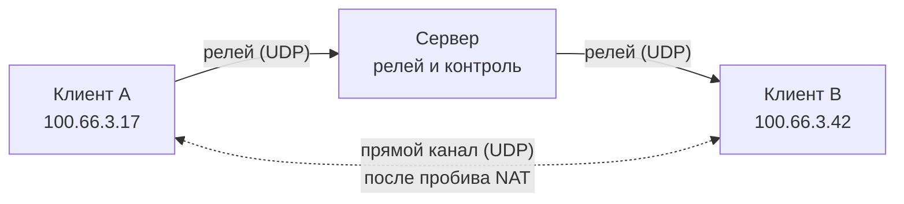
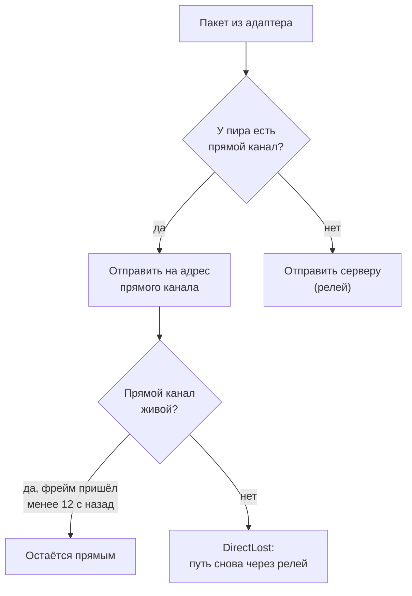
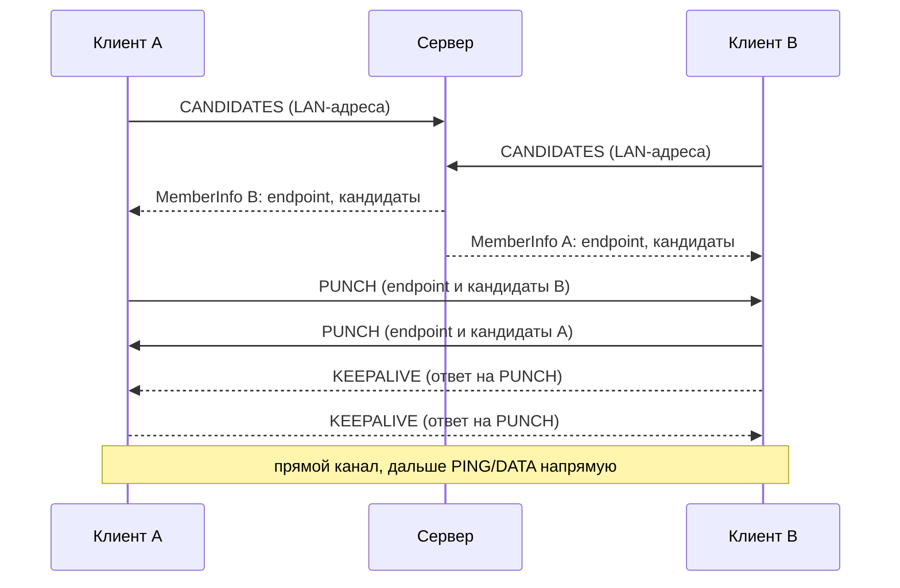

# Сеть VoidLink: адресация, прямые соединения и релей

Документ описывает, как пакеты участников группы попадают друг к другу: какие адреса получает каждый участник, когда трафик идёт напрямую (p2p), а когда через релей на сервере, как устроен пробив NAT, что делать, если UDP заблокирован, как работают имена `*.vl`, какие порты открыть и как диагностировать связность. Нормативный формат пакетов описан в [PROTOCOL.md](PROTOCOL.md), эксплуатация сервера — в [SERVER.md](SERVER.md), установка — в [INSTALL.md](INSTALL.md). Здесь — поведение сети и то, что видно пользователю.

## Содержание

- [Общая картина](#общая-картина)
- [Адресация](#адресация)
- [Релей и прямой канал](#релей-и-прямой-канал)
- [Пробив NAT](#пробив-nat)
- [Симметричный NAT](#симметричный-nat)
- [UDP заблокирован: TCP-фолбэк](#udp-заблокирован-tcp-фолбэк)
- [MTU и размер пакетов](#mtu-и-размер-пакетов)
- [Имена *.vl](#имена-vl)
- [Порты и файрвол](#порты-и-файрвол)
- [Задержка и пропускная способность](#задержка-и-пропускная-способность)
- [Диагностика](#диагностика)
- [Связанные документы](#связанные-документы)

## Общая картина

Сервер не является VPN-шлюзом: он знает группы и адреса участников, пересылает зашифрованные пакеты, когда прямой связи нет. Внимание: ключи групп создаёт и раздаёт сервер, поэтому он технически способен расшифровать групповой трафик (см. [SECURITY.md](SECURITY.md)); для посторонних в сети трафик зашифрован. Клиенты пытаются соединиться напрямую, а сервер выступает запасным путём.



Пунктир — цель: когда прямой канал поднят, пакеты между A и B идут мимо сервера. Пока его нет, всё идёт через релей.

## Адресация

### IPv4

Каждая identity получает от сервера **один** адрес из диапазона `100.66.0.0/16`. Адрес закреплён за пользователем (pubkey), а не за группой: во всех своих группах на этом сервере участник виден под одним и тем же адресом. Номер группы (`gid`) в адрес не входит.

```text
100.66.<a>.<b>/16
```

| Часть | Что означает | Пример |
|---|---|---|
| `100.66.0.0/16` | общий диапазон оверлея; на адаптере маска `255.255.0.0` | — |
| `<a>.<b>` | адрес пользователя на сервере, выдаёт сервер (lease); `<a>` от 1 до 255, `<b>` от 1 до 254 | `3.17` |

Пул сервера: `100.66.1.1` … `100.66.255.254`, последний октет не бывает `.0` и `.255`, всего 255 × 254 = 64 770 адресов. Подсеть `100.66.0.0/24` зарезервирована под служебные нужды; `100.66.0.53` — адрес встроенного DNS-резолвера (см. [Имена *.vl](#имена-vl)).

Пример: пользователь с адресом `100.66.3.17` имеет его в любой своей группе на этом сервере. Адрес выдаётся при первом создании группы или входе в группу (поле `my_ip` в `GROUP_STATE`), сохраняется в `server.json` (`user_ips`) и не меняется после выхода из всех групп, повторного входа и рестарта сервера. На другом сервере у той же identity будет другой адрес. Если пул исчерпан, сервер забирает адрес у identity, которая сейчас не состоит ни в одной группе.

Клиент ставит на виртуальный адаптер один IPv4-адрес с маской `/16`; on-link маршрут `100.66.0.0/16` создаёт ОС. Исходящий пакет уходит через группу, в которой состоит получатель. Если общих групп несколько, выбирается группа с живым прямым каналом, затем та, где пир онлайн, затем с наименьшим `gid`.

### IPv6

Параллельно участник получает адрес из ULA-подсети `fd66:766c:696e::/64`:

```text
fd66:766c:696e::<a>:<b>/64
```

Для IPv4 `100.66.<a>.<b>` адрес IPv6 — `fd66:766c:696e::<a>:<b>`, где `<a>` и `<b>` записаны в hex. Пример: `100.66.7.42` → `fd66:766c:696e::7:2a`. Соответствие однозначное: по IPv6-адресу клиент находит IPv4-идентичность участника (`ipv6::route_target`); принимается только эта `/64` при `a`, `b` не больше 255. Адреса вне `100.66.0.0/16` и вне `fd66:766c:696e::/64` клиент не принимает. На адаптер назначается один IPv6-адрес с префиксом `/64` (Windows, Linux, macOS).

### Что видит пир

Адрес участника для остальных — это его `ip` из `MemberInfo`. Внешний адрес (как его видит сервер) и LAN-кандидаты приходят отдельно (см. ниже).

## Релей и прямой канал

Каждый пакет IP между двумя участниками инкапсулируется в групповой фрейм (раздел 7 [PROTOCOL.md](PROTOCOL.md)). Фрейм шифруется ключом группы, а открытым остаётся только заголовок: `gid`, адрес отправителя, адрес получателя и эпоха ключа. По заголовку сервер решает, пересылать ли фрейм.

Выбор пути делает клиент в момент отправки:



Правила:

- **Релей.** Сервер принимает групповой фрейм, только если отправитель — участник группы и пишет от своего адреса. Тип фрейма должен быть групповым (`DATA`, `PING`, `PONG`, `PUNCH`, `KEEPALIVE`), остальное сервер не пересылает. Лимит частоты описан в [Задержка и пропускная способность](#задержка-и-пропускная-способность).
- **Прямой канал.** Пир получает адреса двух видов: `endpoint` (адрес, с которого сервер получил UDP от его клиента) и `candidates` (до 4 LAN-адресов, которые клиент сообщает сам). Прямым становится тот адрес из этого набора, с которого раньше всех пришёл ответ. Адрес пакетов не переписывается: фреймы принимаются только с адресов, известных от сервера.
- **Срок жизни.** Если от пира на прямом адресе не пришло ни одного фрейма 12 с (`DIRECT_TIMEOUT`), канал считается потерянным: клиент шлёт событие `DirectLost`, сбрасывает прямой адрес и возвращает трафик на релей. Пир, сменивший адрес в списке участников, тоже даёт `DirectLost` сразу.

Прямой канал поддерживают RTT-зонды (`PING`), которые клиент шлёт каждые 2 с. Прямому пиру они уходят напрямую, и этим же пакетом обновляется NAT-маппинг.

## Пробив NAT

Пробив нужен, чтобы два клиента за NAT открыли друг другу UDP-дыры. Порядок:

1. **Регистрация адреса.** Клиент после рукопожатия (WELCOME) и далее раз в минуту шлёт серверу `CANDIDATES` — свои LAN-адреса: IP интерфейса, через который виден сервер, и порт UDP-сокета движка. Сервер отбрасывает непригодные адреса (нулевой адрес или порт, multicast, broadcast) и отдаёт их пирам в `MemberInfo`. Отключается настройкой `lan_discovery: false` в конфиге клиента.
2. **Endpoint.** Сервер видит UDP-источник клиента и сообщает его пирам как `endpoint`. Это внешний адрес после NAT.
3. **PUNCH.** Клиент каждые 5 с шлёт `PUNCH` всем онлайн-пирам без прямого канала, на `endpoint` и на все кандидаты. Пакет без полезной нагрузки.
4. **Ответ — KEEPALIVE.** На `PUNCH` отвечают `KEEPALIVE`, а не `PUNCH`, иначе два клиента бесконечно отражали бы друг другу один и тот же пакет.
5. **Прямой канал.** Адрес, с которого первым пришёл валидный ответ, становится `direct_addr`. Дальше трафик и RTT-зонды идут на него, а PUNCH этому пиру больше не шлётся.
6. **Поддержание.** `KEEPALIVE` и RTT-зонды держат NAT-маппинг открытым (NAT обычно закрывает неактивную дыру через десятки секунд).



Если пробить не удалось, ничего не ломается: трафик остаётся на релее, а PUNCH продолжает уходить раз в 5 с.

## Симметричный NAT

NAT, который выбирает внешний порт отдельно для каждого адреса назначения (symmetric NAT, часто встречается у мобильных операторов и в некоторых корпоративных сетях), ломает пробив: порт, который видит сервер, не совпадает с портом, который откроется для пира. В коде нет отдельного определения типа NAT. Клиент просто не получает ответа на PUNCH и остаётся на релее.

Практически это значит: одна из сторон за симметричным NAT — связь идёт через сервер. Сама связь при этом работает; меняется задержка и пропускная способность (см. ниже).

## UDP заблокирован: TCP-фолбэк

Некоторые сети режут UDP целиком. Для них клиент умеет ходить к серверу по TCP: модуль клиента `tcp_link.rs`, серверный `tcp.rs`.

Как это работает:

- Серверный TCP-фолбэк слушает **тот же порт**, что и UDP, и включён по умолчанию (`--tcp` / `--no-tcp`).
- Выбор транспорта до сервера задаёт поле `transport` в конфиге клиента (команда `set-transport auto|udp|tcp`):
  - `auto` (по умолчанию) — UDP; если три рукопожатия подряд не удались, либо хотя бы одно не удалось и UDP молчит 10 с (`should_fallback`), клиент переходит на TCP;
  - `udp` — только UDP;
  - `tcp` — только TCP до сервера.
- По TCP ходят те же датаграммы протокола v3 в рамке `u16 LE длина` + кадр; максимальный кадр 4096 байт, нулевая длина запрещена.
- Групповой трафик через TCP идёт через релей на сервере. Прямые p2p-каналы с пирами остаются UDP: пробив продолжается, и если он удался, трафик идёт напрямую.

Потери на TCP выше, чем на UDP, из-за повторной передачи самим TCP. Для потоковых сервисов в реальном времени это заметно; для обычных сайтов и мессенджеров — обычно нет.

## MTU и размер пакетов

Адаптер клиента по умолчанию имеет MTU **1400** (`DEFAULT_MTU`). Значение из конфига ограничивается диапазоном 576–1500: значения вне диапазона приводятся к границе, а не отклоняются. Команда `set-mtu <N>` вне диапазона отклоняет значение с ошибкой.

Почему 1400. Каждый IP-пакет внутри группы оборачивается так:

| Слой | Байт | Комментарий |
|---|---|---|
| IPv4 + UDP заголовки внешнего пакета | 28 | 20 + 8 |
| Общий заголовок `TNL2` | 7 | magic (4), тип (1), длина (2) — `HDR_LEN` |
| Заголовок группы: gid, src, dst, эпоха | 16 | `GRP_HDR_LEN` |
| Счётчик (nonce) | 8 | `COUNTER_LEN` |
| Тег ChaCha20-Poly1305 | 16 | `TAG_LEN` |
| **Итого накладные расходы** | **75** | при MTU 1400 внешний пакет 1475 байт |

Отсюда правило: при MTU 1500 на адаптере внешний пакет составит 1575 байт и будет фрагментирован или отброшен на любом канале с MTU 1500 (обычный Ethernet, Wi-Fi). Значение 1400 оставляет запас под PPPoE, мобильные сети и туннели провайдера. Если канал точно чистый, можно поднять MTU до 1425 (внешний пакет 1500), но это почти никогда не нужно.

При релее внешний пакет тот же по размеру: сервер пересылает фрейм без перекодирования. TCP-кадр ограничен 4096 байтами, с MTU 1400 это не мешает.

## Имена *.vl

Клиент отвечает на DNS-запросы внутри оверлея сам. Адрес резолвера — `100.66.0.53`, порт 53. Пакеты к нему перехватываются из адаптера, и клиент отвечает по текущему списку участников групп.

| Имя | Что возвращает |
|---|---|
| `<member>.vl` | адрес участника `<member>` во всех его группах, куда он может входить |
| `<member>.<group>.vl` | адрес участника в конкретной группе |

Имена нормализуются: регистр не важен. Запросы AAAA возвращают IPv6-адрес по той же схеме. TTL ответов — 30 с. Для неизвестных имён клиент возвращает NXDOMAIN, а для узлов, которые могут существовать (apex `vl`, `<group>.vl`), — NOERROR без записей.

Чтобы ОС отправляла запросы `.vl` на этот резолвер, клиент при запуске настраивает систему (best-effort: при ошибке выводится предупреждение, связь работает и без имён). Настройка откатывается при остановке клиента.

| ОС | Механизм | Что делает клиент |
|---|---|---|
| Windows | NRPT (Name Resolution Policy Table) | `Add-DnsClientNrptRule -Namespace ".vl" -NameServers "100.66.0.53"` с меткой `VoidLink`; при остановке удаляются только правила с этой меткой |
| Linux | systemd-resolved | `resolvectl dns <интерфейс> 100.66.0.53` и `resolvectl domain <интерфейс> ~vl`; откат — `resolvectl revert <интерфейс>` |
| macOS | файлы резолверов | файл `/etc/resolver/vl` с `nameserver 100.66.0.53` |

На Linux без systemd-resolved настройку придётся сделать вручную. На macOS имя интерфейса `utunN` выбирает ядро, поэтому файл резолвера не привязан к интерфейсу.

Встроенный DNS включён по умолчанию; выключается полем `dns` в конфиге клиента (`dns off`).

## Порты и файрвол

### Сервер

| Порт | Протокол | Направление | Назначение |
|---|---|---|---|
| 5555 | UDP | входящий | управление, рукопожатие и релей (по умолчанию; адрес — позиционный аргумент сервера или `TUNNEL_LISTEN` в systemd) |
| тот же (5555) | TCP | входящий | TCP-фолбэк (включён по умолчанию, `--no-tcp` отключает) |
| 127.0.0.1:порт | TCP | локальный | HTTP-метрики (`/metrics`, `/healthz`), если включены флагом `--metrics <addr>`; по умолчанию выключены |

Открывайте только то, что нужно. Для UDP на Linux, например: `ufw allow 5555/udp` (и `5555/tcp`, если нужен TCP-фолбэк). Метрики слушайте на `127.0.0.1`, наружу их не выставляйте.

### Клиент

Клиенту не нужны входящие правила. Он открывает UDP-сокет на эфемерном порту, который выбирает ОС (настройки фиксированного порта нет). Трафик исходящий:

- UDP к серверу (порт сервера);
- UDP к адресам пиров: `endpoint` и LAN-кандидаты, в том числе на порты, которые выбрали пиры.

Stateful-файрвол пропускает ответы и входящие пакеты от пира, если исходящий PUNCH уже создал состояние. Поэтому прямой канал работает без проброса портов на роутере. Прямой пир, который ждёт входящего пакета от незнакомого адреса, не получит его, пока пробив не состоялся. Это штатная ситуация, и тогда работает релей.

На Windows при первом запуске может появиться запрос файрвола. Разрешайте доступ для частных сетей; для публичных сетей прямая связь обычно не нужна.

## Задержка и пропускная способность

- **Прямой канал.** Задержка — один путь между участниками. Пропускная способность ограничена каналом сторон и MTU.
- **Релей.** Задержка — сумма двух участков: клиент → сервер → клиент. Пропускная способность ограничена лимитом сервера.

Лимиты сервера по умолчанию (настраиваются флагами, см. [SERVER.md](SERVER.md)):

| Параметр | Значение по умолчанию | Смысл |
|---|---|---|
| relay rate / burst | 4000 / 8000 фреймов/с на сессию | релей, включая RTT-зонды |
| ctrl rate / burst | 50 / 100 фреймов/с на сессию | управляющие фреймы |
| hello rate / burst | 5 / 20 в секунду на IP | рукопожатие |
| plain rate / burst | 2000 / 4000 в секунду на весь сервер | открытые ответы без cookie |
| join rate / burst | 1 / 10 в секунду на группу | входы в группу |
| session timeout | 30 с | сессия без пакетов считается офлайн |

Оценка верхней границы релея: 4000 фреймов/с при полном MTU 1400 — около 5,6 МБ/с (≈45 Мбит/с) на сессию. Это грубая оценка: часть фреймов — служебные, и лимит считается по фреймам, а не по байтам. На практике для игр и голосовой связи лимит не бывает узким местом, для больших передач через релей он ощутим.

Клиент шлёт RTT-зонд `PING` каждые 2 с всем онлайн-пирам — это небольшая дополнительная нагрузка, которая растёт с числом участников в группе.

Рекомендации:

- для больших передач (файлы, стриминг) стремитесь к прямому каналу: проверьте, что нет симметричного NAT и что LAN-обнаружение включено;
- на слабом канале сервера держите группы небольшими, так как каждый участник шлёт и получает трафик через релей;
- сервер в том же регионе, что и участники, заметно снижает задержку релея.

## Диагностика

### Что видно в интерфейсе

В строке состояния TUI показываются счётчики путей:

| Индикатор | Значение |
|---|---|
| `◆ N прямых` | N пиров связаны напрямую (прямой канал жив) |
| `◇ N через релей` | N пиров идут через сервер |

Состояние каждого пира (онлайн, путь, RTT) хранится в снимке движка: адрес `endpoint`, признак `direct`, время с последнего фрейма на прямом канале и RTT в миллисекундах. Событие `DirectLost` означает, что прямой канал пропал и трафик вернулся на релей; вывод уведомления о нём в TUI входит в текущую доработку.

### Журнал

Глобальный флаг `--debug` включает подробный журнал движка:

```bash
tunnel-client --debug run
```

В журнале видно рукопожатие (CHALLENGE, WELCOME), отправку `PUNCH`, получение `KEEPALIVE` и смену пути (прямой / релей).

### Типичные симптомы

| Симптом | Вероятная причина | Что делать |
|---|---|---|
| Все пиры «через релей» | симметричный NAT, закрытый UDP, LAN-обнаружение выключено | проверьте `lan_discovery`; для симметричного NAT прямого канала не будет |
| Прямой канал появляется и пропадает | NAT закрывает неактивную дыру; сменился адрес пира | убедитесь, что RTT-зонды доходят (каждые 2 с); `DirectLost` с последующим возвратом — норма |
| Нет связи ни с кем | сервер недоступен по UDP | проверьте порт 5555/udp на сервере и файрвол; при блокировке UDP клиент в режиме `auto` сам перейдёт на TCP; можно задать `set-transport tcp` |
| Имена `*.vl` не резолвятся | ОС не настроила резолвер | проверьте NRPT (Windows), `resolvectl status` (Linux), `/etc/resolver/vl` (macOS) |
| Большие пакеты не доходят, мелкие — да | MTU слишком велик для канала | уменьшите MTU адаптера (1400 по умолчанию, минимум 576) |

## Связанные документы

- [PROTOCOL.md](PROTOCOL.md) — формат пакетов, фреймы групп, `PUNCH`/`KEEPALIVE`, кандидаты.
- [SERVER.md](SERVER.md) — установка и флаги сервера, лимиты, резервные копии.
- [INSTALL.md](INSTALL.md) — установка клиента и сервера по шагам.
- [TESTING.md](TESTING.md) — как проверяется релей, пробив и DNS в тестах.
- [PLAN.md](PLAN.md) — этапы разработки, включая TCP-фолбэк и платформенные TUN.
