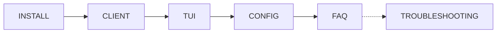
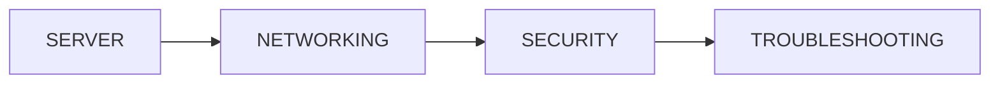
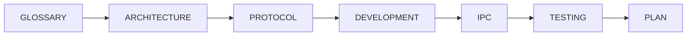
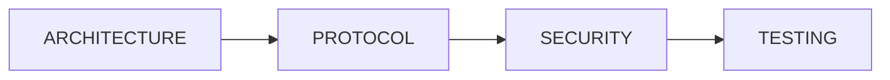

# Документация VoidLink

Этот раздел — точка входа во всю документацию VoidLink. VoidLink — самохостируемая
виртуальная локальная сеть наподобие Hamachi или ZeroTier: участники объединяются в
группы, каждый получает постоянный IP вида `100.66.<a>.<b>` (один на сервере для всех его групп), и внутри группы
проходит ping. Трафик группы шифруется ключом группы; ключи создаёт и раздаёт сервер, поэтому
оператор сервера доверенный (см. [SECURITY](SECURITY.md)).

Здесь собрано, какие документы существуют, кому какой из них нужен и в каком
порядке их читать.

Если вы впервые: начните с [корневого README](../README.md), затем выберите свою роль
в таблице ниже.

## Содержание

- [Кому какой документ нужен](#кому-какой-документ-нужен)
- [Таблица документов](#таблица-документов)
- [Порядок чтения](#порядок-чтения)
- [Как устроена документация](#как-устроена-документация)
- [Соглашения](#соглашения)

## Кому какой документ нужен

Документация делится по ролям. Один читатель обычно нужен не всем документам, а
небольшому набору из них.

| Роль | Что хочет сделать | Читать в первую очередь |
|---|---|---|
| **Пользователь** | Установить клиент, войти в группу, пользоваться TUI и CLI | [INSTALL](INSTALL.md), [CLIENT](CLIENT.md), [TUI](TUI.md), [CONFIG](CONFIG.md), [FAQ](FAQ.md), [TROUBLESHOOTING](TROUBLESHOOTING.md) |
| **Администратор сервера** | Поднять `tunnel-server`, настроить флаги, резервные копии, мониторинг | [SERVER](SERVER.md), [NETWORKING](NETWORKING.md), [SECURITY](SECURITY.md), [TROUBLESHOOTING](TROUBLESHOOTING.md) |
| **Разработчик** | Понять архитектуру, собрать проект, писать код и тесты | [ARCHITECTURE](ARCHITECTURE.md), [DEVELOPMENT](DEVELOPMENT.md), [PROTOCOL](PROTOCOL.md), [TESTING](TESTING.md), [GLOSSARY](GLOSSARY.md) |
| **Ревьюер безопасности** | Оценить модель угроз, криптографию и защиту протокола | [SECURITY](SECURITY.md), [PROTOCOL](PROTOCOL.md), [ARCHITECTURE](ARCHITECTURE.md), [TESTING](TESTING.md) |

Общие термины (friend code, lease, релей, gid и т. п.) собраны в [GLOSSARY](GLOSSARY.md).
Его удобно держать открытым рядом с любым другим документом.

## Таблица документов

Все документы лежат в каталоге `docs/`. Ссылки относительные.

| Документ | Для кого | Что внутри |
|---|---|---|
| [README.md](README.md) | все | этот файл: карта документации и порядок чтения |
| [ARCHITECTURE.md](ARCHITECTURE.md) | разработчик, ревьюер | устройство крейтов, потоки данных, роли клиента, сервера, демона и трея |
| [PROTOCOL.md](PROTOCOL.md) | разработчик, ревьюер | спецификация протокола v4: рукопожатие, управляющие фреймы, группы, релей |
| [SECURITY.md](SECURITY.md) | ревьюер, администратор | модель угроз, ключи и identity, гарантии и известные ограничения |
| [NETWORKING.md](NETWORKING.md) | администратор, разработчик | UDP-релей, hole punching, прямые каналы, NAT, IP-адресация (один адрес на пользователя) |
| [CLIENT.md](CLIENT.md) | пользователь | клиент `tunnel-client`: команды CLI, группы, друзья, приглашения |
| [TUI.md](TUI.md) | пользователь | текстовый интерфейс: клавиши, мышь, командная строка, темы, настройки |
| [CONFIG.md](CONFIG.md) | пользователь, администратор | все поля `client.json` и параметры сервера |
| [SERVER.md](SERVER.md) | администратор | сборка, установка через systemd, флаги `tunnel-server`, эксплуатация |
| [DAEMON.md](DAEMON.md) | пользователь Windows, администратор | служба `tunnel-daemon`, трей, установка и обновление службы |
| [IPC.md](IPC.md) | разработчик | протокол между CLI/TUI/треем и демоном, транспорт (именованный канал, Unix-сокет) |
| [INSTALL.md](INSTALL.md) | пользователь | установка клиента на Windows (служба и трей), Linux и macOS, удаление |
| [DEVELOPMENT.md](DEVELOPMENT.md) | разработчик | сборка из исходников, структура workspace, соглашения, рабочий процесс |
| [TESTING.md](TESTING.md) | разработчик, ревьюер | план тестирования: автоматические и ручные проверки, NAT-лаборатория, критерии релиза |
| [TROUBLESHOOTING.md](TROUBLESHOOTING.md) | все | типичные проблемы и диагностика по симптомам |
| [FAQ.md](FAQ.md) | все | короткие ответы на частые вопросы |
| [CHANGELOG.md](CHANGELOG.md) | все | история изменений по версиям |
| [PLAN.md](PLAN.md) | разработчик | план развития по этапам: что сделано, что в работе |
| [GLOSSARY.md](GLOSSARY.md) | все | определения терминов: identity, friend code, gid, lease, релей, punching и др. |

## Порядок чтения

Ниже — рекомендуемые маршруты. Каждый шаг можно пропускать, если тема уже знакома.

### Пользователь: подключиться к сети

1. [INSTALL](INSTALL.md): установить клиент и, на Windows, службу с треем.
2. [CLIENT](CLIENT.md): основные команды и первая группа.
3. [TUI](TUI.md): если удобнее работать в интерфейсе.
4. [CONFIG](CONFIG.md): что лежит в `client.json` и как его менять.
5. [FAQ](FAQ.md) и [TROUBLESHOOTING](TROUBLESHOOTING.md): при сбоях.

### Администратор сервера: развернуть и сопровождать

1. [SERVER](SERVER.md): сборка, systemd, флаги, резервное копирование `server.json`.
2. [NETWORKING](NETWORKING.md): порты, NAT, какие пути трафика возможны.
3. [SECURITY](SECURITY.md): что защищено, что видит сервер, на что обратить внимание.
4. [TROUBLESHOOTING](TROUBLESHOOTING.md): диагностика при эксплуатации.

### Разработчик: понять и изменить код

1. [GLOSSARY](GLOSSARY.md): словарь терминов, чтобы не спотыкаться о обозначения.
2. [ARCHITECTURE](ARCHITECTURE.md): крейты и связи между ними.
3. [PROTOCOL](PROTOCOL.md): формат фреймов и правила обмена.
4. [DEVELOPMENT](DEVELOPMENT.md): сборка, тесты, соглашения по коду.
5. [IPC](IPC.md) и [TESTING](TESTING.md): если работа касается демона или проверок.
6. [PLAN](PLAN.md): что уже сделано и что в работе.

### Ревьюер безопасности: оценить модель угроз

1. [ARCHITECTURE](ARCHITECTURE.md): кто с кем разговаривает и где проходит граница доверия.
2. [PROTOCOL](PROTOCOL.md): рукопожатие, подписи, шифрование, защита от повторов и усиления.
3. [SECURITY](SECURITY.md): итоговая модель угроз и остаточные риски.
4. [TESTING](TESTING.md): какие проверки подтверждают заявленные свойства.

## Как устроена документация

Документы разделены по темам, а не по крейтам. Пользовательские инструкции
(INSTALL, CLIENT, TUI, CONFIG, FAQ) не требуют знания кода. Серверные и сетевые
документы (SERVER, NETWORKING) описывают эксплуатацию. Документы для разработчиков
(ARCHITECTURE, PROTOCOL, DEVELOPMENT, IPC) описывают внутреннее устройство и
спецификацию. Служебные документы (TESTING, PLAN, CHANGELOG, GLOSSARY) связывают
остальные между собой.

Каждый документ начинается с краткого описания на одном абзаце. Если документ
длиннее примерно 150 строк, в начале есть содержание со ссылками на разделы. Таблицы
используются для справочных данных (флаги, команды, клавиши, поля конфигурации),
а пошаговые инструкции оформлены нумерованными списками.

Спецификация протокола — источник истины для поведения на проводе. Если код и
описание расходятся, это ошибка, которую нужно исправить в одном из мест, а не
терпеть молча. Для вопросов о текущем состоянии функций смотрите
[PLAN](PLAN.md): там отмечено, что уже реализовано, а что ещё в работе.

## Соглашения

- **Язык.** Документация на русском языке. Имена команд, флагов, файлов, крейтов и
  полей протокола пишутся так, как они есть в коде, без перевода.
- **Примеры команд.** Команды оболочки оформляются блоками с указанием языка:
  `bash` для Linux и macOS, `powershell` для Windows, `json` для конфигурации,
  `text` для вывода и разметки.
- **Ссылки.** Между документами используются относительные ссылки вида
  `[TUI](TUI.md)`. Ссылки на разделы внутри документа ведут на его заголовки.
- **Статусы функций.** Функции, которые ещё не выпущены, отмечаются в тексте
  явно (например, «⏳ в работе»), чтобы их не принимали за готовые.
- **Адреса.** В примерах используются документационные значения: `203.0.113.10` для
  сервера, `100.66.<a>.<b>` для адресов участников, `TUN-…` для friend code и
  Server code.
- **Изменения.** Значимые изменения поведения фиксируются в [CHANGELOG](CHANGELOG.md),
  а изменения протокола — также в [PROTOCOL](PROTOCOL.md).
