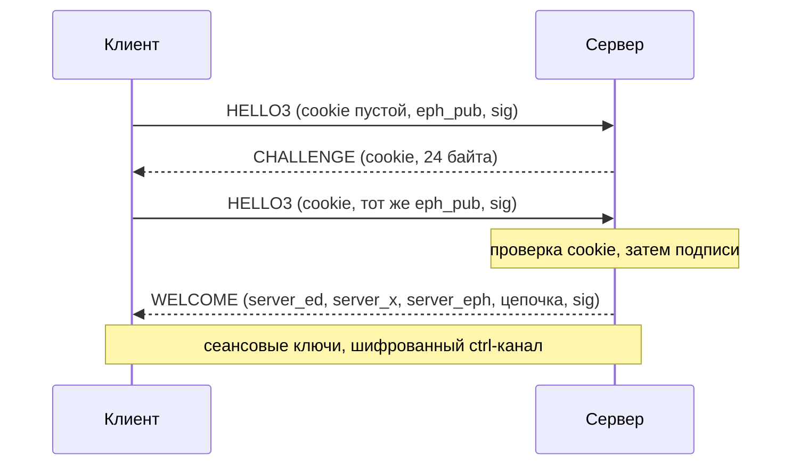

# Безопасность VoidLink

Документ описывает модель угроз VoidLink, криптографический дизайн протокола
v3 и локальные механизмы защиты клиента и сервера. Здесь же честно сказано, что
VoidLink **не** защищает: сервер создаёт и раздаёт ключи групп, поэтому видит и
может расшифровать трафик групп. Сквозного шифрования «до сервера» в проекте
нет, и не стоит считать иначе.

Нормативные детали формата — в [PROTOCOL.md](PROTOCOL.md), эксплуатация сервера —
в [SERVER.md](SERVER.md), план работ и принятые решения — в [PLAN.md](PLAN.md).
При расхождении протокол и код главнее этого документа; расхождения стоит
исправлять здесь.

Статусы в тексте: ✅ реализовано в коде, ⏳ в работе или запланировано.

## Содержание

- [1. Что защищаем](#1-что-защищаем)
- [2. Акторы и модель угроз](#2-акторы-и-модель-угроз)
- [3. Что защищено, а что нет](#3-что-защищено-а-что-нет)
- [4. Рукопожатие HELLO3](#4-рукопожатие-hello3)
- [5. Сеансовые ключи и прямая секретность](#5-сеансовые-ключи-и-прямая-секретность)
- [6. Управляющий канал и окна повторов](#6-управляющий-канал-и-окна-повторов)
- [7. Ключи групп: эпохи и ротация](#7-ключи-групп-эпохи-и-ротация)
- [8. Правила приёма групповых фреймов](#8-правила-приёма-групповых-фреймов)
- [9. Защита от усиления и от перегрузки](#9-защита-от-усиления-и-от-перегрузки)
- [10. Лимиты сервера](#10-лимиты-сервера)
- [11. Закрепление ключа сервера и цепочка ротации](#11-закрепление-ключа-сервера-и-цепочка-ротации)
- [12. Локальное хранение identity и экспорт](#12-локальное-хранение-identity-и-экспорт)
- [13. IPC на Windows: named pipe и проверка SYSTEM](#13-ipc-на-windows-named-pipe-и-проверка-system)
- [14. Windows-служба: усиление и путь к DLL](#14-windows-служба-усиление-и-путь-к-dll)
- [15. Остаточные риски](#15-остаточные-риски)
- [16. Сообщить об уязвимости](#16-сообщить-об-уязвимости)
- [17. Статус реализации](#17-статус-реализации)

## 1. Что защищаем

| Актив | Где живёт | Чем защищён |
|---|---|---|
| Identity клиента (ed25519 + x25519 seed) | `client.json` (клиент), `%ProgramData%\tunnel\client.json` (служба) | права файла/каталога; экспорт — по желанию с парольной фразой |
| Identity сервера (ed25519 + x25519 seed) | `server.json` в каталоге данных (`/var/lib/tunnel` в systemd-юните) | права каталога (0700, `StateDirectory`), резервные копии |
| Ключи групп (32 байта на эпоху) | память сервера и клиентов; `server.json` (ключ текущей эпохи) | случайные ключи, ротация по событиям, `revoke_prev` |
| Содержимое туннеля (IP-пакеты, DATA) | UDP/TCP между участниками и через релей | AEAD ChaCha20-Poly1305 ключом группы |
| Управляющий трафик (группы, приглашения, статусы) | ctrl-канал клиент ↔ сервер | AEAD сеансовыми ключами, X25519 ephemeral |
| Список групп, членство, баны, приглашения | `server.json`, память сервера | доступ только через ctrl-канал; права на файл |
| Доступность сервера и клиента | сервер (UDP-порт), служба Windows | лимиты, cookie, отказ от усиления |
| Системные права на Windows (SYSTEM) | служба `TunnelDaemon` | IPC только через пайп с SDDL и проверкой сервера пайпа |

## 2. Акторы и модель угроз

| Актор | Что может | Чего не может | Что делает VoidLink |
|---|---|---|---|
| **Оператор сервера** | Читает всё, что видит сервер: имена, группы, членство, статусы, приглашения, ключи групп, identity сервера из `server.json`; меняет ключ сервера (`rotate-key`); может выдавать себя за сервер | Подделать подпись клиента (нет его ed25519-ключа) | Оператор доверенный по определению. Клиенты закрепляют ключ сервера, но оператор им и владеет |
| **Участник группы** | Расшифровывает и подделывает групповой трафик (у всех один ключ эпохи); видит имена и адреса участников | Подменить сервер; получить ключи других групп; писать в релей с чужим `src_ip` (сервер проверяет) | Релей проверяет `src_ip` участника; прямые каналы — по адресам, известным от сервера |
| **Исключённый участник** (KICK / BAN / LEAVE) | Помнит старые ключи и всё, что ранее получил; может слать фреймы со старым ключом | Расшифровать трафик новых эпох; получать релей | Ротация с `revoke_prev = true`: получатели сразу забывают прошлый ключ. KICK не запрещает повторный вход в публичную группу, BAN запрещает |
| **On-path атакующий** (видит трафик между клиентом и сервером или между пирами) | Читает открытые заголовки, HELLO3 (`ed_pub`, имя), размеры и время пакетов; задерживает и отбрасывает | Расшифровать ctrl-канал и групповой payload; подделать WELCOME или ротацию ключа сервера; подменить подписанный HELLO3 | Подписи ed25519 на HELLO3 и WELCOME; AEAD; сеансовые ключи с ephemeral. Блокировать трафик может |
| **Off-path атакующий** (не видит трафик, знает адрес сервера) | Шлёт мусор, поддельные пакеты с подменой адреса, пытается запустить усиление, RESET и повторы | Расшифровать, подделать фрейм без ключа, получить ответ на поддельный адрес большого размера | Cookie, лимиты по IP и общий лимит открытых ответов, окна повторов, молчаливый отказ от мусора |

Дополнительно: атакующий с доступом к диску клиента или сервера получает
identity и (на сервере) ключи групп. От этого сеансовые ключи не защищают, см.
раздел 12 и 15.

## 3. Что защищено, а что нет

**Защищено:**

- Содержимое туннеля и групповой payload от наблюдателей в сети (on-path и off-path).
- Управляющий трафик (состав групп, приглашения, статусы, адреса) от наблюдателей в сети. Заголовки открыты, payload — нет.
- Сеансовые ключи ctrl-канала от записи трафика в прошлом: прямая секретность через ephemeral X25519 (раздел 5). Украденные долгосрочные ключи не раскрывают прошлые сессии.
- Подлинность сервера для клиента, который закрепил его ключ (раздел 11): подмена сервера на пути невозможна без его ed25519-ключа.
- Исключённый участник не получает трафик новых эпох, даже если ему попадётся старый ключ.

**НЕ защищено:**

- **От сервера.** Сервер сам генерирует случайный ключ каждой эпохи группы и отправляет его участникам в `GROUP_STATE` и `GROUP_UPDATE` по ctrl-каналу. Значит, сервер может расшифровать любой фрейм группы, который проходит через него (релей), и может формировать групповые фреймы от имени любого участника (он знает ключ и может выбрать `src_ip`). Это следствие архитектуры «релей + раздача ключей». Сквозного шифрования до сервера в текущем дизайне нет.
- **Групповой ключ общий для всех участников.** AEAD даёт целостность и конфиденциальность относительно посторонних, но не подпись отправителя. Участник, знающий ключ, может подделать фрейм другого участника. Через релей отправитель привязан сервером (`src_ip` сверяется с сессией). На прямом канале привязка только к адресу UDP-источника, известному от сервера. Подделка адреса в локальной сети или на пути возможна.
- **Метаданные.** Открыты: `ed_pub` и имя клиента в HELLO3, версия, флаги (в том числе невидимость), `gid`, `src_ip`, `dst_ip`, `epoch` и счётчик групповых фреймов, размеры пакетов, время, адреса-кандидаты (LAN-адреса уходят на сервер и участникам группы). Сервер и наблюдатель на пути видят, кто с кем и как часто общается.
- **Прошлые групповые ключи после компрометации.** Прямой секретности для ключей групп нет: ключ эпохи случаен и не выводится из долгосрочной identity. Кто получил ключ эпохи, тот видит весь трафик этой эпохи, который сумел записать.
- **Утечка при доступе к файлам.** Seed'ы identity клиента лежат в `client.json` в открытом виде; ключи групп и identity сервера — в `server.json`. Права на файлы задаёт окружение (см. раздел 12 и 15).

## 4. Рукопожатие HELLO3

Рукопожатие открытым текстом, но каждое сообщение подписано или привязано к
адресу. Последовательность:



**HELLO3** содержит версию, cookie (0 или 16 байт), `ed_pub` клиента, `x_pub`,
одноразовый `eph_pub` (новый на каждую попытку подключения), имя, флаги и
подпись ed25519 над `"tunnel/v3/hello"` и всеми предыдущими байтами фрейма.

Сервер проверяет по порядку:

1. Версия. Иная версия — `UNSUPPORTED`.
2. Наличие и верность cookie. Нет или неверен — `CHALLENGE`, и больше ничего. Лимит HELLO по IP действует раньше всего.
3. Подпись. Неверная подпись — фрейм молча отбрасывается.
4. Только после этого создаётся сессия и уходит `WELCOME`, затем состояние групп клиента.

**Cookie** — `blake3_keyed(cookie_secret, "tunnel/v3/cookie" || ip || port || eph_pub || bucket)`,
обрезанный до 16 байт. Адрес кодируется как 16 байт (IPv4 — как v4-mapped),
`bucket = unix_secs / 30`. Принимаются текущий и предыдущий bucket, то есть cookie
живёт примерно 30–60 секунд. `cookie_secret` — 32 случайных байта при старте
сервера, на диск не пишется. Cookie привязан к адресу и к `eph_pub`: перехваченный
HELLO3 с другого адреса не пройдёт, а повтор с того же адреса не даёт атакующему
ключей.

**WELCOME** подписан `server_ed` над `"tunnel/v3/welcome" || client_ed || client_eph || …`.
Подпись связывает ответ с конкретным клиентом и его эфемерным ключом, поэтому
WELCOME, предназначенный другому клиенту, не принимается. Фрейм также несёт
цепочку ротации ключа сервера (раздел 11).

**Повторы HELLO3.** Повтор с тем же `(ed_pub, eph_pub)` от того же адреса при живой
сессии не пересоздаёт её: сервер шлёт тот же WELCOME (тот же `server_eph`) и
фреймы, шедшие за ним. Новый HELLO3 с другим `eph_pub` или с другого адреса
создаёт новую сессию, а старую этой identity закрывает.

**Остаточный риск:** поддельный RESET и повторы с подменой адреса вызывают лишь переподключение, ключей атакующий не получает (раздел 15). Сервер запоминает «погашенные» `eph_pub` (`retired_eph`, TTL — два bucket'а cookie плюс 5 с), поэтому HELLO3 со старым `eph_pub` не сбрасывает живую сессию ✅.

## 5. Сеансовые ключи и прямая секретность

После WELCOME обе стороны вычисляют:

```text
ss  = X25519(client_x_static, server_x_static)     статические ключи identity
ee  = X25519(client_eph, server_eph)                эфемерные ключи сессии
k   = blake3_derive("tunnel/v3/session", ss || ee || client_eph || server_eph)
c2s = blake3_derive("tunnel/v3/c2s", k)            клиент → сервер
s2c = blake3_derive("tunnel/v3/s2c", k)            сервер → клиент
```

- Если `ss` или `ee` равен нулю (ключ пира — точка малого порядка), рукопожатие
  отвергается. Сервер молча отбрасывает HELLO3, клиент — WELCOME.
- `ss` даёт аутентификацию (знание статического ключа пира), `ee` — прямую
  секретность. После завершения сессии эфемерные секреты стираются, и записанный
  трафик не расшифровать даже с украденными identity-ключами.
- Каждое направление имеет свой ключ (`c2s` и `s2c`), поэтому счётчики
  разных направлений не пересекаются.

## 6. Управляющий канал и окна повторов

Формат шифрованного ctrl-фрейма:

```text
hdr(7) | counter u64 LE | ChaCha20-Poly1305(payload, aad = hdr)
nonce = [0,0,0,0] || counter (LE)
```

- Счётчик отправителя начинается с 0 в каждой сессии и строго растёт. Nonce
  уникален, пока счётчик не повторяется под одним ключом сессии.
- AAD — заголовок фрейма. Изменение типа или длины ломает проверку тега.
- Получатель ведёт окно повторов **ReplayWindow** на 1024 позиции (как в WireGuard
  и IPsec). Счётчики ниже `max − 1023` и уже виденные отвергаются. Окно
  сдвигается **только после успешной расшифровки**, поэтому подложный фрейм
  не может сдвинуть его и отбросить законные пакеты.
- RESET (открытым текстом, без аутентификации) заставляет клиента переподключиться
  и принимается не раньше чем через 2 с после последнего подлинного фрейма
  сервера. Это ограничивает эффект поддельного RESET: клиент не уходит в
  бесконечный цикл, а при подлинной подделке получает лишь переподключение.

Фреймы групп (клиент ↔ клиент) используют свои окна повторов — см. раздел 8.

## 7. Ключи групп: эпохи и ротация

У каждой группы на сервере есть `epoch` (номер ключа, начинается с 1) и `rev`
(ревизия состояния). Оба сохраняются в `server.json`. Ключ эпохи — случайные
32 байта, генерирует сервер.

Ротация ключа (`epoch += 1`) происходит при:

| Событие | `revoke_prev` | Смысл |
|---|---|---|
| HELLO участника (новая сессия) | false | Ключи групп участника меняются при каждом подключении |
| JOIN не-участника | false | Новичок получает ключ, старые участники ещё 10 с принимают прежний |
| LEAVE / KICK участника | **true** | Ушедший не должен читать новый трафик, получатели сразу забывают прошлый ключ |
| BAN участника | **true** | То же, плюс запрет входа |
| UNBAN, RENAME, смена статуса и т. п. | — | Ротации нет: ключ не меняется |

Правила эпох:

- **Отправка** всегда текущим ключом.
- **Приём** — текущий ключ и прошлый, пока не истекла `PREV_KEY_GRACE = 10 с`
  (участники получают новый ключ не одновременно). При `revoke_prev = true`
  прошлый ключ забывается сразу.
- Фрейм с эпохой новее текущей не принимается. Клиент делает `GET_GROUP`, но не
  чаще раза в секунду на группу, чтобы чужой фрейм не заставлял сервер слать
  полное состояние группы.
- Счётчики групповых фреймов клиент в файл не пишет. После перезапуска клиент
  переподключается и получает новый ключ всех своих групп, так что старые nonce
  не переиспользуются. Внутри одного процесса возможен повторный приём прежнего
  ключа (запоздавший `GROUP_STATE`): тогда счётчик под ним продолжается, а не
  начинается с 0, и nonce по-прежнему не повторяется.

✅ При скачке эпохи сразу на несколько шагов (`GROUP_STATE` с эпохой 7 при локальной 5) прошлый ключ сохраняется только при переходе ровно на `local + 1` и без `revoke_prev` (`set_key` в `crates/client/src/engine.rs`): промежуточный отзывающий KICK мог не дойти.

## 8. Правила приёма групповых фреймов

Групповой фрейм (раздел 7 PROTOCOL.md):

```text
hdr(7) | gid u32 | src_ip u32 | dst_ip u32 | epoch u32 | counter u64 LE
| ChaCha20-Poly1305(payload, aad = hdr || gid || src_ip || dst_ip || epoch)
nonce = src_ip (BE, 4) || counter (LE, 8)
```

Ключ — ключ группы эпохи `epoch`. Открытый заголовок (gid, src_ip, dst_ip, epoch)
читает релей, но не может изменить: он входит в AAD.

Получатель принимает фрейм только если выполнены все условия по порядку:

1. Группа известна, `epoch` — текущая или прошлая в пределах grace. Иначе фрейм отбрасывается, а при более новой эпохе отправляется `GET_GROUP` (раздел 7).
2. Расшифровка успешна (проверяется тег, а значит, и заголовок), `dst_ip` совпадает с собственным IP.
3. `src_ip` — текущий участник группы, и это не сам клиент.
4. Счётчик проходит окно повторов. Окно ведётся по паре (ключ, `src_ip`): nonce состоит из `src_ip` и счётчика. Окно проверяется последним, чтобы отвергнутый фрейм не тратил счётчик.
5. Фрейм пришёл через релей (`src` — адрес сервера) **или** UDP-источник входит в адреса пира, известные от сервера (endpoint и кандидаты). Адреса пира из фрейма не берутся; прямой канал поднимается на адресе, с которого первым пришёл ответ.
6. Для фреймов `DATA`: IPv4-источник внутреннего пакета совпадает с `src_ip`. Так участник не может подменить адрес внутри туннеля.

Релей сервера дополнительно проверяет: отправитель — участник группы, пишет от
своего `src_ip`, получатель — участник с этим IP, а лимит релея на сессию не
исчерпан. Пакет не расшифровывается и не меняется: сервер видит только заголовок.

## 9. Защита от усиления и от перегрузки

**Анти-усиление.** Открытые ответы сервера не превышают размер запроса:

- `CHALLENGE` — 24 байта. Минимальный HELLO3 без cookie — около 171 байта, так что сервер не усиливает трафик даже на поддельном адресе.
- `UNSUPPORTED` — текст только если он не превышает запрос, иначе сокращается до пустой строки.
- `WELCOME` и длинные ответы (`GROUP_STATE` через `FRAG`) уходят только на адрес, который прошёл проверку cookie, то есть ответил на CHALLENGE своим эфемерным ключом.
- `CHALLENGE`, `UNSUPPORTED` и `RESET` сверх общего бюджета открытых ответов не отправляются.

**Фрагментация.** Payload длиннее 1100 байт режется на `FRAG`-фреймы. Клиент
ограничивает сборку: не более 256 кусков, не более 8 сборок одновременно, таймаут
5 с от первого куска, девятая сборка вытесняет самую старую.

**Перегрузка от подделанных адресов.** Лимит HELLO и открытых ответов ведётся по
IP (IPv6 — по /64), а общий бюджет открытых ответов — на весь сервер. Поток
подделанных адресов не может обойти лимит, размазав запросы по адресам:
общий бюджет ограничивает суммарную отдачу. Карта лимитов по IP ограничена
(16 шардов по 4096 записей). Если шард переполнен, новые адреса отклоняются.

Просроченные записи карты лимитов по IP вытесняются при заполнении шарда ✅. Повторный вход в группу после LEAVE ограничен кулдауном `REJOIN_COOLDOWN` (3 с).

## 10. Лимиты сервера

Значения по умолчанию (`Limits` в `crates/server/src/lib.rs`, флаги — в
[SERVER.md](SERVER.md)):

| Параметр | По умолчанию | Область |
|---|---|---|
| Релей: rate / burst | 4000 / 8000 фреймов/с | на сессию |
| Управляющие фреймы: rate / burst | 50 / 100 фреймов/с | на сессию |
| HELLO / HELLO3 / RESET / CHALLENGE / UNSUPPORTED: rate / burst | 5 / 20 в секунду | на IP (IPv6 — /64) |
| Открытые ответы: rate / burst | 2000 / 4000 в секунду | на весь сервер |
| Входы не-участников (ротации): rate / burst | 1 / 10 в секунду | на группу |
| Таймаут сессии | 30 с | сессия без пакетов — офлайн |
| Групп во владении | 16 | на identity (`--max-owned-groups`) |
| Срок приглашения | 7 дней | `--invite-ttl-days` |
| Приглашений в группе | 256 | на группу (`--max-invites-per-group`) |
| Банов в группе | 1024 | на группу (`--max-bans-per-group`) |
| Живых приглашений одной identity | 64 | по всем группам (`--max-invites-per-target`) |

Лимит приглашений и банов не даёт одному владельцу раздуть состояние группы
бесконечно. Лимит входов на группу гасит «чехарду» JOIN и LEAVE, которая
заставляла бы клиентов постоянно переключать ключи.

## 11. Закрепление ключа сервера и цепочка ротации

**Server Code** (`TUN-…`) — это закодированный открытый ключ сервера, который
пользователь получает вне канала связи и вписывает в клиент (`add-server`). Это
единственный якорь доверия клиента. Пока код получен из надёжного источника,
подмена сервера на пути невозможна: WELCOME подписан ключом, которого у
атакующего нет.

**Ротация ключа сервера** (`tunnel-server rotate-key [--data <dir>]` ✅, см. [SERVER.md](SERVER.md)):

- Текущий ключ подписывает новый (`link_sig` = подпись `old_ed` над `"tunnel/v3/rotate" || new_ed || new_x`).
- Звено дописывается в `server.json` (`rotations`). Цепочка идёт от старых ключей к новым.
- WELCOME несёт последние до 8 звеньев. Клиент, закрепивший любой из старых ключей,
  проверяет все подписи от него до текущего ключа (каждое звено продолжает
  предыдущее, последнее совпадает с `server_ed` и `server_x`) и перезакрепляет
  ключ. Событие `ServerKeyRotated` сохраняет новый ключ в `client.json`.
- Если ни одно звено не продолжает закреплённый ключ, WELCOME отвергается с
  сообщением «ключ сервера не совпадает». Так клиент не переходит молча на
  чужой сервер.

`rotate-key` и сервер пишут `server.json` под общей advisory-блокировкой `server.json.lock`, а работающий сервер проверяет смену ключа при сохранении, поэтому ротация не затирается ✅. Новый ключ вступает в силу после перезапуска сервера.

## 12. Локальное хранение identity и экспорт

**Клиент.** Identity (`ed_seed`, `x_seed` в hex) хранится в `client.json`.
Запись делается через временный файл и `rename`, но явных прав на файл клиент не
ставит: итоговые права определяются umask процесса. Пользователь, которому важна
изоляция, должен держать каталог данных в своём домашнем каталоге, а не в общем.
Ключи групп и счётчики клиент на диск не пишет.

**Служба Windows.** Конфиг службы — `%ProgramData%\tunnel\client.json`. Каталог
создаёт установщик, и он проверяет, что каталог заслуживает доверия:

- существующий каталог пересоздаётся, если это ссылка, если его владелец не SYSTEM и не Administrators, или если в нём нет `owner.sid` прошлой установки (защита от подложенного заранее файла, так как `%ProgramData%` доступен для записи пользователям);
- владелец каталога — `BA`, DACL — `O:BAD:PAI(A;OICI;FA;;;SY)(A;OICI;FA;;;BA)`: полный доступ только SYSTEM и Administrators, наследование сброшено и на дочерние объекты.

Identity машины, а не пользователя: `%APPDATA%` у LocalSystem недоступен, поэтому
конфиг службы живёт в `%ProgramData%`. Сиды по IPC не передаются.

**Экспорт identity** (`export-identity` / `import-identity` с `--passphrase`, `--passphrase-stdin`, `--force`; код в `crates/client/src/profile.rs` ✅):

- **Без пароля** — открытый JSON `{version, friend_code, ed_seed, x_seed, check}`. Любой, кто получил файл, получает identity. Файл пишется с правами 0600 на Unix; без `--force` существующий файл не затирается. Используйте только для переноса на свою машину и удаляйте после импорта.
- **С парольной фразой** — `{version, friend_code, kdf, nonce, ciphertext}`:
  - ключ выводится итерированным blake3 (`blake3-iter`, по умолчанию 2^18 итераций)
    со случайной солью 16 байт;
  - шифрование ChaCha20-Poly1305, `aad = friend_code`, так что файл нельзя
    переставить под другой friend code;
  - при импорте принимаются итерации от 2^18 до 2^26, меньше минимума — отказ
    (защита от «облегчённых» файлов), больше максимума — отказ (чтобы файл не
    подвешивал клиент);
  - friend code сверяется с `ed_seed`, а поле `check` связывает `x_seed` с `ed_seed`.

**Ограничение.** Выведение ключа не привязано к памяти (нет scrypt/argon2-подобной
стойкости), поэтому короткая парольная фраза уязвима для офлайн-перебора. Для
экспорта используйте длинную фразу.

## 13. IPC на Windows: named pipe и проверка SYSTEM

Пайп-транспорт нужен, когда TUI, трей или CLI говорят со службой `tunnel-daemon`
(архитектура — [PLAN.md](PLAN.md), этап 7). Защита:

- **Имя пайпа** — `tunnel-daemon` (`DEFAULT_PIPE_NAME`). Сервер пайпа создаётся с
  `PIPE_REJECT_REMOTE_CLIENTS`, то есть сетевые клиенты отвергаются.
- **`FILE_FLAG_FIRST_PIPE_INSTANCE`** на первом экземпляре. Если пайп с таким
  именем уже существует, служба не присоединяется к чужому: это защита от
  захвата имени до старта службы.
- **SDDL пайпа** — `O:SYD:P(A;;GA;;;SY)(A;;GA;;;BA)(A;;0x12019b;;;<SID владельца>)`:
  - владелец объекта — SYSTEM, его может поставить только SYSTEM;
  - полный доступ SYSTEM и Administrators;
  - владелец-пользователь (SID из `owner.sid`) получает только чтение и запись, без права создавать экземпляры пайпа;
  - остальным доступа нет.
- **Проверка сервера пайпа на стороне клиента.** `GetNamedPipeServerProcessId` →
  `OpenProcessToken` → `IsWellKnownSid(LocalSystem)`. Если процесс-сервер не
  SYSTEM, клиент отказывается подключаться и сообщает «возможна подмена демона».
  Дополнительно проверяется владелец самого пайпа (`O:SY`).
- **Исключений нет.** Процесс администратора (`tunnel-daemon console`) не SYSTEM
  и пайп не поднимает. Режим разработки на Linux и macOS использует Unix-сокет с
  правами 0600 в каталоге данных.
- **Формат** — фрейм `u32 LE длина | JSON`, лимит 1 МиБ. Битая длина, превышение
  лимита или мусорный JSON — разрыв соединения без паники.

Доступ к пайпу выдан по SID владельца, а не по процессу: любой процесс этого
пользователя может говорить с демоном. Вопрос о том, кто вправе управлять
туннелем на многопользовательской машине, в [PLAN.md](PLAN.md) открыт.

## 14. Windows-служба: усиление и путь к DLL

Служба `TunnelDaemon` работает как LocalSystem, поэтому любой файл, который она
загружает, — это код с правами SYSTEM. Меры:

- **Wintun DLL — только рядом с exe в каталоге установки.** Каталог
  `%ProgramFiles%\Tunnel` пишет только администратор. Функция
  `winsvc::service_wintun_dll` (✅, её использует служба) берёт только `current_exe().parent()`:
  без `PATH`, без системных каталогов, без относительных путей. Если DLL рядом
  нет, служба возвращает ошибку, а не ищет в других местах.
- **Каталог установки — только для администраторов** (✅). `tunnel-daemon install`
  и служба при старте (`winsvc::verify_install_dir`) проверяют владельца и DACL
  каталога exe, самого exe и `wintun.dll`: писать может только SYSTEM,
  Administrators или TrustedInstaller (без ACE на запись для Users,
  Authenticated Users, Everyone и самого пользователя), а каталоги выше не дают
  переименовать или удалить потомка. Иначе `install` отказывает с подсказкой
  (`install.ps1`, `%ProgramFiles%\Tunnel`), а служба не загружает DLL.
  `install.ps1` выставляет каталогу явный DACL.
- **Флаг `--dll` в службе запрещён** для пути из пользовательского каталога.
  Иначе подмена DLL давала бы код от SYSTEM. `console` тоже берёт DLL только
  рядом с exe и не читает `dll` из `client.json` (конфиг правится по IPC).
- **`console` на Windows** создаёт каталог данных с ACL службы, а незащищённый
  существующий каталог отказывается использовать (✅).
- **Мьютекс single-instance** `Global\TunnelEngine` может создать любой
  пользователь, поэтому учитывается только мьютекс с владельцем SYSTEM,
  Administrators или текущим пользователем; захват имени посторонним не
  блокирует ни службу, ни CLI (✅, `crates/ipc/src/lock.rs`).
- **Фолбэк на голое имя.** В `crates/client/src/tun.rs` (`load_wintun_dll`) остаётся загрузка по имени `wintun.dll` для CLI и TUI; служба использует `service_wintun_dll`.
- **Восстановление службы.** Заданы failure actions (перезапуск через 5, 10 и 30 с).
- **Удаление.** `tunnel-daemon uninstall` снимает службу; данные удаляются только с `--purge`.

## 15. Остаточные риски

| # | Риск | Кто может воспользоваться | Что сделано / что планируется |
|---|---|---|---|
| 1 | Сервер читает и подделывает трафик групп | Оператор сервера, любой, кто получил его доступ | Принято по архитектуре. Честно сообщается в документации; сквозное шифрование не делается |
| 2 | Групповой ключ общий: подделка фрейма другого участника | Участник группы | Релей проверяет `src_ip`; прямой канал — по адресам от сервера. Криптографической подписи отправителя нет |
| 3 | Метаданные открыты: имя и `ed_pub` в HELLO3, `gid`, IP, `epoch`, размеры и время | Наблюдатель на пути, сервер | Payload шифруется, паддинга нет. Принято |
| 4 | Seed'ы identity в `client.json` и identity сервера + ключи групп в `server.json` в открытом виде | Тот, кто получил доступ к диску или к копии файла | Права каталога (0700 у сервера, ACL у службы). Резервные копии `server.json` — полный доступ к identity сервера, их хранение — ответственность оператора |
| 5 | Поддельный RESET и повтор HELLO3 с подменой адреса вызывают переподключение | Off-path атакующий | RESET не чаще 2 с после подлинного фрейма; повтор HELLO3 с тем же ключом не пересоздаёт сессию. Погашенные `eph_pub` повтором не сбрасывают сессию |
| 6 | Прошлый ключ эпохи принимается 10 с после обычной ротации | Исключённый участник, у которого есть старый ключ | Только при переходе ровно на `local + 1` и без `revoke_prev` ✅ |
| 7 | `rotate-key` и работающий сервер пишут один `server.json` | Оператор | Блокировка `server.json.lock` и проверка смены ключа при сохранении ✅ |
| 8 | Крах сервера между сохранениями (раз в 3 с) может потерять изменения | Исключённый участник, если крах совпал с ротацией | BAN, UNBAN и смена эпохи сохраняются срочно (`save_now`, запас `LOAD_MARGIN` для эпох) ✅ |
| 9 | Churn членства и рассылка списков групп создают нагрузку в пределах лимитов | Участник с полномочиями на сервере | Лимит входов на группу, кулдаун повторного входа 3 с; объединение рассылок списка групп — ⏳ |
| 10 | KICK не запрещает повторный вход в публичную группу | Исключённый участник | Так задумано: BAN запрещает вход. Для публичной группы KICK лишь разрывает членство |
| 11 | Нет прямой секретности для групповых ключей | Тот, кто получил ключ эпохи | Ключи эпох случайны и сменяются при отзыве; PFS только для ctrl-канала |
| 12 | Экспорт с парольной фразой уязвим к офлайн-перебору слабой фразы | Тот, кто получил файл экспорта | Длинная фраза; KDF не memory-hard |
| 13 | Экспорт без пароля содержит identity в открытом виде | Тот, кто получил файл | CLI печатает «НЕ зашифрована»; права 0600 на Unix |
| 14 | TCP-фолбэк транспорта: те же фреймы и AEAD, но иной путь и иные условия отказа; заголовки открыты так же | On-path атакующий | Протокол один и тот же; режим выбирается `set-transport auto\|udp\|tcp` |
| 15 | Жёсткое убийство процесса (SIGKILL) теряет изменения последних секунд | Исключённый участник, если крах пришёлся на KICK или BAN (см. 8) | SIGTERM/SIGINT сохраняют состояние (`Server::stop`) ✅ |

## 16. Сообщить об уязвимости

Публичного контакта для security-сообщений в репозитории пока нет. Не открывайте
публичный issue с деталями уязвимости. Сообщите владельцу проекта напрямую,
в приватном канале.

Полезно указать:

- коммит, из которого собран сервер или клиент (`git rev-parse HEAD`), или версию сборки;
- ОС и архитектуру сервера и клиента;
- шаги воспроизведения, по возможности минимальный сценарий;
- что именно нарушено: конфиденциальность, целостность, доступность или права доступа;
- рабочий пример, если он есть, но без реальных ключей и адресов чужих пользователей.

Сроков ответа проект не обещает. Исправления, требующие изменения протокола,
сопровождаются обновлением [PROTOCOL.md](PROTOCOL.md) и тестами.

## 17. Статус реализации

| Область | Код | Примечание |
|---|---|---|
| HELLO3, CHALLENGE, cookie, WELCOME с подписью | ✅ | `crates/protocol/src/handshake.rs`, `crates/server/src/lib.rs` |
| Сеансовые ключи, прямая секретность, отказ при нулевом DH | ✅ | `session_keys`, тесты рукопожатия |
| ctrl-фреймы, ReplayWindow на 1024 | ✅ | `crates/protocol/src/replay.rs` |
| Ротация ключей групп, `revoke_prev`, grace 10 с | ✅ | раздел 5 PROTOCOL.md; `crates/server/src/lib.rs` |
| Правила приёма групповых фреймов | ✅ | `crates/client/src/engine.rs`, `handle_group_frame` |
| Релей с проверкой `src_ip` и лимитом | ✅ | `crates/server/src/lib.rs` |
| Анти-усиление (CHALLENGE, UNSUPPORTED, WELCOME после cookie) | ✅ | раздел 2 PROTOCOL.md |
| Лимиты по IP (IPv6 — /64), на сессию, на группу, общий бюджет | ✅ | `Limits` в `crates/server/src/lib.rs` |
| Цепочка ротации ключа сервера в WELCOME | ✅ | `crates/protocol/src/handshake.rs`, `resolve_pin` |
| Команда `rotate-key` и её блокировка против работающего сервера | ✅ | `crates/server/src/main.rs`, `persist.rs` |
| Скачок эпох (`local + 1`) | ✅ | раздел 7 |
| Повторы HELLO3: старый `eph_pub` не сбрасывает сессию | ✅ | раздел 4 |
| Срочное сохранение при критичных изменениях | ✅ | раздел 15; точный перечень операций сверьте с `crates/server/src/lib.rs` |
| Кулдаун повторного входа | ✅ | раздел 9 |
| Объединение рассылок списка групп | ⏳ | не подтверждено в коде |
| Вытеснение записей карты лимитов по IP | ✅ | раздел 9 |
| Экспорт identity: шифрование и KDF | ✅ | `crates/client/src/profile.rs` |
| Права на `client.json` (явные) | ⏳ | раздел 12 |
| IPC-пайп: SDDL, FIRST_PIPE_INSTANCE, проверка SYSTEM | ✅ (транспорт) | `crates/ipc/src/transport/windows.rs`; служба подключена |
| Wintun DLL: только рядом с exe (`service_wintun_dll`) | ✅ | `crates/winsvc/src/common.rs`, `crates/daemon/src/service.rs` |
| Каталог установки службы: запись только администраторам (`verify_install_dir`) | ✅ | `crates/winsvc/src/acl.rs`, `install.rs` |
| Замок single-instance: владелец мьютекса (Windows), `O_NOFOLLOW` и каталог без записи для других (Unix) | ✅ | `crates/ipc/src/lock.rs` |
| ACL каталога данных службы | ✅ | `crates/winsvc/src/install.rs`, `DATA_DIR_SDDL` |
