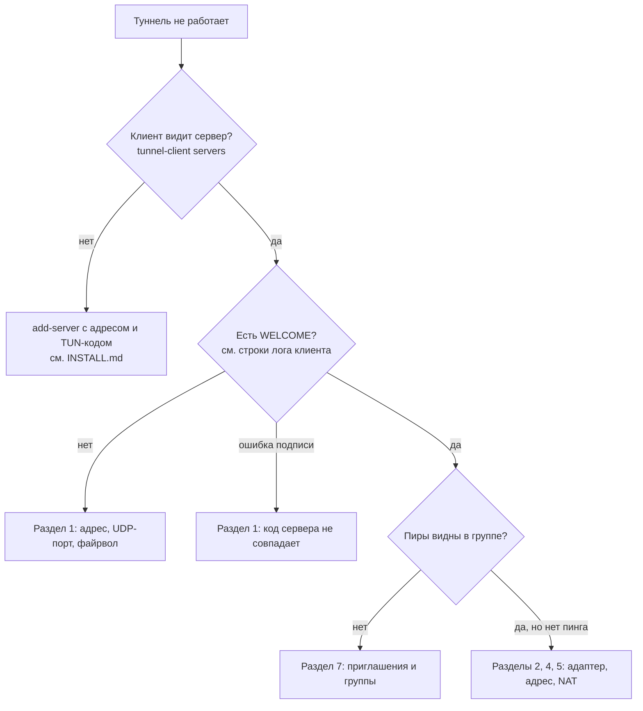
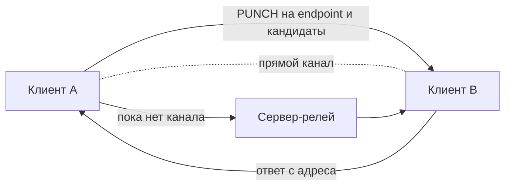

# Диагностика и устранение неполадок

Этот документ собирает типовые симптомы VoidLink в таблицы «симптом → причина → что делать».
Большинство проблем решается одним из трёх путей: проверить код сервера и адрес, проверить
сетевой доступ к UDP-порту сервера, посмотреть лог. Сначала найдите свой симптом в нужном
разделе, а если его нет — перейдите к разделу [Логи](#логи-и-отладка) и [Сбор диагностики](#сбор-диагностики-для-баг-репорта).

Связанные документы: [INSTALL.md](INSTALL.md) (установка клиента), [SERVER.md](SERVER.md)
(установка и эксплуатация сервера), [PROTOCOL.md](PROTOCOL.md) (протокол v4, коды ошибок
и ревизии), [TESTING.md](TESTING.md) (сценарии NAT и проверки).

## Содержание

- [Быстрая диагностика](#быстрая-диагностика)
- [1. Не подключается к серверу](#1-не-подключается-к-серверу)
- [2. Windows: wintun, права и адаптер](#2-windows-wintun-права-и-адаптер)
- [3. Служба, демон и трей](#3-служба-демон-и-трей)
- [4. Адреса оверлея, DNS и IPv6](#4-адреса-оверлея-dns-и-ipv6)
- [5. Пиры идут только через релей](#5-пиры-идут-только-через-релей)
- [6. Высокая задержка и обрывы](#6-высокая-задержка-и-обрывы)
- [7. Приглашения](#7-приглашения)
- [8. Исключение и бан](#8-исключение-и-бан)
- [Логи и отладка](#логи-и-отладка)
- [Сбор диагностики для баг-репорта](#сбор-диагностики-для-баг-репорта)

## Быстрая диагностика

Прежде чем разбирать конкретный симптом, выполните три проверки. Они отвечают на вопросы:
«знает ли клиент сервер», «доходит ли до него сеть» и «что говорит сервер».



| Проверка | Команда | Что ожидать |
|---|---|---|
| Сервер добавлен и выбран | `tunnel-client servers` | строка с адресом и меткой; текущий сервер помечен |
| Своя identity создана | `tunnel-client id` | friend code вида `TUN-…` |
| Группы видны | `tunnel-client groups` | список групп текущего сервера |
| Сервер жив (на сервере) | `systemctl status tunnel-server` | `active (running)` |
| Лог сервера (на сервере) | `journalctl -u tunnel-server -n 50` | события и сводка раз в 5 минут |

## 1. Не подключается к серверу

| Симптом | Причина | Что делать |
|---|---|---|
| `нет WELCOME от сервера (адрес/код сервера верны?)` | Клиент не получил ответ сервера: неверный адрес или порт, закрыт UDP-порт, сервер не запущен, код сервера не совпадает | 1) Проверьте адрес: `tunnel-client servers`. 2) На сервере: `systemctl status tunnel-server`, `ss -ulpn \| grep 5555`. 3) Откройте UDP-порт в файрволе сервера и в панели хостинга (`ufw allow 5555/udp`). 4) Сверьте код сервера (см. ниже) |
| `WELCOME: подпись не от закреплённого сервера (неверный код сервера?)` | Клиент закрепил ключ другого сервера: сервер переустановлен без `server.json` (новая identity), либо на том же адресе работает другой сервер, либо код введён с ошибкой | Получите актуальный код сервера: `journalctl -u tunnel-server \| grep TUN-` (код печатается при старте, см. [SERVER.md](SERVER.md#флаги), флаг `-q` его скрывает). Затем замените запись: `del-server <адрес>` и `add-server <адрес> <TUN-код>`. Если сервер переустановлен, восстановите `server.json` из резервной копии, и код снова станет прежним |
| `сервер другой версии протокола: vN, клиент v4` | Клиент и сервер говорят на разных версиях протокола | Обновите и клиент, и сервер до одной версии. Клиент — повторным запуском `install.ps1` новой версии (Windows) или пересборкой `cargo build --release -p tunnel-client`. Сервер — повторным запуском `install-server.sh` с новым бинарником |
| `сервер VoidLink v4: обновите клиент` (текст `UNSUPPORTED`) | Клиент v3 подключается к серверу v4 | Обновите клиент до v4; клиент и сервер обновляются вместе |
| `сервер старой версии протокола (v2): нужен сервер v4` | На сервере старая сборка, которая отвечает на HELLO3 сбросом сессии (RESET) | Установите сервер v4 из текущей сборки; см. [SERVER.md](SERVER.md#сборка-под-linux) |
| `[engine] ключ сервера … сменён по цепочке ротации, закреплён новый: TUN-…` | Не ошибка. Сервер сменил ключ, и клиент перезакрепил новый ключ по цепочке ротации | Ничего делать не нужно. Если клиент сообщает `подпись не от закреплённого сервера`, значит цепочка прервана (клиент слишком долго не подключался или старый ключ давно вытеснен). Тогда добавьте сервер заново с кодом, который напечатала ротация |
| Туннель не поднимается по UDP, но TCP-порт сервера доступен | Провайдер, корпоративная сеть или NAT режут UDP | В режиме `transport: auto` клиент переходит на TCP после трёх неудачных UDP-рукопожатий подряд или после 10 секунд молчания UDP (`should_fallback` в `crates/client/src/tcp_link.rs`). Можно выбрать транспорт явно: `tunnel-client set-transport tcp`. На сервере TCP-фолбэк включён по умолчанию на том же порту, что UDP (флаг `--no-tcp` его отключает, см. [SERVER.md](SERVER.md#tcp-фолбэк)); проверьте, что он не выключен и порт открыт и для TCP. Прямые каналы между пирами и при TCP до сервера остаются UDP |
| Сервер не запускается, в `journalctl` есть `bad listen addr` | В `TUNNEL_ARGS` указан неизвестный флаг, любой неизвестный аргумент считается адресом | Уберите неизвестный флаг из `/etc/default/tunnel-server`; допустимые флаги перечислены в [SERVER.md](SERVER.md#флаги). Служба уходит в цикл перезапусков, пока флаг не исправлен |
| Сервер не стартует, в логе сообщение о повреждённом `server.json` | Файл состояния повреждён. Сервер намеренно не создаёт новую identity, чтобы не потерять всех клиентов | Восстановите `server.json` из резервной копии (процедура в [SERVER.md](SERVER.md#резервная-копия-serverjson)) |
| `add-server`: `сервер <адрес> уже добавлен` | Сервер уже есть в списке | Используйте `servers` и `del-server <N\|адрес\|метка>`, затем повторите `add-server` |
| Связь есть, но в сетевых логах много `RESET` и переподключений | Сервер перезапускался, либо клиент получил сброс сессии от неизвестного адреса | Нормально на короткое время после рестарта сервера (переподключение за несколько секунд). Если повторяется постоянно, проверьте, не запущено ли два сервера на одном порту и не меняется ли IP клиента |

## 2. Windows: wintun, права и адаптер

Туннель на Windows работает через драйвер Wintun. Для него нужны `wintun.dll` рядом с exe
и права администратора на создание адаптера.

| Симптом | Причина | Что делать |
|---|---|---|
| `wintun.dll not found (положи рядом с exe или укажи --dll)` | DLL не найдена рядом с `tunnel-client.exe` | Положите `wintun.dll` из архива сборки в ту же папку, что и exe. Для разового запуска можно указать путь: `tunnel-client.exe --dll C:\путь\wintun.dll run`. Служба берёт DLL только из каталога `%ProgramFiles%\Tunnel`, рядом с `tunnel-daemon.exe` |
| `cannot load <путь>` | DLL найдена, но не загружается: не та разрядность, повреждённый или подменённый файл | Возьмите `wintun.dll` из того же архива, что и exe, и той же разрядности (x64) |
| `не удалось создать/открыть wintun-адаптер (запуск от администратора?)` | Клиент запущен без прав администратора | Запустите терминал от имени администратора (режим `run`/`tui` без службы). Либо установите службу через `install.ps1`, и тогда CLI и TUI работают без прав администратора |
| `set adapter address` или `netsh add address failed` | Адрес оверлея конфликтует с другим адаптером или маршрутом (другой VPN, Hyper-V, WSL) | Выполните `ipconfig /all` и `route print` и найдите конфликтующий адрес. Отключите конфликтующий адаптер или выберите другое имя адаптера через `--adapter <имя>` (по умолчанию `TunnelVPN`) |
| `set mtu` | Драйвер отверг значение MTU | Уменьшите MTU: `tunnel-client set-mtu <N>` (допустимо 576..1500, по умолчанию 1400; поле `mtu` в `client.json`), перезапустите туннель |
| Туннель пропадает после закрытия окна | Запущен переносной режим (`tunnel-client run` или `tui`), туннель живёт внутри процесса | Установите службу (см. [INSTALL.md](INSTALL.md#windows-служба-и-трей-рекомендуется)). Не запускайте переносной режим одновременно со службой: одна identity — одна сессия на сервере |
| Служба `TunnelDaemon` не стартует или не поднимает туннель | Нет `wintun.dll` рядом с `tunnel-daemon.exe`, права каталога установки небезопасны («каталог … небезопасен для службы» в логе), либо ошибка конфига | `sc query TunnelDaemon`, затем `%ProgramData%\tunnel\logs\daemon.log` (см. [Логи](#логи-и-отладка)); при небезопасном каталоге — переустановите через `install.ps1` |
| `tunnel-daemon install`: «каталог … небезопасен для службы» | exe запущен из каталога, куда может писать обычный пользователь | Установите через `infrastructure\windows\install.ps1` (копирует в `%ProgramFiles%\Tunnel` и выставляет права) |
| Адаптер остался после удаления | Удаление прервано, адаптер не снят | Запустите `uninstall.ps1` из `%ProgramFiles%\Tunnel` от администратора повторно. Адаптер Wintun также можно удалить вручную в «Сетевые подключения» |

## 3. Служба, демон и трей

Фронтенды (CLI, TUI, трей) подключаются к демону через именованный канал
`\\.\pipe\tunnel-daemon`. Если демон недоступен, фронтенд сообщает об этом явно.

| Симптом | Причина | Что делать |
|---|---|---|
| `демон недоступен: …` (CLI или TUI) | Служба не запущена или пайп не создан | `sc query TunnelDaemon`, при необходимости `sc start TunnelDaemon`. Если служба не ставилась, запустите `tunnel-client.exe run` или `tui` от администратора |
| `демон отказал: …` с упоминанием версии | Несовпадение версии IPC между фронтендом и демоном, так бывает после частичного обновления | Обновите все exe из одного архива: `install.ps1` поверх работающей службы заменит файлы и перезапустит службу |
| `демон не ответил вовремя` | Демон завис или перегружен | Перезапустите службу: `sc stop TunnelDaemon` и `sc start TunnelDaemon`. Если повторяется, сохраните `daemon.log` и приложите его к отчёту |
| `pipe access denied` или `Access is denied` при подключении CLI | Доступ к пайпу выдан только владельцу службы (SID из `%ProgramData%\tunnel\owner.sid`) и администраторам. Пользователь, который не установил службу, не может подключиться | Работайте из-под пользователя, который устанавливал службу. Либо переустановите службу из-под нужного пользователя (`uninstall.ps1`, затем `install.ps1`). Не меняйте ACL пайпа вручную |
| `демон завершается: …` | Служба останавливается (выключение, обновление, `sc stop`) | Дождитесь запуска службы или повторите команду |
| В шапке TUI «○ демон недоступен» | Тонкий TUI потерял связь с демоном; он переподключается раз в секунду | Проверьте, что демон жив (`sc query TunnelDaemon` / `tunnel-daemon console`); после запуска TUI подключится сам |
| `демон не запущен (…); без --remote tui поднимет свой движок` | `tui --remote` без демона | Запустите демон или уберите `--remote` |
| `движок уже запущен без демона (embedded TUI или run): …` | CLI-команда, пока работает embedded TUI или `run`: свой HELLO вытеснил бы сессию движка | Закройте TUI / остановите `run` или установите службу. Читают конфиг и работают `id`, `servers`, `friends` |
| `<команда>: при работающем демоне недоступно …` | `set-transport`, `set-mtu`, `dns` и `import-identity` меняют настройки движка, IPC-команд для них нет | Остановите демон, выполните команду, запустите демон. `run` при демоне тоже отказывает |
| Команды трея: `Служба Tunnel недоступна — действие не выполнено` | Служба не работает, трей не может передать команду | Запустите службу: `sc start TunnelDaemon` |
| Иконка трея пропала после перезапуска `explorer.exe` | Панель задач пересоздала область уведомлений, а трей не восстановился | Перезапустите `tunnel-tray.exe`. Проверьте стрелку «Скрытые значки» в области уведомлений. Трей запускается при входе пользователя по ключу `Run` и работает независимо от туннеля |
| Трей не показывает состояние и не отвечает | Трей не подключился к демону (пайп недоступен) | См. строки про `демон недоступен` и `pipe access denied` выше |

## 4. Адреса оверлея, DNS и IPv6

Каждому участнику сервер назначает один IPv4-адрес вида `100.66.<a>.<b>`, общий для всех его групп на этом
сервере (после выхода из групп и рестарта сервера адрес сохраняется). Адрес можно проверить командой
`ping`, например `ping 100.66.<a>.<b>`. На адаптере стоит один адрес с маской `/16`.

| Симптом | Причина | Что делать |
|---|---|---|
| Адрес участника не пингуется, хотя пир онлайн | Конфликт адреса оверлея, неверный маршрут, файрвол блокирует ICMP на стороне пира | Проверьте адрес через `groups` и `ipconfig` (Windows) или `ip addr` (Linux). Разрешите ICMP в файрволе пира |
| Имена пиров не резолвятся (`<member>.vl`, `<member>.<group>.vl`) | Настройка split-DNS для `.vl` не применилась, либо DNS отключён в конфиге (`dns` в `client.json`, по умолчанию включён). | Проверьте, что DNS включён (`tunnel-client dns on`), и перезапустите туннель. Имена строятся из отображаемых имён участников (`set-name`) по правилам нормализации, поэтому имя может отличаться от того, что видно в интерфейсе. Список участников: `groups` |
| Имена не резолвятся на Windows | NRPT-правило для `.vl` не создано | В PowerShell: `Get-DnsClientNrptRule`. Правило создаётся при старте туннеля (best effort). При ошибке в логе будет уведомление с текстом сбоя |
| Имена не резолвятся на Linux | `resolvectl` не настроил домен `vl` на интерфейсе туннеля | `resolvectl status` (нужна строка с доменом `~vl` у интерфейса туннеля). Проверьте, что `systemd-resolved` запущен |
| Имена не резолвятся на macOS | Файл `/etc/resolver/vl` не создан или не читается, либо нет маршрута на `100.66.0.53` через utun | `cat /etc/resolver/vl`, `scutil --dns` и `route -n get 100.66.0.53` (интерфейс должен быть `utunN` туннеля; маршрут ставится при входе в группу). Для записи в `/etc/resolver` и маршрута нужен root |
| `Без прав` (Linux, macOS) | Для создания TUN-интерфейса и маршрутов нужен root или `CAP_NET_ADMIN` | Запустите через `sudo`. Ошибка должна быть понятной, а не паникой |
| IPv6 внутри оверлея не работает | IPv6-адрес `fd66:766c:696e::<a>:<b>/64` (например, `100.66.7.42` → `fd66:766c:696e::7:2a`) назначается отдельно от IPv4 и может не применяться в версии клиента | Проверьте IPv4 через `ping`. Для IPv6 проверьте адрес на интерфейсе (`ipconfig` / `ip -6 addr`) и `ping6` до адреса пира |
| Сервер доступен по имени, но не рукопожатие | Имя резолвится в старый адрес | Проверьте `nslookup` или `getent hosts <имя>`. Переподключение подхватит новый адрес |

## 5. Пиры идут только через релей

Релей — штатный путь, который сервер использует, пока прямой канал между клиентами не пробит.
Трафик через релей работает, но обычно с большей задержкой и с ограничением скорости на сервере.
Признак релея: в интерфейсе пир помечен как «relay» или не появился «direct» (в TUI — счётчики
direct и relay в строке состояния).



| Симптом | Причина | Что делать |
|---|---|---|
| Пиры всегда через релей | Symmetric NAT хотя бы на одной стороне: порт меняется для каждого адреса, пробитие не работает | Ожидаемое поведение. Разрешите проброс UDP-порта на роутере (тогда пир станет доступен напрямую) или смиритесь с релеем |
| Оба пира за одним NAT, прямого канала нет | Роутер не делает hairpin (петлю NAT) для адреса того же внешнего IP, а LAN-кандидаты не используются | Включите `lan_discovery` (по умолчанию включён, отключается `lan_discovery: false` в `client.json`). Пиры из одной сети обменяются локальными адресами (CANDIDATES) и соединятся напрямую. Если Wi-Fi включил изоляцию клиентов, LAN-канал не заработает, и это ожидаемо |
| LAN-кандидаты не используются даже в одной подсети | Изоляция клиентов в Wi-Fi, VLAN, разные подсети | Проверьте, что устройства видят друг друга по локальным адресам (`ping`). Без этого остаётся релей |
| Прямой канал был, потом пропал | Изменился NAT-маппинг или таймаут NAT сработал раньше keepalive | Клиент сам переходит на релей и пробивает заново. Если таймаут NAT короткий, уменьшите интервалы пингов на роутере или держите соединение активным |
| Прямой канал не устанавливается до 10 секунд и дольше | Пробитие повторяется раз в 5 секунд, на каждом раунде отправляется PUNCH на endpoint и все кандидаты | Подождите 10–15 секунд после подключения. Если канала нет, это релей, и проблема в NAT |
| Файрвол Windows блокирует входящий UDP | Правило для `tunnel-client`/`tunnel-daemon` не разрешает входящий UDP | Разрешите входящий UDP для исполняемого файла в брандмауэре Windows (или для всех частных сетей) |
| Пир появился в списке, но не отвечает | Пир невидим (`invisible`) или не подключён к серверу | Невидимый пир (режим `invisible on`) считается офлайн, это штатно. Попросите пира подключиться |

Количество кандидатов ограничено четырьмя адресами. Сервер отбрасывает непригодные кандидаты
(нулевой адрес или порт, multicast и broadcast). Подробности — в [PROTOCOL.md](PROTOCOL.md#кандидаты-для-пробития-nat).

## 6. Высокая задержка и обрывы

| Симптом | Причина | Что делать |
|---|---|---|
| Задержка 100 мс и больше на связи через релей | Пакеты идут до сервера и обратно. Чем дальше сервер, тем выше задержка | Выберите сервер географически ближе к участникам. Проверьте `ping <адрес сервера>` с клиента |
| Задержка скачет, пинг иногда пропадает | Потери на UDP-пути или переход на TCP-фолбэк, где потеря одного пакета задерживает все следующие | Если UDP доступен, держите транспорт `auto` или `udp`. TCP — запасной путь, он не рекомендуется для игр и звонков |
| Большие пакеты теряются, маленькие ходят | Проблема MTU: пакеты больше пути не проходят | Уменьшите MTU: `tunnel-client set-mtu 1280` и перезапустите туннель (по умолчанию 1400) |
| Игра или TCP-соединение зависают на несколько секунд | Превышен лимит релея на сессии (4000 кадров в секунду, всплеск до 8000) или сервер перегружен | Проверьте сводку сервера раз в 5 минут (`journalctl -u tunnel-server`): строки с пакетами в секунду и количеством отброшенных |
| Туннель часто переподключается | Нестабильный интернет, сон компьютера, потеря сессии (сервер не получил пакетов 30 секунд) | Проверьте стабильность канала до сервера. Переподключение после сна происходит автоматически за несколько секунд |
| Сервер загружен на одном ядре | Низкое число воркеров или большое число сессий | Укажите `--workers N` (0 — по числу ядер, не больше 8) в `TUNNEL_ARGS` |

## 7. Приглашения

Приглашения хранятся на сервере и привязаны к конкретному серверу. Приглашение, созданное на
одном сервере, не видно на другом.

| Симптом | Причина | Что делать |
|---|---|---|
| Приглашение не приходит | Получатель не подключён к тому же серверу; неверный friend code; получатель забанен в группе | Проверьте, что получатель выбрал тот же сервер (`servers`) и подключён. Неотвеченные приглашения повторно приходят при каждом подключении клиента. Убедитесь, что friend code получателя верный (`id` у получателя) |
| `приглашать может только владелец` | Приглашение отправляет не владелец группы | Владелец отправляет приглашение, либо передаёт группу командой `transfer <gid> <peer>` |
| `уже участник группы` | Получатель уже в группе | Ничего не нужно |
| `лимит приглашений в группе` | В группе достигнут лимит неотвеченных приглашений | Дождитесь ответов или отзовите лишние приглашения (`kick <gid> <peer>`). Лимит задаётся на сервере |
| `группа приватная, нужно приглашение` | Группа приватная, вход без приглашения запрещён | Получите приглашение от владельца и примите его через `join <gid>` |
| Приглашение исчезло из списка | Срок жизни истёк (по умолчанию 7 дней, на сервере `--invite-ttl-days`) или приглашение отозвано | Попросите владельца отправить приглашение заново. Срок видно в `bans <gid>` у владельца (поле «истекает через») |
| `список приглашений не получен (потеря пакетов) — повторите` | Сервер не ответил на запрос списка | Повторите `invites`. Ошибка связана с потерей UDP-пакетов, а не с отсутствием приглашений |
| `сервер не подтвердил отказ — повторите` | Отказ от приглашения не подтверждён сервером (потеря пакетов) | Повторите `decline <gid>` |

## 8. Исключение и бан

| Симптом | Причина | Что делать |
|---|---|---|
| `вас исключили из группы` или `вас забанили и исключили` | Владелец или администратор удалил участника | Для повторного входа в приватную группу нужно новое приглашение. Публичную группу можно снова открыть через `join <gid>`, если не забанены |
| `вы забанены в этой группе` при `join` | Участник забанен владельцем | Владелец снимает бан: `unban <gid> <peer>`. Список банов: `bans <gid>` |
| Исключённая группа ещё пару секунд отображается | После исключения клиент помнит кик 60 секунд и отбрасывает запоздавшие состояния и списки группы | Подождите; если группа не исчезает, обновите список (`r` в TUI, `groups` в CLI) и приложите лог с `--debug` |
| `цель забанена` при `kick`/`invite` | Владелец пытается пригласить или исключить забаненного участника | Сначала снимите бан: `unban <gid> <peer>` |
| Группа исчезла после смены сервера | Группы и баны принадлежат конкретному серверу | Переключитесь на нужный сервер через `--server <N\|адрес\|метка>` или выберите его в `servers` |

## Логи и отладка

| Компонент | Где лог | Как получить больше подробностей |
|---|---|---|
| Служба Windows (`tunnel-daemon service`) | `%ProgramData%\tunnel\logs\daemon.log`. Ротация: 1 МиБ, до 5 файлов (`daemon.log`, `daemon.log.1`…`daemon.log.4`) | Для подробного лога запустите `tunnel-daemon console --debug` от администратора (остановите службу, чтобы не было двух экземпляров) |
| Консольный демон (`tunnel-daemon console`) | Вывод в консоль и тот же `daemon.log` в каталоге данных | Флаг `--debug` включает подробный уровень. Для отладки на Linux и macOS используйте `--data-dir` |
| Клиент CLI и переносной режим (`run`, `tui`) | Вывод в stderr с префиксом `[engine]`. В TUI — панель лога внутри окна | Глобальный флаг `--debug` включает подробный вывод движка |
| Сервер (systemd) | `journalctl -u tunnel-server`. Сводка раз в 5 минут | Уберите `-q` из `TUNNEL_ARGS`, чтобы видеть события. С `-q` сводка и строка `Server code` не печатаются |
| Конфиг клиента | Windows: `%APPDATA%\tunnel\client.json` (переносной режим) или `%ProgramData%\tunnel\client.json` (служба). Linux и macOS: `~/.tunnel-client/client.json` | Каталог меняется глобальным флагом `--dir <путь>` |
| Состояние сервера | `/var/lib/tunnel/server.json` (identity, группы, баны, приглашения) | Не меняйте файл вручную, пока сервер запущен. Используйте резервную копию |

Полезные команды:

```bash
# Сервер (Linux): последние события и поиск Server code
journalctl -u tunnel-server -n 200 --no-pager
journalctl -u tunnel-server | grep TUN-

# Клиент (Linux/macOS): подробный лог при подключении
tunnel-client --debug --server 0 run
```

```powershell
# Windows: состояние службы и последние строки лога
sc query TunnelDaemon
Get-Content "$env:ProgramData\tunnel\logs\daemon.log" -Tail 200

# Переносной режим с подробным логом (окно администратора)
.\tunnel-client.exe --debug run
```

## Сбор диагностики для баг-репорта

Если проблема не решается по таблицам, соберите данные и приложите их к отчёту. Перед отправкой
проверьте, что в данных нет личного: файл `client.json` содержит закрытый ключ identity и
не должен попадать в отчёт. Friend code и публичные ключи можно указывать.

**Что указать в отчёте:**

1. Версии: клиент, демон, сервер (по архиву сборки или коммиту).
2. Операционная система и версия (Windows 10/11, Linux, macOS).
3. Тип сети: домашний роутер, мобильный интернет, корпоративная сеть, Wi-Fi с изоляцией клиентов.
4. Симптом и точное время, когда он произошёл. Шаги, которые воспроизводят проблему.
5. Фрагмент лога с `--debug` и отметкой времени.
6. Вывод команд ниже.

**Клиент (CLI):**

```bash
tunnel-client servers
tunnel-client groups
tunnel-client id
```

**Сервер (Linux):**

```bash
systemctl status tunnel-server --no-pager
journalctl -u tunnel-server --since "1 hour ago" --no-pager > server.log
ss -ulpn | grep 5555
```

**Windows:**

```powershell
sc query TunnelDaemon
ipconfig /all
route print
Get-Content "$env:ProgramData\tunnel\logs\daemon.log" -Tail 500
```

**Linux и macOS (сеть):**

```bash
ip addr && ip route          # Linux
ifconfig && netstat -rn      # macOS
resolvectl status            # Linux, DNS
scutil --dns                 # macOS, DNS
```

Если проблема связана с NAT, опишите модель роутера и то, работает ли пробитие между двумя
клиентами в одной сети. Сценарии, которые уже проверены, перечислены в [TESTING.md](TESTING.md#3-nat-и-пути-трафика-лаборатория-nat-labsh).
